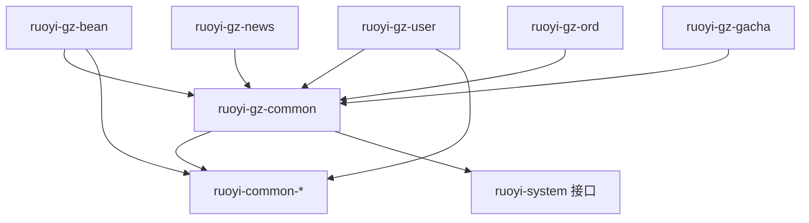
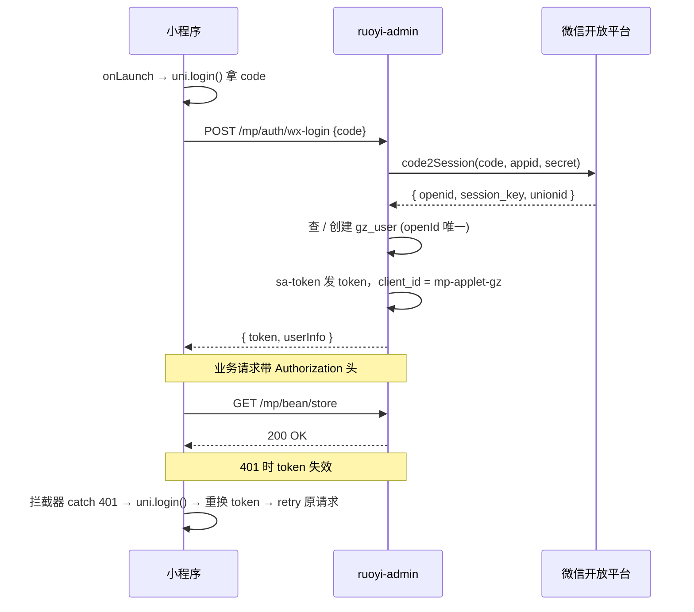
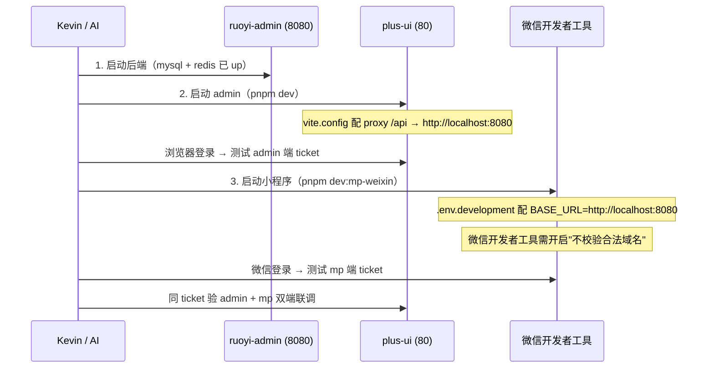

## Changelog
- **v0.4 (2026-05-27)** — environment files 跨 3 端补齐（GZ-SYS-001 §实施漏项补全 #3）
  - §5.4 新增 §5.4.5 environment files 完整清单（miniapp 3 / plus-ui 2 / 后端 3 + prod 走 `${ENV:default}` 占位符模式）
  - §5.4.5 加 placeholder 待填清单（6 项，与 progress R10 cross-ref）
  - §5.4.3 补 miniapp CI 工具链链路完整性（package.json `build:mp:staging` script + scripts/upload-weixin.js `--mode=staging` 支持）
- **v0.3 (2026-05-27)** — CI/CD workflows 落地（GZ-SYS-001 §实施漏项补全 #2）
  - §5.4 描述层从"参考 dongjiaoshan"升级为"已 1:1 映射 6 个文件"（详见 §5.4 / §5.6 已落地清单）
  - §5.4.3 接入步骤更新：小程序上传密钥**走 GitHub Secret**（dongjiaoshan 最新版改进），不入库 repo
  - §5.4.3 删除 VitePress `deploy.yml` 引用（dongjiaoshan 该文件是 unibest 模板自带的文档站部署，sensenran 不需要）
  - §5.4.x 新增 secrets 完整清单（5 个，去掉 GH_TOKEN_AUTO_MERGE — 因 auto-merge-to-aliyun.yml 不需要）
  - §5.6 状态从"D01 之前的 CI/CD 状态"改为"D01 落地结果"
- **v0.2 (2026-05-26)** — Kevin 当日 4 项事实纠正
  - C1: 云厂商从（错误推断）"腾讯云全栈" 纠正为 **阿里云**（服务器 / 域名 / OSS / RDS）
  - C2: GitHub 默认分支保留 5.X / ts（fork 同步通道与业务分支双轨策略，故意为之，删 §5.6 + 关闭 Q1）
  - C3: 阿里云购买执行中（关闭 Q2 主体歧义）
  - C4: 微信支付证书等甲方提供（降级 Q4 为等待态）
- **v0.1 (2026-05-26)** — 首次产出（参考 dongjiaoshan/doc/05 母版 + 当前 code/ 事实）

---

> **本文档目标**：5 个月后入职的新人只看这一份 doc 就能搞清楚谷子宇宙系统三端的代码结构、模块划分、分支策略、部署流程、依赖关系、技术选型——不用再翻其他 doc 或问 Kevin。
>
> doc/04 在 doc/10（业务流）/ doc/11（字段）/ doc/12（UI）三层权威 doc 之上加一层**实施架构层**，回答"代码长在哪 / 怎么分模块 / 怎么部署"，**不回答业务规则 / 字段语义 / 像素细节**。

---

## 0. TL;DR

| 维度 | 决策 |
|---|---|
| 后端框架 | **RuoYi-Vue-Plus 5.6.1**（fork commit `6bfdcae06`，2026-05-25 锁定） |
| 运行时 | JDK 17 LTS + Spring Boot 3.5.14（跟随 ruoyi 主线） |
| 鉴权 | **Sa-Token 1.45.0**（admin + 小程序共用，sys_client 区分发 Token 来源） |
| ORM | MyBatis-Plus 3.5.16 |
| DB migration | **Flyway**（CLAUDE.md §6 #5；当前 ruoyi-admin 未接入，D01 由 GZ-SYS-001 接入） |
| 数据库 | MySQL 8（**阿里云 RDS**） |
| 缓存 | Redis 7（座位锁 / 字典缓存 / 扭蛋库存 / sa-token session） |
| 对象存储 | **阿里云 OSS**（ruoyi-common-oss 用 S3 协议封装，本身通吃 OSS / COS / MinIO；本项目用 OSS） |
| Admin 前端 | plus-ui (Vue3 + Element Plus + Pinia)，5.6.1-2.6.1 |
| 小程序 | **uni-app + Vue3 + wot-design-uni + Pinia**（D01 由 GZ-SYS-001 脚手架） |
| 业务域包名前缀 | `org.dromara.gz`（`gz` = 谷子，与 dongjiaoshan 的 `djs` 区分） |
| 业务表前缀 | `gz_<域>_<表>` |
| 多租户 | 启用（ruoyi 自带 `TenantLineInnerInterceptor`），V1.0/V1.1 全 `tenant_id='1001'` |
| 状态机 | **不引重型库**，所有业务流用枚举 + service 推进（拼豆 5 态 / 预购 6 态 / 扭蛋 4 态等都 ≤ 6 个状态） |
| 工作流 | **V1.0/V1.1 不启用**（ruoyi-workflow 模块保留依赖，菜单隐藏） |
| 任务调度 | **V1.0/V1.1 不启用 SnailJob**（本地开发关，生产 V2.0 视情况启用：对账定时跑批） |
| 异步消息 | Spring `ApplicationEventPublisher` + `@TransactionalEventListener`，不上 MQ |
| 部署 | **阿里云 ECS 4C8G + Docker Compose**（与 dongjiaoshan 同构） |
| CI/CD | GitHub Actions（与 dongjiaoshan 同构：后端 SSH + Docker rebuild / Admin SSH + scp dist / 小程序 miniprogram-ci） |
| Git 分支 | 三端各自独立 repo（org `sengsengran-guzi`），**main + staging 双分支**（main 部署生产 / staging 部署测试） |

**核心论点**：

1. **复用 dongjiaoshan 的全套基础设施模式**（部署完全一致、技术栈完全一致、云厂商一致），sensenran 仅在业务名 / 业务域上特化。dongjiaoshan 5 个月的踩坑直接吃下来，sensenran V1.0 不重新交学费
2. **业务复杂度远低于 dongjiaoshan**：sensenran 6 业务域 + 30 ticket V1.0；dongjiaoshan 4 业务域但 130+ ticket。**不需要 spring-statemachine / SnailJob / 多农场**这些重型组件
3. **云厂商：阿里云全栈**（服务器 / 域名 / 数据库 / OSS / SMS），与 dongjiaoshan 同。ruoyi-common-oss 自身用 S3 协议封装，无需替换 SDK，仅切配置即可适配 OSS bucket / region
4. **V1.0 6/15 硬期限驱动一切**：架构选型一律选"够用 + 与母版同构"，不引新技术
5. **微信支付商户号挂甲方**（合同 §2.1 #12，避免二清违规），V1.0 仅通道调通拿到 `prepay_id`，业务支付推 V1.1
6. **跨境物流 / 国内物流不自动抓取**：合同 #14/#15 硬约束 — 仅展示甲方手动录入的节点 / 单号

---

## 1. 三端代码结构总览

### 1.1 仓库与代码位置

```
sensenran-guzi/                                       项目根（doc + design + .claude）
└── code/main/
    ├── RuoYi-Vue-Plus/                              后端（fork from ruoyi-vue-plus 5.6.1）
    │   ├── ruoyi-admin/                             启动模块（★ 不动源码，仅 application*.yml / db/migration 由本项目维护）
    │   ├── ruoyi-common/                            通用层（★ 不动）
    │   │   ├── ruoyi-common-core / ruoyi-common-bom
    │   │   ├── ruoyi-common-mybatis / ruoyi-common-redis
    │   │   ├── ruoyi-common-oss                     S3 协议封装（通吃阿里云 OSS / 腾讯云 COS / MinIO，本项目用阿里云 OSS）
    │   │   ├── ruoyi-common-satoken / ruoyi-common-sms
    │   │   ├── ruoyi-common-tenant                  多租户拦截器（启用）
    │   │   └── ...
    │   ├── ruoyi-modules/
    │   │   ├── ruoyi-system / -generator / -job / -workflow / -demo   (★ 不动；ruoyi 自带)
    │   │   └── （以下 6 个 sensenran 业务模块，D01 由 GZ-SYS-001 创建）
    │   │       ├── ruoyi-gz-common                  通用主数据 + 微信登录 + 支付通道 + OSS（V1.0）
    │   │       ├── ruoyi-gz-bean                    拼豆预约 GZ-BEAN（V1.0 ⭐ 重头）
    │   │       ├── ruoyi-gz-user                    会员中心 GZ-USER（V1.0 占位 + V1.1 真数据）
    │   │       ├── ruoyi-gz-news                    资讯 GZ-NEWS（V1.0）
    │   │       ├── ruoyi-gz-ord                     预定货品 GZ-ORD（V1.1）
    │   │       └── ruoyi-gz-gacha                   扭蛋机 GZ-GACHA（V1.1）
    │   ├── ruoyi-admin/src/main/resources/db/migration/   Flyway DDL（V<yyyyMMddHHmm>__<TICKET-ID>-<desc>.sql）
    │   └── script/docker/                           Docker 编排（dev-compose.yml / docker-compose.deploy.yml）
    │
    ├── plus-ui/                                     Admin 前端（fork from plus-ui 5.6.1-2.6.1）
    │   └── src/
    │       ├── views/                               业务页
    │       │   ├── system / monitor / tool / workflow   (★ ruoyi 自带，不动)
    │       │   └── gz-{common,bean,user,news,ord,gacha,admin}/   (D01 由 GZ-SYS-001 创建)
    │       ├── api/
    │       │   ├── system / tool / monitor           (★ 不动)
    │       │   └── gz-{common,bean,user,news,ord,gacha,admin}/
    │       └── router/modules/                      路由分包（菜单仍走后端动态注入）
    │
    └── miniapp/                                     小程序（D01 由 GZ-SYS-001 用 uni-app + Vue3 + wot-design-uni 脚手架）
        └── src/
            ├── pages/                               主包 + 板块入口
            │   ├── index/                           首页
            │   ├── login/                           微信授权弹窗
            │   ├── bean/                            拼豆预约（4 页）
            │   ├── me/                              会员中心（5 页 + 个人资料缺口）
            │   ├── news/                            资讯（2 页）
            │   ├── ord/                             预定货品（V1.1，3 页）
            │   ├── gacha/                           扭蛋机（V1.1，4 页）
            │   ├── order/                           订单确认（V1.1）
            │   └── pay/                             支付结果三态
            ├── api/                                 后端 API 封装
            ├── store/                               Pinia stores（user / dict / ord / gacha）
            ├── components/biz/                      业务通用组件
            └── components/ui/                       基于 wot-design-uni 的业务定制薄封装
```

### 1.2 包名规则（CLAUDE.md §6 #4 强约束）

所有 sensenran 业务代码：

```
org.dromara.gz.<域>.{controller, service, service.impl, mapper, domain, domain.bo, domain.vo, dto, enums}
```

- **`org.dromara.gz` 是固定根**：与 ruoyi 自带 `org.dromara.system / -workflow / -resource` 等隔离；与 sibling 项目 dongjiaoshan 的 `org.dromara.djs` 区分
- **域名小写**：`common / bean / user / news / ord / gacha` 各对应一个 ruoyi-gz-* maven module
- **controller / service / mapper 三层标准 ruoyi 结构**：不引入 DDD 战术模式，与 ruoyi 代码生成器、文档、外包心智完全一致

### 1.3 表前缀 + 菜单 ID 分段（CLAUDE.md §6 #6 强约束）

**表前缀** `gz_<域>_<表>`（doc/11 §3.1 / §4.1 等已统一）：

| 前缀 | 业务域 | 例 |
|---|---|---|
| `gz_bean_*` | 拼豆预约 | `gz_bean_store / gz_bean_booking / gz_bean_seat` |
| `gz_user_*` | 会员 | `gz_user / gz_user_address` |
| `gz_news_*` | 资讯 | `gz_news_article / gz_news_category` |
| `gz_pay_*` | 支付 | `gz_pay_channel / gz_pay_transaction / gz_pay_callback_log` |
| `gz_ord_*` | 预定货品（V1.1） | `gz_ord_product / gz_ord_order` |
| `gz_gacha_*` | 扭蛋机（V1.1） | `gz_gacha_machine / gz_gacha_prize / gz_gacha_draw / gz_gacha_order` |
| `gz_logistics_*` | 物流（V1.1） | `gz_logistics_audit` |
| `gz_recon_*` | 对账（V1.1） | `gz_recon_daily / gz_recon_monthly / gz_recon_exception / gz_recon_settle` |
| `gz_file_object` | 全局共用文件元数据 | (单表) |

**全局共享表沿用 ruoyi 自带**：`sys_user / sys_role / sys_dept / sys_post / sys_menu / sys_dict_* / sys_config / sys_client / sys_oss / sys_oss_config / sys_oper_log / sys_logininfor` 等 — 不改 schema（doc/11 §10.1）。

**menu_id 分段**（CLAUDE.md §6 #6）：

| 段 | 业务域 |
|---|---|
| 5000-5999 | GZ-SYS（系统底座 / 微信登录 / 客服） |
| 5100-5199 | GZ-PAY（支付通道 / 业务支付） |
| 6000-6999 | GZ-BEAN（拼豆预约 ⭐ V1.0） |
| 7000-7999 | GZ-USER（会员中心） |
| 8000-8999 | GZ-NEWS（资讯中心） |
| 9000-9999 | GZ-ORD（预定货品 V1.1） |
| 10000-10999 | GZ-GACHA（扭蛋机 V1.1） |
| 11000-11999 | GZ-ADMIN（管理后台扩展） |

### 1.4 与 dongjiaoshan 母版的差异

sensenran 部署 / 技术栈 / git workflow / CI/CD 与 dongjiaoshan **完全同构**。**仅业务字 + 业务域 + 业务约束差异**：

| 维度 | dongjiaoshan | sensenran |
|---|---|---|
| 业务包名前缀 | `org.dromara.djs` | `org.dromara.gz` |
| 业务表前缀 | `t_plant_* / t_farm_* / t_warehouse_* / t_store_*` | `gz_bean_* / gz_user_* / gz_news_* / gz_pay_* / gz_ord_* / gz_gacha_* / gz_recon_*` |
| 多租户字段名 | `farm_id`（语义"农场"，但实现走 ruoyi tenant_id） | `tenant_id`（直接用 ruoyi 默认，未来不会出现"多商户"） |
| 业务域数 | 4 个（plant / farm / warehouse / store）+ trace + dashboard | 6 个（bean / user / news / ord / gacha + common 横切） |
| 状态机重量 | spring-statemachine 4.0.x（养殖 9 态 11 事件，必须用） | **不引**（最长状态链 = 预购订单 6 态，枚举 + service if-else 够用） |
| 工作流 | 不启用（同） | 不启用（同） |
| 任务调度 | SnailJob 启用（养殖统计 / 流水号重置） | **V1.0/V1.1 不启用**（无定时任务需求；V2.0 对账跑批再评估） |
| 多租户拦截器 | V1 disable + ADR-0001 留路 | **启用**（ruoyi 默认，全 1001；未来不会切多租户） |
| 部署目标 | 阿里云 ECS + RDS + Redis + OSS | 阿里云 ECS + RDS + Redis + OSS（同） |
| Git org | （独立） | `github.com/sengsengran-guzi` |
| 业务核心难点 | 养殖事件流 + 5 产线状态机 + 追溯链 | 拼豆座位锁 + 微信支付通道 + 扭蛋抽奖事务 + 4% 分成对账 |
| 总 ticket | 130+ | **57**（V1.0 30 + V1.1 27） |

---

## 2. 后端模块切分

### 2.1 Maven 模块树

`code/main/RuoYi-Vue-Plus/pom.xml` 的 `<modules>` 当前包含 `ruoyi-admin / ruoyi-common / ruoyi-extend / ruoyi-modules`。其中 `ruoyi-modules/pom.xml` 列出 5 个 ruoyi 自带子模块（demo / generator / job / system / workflow）。

**D01 由 GZ-SYS-001 ticket 在 `ruoyi-modules/pom.xml` 追加 6 个 sensenran 业务子模块**：

```xml
<modules>
    <!-- ruoyi 自带 -->
    <module>ruoyi-demo</module>
    <module>ruoyi-generator</module>
    <module>ruoyi-job</module>
    <module>ruoyi-system</module>
    <module>ruoyi-workflow</module>

    <!-- sensenran 业务（D01 由 GZ-SYS-001 创建） -->
    <module>ruoyi-gz-common</module>
    <module>ruoyi-gz-bean</module>
    <module>ruoyi-gz-user</module>
    <module>ruoyi-gz-news</module>
    <!-- V1.1 启动时启用以下两个 -->
    <module>ruoyi-gz-ord</module>
    <module>ruoyi-gz-gacha</module>
</modules>
```

### 2.2 业务模块职责

| 模块 | 阶段 | 职责 | 主表 |
|---|---|---|---|
| **ruoyi-gz-common** | V1.0 D01 | 横切层：微信登录 / 支付通道 / OSS / 业务码生成 / 全局拦截 / Redis Key 命名 | （不持有主表，所有公共服务） |
| **ruoyi-gz-bean** | V1.0 ⭐ | 拼豆预约：门店 / 时段模板 / 座位 / 预约单 + 核销 + 座位锁（Redis 分布式锁） | `gz_bean_store / gz_bean_time_slot_template / gz_bean_seat / gz_bean_booking / gz_bean_booking_log` |
| **ruoyi-gz-user** | V1.0 + V1.1 | 会员中心：用户主表 / 地址簿 / 操作审计 / 我的订单 / 我的扭蛋记录（聚合，不直接持表） | `gz_user / gz_user_address / gz_user_audit_log` |
| **ruoyi-gz-news** | V1.0 | 资讯 CMS：文章 / 分类 / 定时发布 | `gz_news_article / gz_news_category` |
| **ruoyi-gz-ord** | V1.1 | 预定货品：商品 / SKU / 订单 / 物流 7→2 节点 / 三类订单聚合 | `gz_ord_product / gz_ord_order / gz_logistics_audit` |
| **ruoyi-gz-gacha** | V1.1 | 扭蛋机：机器 / 奖品 / 抽奖事务 / 库存扣减 / 概率随机 / 火花券 V2 占位 | `gz_gacha_machine / gz_gacha_prize / gz_gacha_draw / gz_gacha_order` |

**对账域不独立成模块**：`gz_recon_*` 4 张表放 `ruoyi-gz-common`，因为它消费 `gz_pay_transaction + gz_ord_order + gz_gacha_order` 的数据，需要跨域读权限，放公共模块更自然。

### 2.3 模块间依赖关系



**强约束**（参考 dongjiaoshan/doc/05 §3.2）：
- ruoyi 自带模块**不修改源码**（CLAUDE.md §6 #1）；要扩字段就在自己模块内 wrap
- `ruoyi-gz-common` 是所有业务模块的依赖；其他业务模块**之间不直接依赖**，跨域通过 Spring Events 或聚合层（如"我的订单"在 user 模块聚合 ord / gacha / bean 数据，用 service 接口隔离）

### 2.4 单模块内部包结构

以 `ruoyi-gz-bean` 为例（参考 dongjiaoshan/doc/05 §4.1）：

```
ruoyi-gz-bean/
├── pom.xml
└── src/main/
    ├── java/org/dromara/gz/bean/
    │   ├── controller/
    │   │   ├── BeanStoreController.java         /admin/bean/store
    │   │   ├── BeanSeatController.java          /admin/bean/seat
    │   │   ├── BeanTimeSlotController.java      /admin/bean/time-slot
    │   │   ├── BeanBookingAdminController.java  /admin/bean/booking
    │   │   └── mp/
    │   │       ├── MpBeanBookingController.java  /mp/bean/booking
    │   │       └── MpBeanSelectController.java   /mp/bean/select
    │   ├── service/
    │   │   ├── IBeanBookingService.java
    │   │   ├── IBeanSeatLockService.java        座位 Redis 分布式锁
    │   │   └── impl/
    │   │       ├── BeanBookingServiceImpl.java
    │   │       └── BeanSeatLockServiceImpl.java
    │   ├── mapper/
    │   │   ├── BeanBookingMapper.java
    │   │   ├── BeanSeatMapper.java
    │   │   └── ...
    │   ├── domain/
    │   │   ├── BeanBooking.java                 实体（@TableName("gz_bean_booking")）
    │   │   ├── bo/ BeanBookingBo.java           请求 BO
    │   │   ├── vo/ BeanBookingVo.java           响应 VO
    │   │   └── enums/ BookingStatusEnum.java    状态枚举（与 sys_dict_data djs_bean_booking_status 对齐）
    │   ├── dto/ ConfirmBookingDto.java          跨层 DTO
    │   ├── event/ BeanBookingConfirmedEvent.java  Spring Event
    │   └── listener/ BeanBookingNotifyListener.java  监听其他模块事件
    └── resources/
        └── mapper/bean/
            ├── BeanBookingMapper.xml
            └── ...
```

**强约束**（重申 dongjiaoshan/doc/05 §4.1，本项目沿用）：
- Controller 只做参数校验 + 调 service + 包装响应（`R<T>`），**不写业务逻辑**
- ServiceImpl 单文件 ≤ 800 行；超过拆子 service
- Mapper XML 文件名与 interface 一致
- **admin 端与 mp 端 controller 分包**（`controller/` vs `controller/mp/`），URL 前缀分别 `/admin/<域>/` 和 `/mp/<域>/`，便于 sa-token 按 client 区分鉴权策略

### 2.5 服务分层

```
HTTP Request
    │
    ▼
@RestController（鉴权 + 参数校验 + 响应包装）
    │
    ▼ @Validated BO
@Service Interface
    │
    ▼
@Service Impl
    │
    ├── 调 Mapper / IService（MyBatis-Plus 提供）
    ├── 调 Redisson / RedisTemplate（座位锁 / 库存扣减）
    ├── 发布 ApplicationEvent（跨域协同）
    └── 调 OssClient / WxPayService / WxMaService
    │
    ▼
@Mapper Interface（继承 BaseMapperPlus）
    │
    ▼ XML / 注解
MySQL
```

**不引 DDD 战术模式**（同 dongjiaoshan/doc/05 §4.2 理由）：
- 项目复杂度中等，团队是外包 + Kevin 单人 + AI
- ruoyi 生态全是"贫血模型 + Service-Mapper"，引 DDD 反而成异类

---

## 3. Admin 前端分包

### 3.1 项目入口

直接 fork plus-ui 配套的 admin 前端（Vue3 + Element Plus + Pinia），跟随 RuoYi-Vue-Plus 主版本走（当前 5.6.1-2.6.1）。

**强约束**（同 dongjiaoshan/doc/05 §5.1）：
- ruoyi 自带页面**不修改源码**（`src/views/system / monitor / tool / workflow`）
- 业务页全部放 `src/views/gz-{common,bean,user,news,ord,gacha,admin}/`
- 业务 API 客户端放 `src/api/gz-*/`

### 3.2 业务页位置

```
src/views/
├── system / monitor / tool / workflow    (★ ruoyi 自带，不动)
├── login.vue / register.vue / redirect / error    (★ ruoyi 自带)
└── （D01 由 GZ-SYS-001 创建：）
    ├── gz-common/                         字典初始化、客服配置
    ├── gz-bean/                           ⭐ V1.0
    │   ├── store/                         AD-BEAN-CONFIG 门店配置
    │   ├── seat/                          座位排版
    │   ├── time-slot/                     时段模板
    │   └── booking/                       AD-BEAN-LIST 预约列表 + 核销
    ├── gz-user/
    │   ├── user-list/                     AD-SYS-USER-LIST C 端用户管理
    │   └── admin-user/                    AD-SYS-USERS 管理员账号 CRUD
    ├── gz-news/                           AD-NEWS-LIST-EDIT 资讯 CMS
    ├── gz-ord/                            V1.1
    │   ├── product/                       AD-ORD-PRODUCTS 商品 CRUD
    │   └── order/                         AD-ORD-ORDERS 三类订单聚合
    ├── gz-gacha/                          V1.1
    │   └── pool/                          AD-GACHA-POOL 扭蛋池管理
    └── gz-admin/                          V1.1 admin 扩展
        ├── logistics/                     AD-ADMIN-LOGISTICS 物流推进
        ├── finance/                       AD-ADMIN-FINANCE 对账中心
        ├── dashboard/                     AD-SYS-DASHBOARD 数据看板
        └── log/                           AD-SYS-LOG 操作日志
```

页面 ID 与 doc/12 §1.2 完全对齐，每页对应 1 个或多个 ticket（参考 doc/12 关联 ticket 列）。

### 3.3 通用组件抽象

| 组件 | 用途 | 复用页 | 来源 |
|---|---|---|---|
| `<BizTable>` | 列表 + 分页 + 筛选条 + 导出 | 12+ | ruoyi 自带 |
| `<DictSelect>` / `<DictTag>` | 字典联动 | 全模块 | ruoyi 自带 |
| `<StatusTag>` | 状态标签（颜色按字典配） | 全模块 | ruoyi 自带 |
| `<OssUpload>` | OSS 直传组件（接 ruoyi-common-oss）| 6+ | ruoyi 自带 + 本项目封装 bizType 必传 |
| `<ImageCropper>` | 头像 / 文章封面裁切 | 3+ | ruoyi 自带 |
| `<Editor>` | 富文本编辑器（资讯文章） | 1 | ruoyi 自带 + 接入 OssUpload |
| `<MoneyInput>` | 金额输入（cent 单位，前端 ÷100 显示）| 5+ | **本项目新增**（doc/11 附录 B.1） |

### 3.4 路由 + 权限

完全沿用 ruoyi 默认机制（参考 dongjiaoshan/doc/05 §5.1.4）：
- 后端配置菜单 → 前端动态生成路由（**不写死前端路由表**）
- 按钮级权限：`v-hasPermi="['gz:bean:booking:cancel']"`
- 数据范围：V1.0/V1.1 **不启用**（单租户全 1001，所有 admin 用户看全量数据；如果未来需要"门店店长只看自己门店预约"再启用 ruoyi 的 `@DataScope`）

### 3.5 国际化（CLAUDE.md §6 #9）

- 所有可见字符串走 `t('xxx.yyy')` + `src/lang/zh-CN.ts` / `src/lang/en-US.ts`
- 默认 `zh-CN`
- **不混 emoji**

### 3.6 状态管理

- Pinia + persist（ruoyi 默认）
- 业务 store：`useUserStore / usePermissionStore / useDictStore`（ruoyi 自带）
- **不新增大型 store**：业务数据走 API 实时拉取，不缓存到 store

---

## 4. 小程序分包

### 4.1 技术选型

基于 dongjiaoshan/doc/05 §2.5 的完整调研结论沿用（sensenran 业务量比 dongjiaoshan 小，更适合）：

| 类别 | 选型 | 备注 |
|---|---|---|
| 框架 | **uni-app + Vue3 + TypeScript** | 客户只编微信小程序 |
| 构建 | Vite + CLI（VSCode 主开发） | HBuilderX 仅备份 IDE |
| 脚手架 | **D01 由 GZ-SYS-001 选定**（unibest 模板候选，也可手搭，由 coder 拍板） | — |
| UI 库 | **wot-design-uni** 1.14+ | 70+ 组件，TS 原生；doc/12 §6 已映射所有 mockup 元素到 wot 组件 |
| 状态管理 | **Pinia + pinia-plugin-persist-uni** | 持久化解决小程序无 localStorage |
| 请求层 | **luch-request** 3.x | axios 风格，团队迁移成本接近 0 |
| CSS | UnoCSS（unibest 默认） | 原子化，与 wot-design-uni 不冲突 |
| 视觉 token | `doc/tokens.md` 引入 CSS 变量 | **不硬编码颜色**（CLAUDE.md §6） |
| 微信登录 | `uni.login` + `<button open-type="getPhoneNumber">` | 不引第三方包 |
| 微信支付 | `uni.requestPayment` | V1.0 通道调通，V1.1 接业务订单 |
| 客服 | 原生 `<button open-type="contact">` | **不接第三方客服系统** |
| 订阅消息 | `uni.requestSubscribeMessage`（V1.1）| 模板 ID 甲方申请后注入 sys_config |
| 错误监控 | **暂不接 Sentry**（V1.0/V1.1，与 dongjiaoshan 差异） | V2.0 视情况启用 |

### 4.2 项目结构

```
miniapp/                                  （D01 由 GZ-SYS-001 创建）
├── src/
│   ├── pages/                            主包（C 端 22 页，doc/12 §1.1）
│   │   ├── index/index.vue               MP-SYS-HOME 首页
│   │   ├── login/auth-modal.vue          MP-SYS-AUTH 微信授权弹窗
│   │   ├── bean/                         拼豆 4 页（V1.0）
│   │   │   ├── select.vue                MP-BEAN-SELECT
│   │   │   └── my-list.vue               MP-BEAN-LIST
│   │   ├── me/                           会员 5 页
│   │   │   ├── index.vue                 MP-ME-HOME
│   │   │   ├── profile.vue               MP-ME-PROFILE（缺 mockup，等 designer）
│   │   │   ├── address/list.vue          MP-ME-ADDR-LIST
│   │   │   ├── address/edit.vue          MP-ME-ADDR-EDIT
│   │   │   ├── orders.vue                MP-ORD-LIST 我的订单 3 tab
│   │   │   ├── order-detail.vue          MP-ORD-DETAIL（V1.1 物流 2 态简化）
│   │   │   └── collection.vue            MP-ME-COLLECTION 我的图鉴（V1.1 待裁定）
│   │   ├── news/                         资讯 2 页
│   │   │   ├── list.vue                  MP-NEWS-LIST
│   │   │   └── detail.vue                MP-NEWS-DETAIL
│   │   ├── ord/                          预购 2 页（V1.1）
│   │   │   ├── list.vue                  MP-ORD-PREORDER-LIST
│   │   │   └── detail.vue                MP-ORD-PREORDER-DETAIL
│   │   ├── gacha/                        扭蛋 4 页（V1.1）
│   │   │   ├── list.vue                  MP-GACHA-LIST 大厅
│   │   │   ├── detail.vue                MP-GACHA-DETAIL 单机详情
│   │   │   ├── draw.vue                  MP-GACHA-DRAW 开盒结果
│   │   │   └── history.vue               MP-GACHA-HISTORY 我的扭蛋记录
│   │   ├── order/confirm.vue             MP-ORD-CONFIRM 确认订单（V1.1）
│   │   └── pay/result.vue                MP-PAY-RESULT 支付结果三态
│   ├── api/                              luch-request 封装
│   │   ├── request.ts                    拦截器 + token 刷新
│   │   ├── bean.ts / user.ts / news.ts / ord.ts / gacha.ts / pay.ts / file.ts
│   ├── store/                            Pinia
│   │   ├── user.ts                       openId / token / userInfo
│   │   ├── dict.ts                       字典版本号 + 全量字典缓存
│   │   ├── bean.ts                       拼豆选时段中间态
│   │   └── ord.ts / gacha.ts             订单 / 扭蛋
│   ├── components/
│   │   ├── biz/                          业务通用组件
│   │   │   ├── BookingCard.vue           预约卡片
│   │   │   ├── OrderCard.vue             订单卡片
│   │   │   ├── GachaPrizeCard.vue        扭蛋奖品卡
│   │   │   ├── NewsCard.vue              资讯卡
│   │   │   ├── PayButton.vue             支付按钮（包统一支付参数）
│   │   │   ├── SubscribeMessageBtn.vue   订阅消息（V1.1）
│   │   │   └── EmptyState.vue            空态
│   │   └── ui/                           wot-design-uni 薄封装（如 DictPicker / DateRangePicker）
│   ├── utils/
│   │   ├── login.ts                      wx.login + 后端换 token + token 刷新拦截
│   │   ├── pay.ts                        uni.requestPayment 包装
│   │   ├── token-bus.ts                  全局 token 状态机
│   │   ├── format.ts                     金额 cent ↔ 元 / 时间 / 业务码
│   │   └── theme.ts                      引入 doc/tokens.md CSS 变量
│   ├── types/                            TS 类型（从后端 DTO 镜像）
│   │   ├── api.ts                        (可选) openapi-typescript 自动生成
│   │   └── biz.ts
│   ├── App.vue
│   ├── main.ts
│   ├── pages.json                        路由配置
│   └── manifest.json                     uni-app + 小程序 appid 配置
├── .env.development / .env.staging / .env.production
├── package.json
├── tsconfig.json
└── vite.config.ts
```

### 4.3 分包策略

**V1.0**：单主包，**不分包**。

V1.0 范围 = 拼豆 + 会员 + 资讯 + 首页 + 授权弹窗 + 支付结果 = ~12 页 + ~600KB（含 wot-design-uni 主包基线 ~250KB）。**远低于 2MB 单包限制**。

**V1.1**：加入扭蛋 + 预购 + 我的订单详情后，预估 ~20 页 / ~1.2MB。**仍可单包**。

**如果体积超 1.8MB**（CI/CD 校验关卡），按 dongjiaoshan/doc/05 §5.2.2 模式分包：

```json
{
  "subPackages": [
    { "root": "packageGacha", "pages": ["list", "detail", "draw", "history"] },
    { "root": "packageOrd", "pages": ["list", "detail"] }
  ],
  "preloadRule": {
    "pages/index/index": { "network": "all", "packages": ["packageGacha", "packageOrd"] }
  }
}
```

**强约束**：当且仅当主包 > 1.8MB 时启用分包；不要"为了未来"提前分包，分包会增加跨包跳转复杂度。

### 4.4 多业务 tabbar 与路由

小程序 tabbar 上限 5 个，sensenran 选定 **4 个**：

| Tab | 路径 | V1.0 状态 | V1.1 真数据 |
|---|---|---|---|
| 首页 | `/pages/index/index` | ✅ | banner 走 admin CMS |
| 拼豆 | `/pages/bean/select` | ✅ ⭐ | — |
| 我的 | `/pages/me/index` | ✅（订单 tab 空态） | 接 ord / gacha |
| 客服 | （非独立页，触发 `<button open-type="contact">`）| ✅ | — |

**扭蛋 / 预购入口**：V1.0 不在 tabbar；V1.1 进入后从首页"九宫格 / banner" 跳转。

**强约束**（吸收 dongjiaoshan D1-D6 教训，详见 `.claude/agents/kevin-coder.md` mp 实现陷阱 #2）：
- 拼豆预约成功后页面必须有"查看我的预约"卡片入口（不能只靠 tabbar）
- 扭蛋抽奖完成（V1.1）→ 必须有"我的扭蛋记录"卡片
- 资讯详情页 → 必须有"返回资讯列表"卡片
- 订单支付成功（V1.1）→ 必须有"查看我的订单"卡片

### 4.5 登录与 token 刷新



**强约束**（吸收 dongjiaoshan mp 陷阱 #5 + .claude/agents/kevin-coder.md）：
- 业务 token 有效期 < session_key 有效期（避免 session_key 过期 mp 还用旧 token）
- 401 拦截器自动 retry，**不要让用户感知**
- sa-token client_id 必须新增 `mp-applet-gz`（D01 由 GZ-SYS-002 注册到 sys_client）

### 4.6 跨层契约（mp ↔ admin ↔ be 强一致）

参考 `.claude/agents/kevin-coder.md` 跨层契约必背（吸收 dongjiaoshan D1-D6 12+ ticket 翻车教训），sensenran 全部沿用：

1. **ID 全部 string**（Java long ↔ JS number 精度丢失）
   - 后端 `Long id` 字段加 `@JsonSerialize(using = ToStringSerializer.class)` 或全局配 `ObjectMapper`
   - mp + admin TS 类型 `id: string`
2. **业务码替代 ID 暴露**（用户可见的"号"）
   - 拼豆预约：`booking_no`（如 `BK20260615-001234`）
   - 扭蛋抽奖：`draw_no`
   - 预定订单：`order_no`
   - 微信支付：`out_trade_no`（微信侧硬要求）
   - 统一在 `ruoyi-gz-common` 的 `BizNoGenerator` 生成，禁止各模块自写
3. **DDL 必含字段**（doc/11 §1.1）：`id / tenant_id / del_flag / create_time / create_by / update_time / update_by / remark` + 业务码 UNIQUE 必含 `del_flag` 才能软删后复用
4. **mp + admin 同 ticket scope**：拼豆后台配置 + mp 预约页 = 同一个 ticket（不允许拆"先 admin 后 mp"）
5. **OSS bizType 三端同步**：`booking-avatar / news-cover / gacha-prize`（D01 由 GZ-SYS-005 在 `ruoyi-gz-common` 定义枚举）

### 4.7 mp 实现陷阱速查（详见 `.claude/agents/kevin-coder.md`）

- 表单数字字段用 `<u-input type="digit">`（不是 `type="number"`）
- 板块切换时 store 状态清理（`$reset()`）
- 所有 number 字段提交前 `parseFloat()` 显式 cast，后端 BigDecimal
- 拍照 → OSS STS 直传 → `/api/file-object/save` 落库 → 返回 `oss_id` 给业务

---

## 5. git 分支策略 + CI/CD

### 5.1 三端 git repo

| 端 | repo | 默认分支 | 上游 fork 同步通道 |
|---|---|---|---|
| 后端 | `git@github.com:sengsengran-guzi/RuoYi-Vue-Plus.git` | `5.X` | `5.X`（同左 — 上游 ruoyi-vue-plus 5.X 镜像分支） |
| Admin | `git@github.com:sengsengran-guzi/plus-ui.git` | `ts` | `ts`（上游 plus-ui ts 分支镜像） |
| 小程序 | `git@github.com:sengsengran-guzi/miniapp.git` | `main` | 无（小程序无上游 fork） |

**默认分支保留 5.X / ts 是有意的**（详见 §5.2 双轨策略），**不要改为 main**。

**当前本地三端均 checkout 在 `staging` 分支**（开发期主战场）。

### 5.2 双轨分支策略（重要）

后端 / Admin 都是从 ruoyi-vue-plus / plus-ui **fork** 而来。sensenran 采用**双轨分支策略**：

| 轨道 | 分支 | 用途 | CI/CD |
|---|---|---|---|
| **上游同步轨**（仅后端 / Admin）| `5.X`（后端） / `ts`（Admin） | 镜像上游 fork 主线。Kevin 手动从 `dromara/RuoYi-Vue-Plus` / `plus-ui` 上游 pull 最新代码 | 不参与 CI/CD |
| **业务轨**（三端通用） | `main` + `staging` | sensenran 业务代码 | 参与 CI/CD（push staging → 测试环境 / push main → 生产环境） |

**关键点**：
- **不向上游发 PR**：sensenran 是甲方独占的下游项目，不回馈上游
- 上游同步轨与业务轨**独立**：业务分支不 merge 上游同步分支；需要上游修复时由 Kevin 手动 cherry-pick 到业务分支
- 默认分支保留 `5.X` / `ts` 是有意保留 fork 同步语义（GitHub fork 自动比较的基线分支）

### 5.3 业务分支模型（main + staging）

```
┌─────────────────────────────────────────────────────────────────┐
│                       开发 → 测试 → 生产                          │
├─────────────────────────────────────────────────────────────────┤
│                                                                 │
│   feature 开发                                                  │
│       │                                                         │
│       │ 1. 本地直接 commit 到 staging（单人 + AI 流程，无 PR）  │
│       ▼                                                         │
│   ┌─────────────────┐                                           │
│   │  staging        │   push → GitHub Actions →                 │
│   │                 │   构建 + 部署到 testing 环境              │
│   └─────────────────┘                                           │
│       │                                                         │
│       │ 2. Kevin testing-human 全过 ✅                          │
│       │ 3. 手动 merge staging → main（或 PR review then merge） │
│       ▼                                                         │
│   ┌─────────────────┐                                           │
│   │  main           │   push → GitHub Actions →                 │
│   │                 │   构建 + 部署到生产环境                   │
│   └─────────────────┘                                           │
│                                                                 │
│   上游 fork 同步轨（5.X / ts）：与业务轨独立                    │
│   Kevin 手动 pull 上游 → 视需要 cherry-pick critical fix 到业务 │
└─────────────────────────────────────────────────────────────────┘
```

**分支语义**：
- `staging`：开发期主战场。所有 ticket 实施期 push 这里。CI/CD 自动部署到测试服务器
- `main`：生产分支。**只接受 staging merge**，不直接 push feature commit。CI/CD 自动部署到生产服务器
- `5.X`（后端） / `ts`（Admin）：上游 fork 同步通道。Kevin 手动同步上游 critical fix（如 sa-token CVE 等）

**Kevin 单人 + AI 流程下的简化**：
- **不强制 PR**（agent-lab 体系单人项目，自己改自己 review）
- merge staging → main 时建议 `git merge --no-ff -m "release: v1.0.x"` 留 merge commit
- 紧急 hotfix 允许直接 push main（生产 P0），但事后必须回填 staging

### 5.4 CI/CD：GitHub Actions（D01 已落地 6 个文件 1:1 映射 dongjiaoshan）

**与 dongjiaoshan 同构**，三端 6 个 workflow + 1 个部署 compose。D01 GZ-SYS-001 §实施漏项补全 #2 完成 1:1 映射，diff dongjiaoshan 仅业务字 9 行差异（详见 reports/GZ-SYS-001.md §自测 6）。

#### 5.4.1 后端（RuoYi-Vue-Plus）

`.github/workflows/deploy-staging.yml`：
- **触发**：`push` 到 `staging` 分支 / 手动 `workflow_dispatch`
- **runner**：ubuntu-latest / timeout 30 min
- **核心动作**：`appleboy/ssh-action@v1` SSH 到测试服务器 → `git fetch + reset --hard origin/staging` → Docker Compose 停旧容器 → `docker compose build ruoyi-admin`（多阶段 Maven build） → `docker compose up -d ruoyi-admin` → 60s 等待 + curl 烟测（最多 12 次 × 5s） → 打印容器状态 + 末 80 行日志
- **关键 secrets**：`SSH_HOST_STAGING / SSH_PRIVATE_KEY_STAGING`
- **特性**：`exit 0` 永远成功（部署完成就算成功，健康状态自己 SSH 看）
- **远端目录**：`/www/wwwroot/api.sensenran-guzi.com`（沿用 dongjiaoshan 宝塔默认目录范式；域名待甲方购买 + ICP 备案后定）

`.github/workflows/deploy-prod.yml`：
- **触发**：`push` 到 `main` / 手动
- 其他完全同 staging，仅 secrets 切 `SSH_HOST_PROD / SSH_PRIVATE_KEY_PROD`，`DEPLOY_ENV=prod`
- **远端目录**：`/opt/sensenran-guzi-prod`（沿用 dongjiaoshan prod /opt 范式）

**Docker 编排文件**：`script/docker/docker-compose.deploy.yml`（D01 已建）：
- 2 个 service：`redis`（带 healthcheck + 密码走 .env REDIS_PASSWORD） / `ruoyi-admin`（多阶段 Maven build + 8080 端口 + actuator liveness probe）
- container_name 用 `gz-redis-${DEPLOY_ENV}` / `gz-ruoyi-admin-${DEPLOY_ENV}` 前缀，与本地 `sensenran-dev-*` + dongjiaoshan `djs-*` 全部隔离
- image tag `sensenran-guzi/ruoyi-admin:${DEPLOY_ENV}`

#### 5.4.2 Admin（plus-ui）

`.github/workflows/deploy-staging.yml` / `deploy-prod.yml`（结构同后端，差异在构建产物）：
- `pnpm install --frozen-lockfile` → `pnpm build:prod`（在 GitHub runner 上构建，不在服务器构建）
- SSH 到服务器清理目标目录（保留 `.well-known` / `.user.ini`）
- `appleboy/scp-action@v0.1.7` 上传 `dist/*` 到 `/www/wwwroot/admin.sensenran-guzi.com/`
- Nginx 自动从静态目录加载（无需重启 Nginx）

#### 5.4.3 小程序（miniapp）

`.github/workflows/upload-mp-staging.yml`：
- **触发**：push 到 `staging`
- 流程：`pnpm install` → 校验 `.env.staging` 里 `VITE_WX_APPID` 不是 mock 占位 → 从 GitHub Secret `WECHAT_PRIVATE_KEY` 写出 `private.${appid}.key` 临时文件（含 PEM 首行校验） → `pnpm upload:mp --robot=1 --mode=staging`（miniprogram-ci）→ 微信公众平台"开发版本"槽位 robot=1 自动出现新版 → `always` 清理私钥临时文件
- **同 robot 反复推 = 覆盖上次开发版**（这就是 staging 想要的语义）

**已删的 3 个 dongjiaoshan 同源 workflow（D01 sensenran 不需要）**：
- ~~`auto-merge-to-aliyun.yml`~~（dongjiaoshan main → aliyun gitee mirror；sensenran github 单源不需要）
- ~~`auto-merge.yml.disabled`~~（unibest 模板自带 main → base / base-login / base-i18n 多语言分支同步；sensenran 不用这些分支）
- ~~`deploy.yml`~~（unibest 模板自带 VitePress 文档站部署到 GitHub Pages；sensenran 不部署 docs 站点）

**生产小程序发版走人工**：staging 验证通过 → Kevin 在微信公众平台"提交审核"→ 审核通过 → 发布。**不做 main → 生产 robot 自动上传**（避免误发到正式版）。

**一次性接入步骤**（密钥走 GitHub Secret，**不入库**）：
1. 微信公众平台 → 开发管理 → 开发设置 → 小程序代码上传 → 生成上传密钥（`private.wx*.key`）
2. IP 白名单**关掉**（GitHub Actions 出口 IP 不固定）
3. GitHub Repo Settings → Secrets and variables → Actions → New repository secret：
   - Name: `WECHAT_PRIVATE_KEY`
   - Value: 整个 `private.wx*.key` 文件内容（多行 RSA PRIVATE KEY 块）
4. `manifest.config.ts` mp-weixin appid 必须是真实 appid（业务代码可走 `.env` `VITE_WX_APPID` mock）
5. 顺便生成 AppSecret 给 Kevin（后端 jscode2session 用）

#### 5.4.4 GitHub Secrets 完整清单（5 个 / 三端 repo 各自配）

| Secret 名 | 用于 | 在哪个 repo 配 |
|---|---|---|
| `SSH_HOST_STAGING` | 测试环境 SSH 主机（阿里云 ECS 内网或公网 IP） | RuoYi-Vue-Plus + plus-ui |
| `SSH_PRIVATE_KEY_STAGING` | 测试环境 SSH 私钥（root 用户） | RuoYi-Vue-Plus + plus-ui |
| `SSH_HOST_PROD` | 生产环境 SSH 主机 | RuoYi-Vue-Plus + plus-ui |
| `SSH_PRIVATE_KEY_PROD` | 生产环境 SSH 私钥 | RuoYi-Vue-Plus + plus-ui |
| `WECHAT_PRIVATE_KEY` | 微信公众平台小程序上传密钥（PEM 多行） | miniapp |

**配置阻塞期**：D01 完工时 workflows 已就位，但 secrets 在 GitHub 各 repo Settings 待配（详见 progress.md R8）。Kevin 在阿里云 ECS 购买后（doc §11 Q2 🟡）+ 微信小程序账号申请通过后（GZ-SYS-001 AC 2.6 / 3.2）配齐 5 个 secret 即自动跑。

#### 5.4.5 Environment files 完整清单（D01 v0.4 落地）

CI/CD workflows 调用环境文件链路完整。三端环境文件清单：

| 端 | 文件 | 用途 | 加载条件 |
|---|---|---|---|
| miniapp | `.env` | 公共字段（VITE_APP_TITLE / VITE_UNI_APPID / VITE_APP_CLIENT_ID / VITE_APP_TENANT_ID） | 所有 mode 加载 |
| miniapp | `.env.development` | 本地 dev（127.0.0.1:8080 + wxMOCK 短路登录 + 保留 console） | `pnpm dev:mp-weixin`（mode=development 默认） |
| miniapp | `.env.staging` | CI 体验版（占位域名 + TBD 真实 wxAppid + 删 console） | `pnpm upload:mp --mode=staging`（workflow 调用） |
| plus-ui | `.env.development` | 本地 dev（VITE_APP_BASE_API=/dev-api，端口 80） | `pnpm dev` |
| plus-ui | `.env.production` | CI build（VITE_APP_BASE_API=/prod-api，gzip 压缩） | `pnpm build:prod`（staging + prod workflow 都用） |
| 后端 | `application.yml` | 主配置（端口 8080 / 验证码 / 通用 Spring 配置） | 所有 profile |
| 后端 | `application-dev.yml` | 本地 dev（MySQL 3307 / Redis 6380，对齐 script/docker/dev-compose.yml 端口偏移） | `-P dev` |
| 后端 | `application-prod.yml` | 生产 + staging（`${ENV:default}` 占位符模式 — boot admin 默认 false / snail-job 默认 false / DB+Redis 走 env var） | `SPRING_PROFILES_ACTIVE=prod`（staging + prod workflow 都用，靠 docker compose `DEPLOY_ENV` 区分容器名） |

**注意 staging 设计差异**：
- miniapp staging 有独立 `.env.staging`（uni-app build mode 体验版语义需要）
- plus-ui **无** staging.env：dongjiaoshan 也没有；workflow staging 跑 `pnpm build:prod` + 上传到 staging 服务器，靠部署目标 IP 区分环境
- 后端 **无** application-staging.yml：dongjiaoshan 也没有；workflow staging 用 `SPRING_PROFILES_ACTIVE=prod`，靠 docker compose `DEPLOY_ENV=staging` + 不同的 ECS host 区分

**miniapp CI 工具链链路（v0.4 完整化）**：

```
push staging
  → GitHub Actions upload-mp-staging.yml
  → pnpm upload:mp --robot=1 --mode=staging
    → scripts/upload-weixin.js（dongjiaoshan 最新版 — 支持 --mode 参数 + wxMOCK 校验）
      → loadEnvFile('staging') → 加载 .env + .env.staging
      → execSync('pnpm build:mp:staging')
        → uni build -p mp-weixin --mode staging（package.json script，v0.4 新加）
          → 产出 dist/build/mp-weixin/
      → miniprogram-ci.upload（用 WECHAT_PRIVATE_KEY secret）
      → 微信公众平台 robot=1 体验版
```

**6 个 placeholder 待 Kevin 填实际值**（合并 R10）：

| # | 文件 | 字段 | 占位 → 实际值（Kevin 填） |
|---|---|---|---|
| 1 | `miniapp/.env.staging` | `VITE_WX_APPID` | `TBD_BY_KEVIN_WX_APPID` → 真实微信 appid |
| 2 | `miniapp/.env.staging` | `VITE_SERVER_BASEURL` | `https://api.sensenran-guzi.com` → 实际域名（ICP 备案通过） |
| 3 | RuoYi-Vue-Plus 两个 workflow | `REPO_DIR` | 同上域名替换（如果不是 sensenran-guzi.com） |
| 4 | plus-ui 两个 workflow | `TARGET` | 同上 admin 子域名 |
| 5 | 后端 ECS 上 `.env` 文件（不入库） | `MASTER_DB_URL / MASTER_DB_PASSWORD / REDIS_HOST / REDIS_PASSWORD` | 阿里云 RDS + Redis 实际 endpoint + 密码 |
| 6 | 后端 docker-compose.deploy.yml | `image` tag（如有自托管 registry） | 当前用 `sensenran-guzi/ruoyi-admin:${DEPLOY_ENV}` 本地构建无需 registry，如未来推 ACR 需要 prefix |

详见 progress.md R10。

### 5.5 部署目标推断

基于 dongjiaoshan/.github/workflows 5 个 yml 的实际配置，推断 sensenran 部署关键事实：

1. **后端走 Docker Compose + SSH**（不是 systemd 直接跑 jar）— 与 dongjiaoshan/doc/05 §8.1 "V1 不用 Docker" 不符，dongjiaoshan 实际生产是 Docker。sensenran 沿用 Docker
2. **Admin 走 scp 静态文件 + Nginx 服务**（轻量级，秒级生效）
3. **小程序 staging 全自动**（miniprogram-ci robot=1 覆盖式上传）；生产人工提审
4. **密钥管理走 GitHub Secrets**（`SSH_HOST_* / SSH_PRIVATE_KEY_*`），小程序上传密钥例外（入库 private repo）
5. **deploy 失败 exit 0 容忍**（部署完成 = 成功，健康检查 SSH 看；CI 不卡）
6. **不做蓝绿 / 滚动发布**（单容器 stop + build + up，60s 停机窗口）

### 5.6 D01 CI/CD 落地结果

D01 GZ-SYS-001 §实施漏项补全 #2 已完成：

| 端 | 文件 | 行数 | diff dongjiaoshan |
|---|---|---|---|
| RuoYi-Vue-Plus | `.github/workflows/deploy-staging.yml` | 68 | 1 行（业务字 REPO_DIR） |
| RuoYi-Vue-Plus | `.github/workflows/deploy-prod.yml` | 67 | 1 行（业务字 REPO_DIR） |
| RuoYi-Vue-Plus | `script/docker/docker-compose.deploy.yml` | 61 | 3 行（container_name × 2 + image） |
| plus-ui | `.github/workflows/deploy-staging.yml` | 61 | 2 行（TARGET × 2） |
| plus-ui | `.github/workflows/deploy-prod.yml` | 58 | 2 行（TARGET × 2） |
| miniapp | `.github/workflows/upload-mp-staging.yml` | 95 | **0 行**（已通用化无业务字） |

**总 diff 9 行**（全部是业务字 `dongjiaoshan → sensenran-guzi` / `djs → gz`），与 grep 业务字结果完全吻合。

**D01 之后待 Kevin 推进**：
1. ✅ workflows 已就位 + 1:1 验证 + yml 语法 OK
2. 🟡 GitHub Secrets 待配（5 个，详见 §5.4.4，Kevin 在 ECS + 微信小程序账号 ready 后配齐）
3. 🟡 ECS / 域名 / ICP 备案待甲方主体推进（AC 2.1-2.5）
4. 🟡 微信小程序 AppID + 上传密钥 待甲方主体申请通过（AC 2.6 + AC 3.2）

配齐后第一次 push staging 即自动跑（曾在 dongjiaoshan 实践跑通，sensenran 1:1 同款）。

---

## 6. 数据库 + Flyway DDL

### 6.1 数据库实例

**生产**：阿里云 RDS MySQL 8.0

**开发**：本地 Docker MySQL 8.0.42（`code/main/RuoYi-Vue-Plus/script/docker/docker-compose.yml` 已配置）
- 端口 3306
- 字符集 utf8mb4 / utf8mb4_general_ci
- 密码 `root`（仅开发）
- 初始库名 `ry-vue`（建议改为 `gz_dev` / `sensenran_dev`，由 D01 GZ-SYS-001 在 `application-dev.yml` 中切换）

**库命名约定**（生产）：
| 环境 | 库名 |
|---|---|
| 生产 | `sensenran_prod` |
| 测试（staging） | `sensenran_staging` |
| 本地开发 | `sensenran_dev` |

**关键 MySQL 配置**（沿用 dongjiaoshan/doc/05 §2.2.2）：

```yaml
character_set_server: utf8mb4
collation_server: utf8mb4_unicode_ci    # 不是 ruoyi 默认的 general_ci，统一改 unicode_ci
default_storage_engine: InnoDB
lower_case_table_names: 1                # macOS 必须
default_authentication_plugin: mysql_native_password
time_zone: '+08:00'
sql_mode: STRICT_TRANS_TABLES,NO_ENGINE_SUBSTITUTION
```

### 6.2 Flyway DDL 管理

**当前状态**：sensenran 后端**尚未接入 Flyway**（`ruoyi-admin/src/main/resources/db/migration/` 目录不存在；application*.yml 无 flyway 配置）。

**D01 由 GZ-SYS-001 接入**：
- 添加 `flyway-core` + `flyway-mysql` 依赖（`ruoyi-admin/pom.xml`）
- 配置 `application.yml`：
  ```yaml
  spring:
    flyway:
      enabled: true
      locations: classpath:db/migration
      baseline-on-migrate: true
      baseline-version: 0
      table: flyway_schema_history
      validate-on-migrate: true
  ```
- 创建目录 `ruoyi-admin/src/main/resources/db/migration/`
- 首份 baseline SQL 由 ruoyi 自带 `script/sql/ry_vue_5.X.sql` 手动跑（不进 Flyway 历史），sensenran 业务 SQL 从 V20260601* 开始

### 6.3 DDL 文件命名（CLAUDE.md §6 #5 强约束）

```
V<yyyyMMddHHmm>__<TICKET-ID>-<desc>.sql

例：
V202606010900__GZ-SYS-001-flyway-init.sql
V202606010910__GZ-SYS-005-file-object-table.sql
V202606010920__GZ-BEAN-001-store-and-seat.sql
V202606021000__GZ-BEAN-003-booking-table.sql
V202606101100__GZ-PAY-001-pay-transaction.sql
```

- 时间戳必须 > Flyway baseline_version（D01 后所有时间戳 > `202606010000`）
- 时间戳精度到分钟（同一 ticket 多个文件按顺序编号）
- TICKET-ID 严格对应 doc/02-需求拆解.md 的 ticket 编号

### 6.4 公共字段强约束（doc/11 §1.1 + CLAUDE.md §6 #2 #3）

所有 `gz_*` 业务表必须有：

```sql
CREATE TABLE gz_<域>_<表> (
  id BIGINT UNSIGNED PRIMARY KEY AUTO_INCREMENT,
  tenant_id VARCHAR(20) NOT NULL DEFAULT '1001' COMMENT '多租户ID（V1.0 全 1001）',
  -- 业务字段
  -- ...
  create_time DATETIME(3) DEFAULT CURRENT_TIMESTAMP(3),
  create_by VARCHAR(64),
  update_time DATETIME(3) DEFAULT CURRENT_TIMESTAMP(3) ON UPDATE CURRENT_TIMESTAMP(3),
  update_by VARCHAR(64),
  del_flag CHAR(1) NOT NULL DEFAULT '0' COMMENT '0=正常 / 2=已删（对齐 ruoyi）',
  version INT DEFAULT 0 COMMENT '乐观锁（仅状态推进类表需要）',
  remark VARCHAR(500),
  KEY idx_tenant_id (tenant_id),
  KEY idx_create_time (create_time)
  -- 业务 UNIQUE：必含 tenant_id，软删后复用业务码用 del_unique 列（见 §6.5）
) ENGINE=InnoDB DEFAULT CHARSET=utf8mb4 COLLATE=utf8mb4_unicode_ci COMMENT='...';
```

**不要写 `tenant_id BIGINT`**：必须 `VARCHAR(20)`，对齐 ruoyi `TenantEntity.tenantId` String 类型（doc/11 §1.3）。

### 6.5 软删 + 业务码复用（沿用 dongjiaoshan/doc/05 §6.3.0）

UNIQUE 约束需包含一个生成列 `del_unique`：

```sql
CREATE TABLE gz_bean_booking (
  id BIGINT UNSIGNED AUTO_INCREMENT PRIMARY KEY,
  tenant_id VARCHAR(20) NOT NULL DEFAULT '1001',
  booking_no VARCHAR(32) NOT NULL,
  del_flag CHAR(1) NOT NULL DEFAULT '0',
  del_unique BIGINT NOT NULL DEFAULT 0 COMMENT '软删唯一性辅助：del_flag=0 时为 0；del_flag=2 时由应用层 SET = id',
  -- ...
  UNIQUE KEY uk_booking_no (tenant_id, booking_no, del_unique)
);
```

**应用层 fill 逻辑**（D01 由 GZ-SYS-001 在 `ruoyi-gz-common.InjectionMetaObjectHandler` 实现，参考 dongjiaoshan `DjsMetaObjectHandler.updateFill`）：

```java
@Override
public void updateFill(MetaObject metaObject) {
    super.updateFill(metaObject);
    Object delFlag = metaObject.getValue("delFlag");
    if ("2".equals(delFlag)) {  // ruoyi 默认软删值是 '2'
        Object id = metaObject.getValue("id");
        if (id != null) {
            metaObject.setValue("delUnique", id);
        }
    }
}
```

### 6.6 多租户拦截器

ruoyi-common-tenant 已自带 `TenantLineInnerInterceptor` 和 `PlusTenantLineHandler`，配置在 `application.yml`：

```yaml
tenant:
  enable: true                 # 默认 true，sensenran 沿用
  excludes:                    # 全局共享表白名单
    - sys_user
    - sys_role
    - sys_dept
    - sys_post
    - sys_menu
    - sys_dict_type
    - sys_dict_data
    - sys_config
    - sys_oss
    - sys_oss_config
    - sys_client
    - sys_oper_log
    - sys_logininfor
    - gen_table
    - gen_table_column
    - flyway_schema_history    # Flyway 自身表
    - gz_file_object           # 全局文件元数据（设计上跨租户共享）
```

业务表 INSERT / SELECT / UPDATE / DELETE 全部自动注入 `tenant_id`（INSERT 自动 SET / 其他 WHERE 注入）。**业务代码不显式写 tenant_id**（CLAUDE.md §6 #3）。

### 6.7 字典（sys_dict_data）

参考 doc/11 §10.2 完整字典清单（业务状态 / 业务类型 / 渠道 / 稀有度 / 物流态等）。

**关键 sensenran 字典**：
- `djs_bean_booking_status` — 拼豆预约 5 态
- `djs_pay_status` — 支付订单态
- `djs_news_article_status` — 资讯文章态
- `djs_ord_business_status` — 预购订单 6 态
- `djs_gacha_draw_status` — 扭蛋抽奖态
- `djs_logistics_status` — 物流 2 简化态（C1 后）
- `djs_recon_status` — 对账态

**字典刷缓存**（CLAUDE.md §5 已强调）：每次 SQL cleanup / 字典数据变更后必须 flush Redis 字典缓存，否则 ruoyi 的 `NullValue` 缓存（TTL 1h）会让查空结果保持 1 小时。

---

## 7. 本地启动 + 联调

### 7.1 基础设施（Docker）

```bash
cd code/main/RuoYi-Vue-Plus
docker compose -f script/docker/docker-compose.yml up -d mysql redis
# 注意：当前 docker-compose.yml 还包含 ruoyi-server1/2 / minio / monitor / snailjob 等组件，
# 本地开发只需 mysql + redis；D01 由 GZ-SYS-001 创建 docker-compose-dev.yml 精简版
```

**当前 docker-compose.yml 的问题**（与 dongjiaoshan 对比）：
- 包含太多生产组件（minio / monitor-admin / snailjob / ruoyi-server1+2）
- 没有 `docker-compose-dev.yml` 开发专用版本（dongjiaoshan 有）
- 没有 `docker-compose.deploy.yml` 部署版（dongjiaoshan 有，与 CI/CD 对接）

→ D01 GZ-SYS-001 拆分为三个 compose 文件，与 dongjiaoshan 一致。

### 7.2 三端启动（CLAUDE.md §5 已详）

```bash
# 1. 后端
cd code/main/RuoYi-Vue-Plus
mvn install -DskipTests \
  -pl ruoyi-modules/ruoyi-gz-common,ruoyi-modules/ruoyi-gz-bean,ruoyi-modules/ruoyi-gz-user,ruoyi-modules/ruoyi-gz-news -am
mvn spring-boot:run -pl ruoyi-admin
# 启动后 http://localhost:8080 admin API
# Swagger: http://localhost:8080/doc.html

# 2. Admin 前端
cd code/main/plus-ui
pnpm install
pnpm dev
# http://localhost:80 / admin web

# 3. 小程序
cd code/main/miniapp
pnpm install
pnpm dev:mp-weixin
# 用微信开发者工具打开 dist/dev/mp-weixin
```

### 7.3 改动 ruoyi-gz-* 模块代码后必跑 install + restart

**CLAUDE.md §5 已强调**，重申：

`spring-boot:run -pl ruoyi-admin` 加载的是 `~/.m2/repository/.../ruoyi-gz-*-<ver>.jar`，**不是各业务模块的 `target/classes`**。改 service / mapper / domain 代码：

```bash
cd code/main/RuoYi-Vue-Plus
mvn install -DskipTests -pl ruoyi-modules/ruoyi-gz-<改的模块> -am
# Ctrl+C 当前 spring-boot:run，重跑
mvn spring-boot:run -pl ruoyi-admin
```

**不跑 install 的表现**：新写的 Controller 全 404；新加的 Service Bean 不存在。

### 7.4 跑完 SQL cleanup 后 flush Redis 字典缓存

ruoyi-common-redis 用 Redisson 把"查空"结果按 `NullValue` 缓存（TTL 1h）。每次重建数据库 / 字典数据变更后：

```bash
cd code/main/RuoYi-Vue-Plus
bash script/sql/gz/_post-init.sh   # D01 由 GZ-SYS-001 创建
```

脚本内容（参考 dongjiaoshan 同名脚本）：
```bash
redis-cli -h 127.0.0.1 -p 6379 KEYS 'global:dict:*' | xargs redis-cli DEL
redis-cli -h 127.0.0.1 -p 6379 KEYS 'global:config:*' | xargs redis-cli DEL
```

### 7.5 三端联调流程



**mp 联调踩坑**（吸收 dongjiaoshan 经验）：
- mp `wx.request` 默认要求 HTTPS + 合法域名，开发期在微信开发者工具勾选"不校验合法域名"
- 真机预览需要部署到 staging（HTTPS 域名），不能直连 localhost
- 微信支付测试只能在真机 + staging 域名（沙箱也要域名）

### 7.6 Mock 数据 / 假数据

**V1.0 阶段不投资 mock server**（如 mockoon / json-server）：
- admin 直接连后端（后端跑空数据，admin CRUD 自己造）
- mp 接真后端（避免 mock 和真 API 漂移）

仅 designer 评审 mockup 时，HTML mockup 直接用 inline 假数据（`design/mockup/*.html` 已含）。

---

## 8. 测试 + 部署门禁

### 8.1 测试规范

完整规范见 CLAUDE.md §8 + .claude/agents/kevin-coder.md。本节仅补充与部署对接的部分。

**单测命令**（CLAUDE.md §8.1 已详，必加 `-DskipTests=false`，根 pom 默认 skip）：

```bash
# 后端
cd code/main/RuoYi-Vue-Plus
mvn test -DskipTests=false -pl ruoyi-modules/ruoyi-gz-bean -am

# admin
cd code/main/plus-ui
pnpm test       # 当前 plus-ui 5.6.1-2.6.1 未自带 vitest，D01 评估是否接入

# 小程序
cd code/main/miniapp
pnpm test       # vitest，D01 由 GZ-SYS-001 接入
```

**覆盖率目标**（CLAUDE.md §8.1）：
- 业务核心 ≥ 60%
- 拼豆座位锁 / 扭蛋抽奖事务 ≥ 80%

### 8.2 部署门禁

**当前 CI/CD 不卡测试**（dongjiaoshan deploy yml 仅 SSH + Docker build，不跑 test 阶段；smoke test 也 `exit 0` 容忍）。**门禁靠人工 + AI 自检**：

| 门禁 | 谁负责 | 怎么做 |
|---|---|---|
| 编译通过 | AI | `mvn compile` raw output 贴到 reports/<T>.md（CLAUDE.md §9） |
| 单测通过 | AI | `mvn test` raw output 贴 reports |
| API 烟测 | AI | curl 测一遍主路径，贴 raw output |
| DB 验证 | AI | mysql 查关键字段，贴 raw output |
| UI 主观验证 | Kevin | 浏览器 + 微信开发者工具走流程 |
| 产品 sense | Kevin | 客户视角看一遍 |
| merge staging → main | Kevin | 手动 merge（不强制 PR review，单人项目） |

**演进路径**（V2.0+ 视情况）：
- GitHub Actions 加 `mvn test` 阶段，失败阻塞 merge
- 加 lint check（eslint / mvn checkstyle）
- 加 Snyk / Trivy 安全扫描

V1.0/V1.1 不引这些，怕被 false positive 卡进度。

### 8.3 production 灰度策略

**V1.0/V1.1 不做灰度**：
- 单容器停 → build → up（60s 停机）
- 客户业务量小（V1.0 拼豆预约日单量 < 100），停机 60s 可接受
- 真要 0 停机，参考 dongjiaoshan/doc/05 §8.4.2 V2 演进（蓝绿 / 滚动），sensenran V2.0 再做

---

## 9. 不动 ruoyi 哪些（实施级清单）

扩写 CLAUDE.md §6 #1 — 列出每个 ruoyi 自带模块的"为什么不动"：

| 模块 | 不动理由 |
|---|---|
| `ruoyi-admin` | 启动模块。仅可修改 `application*.yml` + `db/migration/` + `i18n/`，不改 java 源码 |
| `ruoyi-common-core` | 基础设施（异常 / 工具类 / 注解）。改了会破坏所有业务模块 |
| `ruoyi-common-mybatis` | MyBatis-Plus 拦截器（多租户 / 数据范围 / 软删）。改了会破坏全表查询行为 |
| `ruoyi-common-redis` | Redisson + 缓存抽象。改了会破坏 sa-token / 字典缓存 |
| `ruoyi-common-oss` | S3 协议封装，**通吃阿里云 OSS / 腾讯云 COS / MinIO**（本项目用阿里云 OSS，仅切配置不改代码） |
| `ruoyi-common-satoken` | 鉴权核心。改了会破坏登录 + 权限 |
| `ruoyi-common-sms` | 短信抽象（ruoyi 默认 application-*.yml 短信 supplier 配置为 `tencent`，本项目 D01 在 application-*.yml 切为 `aliyun`） |
| `ruoyi-common-tenant` | 多租户拦截器。改了会破坏数据隔离 |
| `ruoyi-modules/ruoyi-system` | 用户 / 角色 / 菜单 / 字典 CRUD。改了会破坏管理后台 |
| `ruoyi-modules/ruoyi-generator` | 代码生成器。用它生成 sensenran 业务模块的脚手架，但不改源码 |
| `ruoyi-modules/ruoyi-job` | SnailJob 集成。V1.0/V1.1 不启用但不删 |
| `ruoyi-modules/ruoyi-workflow` | warm-flow 工作流。V1.0/V1.1 不启用，菜单隐藏即可，不删表 / 不删依赖 |
| `ruoyi-modules/ruoyi-demo` | 示例。可删（不影响），但留着便于参考 |

**例外允许修改的地方**：
- `ruoyi-admin/pom.xml`：D01 加 Flyway 依赖
- `ruoyi-admin/src/main/resources/application*.yml`：sensenran 自定配置
- `ruoyi-admin/src/main/resources/db/migration/`：sensenran 所有 DDL（这是本项目专属）
- `ruoyi-admin/src/main/resources/i18n/`：sensenran 业务 i18n key
- `ruoyi-modules/pom.xml`：加 sensenran 6 个业务模块

---

## 10. 与 dongjiaoshan 的同构关系

### 10.1 完全沿用（不变）

| 维度 | 沿用程度 |
|---|---|
| 后端框架（ruoyi-vue-plus） | 100%（仅版本不同：dongjiaoshan 5.5.x / sensenran 5.6.1） |
| Admin 框架（plus-ui） | 100% |
| 小程序栈（uni-app + wot-design-uni） | 100% |
| 包名前缀规则（域分包） | 100%（前缀 `djs` → `gz`） |
| 表前缀规则（域分表） | 100%（前缀 `t_<域>_*` → `gz_<域>_*`） |
| 公共字段规约（id / tenant_id / del_flag / del_unique / version / create_time/by ...） | 100% |
| Flyway DDL 命名 | 100% |
| menu_id 分段 | 100%（域不同但模式同） |
| 多租户拦截器（ruoyi 自带） | 100%（dongjiaoshan V1 disable 走 ADR-0001，sensenran enable 全 1001） |
| Sa-Token 鉴权 + sys_client 多端区分 | 100% |
| 对象存储（阿里云 OSS）+ ruoyi-common-oss 抽象 | 100% 同构（都用阿里云 OSS） |
| 云厂商（阿里云全栈：ECS / RDS / Redis / OSS / SMS / 域名） | 100% 同构 |
| git 分支模型（main + staging）| 100% |
| GitHub Actions CI/CD（SSH + Docker / scp + Nginx / miniprogram-ci）| 100% |
| MetaObjectHandler 软删 fill 逻辑 | 100% |
| Spring Events 跨域协同（不上 MQ） | 100% |
| 字典管理（sys_dict_data + 版本号同步）| 100% |
| 安全（@RepeatSubmit / @RateLimiter / @SaCheckPermission / @Log）| 100% |
| 视觉 token（design/tokens.md → CSS 变量）| 100% |

### 10.2 sensenran 特化

| 维度 | 差异 |
|---|---|
| 业务字 | `djs` → `gz` |
| 业务域 | 4 域（plant/farm/warehouse/store）→ 6 域（bean/user/news/ord/gacha + common） |
| 状态机 | dongjiaoshan 用 spring-statemachine（养殖 9 态）；sensenran 不引（最长 6 态） |
| 任务调度 | dongjiaoshan 启用 SnailJob；sensenran V1.0/V1.1 不启用 |
| 多租户 | dongjiaoshan V1 disable（ADR-0001）；sensenran enable 全 1001（永远单租户） |
| 工作流 | dongjiaoshan / sensenran 都不启用（同） |
| 监控 | dongjiaoshan Sentry 自建（V2）；sensenran 不引 Sentry（V2.0 再说） |
| 业务核心难点 | 养殖事件流 + 5 产线状态机 + 追溯链 → 拼豆座位锁 + 微信支付通道 + 扭蛋抽奖事务 + 4% 分成对账 |
| 总 ticket 量 | 130+ → 57 |
| 时间窗口 | 多 phase 长线 → V1.0 硬期限 6/15（3 周）+ V1.1 软期限 7/31 |
| 物流 | dongjiaoshan 无（B 端业务）→ sensenran 7 节点跨境物流 + 国内物流（仅展示甲方录入） |
| 分成口径 | dongjiaoshan 无 → sensenran 4% 分成两业务线分别核算（合同 §4.1） |
| 客户特性 | dongjiaoshan B 端农场 → sensenran C 端 + 后台双轨；合伙人翻车风险高 |

### 10.3 直接借鉴 dongjiaoshan 的经验

来源：`.claude/agents/kevin-coder.md` 跨层契约必背 + mp 实现陷阱必背（吸收 dongjiaoshan D1-D6 12+ ticket 翻车经验）：

1. **ID 全部 string**（Java long ↔ JS number 精度丢失）
2. **业务码替代 ID 暴露**
3. **DDL 必含 del_flag + del_unique 才能软删后复用业务码**
4. **mp + admin 同 ticket scope**（不允许拆 fe / be 两个 ticket）
5. **OSS bizType 三端同步**
6. **mp 数字输入用 type="digit"**（不要 type="number"）
7. **板块首页必须有回流入口卡片**
8. **板块切换时 store 状态清理**
9. **wx.login token 刷新机制**
10. **微信支付 V3 mp 唤起前必须有 prepay_id**

每一条都是 dongjiaoshan 翻过车的，sensenran 从 D01 开始就按规约写。

---

## 11. 待澄清问题

### 11.1 ⚠️ 高优先级（V1.0 启动前必答）

| # | 问题 | 影响 | 状态 |
|---|---|---|---|
| Q3 | **微信小程序 appid** — V1.0 开发用甲方正式 appid 还是 Kevin 自己 dev appid？正式 appid 受限可能让本地开发卡壳 | 小程序联调 | 建议：Kevin 先用 dev appid，6/01 前甲方开通正式 appid 切过去 |
| Q5 | **数据库实例独立 vs 共享** — sensenran 是否与 dongjiaoshan / 其他客户共用一台阿里云 RDS？影响连接数 / 备份策略 | 部署 | 建议：独立实例（合规 + 数据隔离 + 故障爆炸半径小） |

### 11.2 🟡 执行中 / 等甲方（不阻塞 D01 脚手架）

| # | 问题 | 状态 |
|---|---|---|
| Q2 | **阿里云资源购买** — 服务器 / 域名 / OSS / RDS / Redis 何时到位？ | 🟡 执行中（Kevin 2026-05-26 确认购买阿里云，资源逐项采购中）。**不阻塞** D01 脚手架阶段；D01 AC 2 部署上线时需到位。**workflows 已就位**（v0.3 §5.6），仅等 ECS + 5 个 GitHub Secrets 配齐即自动跑 |
| Q4 | **微信支付商户证书** — V1.0 通道调通时商户证书放哪 | 🟡 等甲方（Kevin 2026-05-26 确认证书由甲方后续提供）。甲方主体已确认（合同 §1）；**不阻塞** D01 脚手架；仅阻塞 GZ-PAY-001 实施 |

### 11.3 ⚠️ 中优先级（V1.0 实施期可答）

| # | 问题 | 影响 |
|---|---|---|
| Q6 | Flyway baseline 版本号 — 用 ruoyi 自带 `ry_vue_5.X.sql` 还是 sensenran 重写一份精简版（无 demo / job 数据）？| GZ-SYS-001 |
| Q7 | 小程序上传密钥是入库 private repo（与 dongjiaoshan 一致）还是走 GitHub Secret？前者方便但有泄漏风险 | GZ-SYS-001 |
| Q8 | 微信订阅消息 V1.1 模板由谁申请 — 甲方运营人员还是 Kevin 代申请？模板 ID 注入 sys_config 的时间点 | V1.1 跨境物流推进 |
| Q9 | docker-compose.deploy.yml 是从 dongjiaoshan 直接复制再改，还是 Kevin 重新写？dongjiaoshan 现版包含 ruoyi-monitor / snailjob / minio，sensenran 不需要 | GZ-SYS-001 |
| Q10 | admin URL 子域 — `admin.sensenran-guzi.com` 还是甲方主域 `admin.guziyuzhou.com`（待甲方备案）？影响 SSL 证书申请节奏 | 部署 |

### 11.4 低优先级（V1.1+ 决定）

| # | 问题 |
|---|---|
| Q11 | 监控方案 — 阿里云云监控免费版 + Druid（ruoyi 自带）足够，还是 V1.1 就上 Prometheus？|
| Q12 | Sentry 自建 — V1.1 上还是 V2.0 上？|
| Q13 | 对账定时跑批是用 SnailJob 还是 Spring `@Scheduled`？SnailJob 重，sensenran 量级用 `@Scheduled` 足够 |
| Q14 | 物流 7 节点 → 2 节点简化是 admin 配置还是代码硬编码？影响 GZ-ADMIN-104 实施方式 |
| Q15 | docs 站点（如 VitePress 暴露 mockup / PRD）是否需要 — dongjiaoshan miniapp 仓库的 `deploy.yml` 是 VitePress 部署，sensenran 是否复用？|

### 11.5 已裁定（历史索引）

| # | 问题 | 裁定 | 时间 |
|---|---|---|---|
| Q1 | GitHub 默认分支未改（`RuoYi-Vue-Plus` 仍 `5.X` / `plus-ui` 仍 `ts`） | ✅ **故意保留** — fork 同步通道与业务分支双轨策略（详 §5.2）。**不要改为 main** | 2026-05-26 Kevin 当面确认 |

### 11.6 排名前 3（最紧迫，Kevin 必答）

1. **Q3**：微信小程序 appid（影响小程序联调时间表）
2. **Q5**：阿里云 RDS 实例独立 vs 共享（影响 D01 AC 2 部署前 connstring）
3. **Q6**：Flyway baseline 选型（影响 D01 GZ-SYS-001 接入 Flyway 的具体动作）

---

## 附录 A. 关键 secrets / 环境变量清单

GitHub Actions Secrets（由 Kevin 在 GitHub 三端 repo Settings → Secrets 配置）：

```
# 后端 + admin 共用
SSH_HOST_STAGING        = staging 服务器公网 IP
SSH_HOST_PROD           = prod 服务器公网 IP
SSH_PRIVATE_KEY_STAGING = staging SSH 私钥（GitHub Actions runner 用，对应公钥放 staging /root/.ssh/authorized_keys）
SSH_PRIVATE_KEY_PROD    = prod SSH 私钥

# 小程序（V1.0 不需要 secret，密钥入库 private repo；如转 secret 模式则需要：）
WX_MP_UPLOAD_KEY        = miniprogram-ci 上传密钥（base64 编码的 private.wx*.key 内容）
```

服务器 `.env`（不入 git，仅服务器本地）：

```bash
# 数据库（阿里云 RDS）
SPRING_DATASOURCE_DYNAMIC_DATASOURCE_MASTER_URL=jdbc:mysql://rm-xxx.mysql.rds.aliyuncs.com:3306/sensenran_prod?useUnicode=true&characterEncoding=utf-8&useSSL=false&serverTimezone=Asia/Shanghai
SPRING_DATASOURCE_DYNAMIC_DATASOURCE_MASTER_USERNAME=gz_app
SPRING_DATASOURCE_DYNAMIC_DATASOURCE_MASTER_PASSWORD=<32位强密码>

# Redis（阿里云 Redis）
SPRING_DATA_REDIS_HOST=r-xxx.redis.rds.aliyuncs.com
SPRING_DATA_REDIS_PASSWORD=<强密码>
SPRING_DATA_REDIS_DATABASE=0

# Sa-Token
SA_TOKEN_JWT_SECRET_KEY=<32位 base64>

# OSS（阿里云 OSS — bucket 名全局唯一，不需要 appid 后缀）
OSS_REGION=oss-cn-chengdu                       # 成都，与甲方公司所在地一致；按实际购买 region 调整
OSS_BUCKET_PRIVATE=sensenran-private            # 业务图片（拼豆头像 / 凭证）
OSS_BUCKET_PUBLIC=sensenran-public              # 公开资源（资讯封面 / 扭蛋奖品图）
OSS_ACCESS_KEY_ID=<>                            # ruoyi-common-oss 用 sys_oss_config 表配置，不走环境变量
OSS_ACCESS_KEY_SECRET=<>                        # 同上，仅本表占位

# 微信小程序
WX_APP_ID=wx<甲方正式 appid>
WX_APP_SECRET=<>                                # 也通过 sys_config 注入，便于运维改

# 微信支付（甲方商户号）
WX_MCH_ID=<甲方商户号>
WX_MCH_KEY=<API V3 密钥>
WX_MCH_CERT_PATH=/opt/sensenran/cert/apiclient_cert.pem
WX_MCH_CERT_KEY_PATH=/opt/sensenran/cert/apiclient_key.pem

# 阿里云 SMS（如启用，V1.1 跨境物流推进通知备选）
ALIYUN_SMS_AK=<>
ALIYUN_SMS_SK=<>
ALIYUN_SMS_SIGN_NAME=谷子宇宙
```

**强约束**：密码 / 密钥不进 git。生产服务器用 `.env` + `docker-compose --env-file` 注入。

---

## 附录 B. 三端常用命令速查

```bash
# === 后端 ===
cd code/main/RuoYi-Vue-Plus

# 启动基础设施
docker compose -f script/docker/docker-compose-dev.yml up -d   # D01 后

# 全量 install（首次或多模块改动）
mvn install -DskipTests

# 单模块 install
mvn install -DskipTests -pl ruoyi-modules/ruoyi-gz-bean -am

# 启动后端
mvn spring-boot:run -pl ruoyi-admin

# 单测（必加 -DskipTests=false）
mvn test -DskipTests=false -pl ruoyi-modules/ruoyi-gz-bean -am

# 跑 Flyway migration（手动；启动时也会自动跑）
mvn flyway:migrate -pl ruoyi-admin

# 清理 Redis 字典缓存
bash script/sql/gz/_post-init.sh

# === Admin ===
cd code/main/plus-ui
pnpm install
pnpm dev               # localhost
pnpm build:prod        # 生产构建

# === 小程序 ===
cd code/main/miniapp
pnpm install
pnpm dev:mp-weixin     # 开发期，用微信开发者工具打开 dist/dev/mp-weixin
pnpm build:mp-weixin   # 生产构建
pnpm upload:mp --robot=1   # 调 miniprogram-ci 上传到微信开发版 robot=1
```

---

## 附录 C. 文档导航

| 文档 | 位置 | 用途 |
|---|---|---|
| 项目宪法 | `.claude/CLAUDE.md` | 强约束 / 流程 / 代码位置 |
| coder agent prompt | `.claude/agents/kevin-coder.md` | 实施纪律 / 跨层契约 / mp 陷阱 |
| 需求记录 | `doc/01-need.md` | 客户需求 + 合伙人翻车风险 |
| PRD | `doc/02-prd.md` | M1-M8 模块详细 |
| 需求拆解 | `doc/02-需求拆解.md` | 57 ticket 索引 |
| 合同 | `doc/03-contract.md` / `doc/03-contract-formal.md` | V1.0/V1.1 / 分成 / 解约 |
| **本文档** | `doc/04-架构.md` | **实施架构层** |
| 执行手册 | `doc/09-执行手册.md` | 单人 + AI 自闭环 SOP |
| 业务流权威图 | `doc/10-业务流权威图.md` | 10 个业务流 + 状态机 |
| 字段权威表 | `doc/11-字段权威表.md` | 30 个业务实体 + 字典 |
| UI 权威索引 | `doc/12-UI-权威索引.md` | 34 个页面 + mockup 缺口 |
| 视觉 token | `doc/tokens.md` | CSS 变量 / 配色 |
| ADR | `doc/_adr/` | 重大决策记录（V0.1 时空目录） |
| 每日 SOP | `doc/daily/README.md` | daily 工作流 |
| 母版项目 | `../dongjiaoshan/doc/05-架构文档-ruoyi.md` | sensenran 直接 fork 模式（仅参考，不修改） |

---

**文档结束**。

下一步建议：
1. Kevin review 本文档 → 调整 §11 待澄清问题里 Q3 / Q5 / Q6（启动前必答）
2. D01 由 GZ-SYS-001 ticket 启动：Maven 6 业务模块创建 + Flyway 接入 + Docker Compose 拆分 + CI/CD yml 复制（**默认分支保持 5.X / ts 不动**，见 §5.2）
3. 本文档进入 `referenced-by` 状态：所有 V1.0/V1.1 ticket 任务卡的 §0 自检必须 `grep doc/04` 至少一次
