# 业务流权威图 v0.4

> **本文档是 sensenran-guzi 项目的"出厂蓝图"**。所有 ticket 实施前必读对应章节；ticket 实施发现业务流跟本图不一致 → **改本图源头**，不允许在 ticket 里偏离实现。
>
> 状态机 / 触发条件 / 异常分支以本图为权威；PRD（doc/02-prd.md）作为业务需求来源被本图归集裁定；mockup（design/mockup/）作为 UI 锚点参考但不作为业务流权威。
>
> **本版本 v0.4**：在 v0.3 基础上吸收甲方 4 项修正。核心变化：① 拼豆预约粒度改**单笔单时段**（一笔预约 = 1 座位类型 + 1 时段 = 1 行 booking，删多单元累加，mp 选座实时显余量）；② 新增 §15 微信登录 + 资料采集（chooseAvatar + nickname 持久化）+ 登录态 sa-token 长效 + 静默续期；③ 优惠券发放改**多策略**（manual / register_window / event 回收自动发，SPI / V1 仅 manual + event 钩子）；④ 回收**用户提交拍照**（submit_image_ids 必填）+ 店员核对再拍照（verify_image_ids）。v0.3 基线（拼豆付费 / 座位类型配额 / 优惠券 / 回收 / 反向打款 / 预购下线 / 扭蛋权重放低）保留。

## Changelog

- **v0.4 (2026-06-09)** — 拼豆预约粒度修正 + 微信资料/登录态 + 优惠券多策略 + 回收用户拍照
  - **§11 拼豆付费时序**改**单笔单时段**：一笔预约 = **1 座位类型 + 1 时段**（用户多次预约 = 多行 booking），删除多单元累加 / `gz_bean_booking_unit` / 「部分冲突整单回滚」；mp 选座**实时显余量**「还剩 N 个单人座」/「已满」灰显单选；金额 = 该类型单价单笔（`amount_cent`）；防超卖 = 该 `(类型,日期,时段)` 活跃 booking 计数 vs 配额（ADR-0007/0008）
  - **§15 微信登录 + 资料采集 + 登录态续期流**（新增）：`wx.login` 静默拿 openid → sa-token 长效；头像昵称走 `chooseAvatar` 按钮 + `<input type=nickname>` 一次性采集存库（`getUserProfile` 已废弃）；token 失效**静默 wx.login 续期**不踢用户；微信号无 API 只能手动填（ADR-0009）
  - **§12 优惠券发放**改**多策略**：`manual`（手动选用户）/ `register_window`（按注册时段）/ `event`（回收完成自动发，事件钩子）；V1 实现 manual 其余预留 SPI；锁定核销流不变（`unused→locked→used`，券面额不计 GMV）
  - **§13 回收流**用户提交时**新增「拍照上传实物」步骤**（`submit_image_ids` 必填）→ 自动估价 → 选时段 → submitted；店员到店核对再拍照（`verify_image_ids`）。两套照片
- **v0.3 (2026-06-08)** — V1.2 调整批次 6 条工作流回写
  - **§11 拼豆付费时序**（推倒 §3 的免费 + A1-A10 具体座位）：座位类型库存配额模型 + 付费前置 + 付款前采集手机/微信号 + JSAPI（`business_type=pindou`）；新增 `pay_status` 状态机（`unpaid→paid→verified`，旁路 `cancelled/no_show/refunded`）
  - **§12 优惠券流**（代金券）：发放 → 领取 → 下单锁定 → 支付核销 / 取消解锁 / 过期；抵扣 = 实付 = 单笔价 − 券面额（下限 0），券面额不计 GMV
  - **§13 回收预约状态机**：填单 + 自动估价 + 数量匹配时长 → 选时段 → submitted → 店员核对实物 + 拍照 + 微调 final_amount → confirmed_onsite → 触发反向打款 → paying → paid
  - **§14 反向打款时序**（微信商家转账到零钱 V3）：`created→processing→success`，`out_payout_no` 幂等 + 主动查单优先 + mock 降级（仿 ADR-0003）
  - **§3 拼豆免费流**标注「**已被 §11 推倒，V1.2 起以 §11 为权威**」；A1-A10 具体座位 / Redis 座位锁 / 免费提交均过时
  - **§7 预购**标注「**V1.2 屏蔽入口，代码保留**」
  - **§8 扭蛋**标注「**V1.2 权重放低（admin 调 weight），保留做活**」
  - 附录 A 新增 A.14 拼豆付费态 / A.15 优惠券态 / A.16 回收预约态 / A.17 反向打款态；A.9 business_type 增 `recycle`
- **v0.2 (2026-05-26)** — 4 项 Kevin 裁定回写
  - **C1**: 跨境物流 7 节点 → 简化 2 态（用户视角"在日本" / "已发往中国（仅显示快递单号 + 快递公司）"，不展示节点流转 / 不集成快递 100 / 不存物流明细）
  - **C2**: 预购全款一次性付清（保持 v0.1 写法，从待澄清移除）
  - **C3**: 火花券店 V1.0/V1.1 不做（V2 候选，doc/11 新增 V2 候选附录）
  - **C4**: 退款归属月份按 refunded_time 当日（保持 v0.1 写法，从待澄清移除）
- **v0.1 (2026-05-26)** — 首次产出

---

## 0. 文档导航

| 章节 | 内容 | V1.0 / V1.1 |
|---|---|---|
| §1 | M1-A 微信登录 + 实名 | V1.0 |
| §2 | M1-B 微信支付通道接入（HelloWorld） | V1.0 |
| §3 | M3 拼豆预约全流程（免费 + A1-A10 座位）⚠️ **已被 §11 推倒** | ~~V1.0~~ → V1.2 §11 |
| §4 | M5-V1.0 会员中心占位流 | V1.0 |
| §5 | M6 资讯发布流 | V1.0 |
| §6 | M2-业务支付流（V1.1 业务接入） | V1.1 |
| §7 | M3 预定货品全流程 ⚠️ **V1.2 屏蔽入口保留代码** | V1.1 → V1.2 屏蔽 |
| §8 | M2 扭蛋机抽奖全流程（V1.2 权重放低保留做活）⭐ | V1.1 |
| §9 | M5-V1.1 订单聚合流 | V1.1 |
| §10 | M7.8 对账中心流 | V1.1 |
| §11 | M4 拼豆付费预约全流程（座位类型配额 + 付费前置）⭐ **V1.2 重头** | V1.2 |
| §12 | M9 优惠券流（代金券，发放 + 拼豆抵扣） | V1.2 |
| §13 | M10 回收预约全流程（自动估价 + 用户拍照 + 店员核对 + 反向打款触发） | V1.2 |
| §14 | M10-B 反向打款时序（微信商家转账到零钱 V3） | V1.2 |
| §15 | M1-C 微信登录 + 资料采集 + 登录态续期流（chooseAvatar + nickname + sa-token 长效）⭐ | V1.2 |
| 附录 A | 状态枚举速查表（doc/11 引用基础） | 跨 V1.0/V1.1/V1.2 |
| 附录 B | 跨流时序图（端到端用户旅程） | 跨 V1.0/V1.1 |
| 附录 C | 业务流 ↔ ticket 反查表 | 跨 V1.0/V1.1 |
| 附录 D | 全局待澄清问题（doc/10 v0.1 → v0.2 演进） | 跨 V1.0/V1.1 |

### 0.1 阅读约定

- **状态名**：本图统一用「**简体中文 + 英文枚举**」双标。中文给客户和 UI 看，英文枚举给 coder（数据库 / API 用），二者必须一一对应（见附录 A）。
- **节点编号**：每个业务流的关键节点统一编号 `N1 / N2 / ...`，便于跨文档引用。
- **角色**：`U`=C 端用户 / `A`=甲方管理员 / `S`=系统（含定时任务、回调）/ `W`=微信平台。
- **mermaid 图**：能用就用，方便 5 个月后新人扫一眼就懂。
- **每个流末尾的「待澄清」**：是 doc/10 v0.1 → v0.2 的演进路径，不要在 ticket 里独自决定 — 交给 Kevin 跟客户对齐。

---

## §1. 微信登录 + 实名认证流（M1-A，V1.0）

### 触发条件

- 用户首次进入小程序（任意页面，无 token）
- 用户已登录但 token 过期 / sessionKey 失效（后端重发 401）
- 用户主动从「我的」页点击「退出登录」后重进（V1.0 不实现退出，写入待澄清 Q1.1）

### 前置依赖

- 微信小程序账号已注册（甲方公司主体，合同 §3.3 启动费覆盖）
- 后端云函数/服务对接 `code2Session` 接口已部署
- ICP 备案完成（合同 §3，约 7-20 天）

### 状态机

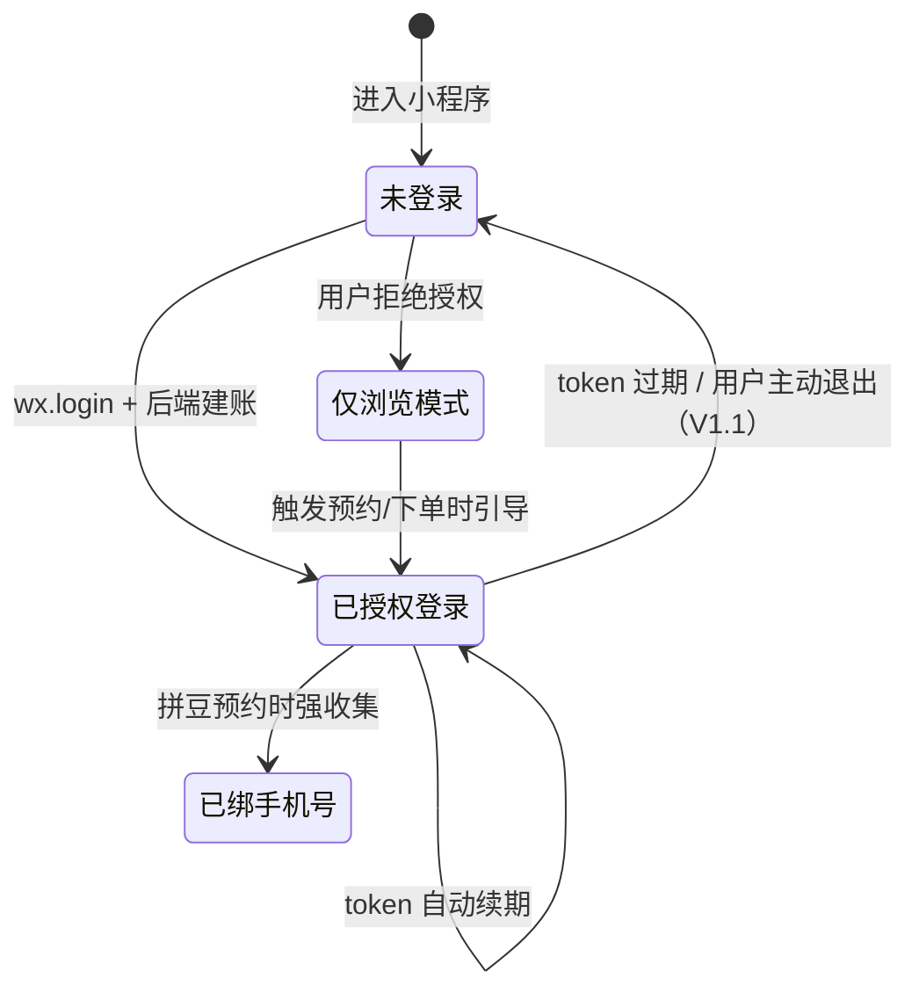

| 状态枚举（英文）| 中文 label | 触发该状态的事件 |
|---|---|---|
| `guest` | 未登录 | 首次进入 / token 失效 |
| `browse_only` | 仅浏览模式 | 用户首次拒绝授权 |
| `authorized` | 已授权登录 | wx.login + 用户授权头像/昵称 |
| `phone_bound` | 已绑手机号 | 拼豆预约时强收集成功 |

### 关键节点

| # | 节点 | 角色 | 发生什么 | 数据变更 | 副作用 |
|---|---|---|---|---|---|
| N1 | 进入小程序 | U → S | 启动小程序，检查 storage.token | — | 触发 N2 或 N6 |
| N2 | 调 wx.login() | U → W | 拿 `code`（5 分钟有效） | — | — |
| N3 | 弹出授权框 | U → W | 微信原生弹「获取头像/昵称」 | — | 用户选择「允许」走 N4，「拒绝」走 N7 |
| N4 | 后端 jscode2session | S → W | 后端用 `code` + `appid` + `secret` 调微信 `jscode2session` | 拿到 `openid` / `unionid` / `session_key` | — |
| N5 | 用户落库 | S | 查 `gz_user` where openid，无则 INSERT | 新增/更新 `gz_user` 记录（昵称 / 头像 URL / 注册时间 / 最后登录时间） | — |
| N6 | 签发 token + 缓存 sessionKey | S | sa-token 签业务 token；`session_key` 写 Redis（TTL 24h） | Redis `wx_session_key:{openid}` | 返回 token 给 mp |
| N7 | 仅浏览模式 | U | 用户拒绝授权，仍可看资讯列表/详情 / 拼豆首页 | — | 触发预约 / 下单时弹 N3（再次引导） |
| N8 | 拼豆预约前强收集手机号 | U → S | 用户点「提交预约」时检查 `gz_user.phone` 为空 → 弹原生 `<button open-type="getPhoneNumber">` → 后端 `phonenumber/getPhoneNumber` 解密 | 更新 `gz_user.phone` | 触发 §3.N8 提交预约 |

### 异常分支

| 异常 | 触发条件 | 回退动作 | 用户视感 |
|---|---|---|---|
| E1 用户拒绝授权 | N3 用户点「不允许」 | 进入 `browse_only` 状态，资讯/拼豆首页可看；触发预约/下单时回到 N3 | 提示「需要授权才能预约 / 下单，是否继续？」 |
| E2 code2Session 限流 | 微信侧限流 / 网络异常 | 提示「微信侧繁忙，请稍后重试」；3 次失败后引导反馈 | 短 toast 提示 |
| E3 session_key 过期 | 拼豆获取手机号时 `session_key` 已 TTL 过期 | 静默重走 N2-N4 重新拿 `session_key` 再解密手机号 | 用户无感 |
| E4 openid 但 unionid 缺失 | 未绑公众号 / 开放平台 | `gz_user.unionid` 存 NULL，不阻断 | 用户无感 |
| E5 用户切换微信账号重进 | openid 变化 | 视为新用户，新建 `gz_user` 记录 | 用户无感（V1.0 不做账号合并，写入 v2 候选）|

### 合同 / PRD 引用

- PRD §M1 §微信登录 §用户故事 + §用户操作流程 §首次登录
- PRD §M1 §关键字段 §用户模型
- 合同 §2.1 第一期（一）：「微信登录（含头像/昵称授权）」
- 强约束 #12：微信支付商户号挂甲方公司主体（避免二清）— 与登录同 appid

### 涉及 ticket

- GZ-SYS-002 微信登录链路（C 端）
- GZ-SYS-003 用户基础模型
- GZ-BEAN-004 §N8 手机号强收集（拼豆预约入口）

### 待澄清问题（v0.1 → v0.2）

- **Q1.1**：V1.0 是否实现「退出登录」入口？PRD/mockup/me-home 均无该按钮，合同 §2.1 未强制。**默认不实现**，写入 V1.1 候选。
- **Q1.2**：unionid 不存在时（甲方公众号 / 开放平台未绑），后续 V1.1 是否会跨端识别用户？影响 GZ-USER-101 订单聚合是否能 PC 后台合并 openid → unionid。**默认 V1.0/V1.1 都不跨端**，按 openid 唯一识别。
- **Q1.3**：「仅浏览模式」下能看哪些页面？mockup 未明确。**默认**：首页（home）/ 资讯（news-list / news-detail）/ 拼豆首页（booking landing）可看；其余触发登录。

---

## §2. 微信支付通道接入流（M1-B，V1.0 HelloWorld 级）

### 触发条件

- V1.0 范围：**仅商户号申请 + 通道调通**（甲方主体注册 + 0.01 元测试单跑通完整链路），**不接入业务支付**（业务调用 V1.1 实现，见 §6）
- 触发时机：后端测试环境的「测试支付」入口（admin 端）/ 微信支付 V3 回调验签自动测试

### 前置依赖

- 合同 §3 启动费已到账 + 微信支付商户号注册资料齐备（甲方提供）
- 商户号申请通过（5-10 工作日，是 V1.1 业务支付的硬前置）
- 后端 V3 SDK 集成 + APIv3 密钥 + 商户证书部署完毕
- ICP 备案完成 + 域名加白名单

### 状态机（V1.0 仅通道测试单的最小闭环）

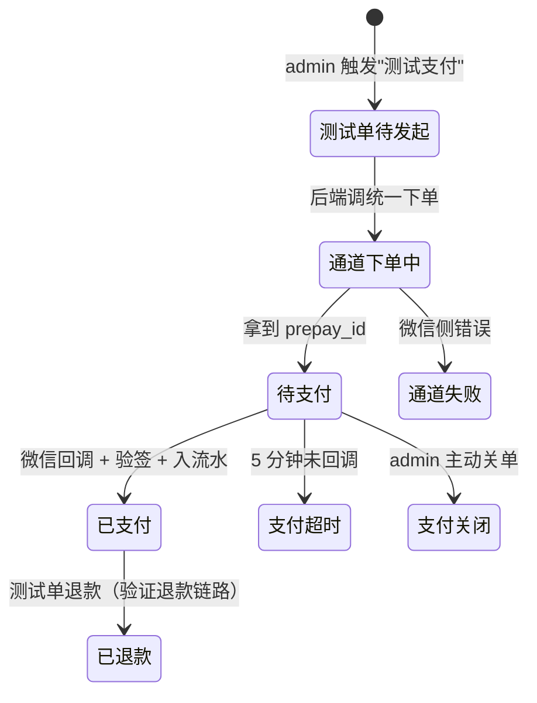

| 状态枚举（英文）| 中文 label |
|---|---|
| `created` | 测试单已创建 |
| `pending` | 待支付 |
| `paid` | 已支付 |
| `timeout` | 支付超时 |
| `failed` | 通道失败 |
| `closed` | 支付关闭 |
| `refunded` | 已退款 |

### 关键节点

| # | 节点 | 角色 | 发生什么 | 数据变更 |
|---|---|---|---|---|
| N1 | admin 触发测试支付 | A → S | admin 后台「商户号通道测试」按钮，输入测试金额（默认 0.01 元）| 写 `gz_pay_test_order` 一条 `created` 记录 |
| N2 | 后端调统一下单 V3 | S → W | POST `/v3/pay/transactions/jsapi`（含 `appid` / `mchid` / `notify_url` / `out_trade_no` / `amount` / `openid`）| `gz_pay_test_order.status = pending` |
| N3 | 拿到 prepay_id | W → S | 返回 `prepay_id` + 五参签名给 mp | 记 `prepay_id` |
| N4 | mp 拉起支付 | S → W → U | mp 调 `wx.requestPayment(五参)` | — |
| N5 | 用户支付 | U → W | 用户输入密码 / 指纹完成支付 | — |
| N6 | 微信回调 notify_url | W → S | POST `/api/pay/v3/notify`（AES-GCM 加密 body） | — |
| N7 | 验签 + 解密 + 幂等 | S | 用 APIv3 密钥解 body；用 `transaction_id` 查重 | 若 `paid` 已存在直接返回成功（幂等）；否则 `paid` |
| N8 | 入流水 | S | INSERT `gz_pay_transaction`（业务订单号 / transaction_id / 金额 / 业务类型 / 支付时间 / 状态） | — |
| N9 | 主动查单兜底 | S | 定时任务每分钟扫 `pending > 5min` 的测试单，调 `/v3/pay/transactions/out-trade-no/{out_trade_no}` 查 | 如查到 paid 主动 paid（与 N7 幂等）|

### 异常分支

| 异常 | 触发条件 | 回退动作 | 用户视感 |
|---|---|---|---|
| E1 商户号未通过 | 微信侧资质审核不过 | 阻断 V1.0 验收基础设施项 C.1 | Kevin 当天 raise 给客户 |
| E2 回调验签失败 | 签名串伪造 / APIv3 密钥配错 | 拒收 + 告警；订单保 `pending` 等 N9 主动查单 | — |
| E3 同 transaction_id 重复回调 | 微信多次推送 | N7 幂等：直接返回 200 success，不重复处理 | — |
| E4 支付成功但 mp 断网 | 用户支付后立即关闭 mp | N6 服务端正常处理；重进 admin 测试页能看到 `paid` | — |
| E5 5 分钟未支付 | 用户犹豫不付款 | 状态 `timeout`；admin 可手动关单 → `closed` | mp 端显示「支付超时」 |
| E6 测试退款失败 | 商户余额不足 / 通道异常 | 状态保 `paid`；写 ops log；告警 | admin 看到「退款失败，请人工介入」 |

### 合同 / PRD 引用

- PRD §M1 §微信支付 §用户操作流程 §下单支付（V1.0 仅链路打通，业务调用 V1.1）
- 合同 §2.1 第一期（一）「微信支付 V3 商户号申请与通道调通」
- 强约束 #12：商户号必须挂甲方公司主体（避免二清违规）

### 涉及 ticket

- GZ-PAY-001 微信支付 V3 商户号申请 + 通道 HelloWorld

### 待澄清问题

- **Q2.1**：V1.0 测试单的 `out_trade_no` 编码规则是否要跟 V1.1 业务订单号统一？**建议统一**（业务前缀 + 时间 + 序号），避免 V1.1 重构。在 GZ-PAY-001 实施时一次性约定好。
- **Q2.2**：V1.0 退款测试是否要做？合同未硬性要求，但建议跑一次完整退款链路验证 V1.1 GZ-PAY-103 时不踩坑。**默认做一次 0.01 元退款测试**。

---

## §3. 拼豆预约全流程（M4，免费 + A1-A10 具体座位）⚠️ 已被 §11 推倒

> ⚠️ **V1.2 起本节作废，以 §11「拼豆付费预约全流程」为权威。** V1.2 调整批次（GZ-BEAN-013/014/015）把拼豆从「免费 + A1-A10 具体座位 + Redis 座位锁」推倒重做为「付费前置 + 座位类型库存配额模型」。本节保留作 V1.0 历史基线对照（旧 booking 数据迁移参考），新实现一律读 §11。
>
> **本节与 §11 的关系**：`gz_bean_seat`（A1-A10 具体座位）表物理保留不 DROP，但停用于预约；`gz_bean_booking` 主单 ALTER 增 `seat_type` + 付费列（**单笔单时段，无子表**）；新增 `gz_bean_seat_type_config`（类型配额）。旧单本就单类型单时段，原地补 `seat_type` 兜底迁移。
>
> ——以下为 V1.0 免费流原文（历史基线）——
>
> 这是 V1.0 唯一完整业务闭环。承接甲方现有线下流量；UI 颗粒度比其他域稍密；状态机最复杂。
>
> **V1.0 仅成都拼豆店一家门店**（合同 §2.3 第 7 项硬约束）；多门店配置代码留接口、UI 隐藏。

### 触发条件

- U：从底部 5 tab 的「拼豆」入口进入 / 从 home / news 文章里的拼豆推荐入口进入
- U：从「我的」→「我的预约」入口进入（看历史/取消）
- A：admin 端进入「预约管理」做核销 / 改时段配置

### 前置依赖

- §1 微信登录（authorized 状态）
- 门店主数据已配置（GZ-BEAN-001：成都拼豆店一家）
- 座位主数据 + 时段模板已配置（GZ-BEAN-002）

### 状态机（预约单 booking_status）

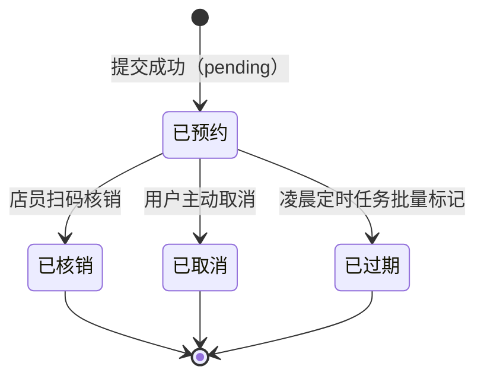

| 状态枚举（英文）| 中文 label | UI 同义词（mockup booking-list 用）| 触发该状态的事件 |
|---|---|---|---|
| `pending` | 已预约 | `upcoming`（待核销）| N7 提交成功 |
| `used` | 已核销 | `used` | N11 店员核销 |
| `cancelled` | 已取消 | `cancelled` | N12 用户取消 |
| `no_show` | 已过期 | （mockup 未明示，待澄清 Q3.1）| N13 凌晨定时任务标记 |

> ⚠️ **mockup booking-list.html 仅渲染 3 个状态（upcoming / used / cancelled），无 no_show 视觉**。PRD 明确 4 状态。**裁定**：V1.0 实现 4 状态；mockup 待 designer 补 `no_show` 样式（详见 Q3.1）。

### 关键节点

| # | 节点 | 角色 | 发生什么 | 数据变更 | 副作用 |
|---|---|---|---|---|---|
| N1 | 进入拼豆首页 | U | home / 拼豆 tab → booking landing | — | — |
| N2 | 选门店 | U | mockup booking-select.html 顶部门店选择条；**V1.0 仅 1 家时跳过该步**（直接默认选中成都店） | — | — |
| N3 | 选日期 | U | 默认今天，最多 7 天选择；过去日不可选 | — | 触发 N4 |
| N4 | 拉取时段 + 座位 | mp → S | GET `/api/bean/slots?store_id&date` 返回该日所有开放时段 + 每时段座位占用状态 | — | mp 渲染时段列表 + 座位平面图（mockup 是列表型）|
| N5 | 选时段 + 选座位 | U | 已满 / 未开放时段灰显；座位卡片可点选 | — | — |
| N6 | 检查手机号（手机号强收集前置） | mp → S | 若 `gz_user.phone` 为空 → 弹原生 `<button open-type="getPhoneNumber">` | 更新 `gz_user.phone`（见 §1.N8） | 必须收集成功才能继续 N7 |
| N7 | 提交预约 | mp → S | POST `/api/bean/booking` { store_id, seat_id, date, slot_start } | DB 事务：①Redis 锁（key=`bean_seat:{store_id}:{seat_id}:{date}:{slot}`, TTL 5s）→ ②写 `gz_bean_booking` (status=pending) → ③释锁 → ④唯一索引兜底兜住极端并发 | 返回预约 ID + 核销码（含签名）|
| N8 | 跳预约详情页 | U | 展示门店 / 日期 / 时段 / 座位 / 二维码大图 / 状态 pending | — | — |
| N9 | （可选）取消预约 | U → S | 详情页点「取消预约」→ 二次确认 → POST `/api/bean/booking/{id}/cancel` | `status = cancelled`，二维码作废（核销时校验签名 + 状态）| 释放该座位时段 |
| N10 | 到店出示二维码 | U → A | 用户在「我的预约」详情页给店员看二维码 | — | — |
| N11 | 店员核销 | A → S | admin 端「预约管理」→ 扫码核销（或手动按预约号核销）→ 校验签名 + 校验状态为 pending | `status = used` + `verify_time = NOW` + ops log | 触发用户「核销成功」提示 |
| N12 | 用户取消（与 N9 相同节点，重复编号防遗漏）| U → S | 同 N9 | 同 N9 | 同 N9 |
| N13 | 凌晨 2 点定时任务 no_show 标记 | S | cron：扫昨日 status=pending 预约 → 批量 `status = no_show` | — | V1.0 不影响后续预约（无黑名单）|

### 并发控制

| 场景 | 防护方式 | 兜底 |
|---|---|---|
| 抢座（同时段同座位同一刻多个用户提交）| Redis 锁 key=`bean_seat:{store_id}:{seat_id}:{date}:{slot}` TTL 5s | DB UNIQUE `(store_id, seat_id, date, slot_start, status='pending')` 索引兜底（cancelled / used / no_show 不占用座位）|
| 同一用户连点提交 | Redis 锁 key=`bean_user_submit:{openid}` TTL 5s | 后端业务层校验「该用户该时段该门店已有 pending 预约」直接幂等返回原预约 |
| 同一用户同时段同门店多次抢座 | 后端业务规则校验 | DB 复合 UNIQUE `(openid, store_id, date, slot_start, status='pending')` |

### 异常分支

| 异常 | 触发条件 | 回退动作 | 用户视感 |
|---|---|---|---|
| E1 座位被抢 | N7 唯一索引冲突 | 后端返回 409，mp 提示 + 自动刷新座位占用图 | 「座位已被预约，请重选」|
| E2 手机号收集失败 | N6 用户拒绝授权手机号 | 后端拒收 N7 提交；mp 提示「预约需要手机号以便到店通知」 | 留在 N6 重试或退出 |
| E3 座位被后台停用 | N5 选完座位但提交时座位被 admin 停用 | N7 后端校验 `gz_bean_seat.enabled = 0` → 返回错误 | 「该座位已停用，请重选」|
| E4 时段被后台停用 | 同上 | N7 后端校验 `gz_bean_time_slot_template.enabled = 0` → 返回错误 | 「该时段已停用」|
| E5 重复提交 | 用户狂点提交按钮 | Redis 锁 + 后端业务层校验「该用户该时段该门店已有 pending 预约」直接幂等返回原预约 ID | 跳预约详情页（与正常一致）|
| E6 核销码扫码后已是 used | 同一码被扫两次 | N11 校验 status != pending → 返回错误 | 店员看到「该预约已核销」|
| E7 核销码扫码后已是 cancelled | 用户取消后店员扫码 | N11 校验 status != pending → 返回错误 | 店员看到「该预约已取消」|
| E8 核销码扫码后已是 no_show | 隔夜补核销 | N11 校验 status != pending → 返回错误 | 店员看到「该预约已过期，请重新预约」V1.0 不允许补核销 |
| E9 用户预约后未到店 | 当日结束（最后时段 + 1h 缓冲）后仍 pending | N13 凌晨任务标 no_show | V1.0 不通知用户 / 不进黑名单 |
| E10 定时任务失败 | DB 异常 / Redis 异常 | 任务幂等可重跑；告警 ops + Kevin 微信 | 用户不感知（次日凌晨重跑） |

### 合同 / PRD 引用

- PRD §M4 §用户操作流程 §预约主路径 / §取消预约
- PRD §M4 §关键字段 § Store / Seat / TimeSlotTemplate / Booking
- PRD §M4 §状态机
- PRD §M4 §业务规则 + §并发处理 + §异常分支
- PRD §4.3 拼豆预约规则
- 合同 §2.1 第一期（一）「拼豆预约模块」
- 合同 §2.3 第 7 项「V1.0 仅成都拼豆店一家门店」
- 强约束 #13 拼豆预约 V1.0 仅成都一家门店

### 涉及 ticket

- GZ-BEAN-001 门店主数据
- GZ-BEAN-002 座位主数据 + 时段模板配置
- GZ-BEAN-003 微信端时段 + 座位选择
- GZ-BEAN-004 预约提交 + 唯一索引 + 防并发
- GZ-BEAN-005 微信端预约详情 + 核销码展示
- GZ-BEAN-006 微信端预约列表
- GZ-BEAN-007 微信端取消预约
- GZ-BEAN-008 后台预约列表 + 核销
- GZ-BEAN-009 no_show 自动标记定时任务
- GZ-BEAN-010 拼豆预约首页

### 待澄清问题

- **Q3.1**：mockup booking-list.html 只渲染 `upcoming / used / cancelled` 三态，**无 no_show 视觉样式**。PRD 明确 4 态。**裁定**：V1.0 实现 4 态；mockup 待 designer 补 `no_show` 灰色 pill（参考 cancelled 的视觉 + 加「已过期」文案）。
- **Q3.2**：核销码是「签名串嵌入二维码内容」还是「短码 + 服务端校验」？影响 GZ-BEAN-004 / GZ-BEAN-008 实现。**默认采用「签名串嵌入」**（含 booking_id + sign(booking_id + secret)），admin 扫码后端校验签名 + 查状态 — 离线不可伪造，二维码作废由后端状态判断。
- **Q3.3**：取消预约是否限制时间（如「开始时段前 2h 不能取消」）？PRD §4.3 明确「MVP **不限制**」，但客户运营时可能反悔。**默认按 PRD 不限制**，写入 v2 候选（V2-05）。
- **Q3.4**：no_show 是否影响该用户后续预约（如「2 次 no_show 后 7 天内不能预约」）？PRD §4.3 明确「MVP **不做黑名单**」。**默认不做**，写入 v2 候选（V2-05）。
- **Q3.5**：核销码二维码内容是否有 TTL（如「当日结束后即作废」）？合同 / PRD 未明示。**默认无 TTL**，由 booking_status 决定有效性：pending → 有效；used / cancelled / no_show → 全部作废（后端校验状态）。
- **Q3.6**：用户在预约日期前更换微信账号（openid 变化）→ 原预约还能用吗？**默认按 openid 一一绑定**，旧 openid 的预约保留但用户无法在新账号里看到 / 不能取消；店员仍可正常核销（依赖二维码签名而非用户登录态）。写入 v2 候选 V2-XX「账号合并」。

---

## §4. 会员中心占位流（M5-V1.0，V1.0）

### 触发条件

- U：底部 5 tab「我的」入口
- U：从其他页面（如预约详情）跳「我的预约」入口

### V1.0 范围（合同硬约束）

合同 §2.1 第一期（一）明确：**「会员中心 / 个人主页：个人资料、地址簿、订单聚合 tab（V1.0 仅显示预约记录与占位结构，业务线 A、B 订单数据待 V1.1 接入）」**

所以 V1.0 会员中心是「半架构 + 部分实数据」混合：

| 模块 | V1.0 状态 |
|---|---|
| 个人资料编辑（昵称 / 头像 / 手机号）| ✅ 实数据 |
| 地址簿 CRUD | ✅ 实数据（V1.0 收集，V1.1 真实下单时使用）|
| 我的预约（拼豆）入口 | ✅ 实数据 |
| 我的订单 tab（全部 / 扭蛋 / 预购）| ⚠️ 占位 — 显示「暂无订单，敬请期待 V1.1」|

### 前置依赖

- §1 微信登录（authorized 状态）

### 状态机（地址簿默认地址）

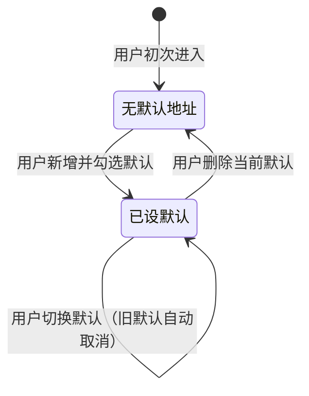

> 默认地址唯一性 = 事务内 reset-then-set（更新时事务：所有 is_default=0，再目标 is_default=1；行锁串行化保证至多一个默认 = 实现口径，不加 DB 唯一约束/乐观锁）

### 关键节点

| # | 节点 | 角色 | 发生什么 | 数据变更 |
|---|---|---|---|---|
| N1 | 进入会员中心首页 | U | 渲染头像 / 昵称 / 功能区入口 | — |
| N2 | 编辑个人资料 | U → S | 修改昵称（可从微信拉取覆盖）/ 头像（可从微信拉取覆盖）/ 手机号 | 更新 `gz_user`；写 `gz_user_audit_log` |
| N3 | 进入地址簿 | U → S | GET `/api/user/address` 返回列表 | — |
| N4 | 新增地址 | U → S | POST `/api/user/address` | 写 `gz_user_address`（含 is_default 字段）|
| N5 | 编辑地址 | U → S | PUT `/api/user/address/{id}` | 更新 |
| N6 | 删除地址 | U → S | DELETE | 软删 `del_flag=1` |
| N7 | 设为默认地址 | U → S | PATCH `/api/user/address/{id}/default` | 事务内：①所有该用户地址 is_default=0 → ②目标地址 is_default=1 |
| N8 | 进入「我的订单」tab | U | V1.0 全部 tab 显示「暂无订单，敬请期待 V1.1」占位 | — |
| N9 | 进入「我的预约」入口 | U | 跳 §3.N8 booking-list | — |

### 异常分支

| 异常 | 触发条件 | 回退动作 | 用户视感 |
|---|---|---|---|
| E1 默认地址并发修改 | 用户在两个端同时点「设为默认」 | DB 事务（行锁串行化 reset-then-set，至多一个默认） | 后到达的请求覆盖先到达的 |
| E2 删除当前默认地址 | 用户先删了默认地址 | `is_default` 落到无；新建/编辑时不自动设新默认 | 用户主动设新默认 |
| E3 V1.0 订单 tab 内有真实数据 | 不应出现（V1.0 无业务订单）| 数据契约层兜底：接口返回空数组 | UI 显示占位文案 |

### 合同 / PRD 引用

- PRD §M5 §用户故事 + §用户操作流程 §进入会员中心
- PRD §M5 §关键字段 § Address
- 合同 §2.1 第一期（一）「会员中心 / 个人主页 ... V1.0 仅显示预约记录与占位结构」
- 强约束 #7 会员中心 V1.0 占位

### 涉及 ticket

- GZ-USER-001 会员中心首页
- GZ-USER-002 个人资料编辑
- GZ-USER-003 地址簿 CRUD
- GZ-USER-004 我的订单 tab 占位结构

### V1.0 → V1.1 演进契约

V1.0 实现时必须预留：
- 「我的订单」tab 接口路径 / 字段结构定好（V1.1 接入真实数据时不重构）
- 订单聚合接口 schema 见 §9.「跨业务订单统一字段」

### 待澄清问题

- **Q4.1**：mockup me-collection.html 是否在 V1.0 会员中心首页有入口？mockup `me-home.html` 未含「图鉴」入口，但 mockup `me-collection.html` 已设计。**裁定**：图鉴入口属于扭蛋（V1.1），V1.0 me-home 不出现该入口。
- **Q4.2**：「个人资料编辑」mockup 缺口（me-profile.html 未画）。**裁定**：交 designer 在 5/29 前补，否则 GZ-USER-002 用 wot-design-uni 默认表单兜底。

---

## §5. 资讯发布流（M6，V1.0）

### 触发条件

- A：admin 端新建文章 / 编辑文章 / 发布 / 下架
- A：admin 端设定时发布 → cron 自动 published
- U：mp 端进资讯列表 / 详情
- U：mp 端分享到微信好友 / 朋友圈

### 前置依赖

- §1 微信登录（authorized 或 browse_only 都能看，但分享需 authorized）
- GZ-SYS-005 文件上传链路（富文本内嵌图片走对象存储）

### 状态机（文章 article_status）

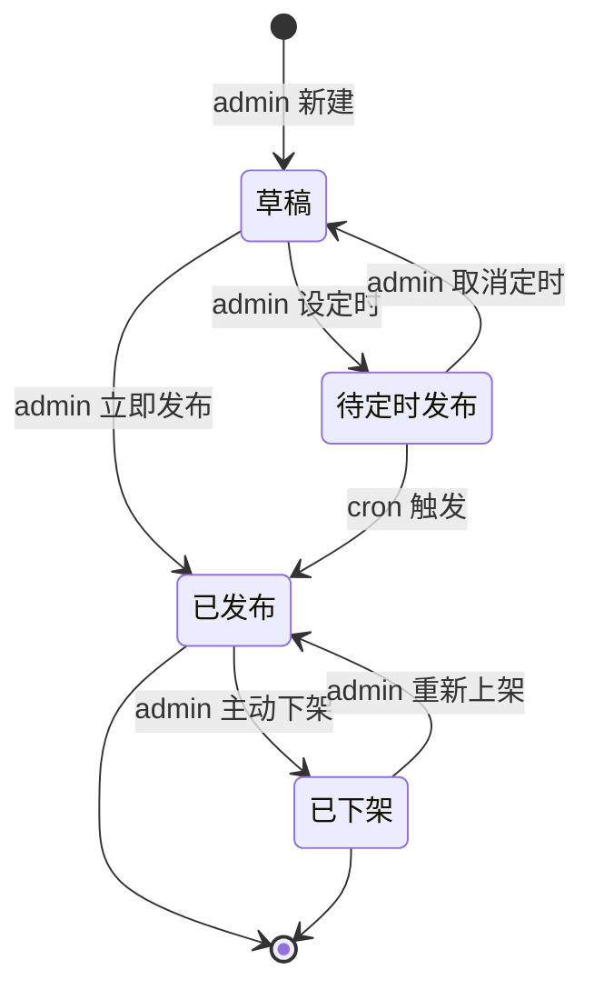

| 状态枚举（英文）| 中文 label |
|---|---|
| `draft` | 草稿 |
| `scheduled` | 待定时发布 |
| `published` | 已发布 |
| `offline` | 已下架 |

### 关键节点

| # | 节点 | 角色 | 发生什么 | 数据变更 |
|---|---|---|---|---|
| N1 | admin 新建文章 | A → S | 填标题 / 分类 / 封面 / 富文本正文 / 摘要 / 视频列表 | 写 `gz_news_article` (status=draft) |
| N2 | admin 富文本内嵌图片 | A → S | 上传图片 → GZ-SYS-005 走对象存储 → 返回对象 id → 富文本内嵌 URL | 写 `gz_file_object`（id / bucket / key / url）|
| N3 | admin 保存草稿 | A → S | 同 N1 持续编辑 | — |
| N4 | admin 立即发布 | A → S | 状态 `published`，写 `publish_time = NOW`；写 ops log | — |
| N5 | admin 设定时发布 | A → S | 状态 `scheduled`，写 `schedule_publish_time`；写 ops log | — |
| N6 | cron 触发定时发布 | S | 每分钟扫 `scheduled` 且 `schedule_publish_time <= NOW` → 状态 `published` | — |
| N7 | U 进资讯列表 | U → S | GET `/api/news/articles?category` + 按分类 tab 筛 | — |
| N8 | U 进文章详情 | U → S | GET `/api/news/articles/{id}` → mp 渲染富文本 + 视频 | `read_count += 1`（防刷待 v2）|
| N9 | U 分享到微信好友 | U → W | 小程序 `onShareAppMessage` 返回自定义卡片 | — |
| N10 | U 分享到朋友圈 | U → W | 小程序 `onShareTimeline` 返回自定义卡片 | — |
| N11 | admin 下架文章 | A → S | 状态 `offline`，写 ops log | — |
| N12 | 富文本节点白名单过滤 | S | 渲染前 sanitize HTML（防 XSS / 外站链接拦截）| — |

### 异常分支

| 异常 | 触发条件 | 回退动作 | 用户视感 |
|---|---|---|---|
| E1 富文本嵌入外站链接 | A 复制粘贴外站 a[href] | N12 统一拦截或转纯文本 | admin 看到「外链已被过滤」提示 |
| E2 视频体积过大 | A 上传 > 100MB 视频 | N2 文件上传层拦截 | 提示「视频不超过 100MB」|
| E3 已发布文章被下架时用户正在分享 | E 落地页提示「文章已下线」| `published → offline` 后旧 share 链接进 404 | U 看到「文章已下线」 |
| E4 定时发布到点失败 | cron 异常 / DB 异常 | 任务幂等可重跑；告警 ops | 上线推迟，admin 手动补救 |

### 合同 / PRD 引用

- PRD §M6 §用户故事 + §用户操作流程
- PRD §M6 §关键字段 § Article
- PRD §M6 §状态机
- 合同 §2.1 第一期（一）「资讯中心模块」+ 第二期（二）「资讯 CMS」

### 涉及 ticket

- GZ-NEWS-001 文章列表 + 详情 + 分类
- GZ-NEWS-002 文章分享（微信好友 / 朋友圈）
- GZ-NEWS-003 后台资讯 CMS（富文本编辑）
- GZ-NEWS-004 定时发布
- GZ-SYS-005 文件上传（富文本内嵌图片依赖）

### 待澄清问题

- **Q5.1**：分类是「枚举固定」还是「admin 可扩展」？PRD §6.4 列举「新品 / 活动 / 攻略 / 全部」4 类，但又说「枚举可后台扩展」。**裁定**：V1.0 实现「枚举固定」（admin 后台无分类管理 UI，硬编码 4 类），可扩展能力推 v2。
- **Q5.2**：阅读量 `read_count` 是否需要防刷（同一用户同一文章每天只 +1）？**默认不防刷**（admin 自己看大致趋势即可），写入 v2。

---

## §6. 业务支付流（M1-业务接入，V1.1）

### 触发条件

- U：扭蛋详情页点「投币抽奖」按钮（→ §8 扭蛋）
- U：预购商品详情页点「立即预购」+ 确认订单页点「支付」（→ §7 预定）

### V1.0 → V1.1 边界

V1.0 通道已 HelloWorld 调通（§2）；V1.1 在此基础上：
- 业务支付统一服务（GZ-PAY-101）：统一订单号、统一回调入口
- 主动查单 + 补单（GZ-PAY-102）
- 退款服务（GZ-PAY-103，仅 admin 触发）

### 前置依赖

- §1 微信登录 authorized
- §2 商户号 + 通道已调通
- §7 / §8 业务订单已创建（pending 状态）

### 状态机（支付 transaction_status，所有业务订单共用）

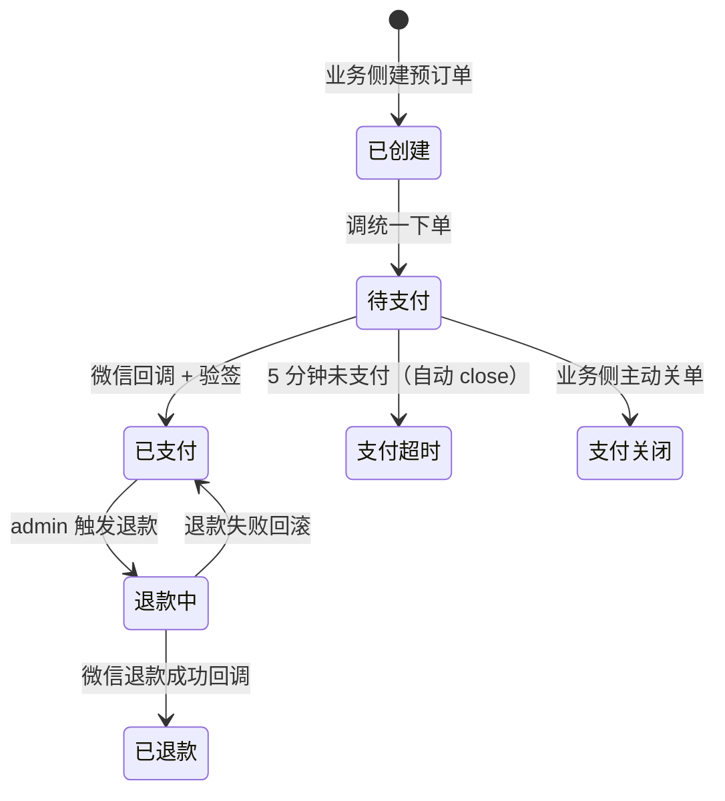

| 状态枚举（英文）| 中文 label |
|---|---|
| `created` | 已创建 |
| `pending` | 待支付 |
| `paid` | 已支付 |
| `timeout` | 支付超时 |
| `closed` | 支付关闭 |
| `refunding` | 退款中 |
| `refunded` | 已退款 |

### 关键节点

| # | 节点 | 角色 | 发生什么 | 数据变更 |
|---|---|---|---|---|
| N1 | 业务侧建预订单 | S | 扭蛋 / 预购各自的订单创建逻辑（§7.N5 / §8.N5）| 业务订单 `status=created`，写 `gz_pay_transaction (status=created)` |
| N2 | 调统一下单 | S → W | 同 §2.N2，传业务订单号 `out_trade_no`（含业务前缀如 `GACHA-` / `PREORD-`）| `gz_pay_transaction.status = pending` |
| N3 | mp 拉起支付 | mp → W | wx.requestPayment | — |
| N4 | 用户支付完成 | U → W | 微信扣款 | — |
| N5 | 微信回调 notify | W → S | 同 §2.N6 | — |
| N6 | 验签 + 幂等 + 业务回调 | S | 同 §2.N7；幂等基于 transaction_id。**业务回调**：根据 out_trade_no 前缀分发到扭蛋抽奖事务（§8.N6）或预购订单 paid（§7.N7）| `gz_pay_transaction.status = paid`；业务订单状态同步 |
| N7 | 主动查单兜底 | S | 同 §2.N9，扫所有 pending > 5 min 的 gz_pay_transaction | — |
| N8 | admin 触发退款 | A → S | admin 在订单详情点「申请退款」（owner 权限）| `gz_pay_transaction.status = refunding`；写 ops log |
| N9 | 调微信退款 API | S → W | POST `/v3/refund/domestic/refunds` | — |
| N10 | 微信退款回调 | W → S | 异步回调 `/api/pay/v3/refund-notify` | `status = refunded`；触发业务回滚（库存归还 / 订单状态变更）|

### 异常分支

| 异常 | 触发条件 | 回退动作 | 用户视感 |
|---|---|---|---|
| E1 同 transaction_id 重复回调 | 微信多次推送 | N6 幂等，直接返回 200 | — |
| E2 业务回调失败（扭蛋抽奖事务异常）| §8.N6 事务 rollback | gz_pay_transaction 保 paid；业务订单保 created；告警 + 异步重试 → 重试 3 次仍失败 → 自动触发退款 | 用户重新进入付款结果页看到「抽奖失败已退款」 |
| E3 主动查单查到 paid 但本地是 pending | 微信回调丢失 | 主动 paid + 业务回调 | 用户无感 |
| E4 退款回调失败 | 微信侧延迟 / 网络异常 | 后端定时主动查退款状态 | admin 看到「退款中」直至到账 |
| E5 退款金额不足（部分退款）| V1.1 默认全额退款 | 不支持部分退款（写入 v2） | — |
| E6 通道侧手续费变化 | 微信调整费率 | 不影响业务流；对账中心 §10 按实际通道费扣减 | — |

### 合同 / PRD 引用

- PRD §M1 §微信支付 §下单支付 + §异常分支
- 合同 §2.1 第二期（一）（二）业务线 A/B 交易模块 + 退款触发
- 合同 §4.5 内容管理权 / 暂停权（与支付无关，但是后台主动权来源）

### 涉及 ticket

- GZ-PAY-101 业务支付统一服务
- GZ-PAY-102 主动查单 + 补单
- GZ-PAY-103 退款服务

### 待澄清问题

- **Q6.1**：退款触发需「二级审批」（owner 触发后必须再一人确认）？合同未要求。**默认无二级审批**（owner 单点触发，依赖 ops log 审计），写入 v2 候选。
- **Q6.2**：退款是否支持「全额 / 部分」？PRD 未明示，但 mockup `admin-orders.html` 内有「申请退款」按钮，暂未细化金额输入框。**默认仅全额退款**，部分退款推 v2。
- **Q6.3**：业务订单号格式：`GACHA-20260615-000001` vs `GZ-G-20260615-000001` vs UUID？**裁定**：`<域>-<yyyyMMdd>-<6位日内序号>`（如 `GACHA-20260720-000087`），便于对账中心人肉读。在 GZ-PAY-001 V1.0 阶段就一次性约定好。

---

## §7. 预定货品全流程（M3，V1.1）⚠️ V1.2 屏蔽入口保留代码

> ⚠️ **V1.2 调整批次（GZ-ORD-110）屏蔽预购 mp/admin 入口，代码全部保留**（合同 §2.3 范围内业务，非废弃）。mp 首页/「我的」入口卡隐藏；admin 菜单 `sys_menu` 9110-9112 + 订单聚合 11007-11009 中 preorder 相关项 `visible='1'` 关闭。ruoyi-gz-ord 模块代码、`gz_ord_*` 表、§6 业务支付的 preorder 分支全部留存，甲方决定重启时去屏蔽即恢复。本节业务流定义不变，仅入口可见性受影响。

### 触发条件

- U：底部 5 tab「预购」进入预购列表
- U：从首页推荐 / 资讯文章里的商品链接跳转

### 前置依赖

- §1 微信登录 authorized
- §6 业务支付通道
- §4 地址簿（用户至少有 1 个收货地址）
- GZ-ORD-101 预购商品 + SKU 数据已配置（admin 端 GZ-ADMIN-101）

### V1.0 / V1.1 边界

- **V1.0 完全占位**：底部 tab「预购」跳到「敬请期待 V1.1」占位页
- **V1.1 完整实现**：列表 / 详情 / 下单 / 支付 / 订单查询 / 物流推进

### 业务规则（PRD §4.2 业务规则 + 合同 §2.1 V1.1）

| 规则 | 内容 |
|---|---|
| 付款方式 | **全款**，无定金分期 |
| 成团数 | 无（非拼团是预购） |
| 截止日 | 商品级配置，过截止后下架 |
| 到货时间 | 商品级配置，可填精确日期或模糊文案（"X 月下旬"）|
| 退款 | **不支持**（合同 §4.5 + PRD §异常分支，特例由客服判断）|
| 库存 | SKU 级可选（可不限）|
| 跨境物流 | 简化 2 态：「在日本」/「已发往中国」，甲方在 admin 手动切换 + 录入快递单号；UI 仅展示快递公司 + 单号，用户自查（§9）|

### 状态机（预购订单 preorder_order_status）

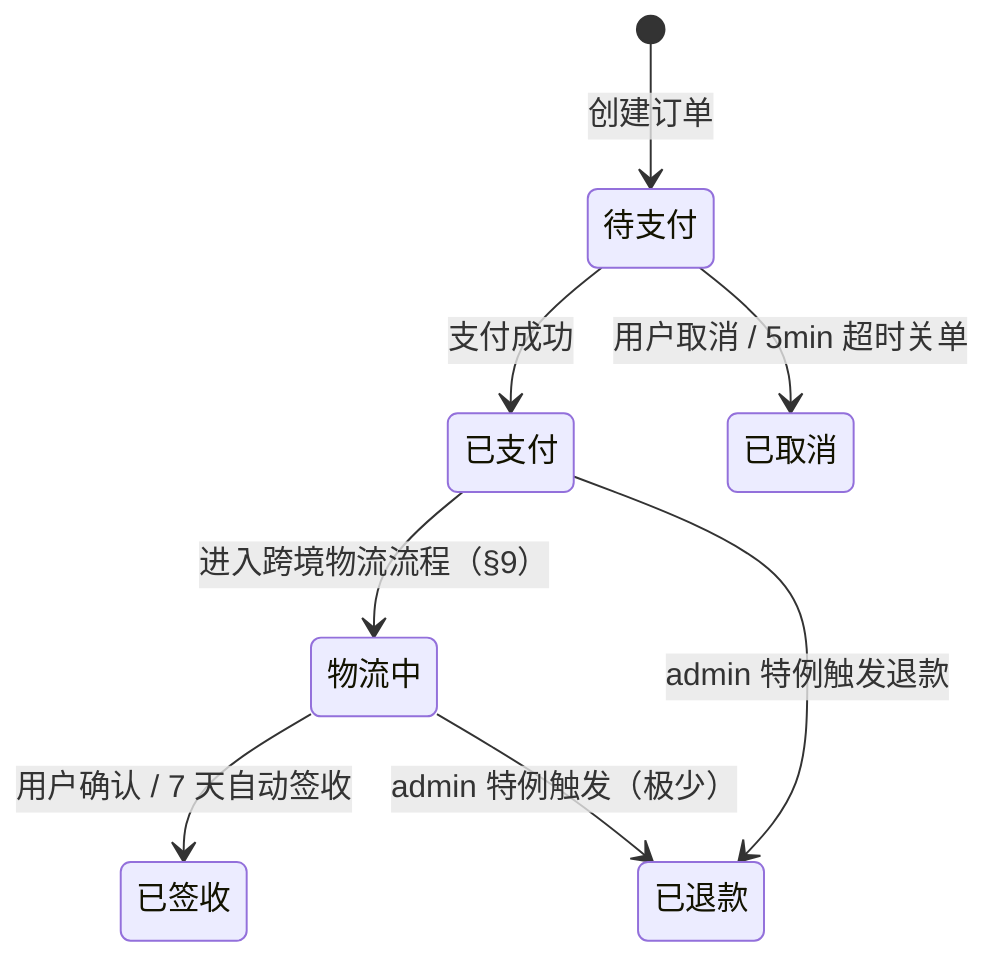

| 状态枚举（英文）| 中文 label | 触发该状态的事件 |
|---|---|---|
| `created` | 待支付 | N5 用户提交订单 |
| `paid` | 已支付 | N7 微信支付成功 |
| `cancelled` | 已取消 | N6 用户主动取消 / 5min 超时 |
| `in_logistics` | 物流中 | 由 admin 推进进入 §9.N2 「已发往中国」时同步（首次切到 §9 状态机时）|
| `delivered` | 已签收 | §9.N5 已签收（V1.1 不维护独立 closed 终态）|
| `refunded` | 已退款 | N13 admin 触发退款成功 |

### 关键节点

| # | 节点 | 角色 | 发生什么 | 数据变更 |
|---|---|---|---|---|
| N1 | U 进预购列表 | U → S | GET `/api/preorder/products` | — |
| N2 | U 筛选 / 排序 | U | 排序：到货近 / 热度 / 截止紧迫；筛 IP 标签 | — |
| N3 | U 进商品详情 | U → S | GET `/api/preorder/products/{id}` | — |
| N4 | U 选规格 + 数量 | U | 选 SKU（含价格）+ 数量；校验 SKU 库存 | — |
| N5 | U 进确认订单页 | U → S | 选地址 / 看金额 / 勾选「已阅读不支持退款」 | — |
| N6 | U 提交订单 | U → S | POST `/api/preorder/orders`：①事务内扣 SKU 库存（乐观锁 version）→ ②写 `gz_ord_order` 含商品 + SKU snapshot + 地址 snapshot → ③创 gz_pay_transaction | 订单 `status = created` |
| N7 | 调统一支付 | S → W | §6.N2 / §6.N3 | — |
| N8 | 支付成功 | W → S | §6.N6 业务回调到预购：订单 `status = paid` | — |
| N9 | 等截止日 | S | 商品截止日到达 → admin 在 admin-products 端能看到「等待发货」状态（甲方逐单在订单详情手动切物流态，无批次概念）| — |
| N10 | admin 进入跨境物流推进 | A → S | 进入 §9（甲方手动切换 in_japan / 录单号 → in_china_dispatching）| 订单 `status = in_logistics` |
| N11 | 已签收 | U / S | §9.N5（用户确认 / 7 天自动）| 订单 `status = delivered` |
| N13 | admin 特例退款 | A → S | §6.N8 | 订单 `status = refunded`；SKU 库存不归还（已采购）|

### 异常分支

| 异常 | 触发条件 | 回退动作 | 用户视感 |
|---|---|---|---|
| E1 截止日已过仍尝试下单 | N6 后端校验 `截止日 < NOW` | 拦截 + 提示 | 「已截止预订」|
| E2 SKU 库存不足 | N6 乐观锁失败 | 回滚事务 + 提示 | 「库存不足，请刷新」|
| E3 商品被后台下架但用户已加车 | N6 校验商品 status != on_shelf | 拦截 + 提示 | 「商品已下架」|
| E4 支付成功后甲方临时改到货日 | A 改 `gz_ord_product.delivery_date` | 仅前端展示新到货日，订单本身不改（已 snapshot）| U 看到新到货日 |
| E5 用户要求退款 | U 投诉 | 拒绝 C 端入口；引导客服；客服判断特例后 admin 走 §6.N8 | C 端只能看「联系客服」 |
| E6 国内单号录错 | A 录错 | admin 编辑（V1.1 GZ-ADMIN-104）；C 端实时刷新 | U 看到新单号 |
| E7 支付超时 | N7 后 5 min 未付 | `gz_pay_transaction.status = timeout`；订单 `status = cancelled`；SKU 库存归还 | 「订单已超时取消」|
| E8 5min 内用户主动取消 | U 点取消 | 订单 `status = cancelled`；SKU 库存归还 | — |

### 合同 / PRD 引用

- PRD §M3 §用户操作流程 §预购主路径
- PRD §M3 §关键字段 § PreorderProduct / 预购 SKU / PreorderOrder
- PRD §M3 §状态机
- PRD §4.2 预购规则
- 合同 §2.1 第二期（一）「业务线 A（预定货品）交易模块」
- 合同 §2.3 第 8 项不支持退款（C 端）

### 涉及 ticket

- GZ-ORD-101 预购商品 + SKU 数据模型
- GZ-ORD-102 微信端商品列表 + 筛选
- GZ-ORD-103 微信端商品详情 + 下单确认
- GZ-ORD-104 预购下单 + 支付 + 订单生成
- GZ-ORD-105 预购订单查询
- GZ-ADMIN-101 预购商品管理（CRUD）

### 待澄清问题

- **Q7.2**：「已签收」是「订单终态」还是要进入「已完成」？PRD §M3 §状态机标的是 `created → paid → in_logistics → delivered → (closed)`，其中 `closed` 在括号里。**裁定**：V1.1 把 `delivered` 视为终态（无独立 closed），UI 显示「已完成」=数据库 `delivered`。
- **Q7.3**：购物车（轻量级）是否在 V1.1 实现？PRD §M3 §关键页面 写「购物车（轻量级，可选实现 / MVP 可砍）」。**裁定**：V1.1 砍购物车，「立即购买」单路径，写入 v2。

> Q7.1（预购支付模型）已在 C2 裁定为全款一次性，从本节移除。

---

## §8. 扭蛋机抽奖全流程（M2，⭐ V1.1 重头）— V1.2 权重放低保留做活

> ⚠️ **V1.2 调整批次（GZ-GACHA-110）权重放低，保留做活**（GACHA-101~104 已交付，非下线）。仅 admin 调 `gz_gacha_prize.weight`（纯数据，附调前后归一化概率对照 + 甲方书面确认）；业务流 / 事务 / 概率算法不变。去首页后入口迁「我的」tab3 入口卡（非 ComingSoon，真活功能，见 doc/12 tabbar 重构）。
>
> 这是 V1.1 最复杂业务，事务一致性 / 防超卖 / 概率公示合规要求最严。
>
> **业务本质（钉死）**：扭蛋 = 通过随机方式"买东西"，付款**必出 1 件实物**，区别仅在"从机器的几个商品里按概率出哪一件"。**不存在"抽空 → 退款"**：单品售罄从随机池剔除，只要池里还有任意有货商品就必出 1 件；整机全空由运营补货保证不发生。**缺货拦截前移到付款前**（投币时校验，无货不收款）；付款后必有货。**并发扣减失败 = 重抽改派其他商品，绝不退款**。扭蛋域无系统自动退款（admin 人工特例退款属未来 ticket，见末段）。

### 触发条件

- U：底部 5 tab「扭蛋」进入扭蛋机列表
- U：从首页推荐 / 资讯文章里的扭蛋活动链接跳转

### V1.0 / V1.1 边界

- **V1.0 完全占位**：底部 tab「扭蛋」跳到「敬请期待 V1.1」占位页
- **V1.1 完整实现**：列表 / 详情 / 概率公示 / 抽奖事务 / 出奖动画 / 抽奖历史 / 图鉴

### 业务规则（PRD §4.1 + 合同 §4.5）

| 规则 | 内容 |
|---|---|
| 必出 | 每次付款**必出 1 件实物**（从在售有货商品中随机），不出空奖 |
| 概率公示 | C 端实时展示「当前在池商品的归一化概率」（合规要求）|
| 保底 | **MVP 不做** |
| 库存 | 每个商品记有限库存（运营盘点 / 稀有度限量 / 列表展示用）；单品售罄从随机池剔除，其他有货商品照常出 |
| 缺货拦截 | **付款前**拦截：投币时机器无任何在售有货商品 → `MACHINE_EMPTY` 不收款；付款后必有货 |
| 退款 | **扭蛋域无系统自动退款**。付款必出商品 = 购买完成；并发扣减失败走重抽（非退款）。极端运营事故由 admin 人工特例退款（合同 §4.5），属未来 ticket |
| 防超卖 | DB 事务 + `SELECT FOR UPDATE` + 乐观锁 version（防同一商品超卖；失败后果 = 改派其他商品重抽）|
| 出货后流程 | 自动建待发货订单，纳入跨境物流 §9 |
| 火花券店 | **V1.0/V1.1 都不做，V2 候选**（C3 裁定）；mockup `gacha-spark-shop.html` 留作 V2 视觉参考 |

### 状态机（抽奖记录 draw_status + 衍生订单 gacha_order_status）

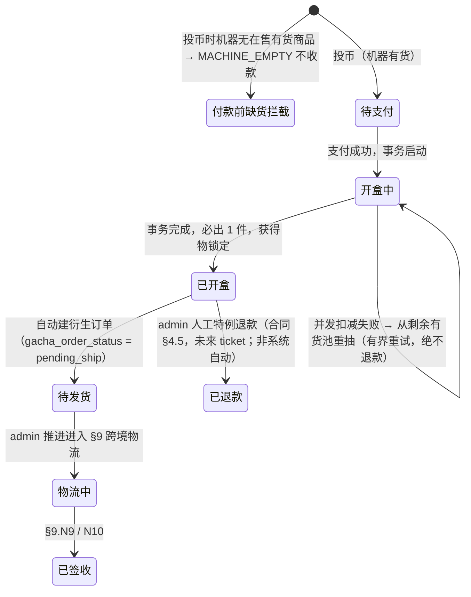
> **无系统自动退款分支**：开盒事务失败的后果是"重抽改派其他商品"（自循环边），不是退款。`refunded` 态只由 admin 人工特例触发（未来 ticket），扭蛋交易主流程不可达。

| 状态枚举（英文）| 中文 label | 阶段 |
|---|---|---|
| `pending` | 待支付 | 支付阶段 |
| `drawing` | 抽奖中 | 事务进行中（一般 < 200ms，UI 不渲染该状态）|
| `drawn` | 已开奖 | 中奖物锁定 |
| `pending_ship` | 待发货 | 衍生订单 |
| `in_logistics` | 物流中 | §9 进行中 |
| `delivered` | 已签收 | §9 终态 |
| `refunded` | 已退款 | 特例 |

### 关键节点

| # | 节点 | 角色 | 发生什么 | 数据变更 |
|---|---|---|---|---|
| N1 | U 进扭蛋机列表 | U → S | GET `/api/gacha/machines` | — |
| N2 | U 进单机详情 | U → S | GET `/api/gacha/machines/{id}`（含奖品池 + 实时归一化概率） | — |
| N3 | U 看概率公示 | U | 底部折叠区展示当前在池奖品的归一化概率（**不是后台配置原值**）| — |
| N4 | U 点投币 | U → S | **付款前缺货拦截**：校验机器 `status=on_shelf` 且至少 1 个 prize `stock_remain>0`；整机无货 → 返回 `MACHINE_EMPTY` 不收款（文案「暂时缺货」）；有货 → 弹支付确认（金额 + 规则二次确认）| — |
| N5 | 调统一支付 | S → W | §6.N2 / §6.N3 | gz_pay_transaction `status = pending` |
| N6 | 支付成功 + 开盒事务 | W → S | §6.N6 业务回调到开盒。**事务流程（必出 1 件，失败重抽不退款）**：①BEGIN TRANSACTION → ② `SELECT prize FROM gz_gacha_prize WHERE machine_id=? AND enabled=1 AND stock_remain>0 FOR UPDATE` 锁所有在售有货候选 → ③ 归一化候选权重 → ④ 随机出 1 个 → ⑤ `UPDATE gz_gacha_prize SET stock_remain=stock_remain-1, version=version+1 WHERE id=? AND version=? AND stock_remain>0`（乐观锁）；**affected=0（被并发抢空）→ 把该商品移出候选 + 回到 ③ 重新归一化重抽（有界重试，绝不退款）** → ⑥ INSERT `gz_gacha_draw`（含获得物 snapshot：名称 / 封面 / 稀有度 / 公示价值）→ ⑦ INSERT/UPSERT `gz_user_gacha_collection`（图鉴 +1）→ ⑧ INSERT `gz_gacha_order`（衍生订单，status=pending_ship）→ ⑨ COMMIT。**付款前已拦缺货 → ② 候选恒非空；运营保证整机不全空**| 4 表变更原子 |
| N7 | mp 拉开盒结果 | mp → S | GET `/api/gacha/draw/{transaction_id}` 返回获得物 snapshot | — |
| N8 | 出奖动画 + 揭晓 | U | mockup gacha-draw.html：转动 → 裂开光爆 → 揭晓稀有度光晕（SSR/SR/R/N 各自光晕 token）| — |
| N9 | 推图鉴进度 | U | 揭晓后强提示「集齐特典进度 +1」（伏笔 me-collection）| `gz_user_gacha_collection` 在 N6.⑦ 事务内已 +1（用户 × 机器 × 商品）|
| N10 | 继续抽 or 进订单 | U | 用户可选 N4 重复 / 跳订单 | — |
| N11 | admin 进入跨境物流推进 | A → S | 衍生订单进入 §9（甲方手动切换 in_japan / 录单号 → in_china_dispatching）| gacha_order.status = in_logistics |
| N12 | 已签收 | U / S | §9.N5 终态 | gacha_order.status = delivered |

### 并发与防超卖

> 三层防超卖（DB 事务 + `SELECT FOR UPDATE` + 乐观锁 version）防的是"**同一商品超卖**"；扣减失败的后果改为"**改派其他商品重抽**"，不是退款。

| 场景 | 防护方式 |
|---|---|
| 同时多用户支付后并发抢同一最后一件（如最后 1 个 SSR）| N6.② `SELECT ... FOR UPDATE` 锁所有候选 + N6.⑤ 乐观锁 `version`：仅 1 个事务扣减成功拿到该 SSR；其余 affected=0 → **回 N6.③ 从剩余有货池重新归一化重抽，各自得其他有货商品**（非退款）|
| 后台运营在开盒瞬间下架机器 | 已进入 N6 事务的请求继续完成（不回滚机器下架）；新发起的 N4 在付款前校验机器 status=on_shelf 拦截 |
| 单品在付款前→开盒间隙被抢空 | 付款前已校验整机有货（N4）；开盒时该单品 N6.② 不进候选 / N6.⑤ 扣减失败 → 重抽改派其他有货商品（候选恒非空，运营保证整机不全空）|
| 同一支付回调被微信多次推送 | §6.N6 幂等基于 transaction_id；开盒事务幂等基于 `pay_transaction_id` 唯一索引在 gz_gacha_draw |

### 异常分支

| 异常 | 触发条件 | 回退动作 | 用户视感 |
|---|---|---|---|
| E1 付款前整机无货 | N4 校验机器无任何在售有货商品 | 返回 `MACHINE_EMPTY`，**不收款**（缺货只在掏钱前发生）| 「暂时缺货」|
| E2 支付中网络断开 | N5 后 mp 关闭 | N6 异步触发；用户重进订单页能看到结果 | — |
| E3 后台运营改概率配置（瞬时）| A 改 `gz_gacha_prize.weight` 时正好有用户 N6 事务进行中 | 事务已 SELECT FOR UPDATE 锁住快照 → 用旧权重出（一致性优先）| — |
| E4 概率公示不一致 | C 端展示**实时归一化**而非配置原值 | 不修复 — 这是合规要求（PRD §M2 §异常分支）| — |
| E5 某候选商品被并发抢空，乐观锁扣减失败 | N6.⑤ affected=0 | **不退款**：把该商品移出候选 → 回 N6.③ 重新归一化重抽（有界重试），必出 1 件 | 无感（仍得 1 件商品）|
| E6 开盒记录 / 衍生订单写入失败 | N6.⑥ / ⑧ 失败（DB 异常等系统级故障，非库存竞争）| 事务整体 ROLLBACK；支付回调按 §6.E2 重试该开盒事务（重试仍失败才走 §6.E2 兜底，扭蛋域不主动退款）| — |
| E7 admin 改商品名/图后历史开盒记录受影响 | A 改 `gz_gacha_prize` 字段 | N6.⑥ 已 snapshot 获得物到 `gz_gacha_draw`，历史记录不受影响 | — |
| E8 整机售罄运营未及时补货（极端事故）| 运营保证不发生；防御性 auto_off | 不出现用户侧退款 UX；如已收款待开盒卡住，由 admin 人工特例退款（合同 §4.5，未来 ticket）| — |

### 合同 / PRD 引用

- PRD §M2 §用户故事 + §用户操作流程 §抽扭蛋主路径
- PRD §M2 §关键字段 § GachaMachine / GachaPrize / GachaDraw
- PRD §M2 §概率算法 + §并发与防超卖 + §异常分支
- PRD §M2 §业务本质（必出 1 件 / 不抽空 / 缺货付款前拦截 / 失败重抽不退款）
- PRD §4.1 扭蛋规则（必出 / 概率公示 / 不保底 / 单品售罄从随机池剔除）
- PRD §5.2 「**不做扭蛋代币 / 积分兑换**」（V1.0/V1.1 都不做，v2 候选）
- 合同 §2.1 第二期（一）「业务线 B（扭蛋机）交易模块」
- 合同 §4.5 admin 人工特例退款（未来 ticket，非扭蛋交易主流程）
- tokens.md §1.4 稀有度色 + doc/13 §3.2 三段分镜动画 token

### 涉及 ticket

- GZ-GACHA-101 扭蛋机 + 奖品池数据模型
- GZ-GACHA-102 微信端扭蛋机列表
- GZ-GACHA-103 微信端单机详情 + 概率公示
- GZ-GACHA-104 抽奖事务 + 防超卖
- GZ-GACHA-105 微信端抽奖动画 + 结果展示
- GZ-GACHA-106 微信端抽奖历史
- GZ-GACHA-107 集齐特典 / 图鉴模块
- GZ-ADMIN-102 扭蛋池管理（admin 端）
- ~~GZ-ADMIN-107~~ 火花券店 — **V2 候选，V1.0/V1.1 不实施**（C3）

### 待澄清问题

- **Q8.2**：mockup `me-collection.html` 图鉴模块 PRD M2 未明确，但 tokens.md §9 写「收集驱动 > 单抽欲望」。**裁定**：图鉴属于 V1.1（GZ-GACHA-107 = P1），V1.1 实现简版（按机器分组展示已得奖品 + 集齐徽章），深化推 v2。
- **Q8.3**：「保底」机制是否要在 schema 层预留？PRD 明确「MVP 不做」。**默认不预留**字段；如未来要做（v2 候选 V2-03），通过新增 `gz_gacha_pity` 表关联 user × machine 计数器实现，不动 `gz_gacha_prize` 表。
- **Q8.4**：「集齐特典」徽章是否影响后续抽奖（如「集齐后可解锁隐藏机器」）？PRD 未明示，tokens.md 也只是动画提示。**默认仅展示徽章**，不解锁任何功能；解锁逻辑推 v2。
- **Q8.5**：抽奖记录展示「公示价值」（参考价）的来源？PRD 标「可空」。**默认 admin 填，用户端可见**；空时不展示。

> Q8.1（火花券店）已在 C3 裁定为 V2 候选，从本节移除。

---

## §9. 跨业务订单聚合 + 跨境物流流（M5-V1.1，V1.1）

### 触发条件

- A：admin 端订单列表手动切换订单 logistics_status（`in_japan` → `in_china_dispatching`），切到 `in_china_dispatching` 时必填快递公司 + 单号
- U：从「我的」→「我的订单」tab 进入订单聚合列表
- U：进订单详情看简化状态 + （若已发往中国）快递单号 + 快递公司，自行去快递公司官网/小程序查物流

### V1.0 / V1.1 边界

- **V1.0**：会员中心订单 tab 占位（§4.N8），实数据接入 V1.1
- **V1.1**：订单聚合统一接口 + 订单详情统一布局 + 跨境物流简化 2 态 + 快递单号展示

### 跨境物流权威状态（C1 裁定，2026-05-26）

| # | 状态（中文）| 状态（英文枚举）| 含义 | 谁触发 | UI 显示 |
|---|---|---|---|---|---|
| L1 | 在日本 | `in_japan` | 订单已支付，货物在日本（**备货 / 等待发货 / 已发出但尚未到中国统一显示「在日本」**，不再细分）| 系统（订单建单即此态）+ 甲方手动维持 | mp 详情仅显示「在日本」 |
| L2 | 已发往中国 | `in_china_dispatching` | 已交国内快递，**仅显示快递公司 + 单号**，用户自查 | 甲方手动切换 + **必录快递公司 + 单号** | mp 详情显示「已发往中国」+ 快递公司 + 单号 + 「复制单号」按钮 |
| L3 | 已签收 | `delivered` | 用户已收货 | 系统 7 天自动 / 用户主动确认 | mp 详情显示「已签收」 |

> **裁定要点（C1）**：
> - **取消 v0.1 的 7 节点状态机概念**（待采购 / 日本备货 / 日本发出 / 国内清关 / 国内仓 / 国内派送 / 已签收）
> - **不集成快递 100 / 快递鸟等第三方轨迹抓取**（系统不存物流节点流转明细）
> - **不展示「日本→中国」的中间过程节点**（用户视角扁平化）
> - **国内物流仅展示甲方手动录入的快递公司 + 单号**，UI 不显示节点流转
>
> 上述裁定是合同 §2.3 第 4 / 5 项的口头约定升级版（合同 v0.1 写"7 节点"，doc/10 v0.2 直接覆盖；PRD v1.0 签字时同步把合同条款也对齐）。

### 前置依赖

- §7 / §8 业务订单已支付（`paid` / `drawn` 状态）
- §1 微信登录

### 状态机（订单物流 logistics_status，跨业务通用）

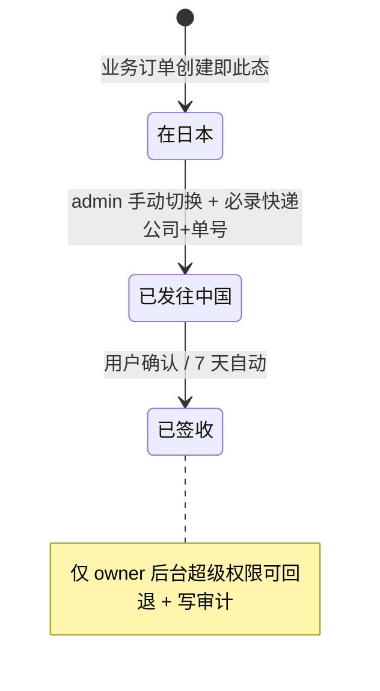

> **状态不可回退**（除 owner 超级权限）。回退操作写 `gz_logistics_audit` 审计表（保留）。

### 关键节点

| # | 节点 | 角色 | 发生什么 | 数据变更 |
|---|---|---|---|---|
| N1 | 业务订单创建 | S | §7.N6 / §8.N6 建单时 logistics_status 默认 `in_japan` | 订单 `logistics_status = in_japan` |
| N2 | admin 切到「已发往中国」| A → S | admin 端订单详情/列表点「发往中国」→ 弹表单必填快递公司 + 快递单号 → 确认 | UPDATE 订单 `logistics_status = in_china_dispatching` + `cn_carrier_code` + `cn_tracking_no`；写 `gz_logistics_audit` 一条 + ops log |
| N3 | U 进订单详情 | U → S | GET `/api/user/orders/{id}` 含简化状态 + （若 L2）快递公司 + 单号 | — |
| N4 | U 复制快递单号 | U | 详情页「复制单号」按钮 → 粘贴到对应快递公司官网 / 微信公众号查询 | — |
| N5 | 自动签收 | S | 凌晨 cron 扫 `in_china_dispatching > 7 天` 订单 → `logistics_status = delivered` | — |
| N6 | U 主动确认收货 | U → S | 详情页「确认收货」按钮（仅 in_china_dispatching 显示）→ 立即 `delivered` | — |
| N7 | 订阅消息推送（可选）| S → W | 进入「已发往中国」/「已签收」节点时推订阅消息 | — |
| N8 | owner 物流回退 | A → S | admin 后台超级权限「回退到上一态」 | 状态回退 + 写 `gz_logistics_audit` |
| N9 | admin 编辑快递单号 | A → S | admin 改 `cn_carrier_code` / `cn_tracking_no` | UPDATE 字段 + 写 `gz_logistics_audit` |

### 跨业务订单聚合（V1.1 GZ-USER-101/102）

```
预购订单（gz_ord_order）──┐
                         ├──→ 统一订单聚合接口 ──→ 会员中心订单 tab
扭蛋订单（gz_gacha_order）─┘    /api/user/orders
                              （按业务类型 + 时间倒序）
```

**统一订单字段（跨业务）**：
- `order_no`（统一订单号 `<域>-yyyyMMdd-序号`）
- `business_type`（preorder / gacha）
- `product_snapshot`（商品名 / 封面 / 规格或扭蛋机名 / 中奖物 + 稀有度）
- `total_amount`
- `business_status`（业务侧状态，按 §7/§8 各自枚举）
- `logistics_status`（统一 2 态枚举 `in_japan` / `in_china_dispatching` / `delivered`，见附录 A.7）
- `cn_carrier_code` / `cn_tracking_no`（L2 后才有）
- `address_snapshot`（收货地址 snapshot）
- `created_at` / `paid_time` / `delivered_time`（字段名以 doc/11 §6.4 时间命名钉死为准：业务态时间点用 `_time`，禁用 `paid_at` / `delivered_at`）

### 异常分支

| 异常 | 触发条件 | 回退动作 | 用户视感 |
|---|---|---|---|
| E1 用户在已签收前一直没收到 | U 投诉客服 | 客服判断 → owner 后台手动回退状态（N8）| C 端看到状态回退 |
| E2 快递单号录错 | A 录错 | admin 编辑（V1.1 GZ-ADMIN-104，N9）；C 端实时刷新 | U 看到新单号 |
| E3 部分订单退款（极少数）| §6.N8 admin 触发 | 订单 `business_status = refunded`；`logistics_status` 独立记录最后态 + UI 显示「已退款」覆盖 | UI 显示「已退款」 |
| E4 自动签收时用户尚未收到 | 7 天定时签收偏早 | U 可联系客服走 N8 回退；V1.1 不在 C 端给「我没收到」反馈入口（推 v2）| — |
| E5 admin 误切「已发往中国」但忘录单号 | UI 限制：表单必填快递公司 + 单号，否则按钮 disabled | — | — |
| E6 推进时订单状态不允许（如已退款 / 已签收）| A 在订单详情切状态时 | 后端校验 business_status 拦截该单 + 提示「该订单当前状态不可推进物流」 | A 看到单条提示（逐单操作，无批次跳过）|

### 合同 / PRD 引用

- PRD §M5 §跨境物流（**v0.2 中 PRD 7 节点表 4.4 被本图 C1 简化为 2 态覆盖**，PRD v1.0 签字时同步对齐）
- 合同 §2.1 第二期（一）「会员中心订单聚合接入」
- 合同 §2.3 第 4 项跨境物流自动抓取**不做**（v2）+ 第 5 项国内物流仅展示单号
- 强约束 #14 / #15

### 涉及 ticket

- GZ-USER-101 订单聚合统一接口
- GZ-USER-102 订单详情统一布局
- GZ-USER-103 跨境物流简化 2 态 + 快递单号展示（C1：mp 详情显示 in_japan / in_china_dispatching + 快递公司 + 单号 + 复制按钮）
- GZ-USER-104 用户确认收货 + 自动签收
- GZ-ADMIN-103 订单管理（三类聚合）
- GZ-ADMIN-104 物流推进 = **订单详情逐单手动切 2 态 + 录单号**（无批次推进 / 无自动归集）。主形态**下沉 mp 店员端**（@SaCheckPermission + 同租户 1001），plus-ui owner 端兜底；详见决策下沉口径

### 待澄清问题

- **Q9.3**：订阅消息推送（N7）是否在 V1.1 实现？V1.1 简化后只有 2 个节点（已发往中国 / 已签收）值得推。**默认 V1.1 实现这 2 个节点推订阅消息**（依赖甲方提供订阅消息模板 ID）。
- **Q9.5**：admin 端切「已发往中国」的形态 → **逐单在订单详情手动切 + 录单号（每单单独录快递公司 + 单号）**。无"按批次自动归集"、无批次推进；快递单号本就一单一号，不存在批量录同一单号的场景。

> Q9.1（7 节点 mockup vs PRD 不一致）已在 C1 裁定为 2 态，从本节移除；Q9.2（批次定义） / Q9.4（扭蛋+预购批次合并）已随"批次推进"概念取消而失效。

---

## §10. 对账中心流（M7.8，V1.1 — 合同 §4.1 兑现核心）

### 触发条件

- A：每月 1-5 日，admin 进对账中心生成上月对账单
- A：每季度末月 15 日前，按合同 §4.2.3 合并支付分成
- S：每日凌晨定时跑批：通道侧流水 ↔ 系统侧订单的自动比对

### 业务核心

合同 §4.1 + §4.2：
- 4% 分成基数 = **实际到账流水 = GMV − 退款/退货 − 第三方支付通道手续费**
- 业务线 A（预定货品）+ 业务线 B（扭蛋机）**分别核算，不交叉冲抵**
- 非交易模块（拼豆 / 资讯 / 会员）不计入分成基数，走 §4.6 月度维护费 ¥3000

### 前置依赖

- §6 业务支付（gz_pay_transaction 全量数据）
- §7 / §8 业务订单
- 甲方按月提供微信商户后台导出对账单

### 状态机（对账单 reconciliation_status）

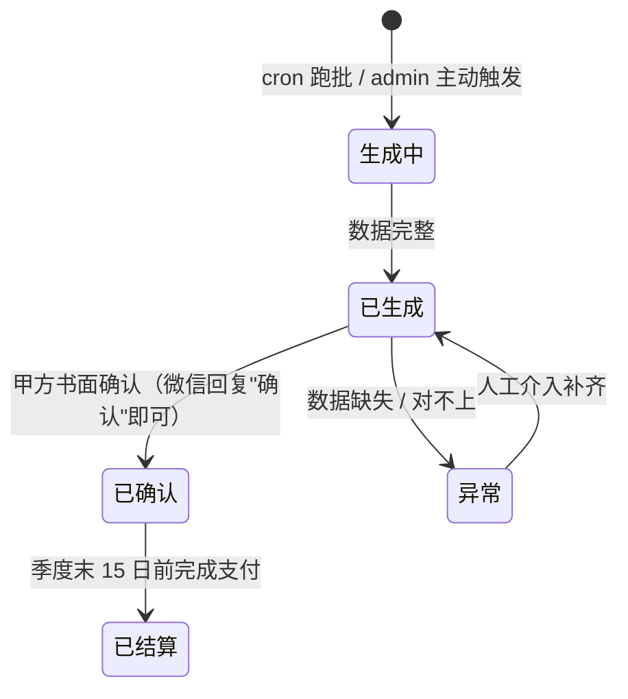

| 状态枚举（英文）| 中文 label |
|---|---|
| `generating` | 生成中 |
| `generated` | 已生成 |
| `confirmed` | 已确认 |
| `settled` | 已结算 |
| `exception` | 异常 |

### 关键节点

| # | 节点 | 角色 | 发生什么 | 数据变更 |
|---|---|---|---|---|
| N1 | 凌晨自动比对 | S | cron 每日 02:00 扫前一日 `gz_pay_transaction` 全量 vs 商户后台导出（人工每周导一次）→ 找差异 | 写 `gz_reconciliation_daily` |
| N2 | 月度对账单生成 | A → S / S | 每月 5 日前甲方提供上月对账单（合同 §4.2.1）；admin 端点「生成本月对账单」 | 写 `gz_reconciliation_monthly`，含 GMV / 退款 / 通道费 / 实际到账 4 项汇总 + 按业务线 A/B 分开 |
| N3 | 双方书面确认 | A | 甲方在微信回复「确认」（合同 §4.2.2 视为书面）| `status = confirmed` |
| N4 | 季度合并支付 | A | 每季度末月 15 日前合并支付该季度 3 月分成；同时支付 §4.6 月度维护费 ¥3000 × 3 | `status = settled` |
| N5 | Excel 导出 | A → S | admin 端点「导出 Excel」生成对账明细（每笔交易 / 金额 / 时间 / 状态 / 通道费明细） | — |
| N6 | 异常处理 | S → A | N1 比对发现差异 → 写 `gz_reconciliation_exception` → 推 admin 处理（人工补齐 / 复核）| — |
| N7 | 自核算兜底 | S → A | 合同 §4.2.4：甲方未按时提供对账单超 7 自然日，乙方有权依小程序后台原始数据自行核算 | 由 Kevin 触发 |

### 异常分支

| 异常 | 触发条件 | 回退动作 | 用户视感 |
|---|---|---|---|
| E1 通道侧 vs 系统侧金额不一致 | N1 比对发现差异 | N6 写异常表 + 推送 admin；24 小时内人工复核 | admin 看异常列表 |
| E2 退款数据缺失 | 微信回调丢失 / 主动查单未跑 | §6.N7 主动查单兜底；24h 内补齐 | — |
| E3 甲方未按时提供对账单 | > 7 天未提供 | N7 乙方自核算 + 微信发送给甲方 + 3 自然日未反对视为认可（合同 §4.2.4）| — |
| E4 分账业务线归类错误 | 订单业务类型字段错误 | 数据契约层强约束：业务订单创建时 business_type 必填 + 枚举校验；对账时按 business_type 分类 | — |
| E5 退款发生在跨结算周期 | 上月已结算订单本月退款 | 退款金额在**发生退款的当月**核算（不追溯调整已结算月）| — |
| E6 通道费率变化 | 微信调整费率（极少）| 系统按 transaction 级实际 fee 字段（来自微信回调 raw）汇总，不依赖固定费率 | — |

### 合同 / PRD 引用

- PRD §M7.8 对账中心
- PRD §4.5 对账规则
- 合同 §4.1 分成比例与口径
- 合同 §4.2 结算节奏
- 合同 §1.5 实际到账流水定义
- 强约束 #16 4% 分成口径

### 涉及 ticket

- GZ-ADMIN-105 对账中心
- GZ-ADMIN-106 数据看板扩展

### 待澄清问题

- **Q10.2**：通道手续费如何 attribute 到业务线 A / B？同一笔微信支付的费率是统一的，但 A / B 业务线订单的 fee 应按订单粒度归属。**默认实现**：`gz_pay_transaction.fee` 字段在回调时记录该笔交易的微信侧 fee；对账时 SUM(fee) GROUP BY business_type。
- **Q10.4**：「业务线 A、B 不交叉冲抵」的实现细节：业务线 A 当月实际到账 = -100（极端情况退款多于收入）时分成为 0 还是负？**默认按 §4.1.1 — 任一业务线负流水不冲减另一业务线分成基数；业务线自身负流水时该月该业务线分成为 0**（不让乙方倒贴）。

> Q10.1（退款归属月份）已在 C4 裁定为按 refunded_time 当月核算，从本节移除；Q10.3（跨季度退款尾巴）随 Q10.1 失效。

---

## §11. 拼豆付费预约全流程（M4，⭐ V1.2 重头 — 推倒 §3 重做）

> 这是 V1.2 调整批次的核心。把拼豆从「免费 + A1-A10 具体座位 + Redis 座位锁」推倒重做为「**付费前置 + 座位类型库存配额模型**」。用户不再选具体座位号（A1/B3），只选**座位类型**（单人/双人/四人桌）；admin 按门店配每类型的数量 + 单价；某 `(类型, 日期, 时段)` 约满该类型数量即不可再约。
>
> **V1.0 仅成都拼豆店一家门店**（合同 §2.3 第 7 项硬约束）；多门店配置代码留接口、UI 隐藏。
>
> 关联 ADR：**ADR-0007 拼豆付费状态机**（status vs pay_status 关系 + 配额并发口径）/ **ADR-0008 座位类型配额模型**（废弃具体座位 + 旧数据迁移）。

### 触发条件

- U：从底部 tab「拼豆」入口进入（V1.2 去首页后「拼豆」为 tab1 落地页）/ 从「我的」→「我的预约」看历史
- A：admin 端「拼豆座位类型配额配置」配数量/单价 / 「预约管理」做核销
- S：支付回调 onPaid 触发预约 verified / 凌晨定时任务标 no_show

### 前置依赖

- §1 微信登录（authorized 状态）
- §2 微信支付通道已调通（V1.2 激活 `PayBusinessType.PINDOU`，§6 业务支付链路复用）
- 门店主数据已配置（沿用 GZ-BEAN-001：成都拼豆店一家）
- **座位类型配额已配置**（GZ-BEAN-013：`gz_bean_seat_type_config` 每门店每类型数量 + 单价）
- 时段模板已配置（沿用 `gz_bean_time_slot_template`）
- `gz_user.wechat_id` 字段就绪（GZ-USER-005，付款前采集用）

### 计费模型（核心 — 单笔单时段）

- **一笔预约 = 一行 `gz_bean_booking` = 1 座位类型 + 1 时段**（**无多单元、无累加、无 `gz_bean_booking_unit` 子表**）
- `seat_type` / `sess_date` / `slot_start` / `slot_end` 直接挂主表；用户需多类型 / 多时段 → **多次预约 = 多行 booking**（每行独立金额、独立配额计数、独立支付）
- **单笔金额** = 该座位类型单价（`gz_bean_seat_type_config.price_cent` 下单时 snapshot 进 `gz_bean_booking.amount_cent`，**单笔就一个值，不累加**）
- **实付** = 单笔金额 − 优惠券面额（下限 0，见 §12）；`gz_bean_booking.amount_cent` 记单笔价，`gz_bean_booking.discount_amount_cent` 记券抵扣，支付建单的 `gz_pay_transaction.amount_cent` = 实付

### 状态机（双状态机：业务 status + 支付 pay_status，见 ADR-0007）

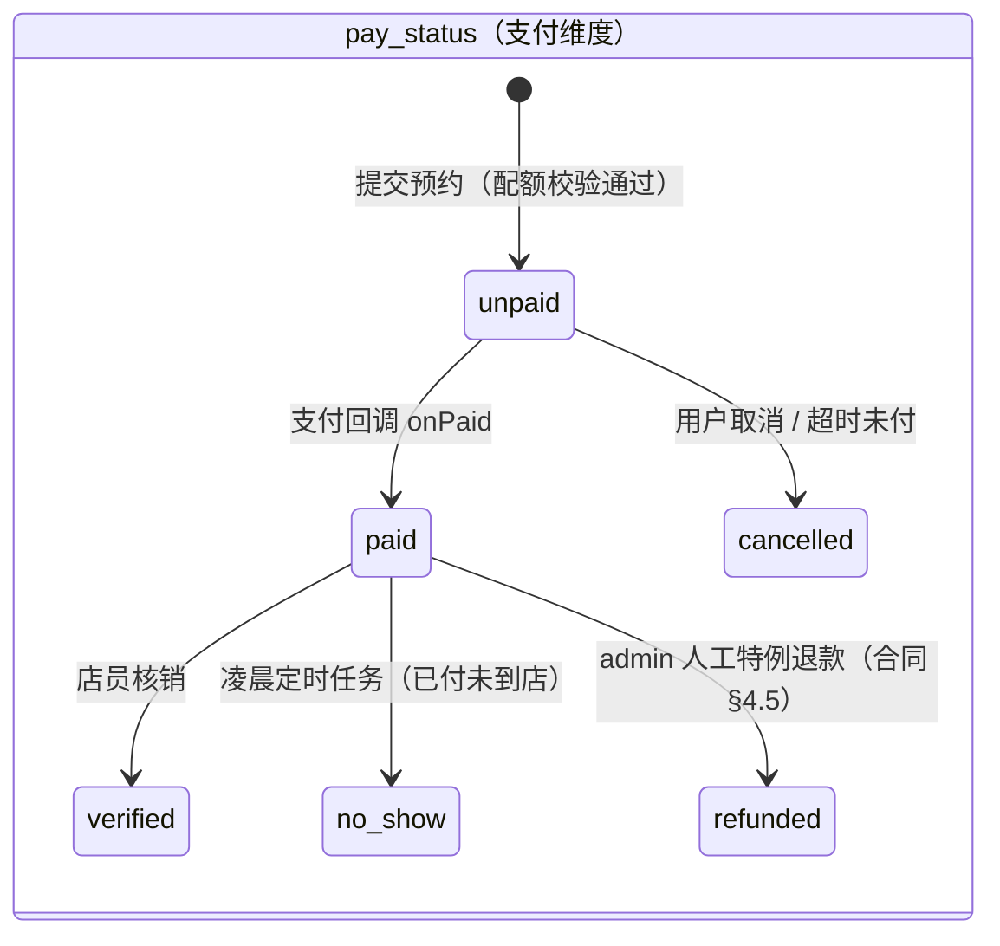

> **status vs pay_status 关系（ADR-0007）**：拼豆主单的业务状态由 `pay_status` 单状态机承载（不再像 §3 用独立 `status`）。`unpaid` 是中间过渡态（建单到支付间），**未支付的预约不占配额**（见并发口径）；`paid` 后才正式占该 `(类型,日期,时段)` 配额一个名额；`verified`=已核销终态；`no_show`/`cancelled`/`refunded` 为旁路终态。

| 枚举（pay_status）| 中文 label | UI 同义 | 触发事件 |
|---|---|---|---|
| `unpaid` | 待支付 | （提交后跳支付，UI 短暂态）| N7 提交预约成功（配额校验通过）|
| `paid` | 已预约 | upcoming（待到店）| N9 支付回调 onPaid |
| `verified` | 已核销 | used | N11 店员核销 |
| `cancelled` | 已取消 | cancelled | N12 用户取消 / N13a 超时未付 |
| `no_show` | 已过期 | （沿用 §3 designer 补样式）| N13b 凌晨任务（已付未到店）|
| `refunded` | 已退款 | refunded | admin 人工特例（合同 §4.5，未来 ticket）|

### 关键节点

| # | 节点 | 角色 | 发生什么 | 数据变更 | 副作用 |
|---|---|---|---|---|---|
| N1 | 进入拼豆首页 | U | tab「拼豆」→ bean/index 落地页（V1.2 单页合并选类型+时段+下单）| — | — |
| N2 | 选门店 | U | V1.0 仅 1 家 → 默认选中成都店，UI 隐藏切换 | — | — |
| N3 | 选 1 座位类型（实时显余量）| U → S | GET `/api/bean/type-slots?store_id&date` 返回各座位类型当日各时段的可约状态 + 单价 + **剩余配额**；mp 每类型卡渲染余量文案「**还剩 N 个单人座**」（余量>0）/「**已满**」灰显置灰（余量=0）；用户**单选**一个座位类型 | — | 选定后该类型单价即单笔金额 |
| N4 | 选 1 时段 | U → S | 在选定座位类型下展示该类型当日各时段的剩余配额；已满时段灰显；用户**单选**一个时段（与座位类型构成「1 类型 + 1 时段」一笔预约）| — | mp 展示单笔金额 = 该类型单价（**不累加**）|
| N5 | （可选）选优惠券 | U → S | 进 §12.N3 选 unused 代金券 → 实付 = 单笔金额 − 券面额（下限 0）| — | 见 §12 |
| N6 | 付款前采集手机号 + 微信号 | U → S | ① `gz_user.mobile` 为空 → 弹原生 `getPhoneNumber`（沿用 §1.N8）；② `gz_user.wechat_id` 为空 → 弹表单**手动填微信号**（GZ-USER-005，微信无 API 取微信号） | 更新 `gz_user.mobile` / `gz_user.wechat_id`；snapshot 到 booking | 两者都采集成功才能 N7 |
| N7 | 提交预约（下单事务）| mp → S | POST `/api/bean/booking` { store_id, date, seat_type, slot_start, slot_end, coupon_id? }（**单笔单时段，无 units 数组**）| **下单事务**（防超卖见下）：① 对该 `(store, seat_type, date, slot)` `SELECT COUNT(活跃 booking) FOR UPDATE` 比对 `gz_bean_seat_type_config.quantity` → ② 配额满 → **拒单**（回滚）→ ③ 写**一行** `gz_bean_booking`(pay_status=unpaid, seat_type + seat_type_snapshot + amount_cent=类型单价) → ④ 锁券（§12.N4 locked）→ ⑤ 建 `gz_pay_transaction`(business_type=pindou, amount_cent=实付) | 返回 prepay 五参 |
| N8 | mp 拉起支付 | mp → W | `wx.requestPayment`（JSAPI，复用 §6 业务支付）| — | — |
| N9 | 支付回调 onPaid | W → S | §6.N6 业务回调分发到拼豆（out_trade_no 前缀 `PINDOU-`）：`gz_bean_booking.pay_status = paid` + `paid_time`；券 `used`（§12.N5）；生成核销码（含签名）| 占该 `(类型,日期,时段)` 配额正式名额 | 返回预约 ID + 核销码 |
| N10 | 跳预约详情 | U | 展示门店 / 座位类型 + 时段 / 单笔实付 / 核销码二维码 / pay_status | — | — |
| N11 | 店员核销 | A → S | admin/店员端「预约管理」扫码或手动核销 → 校验签名 + 校验 pay_status=paid | `pay_status = verified` + `verify_time` + ops log | 触发用户「核销成功」 |
| N12 | 用户取消 | U → S | 详情页「取消预约」→ 二次确认 | unpaid 单：`cancelled`；paid 单是否可退按合同（V1.2 默认 paid 不自助退，引导客服）| 释放配额 + 解锁券（§12.N6）|
| N13a | 超时未付定时任务 | S | SnailJob 扫 `unpaid` 且超 N 分钟未付 → `cancelled` | 解锁占用的券（§12 locked→unused）| — |
| N13b | no_show 凌晨任务 | S | SnailJob 扫昨日 `paid` 未核销 → `no_show` | — | V1.2 不影响后续预约（无黑名单）|

### 并发与防超卖（ADR-0008 配额并发口径，按 booking 计数）

> **配额模型 = 库存配额（非具体座位锁）**。一笔预约 = 一行 `gz_bean_booking`（1 类型 1 时段）。防的是「某 `(store, seat_type, date, slot)` 活跃 booking 行数 ≥ `quantity`」时不可再约。**无子表，直接 COUNT 主表活跃 booking 行**。

| 场景 | 防护方式 | 兜底 |
|---|---|---|
| 多用户并发约同一 `(类型,日期,时段)` 最后名额 | N7 下单事务内 `SELECT COUNT(*) FROM gz_bean_booking WHERE store/seat_type/date/slot AND <活跃> FOR UPDATE` 比对 `quantity`，满则拒单 | V1 单店小量，**悲观计数足够**（ADR-0008）；不引入 Redis 座位锁（§3 的座位锁废弃）|
| 同一用户连点提交 | 后端业务层校验该用户该 `(类型,日期,时段)` 已有活跃 booking → 幂等返回原单 | — |
| 付款中单占配额 | 活跃口径 = `pay_status IN (paying, paid)`（ADR-0008）；`unpaid` **不占配额**（实现 submitPaid 直接置 paying，不经 unpaid 长期态）；paying 超时由 N13a 任务释放 | — |
| 配额校验是否含 unpaid | **含**（unpaid 暂占名额防超卖；超时未付由 N13a 回收）。活跃定义见 doc/11 §3.6 | — |

### 异常分支

| 异常 | 触发条件 | 回退动作 | 用户视感 |
|---|---|---|---|
| E1 配额满（提交瞬间被抢光）| N7 COUNT ≥ quantity | **拒单**（事务回滚）+ 返回该 `(类型,时段)` 已满 | 「[四人桌/下午] 已约满，请重选类型或时段」|
| E2 手机号/微信号采集失败 | N6 用户拒绝授权手机号 / 不填微信号 | 拒收 N7；提示需要联系方式 | 留在 N6 重试 |
| E3 座位类型被 admin 停用 | N7 校验 `gz_bean_seat_type_config.enabled=0` | 返回错误 | 「该座位类型已停用，请重选」|
| E4 支付超时未回调 | N8 后 5 min 无 onPaid | §6.N7 主动查单兜底；查到 paid 走 N9；仍未付 → N13a `cancelled` 释放配额+券 | 「支付超时，预约已取消」|
| E5 券已被其他单锁定 | N5/N7 选的券非 unused | 提示重选券或不用券 | 「优惠券不可用」|
| E6 核销码状态非 paid | N11 扫到 unpaid/cancelled/no_show/verified | 校验拦截 + 提示 | 店员看到对应状态文案 |
| E7 旧数据迁移异常 | 旧 §3 免费 booking 原地补 seat_type 失败 | GZ-BEAN-014 迁移脚本逐单校验（旧单本就单类型单时段，补 `seat_type` 兜底 `single` + 付费列）+ 失败留痕人工处理 | 用户无感（历史单只读展示）|

### 合同 / PRD 引用

- PRD §M4（V1.2 升付费 + 座位改类型配额，PRD v1.2 同步）
- 合同 §2.1 拼豆预约模块 + §2.3 第 7 项「V1.0 仅成都拼豆店一家门店」
- 合同 §4.1 分成口径：`business_type=pindou` V1.2 起产生真实支付流水，入对账（券面额不计 GMV）
- 强约束 #13 拼豆仅成都一家门店

### 涉及 ticket（V1.2）

- GZ-USER-005 `gz_user.wechat_id` 字段 + mp 资料页录入微信号
- GZ-BEAN-013 座位类型配额 config（`gz_bean_seat_type_config`）+ admin 配数量/单价 + 废弃具体座位预约用途
- GZ-BEAN-014 单笔单时段付费预约 + 付费状态机（pay_status）+ 余量查询接口 + 防超卖按 booking 悲观计数 + 旧数据迁移 + 激活 `PayBusinessType.PINDOU`
- GZ-BEAN-015 mp 拼豆页重构（选 1 类型【显余量】 + 选 1 时段 → 付款前采手机/微信号 → JSAPI 支付）
- GZ-COUPON-002/003 优惠券抵扣（见 §12）

### 待澄清问题

- **Q11.1**：paid 后的拼豆预约用户能否自助退款？V1.2 默认**不自助退**（引导客服，admin 走人工特例退款）。若甲方要自助退需评估反向退款链路（不同于 §14 反向打款）。
- **Q11.2**：unpaid 占配额的超时回收时长（N13a）取多少分钟？**默认 15 分钟**（与微信 JSAPI 订单超时对齐），SnailJob 扫描。
- **Q11.3**：同一用户对同一 `(类型,日期,时段)` 是否限重复预约（防恶意占配额）？**默认同一 `(类型,日期,时段)` 已有活跃 booking 即幂等返回原单**（不重复占名额）；跨时段 / 跨类型可多次预约（多行 booking），不设总数上限。

---

## §12. 优惠券流（M9，代金券 — V1.2，仅拼豆抵扣）

> V1.2 调整批次新增。**代金券**（固定抵扣额），**发放策略可扩展**（`manual` 手动选用户 / `register_window` 按注册时段 / `event` 业务事件如回收完成自动发），**仅拼豆付款抵扣**（`applicable_business='pindou'`，预留扩展其他业务）。升级 doc/11 附录 X.3 占位为正式 §优惠券域。
>
> **发放策略 SPI（决策4，ADR 接力 doc/11 §11.1.a）**：`ICouponIssuanceStrategy` 接口，按 `gz_coupon_template.issue_strategy` 路由 + `issue_config_json` 传参。**V1 仅实现 `manual` 全链路**，`register_window` 仅留接口（不实现逻辑），`event` 留**事件发布钩子**（§13 回收完成 paid 时发 `CouponIssuanceEvent`，监听骨架留位）。`issue_strategy` / `issue_config_json` 列 + SPI 路由 V1 即落库落代码，后续加策略只补一个实现不动 DDL。

### 触发条件

- A：admin「优惠券模板管理」建模板（含选发放策略 `issue_strategy`）+ 「发放」（`manual` 策略下选用户/名单批量发）
- U：拼豆付款页（§11.N5）选 unused 券抵扣
- U：「我的」→「我的优惠券」看券列表
- S：`register_window` 策略按注册时段自动发（预留，V1 不实现逻辑）
- S：`event` 策略业务事件触发自动发 — V1 落**回收完成发券钩子**（§13.N10 paid → `CouponIssuanceEvent`，监听骨架留位）
- S：SnailJob 扫过期券 → expired

### 前置依赖

- `gz_coupon_template`（模板）+ `gz_user_coupon`（用户券）就绪（GZ-COUPON-001）
- §11 拼豆付费链路（GZ-COUPON-002 抵扣依赖 BEAN-014 的下单事务）

### 状态机（用户券 gz_user_coupon.status）

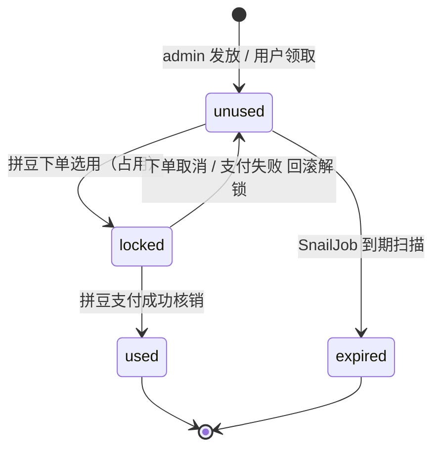

| 枚举（status）| 中文 label | 触发事件 |
|---|---|---|
| `unused` | 未使用 | N1 发放 / N7 解锁回滚 |
| `locked` | 锁定中 | N4 拼豆下单选用 |
| `used` | 已使用 | N5 拼豆支付核销 |
| `expired` | 已过期 | N8 SnailJob 到期 |

### 关键节点

| # | 节点 | 角色 | 发生什么 | 数据变更 |
|---|---|---|---|---|
| N1 | admin 建模板 | A → S | 填 name / `discount_type=cash`（V1 唯一）/ `amount_cent`（面额）/ `applicable_business=pindou` / `valid_days` / `total_quota` / **`issue_strategy`**（`manual`/`register_window`/`event`）+ **`issue_config_json`**（策略参数，如注册时段 / 事件类型，`manual` 可空）| 写 `gz_coupon_template`（template_no `CPN-`, status=active）|
| N2 | 发放（策略路由）| A/S → S | 按 `issue_strategy` 走 `ICouponIssuanceStrategy`：① **`manual`**（V1 实现）admin 选用户/名单批量发 → 校验 `issued_count + N <= total_quota`（乐观锁配额）；② **`register_window`**（预留）按 `gz_user.register_time` 落 config 区间自动发；③ **`event`**（钩子）监听 `CouponIssuanceEvent`（如回收完成 `recycle_paid`）按匹配模板发 | 批量写 `gz_user_coupon`（coupon_no `UC-`, status=unused, `amount_snapshot_cent` 从模板 snapshot, gained_time, expire_time=now+valid_days）；`gz_coupon_template.issued_count += N` |
| N3 | U 拼豆付款选券 | U → S | §11.N5 进选券页 → GET `/api/coupon/usable?business=pindou&total_amount` 返回该用户 unused 且未过期且面额可用的券 | — |
| N4 | 下单锁券 | mp → S | §11.N7 下单事务内：选中券 `unused → locked` + 记 `related_pay_out_trade_no` | `gz_user_coupon.status = locked` |
| N5 | 支付成功核销 | W → S | §11.N9 onPaid 业务回调事务内：`locked → used` + `used_time` | `gz_user_coupon.status = used` |
| N6 | 下单取消解锁 | U/S → S | §11.N12 用户取消 / §11.N13a 超时 → 解锁 | `gz_user_coupon.status = locked → unused` |
| N7 | 支付失败回滚 | S | §6.E2 支付回调业务事务失败 → 券回滚 | `locked → unused` |
| N8 | 过期扫描 | S | SnailJob 每日扫 `unused` 且 `expire_time < NOW` | `unused → expired` |

### 抵扣口径（钉死）

- **实付** = 拼豆单笔金额（该座位类型单价）− `amount_snapshot_cent`（**下限 0**，不找零、不抵成负）
- `gz_bean_booking.discount_amount_cent` = 实际抵扣额（= min(单笔金额, 券面额)）
- `gz_pay_transaction.amount_cent` = **实付**（券抵扣后），**券面额不计入 GMV / 分成基数**（合同 §4.1，对账时实付即流水）
- **不建独立 use 流水表**：用券痕迹靠 `gz_user_coupon.related_pay_out_trade_no` + status 反查

### 异常分支

| 异常 | 触发条件 | 回退动作 | 用户视感 |
|---|---|---|---|
| E1 发放超配额 | N2 `issued_count >= total_quota` | 乐观锁失败 + 提示 | admin 看「该模板已发完」|
| E2 券已被锁/用 | N3/N4 券非 unused | 选券列表只展示 unused；并发选中走乐观锁，失败提示重选 | 「优惠券已被使用」|
| E3 总价 < 券面额 | N4 下单 | 抵扣 = 总价（实付 0），券仍标 used（不退差额）| 「已抵扣 ¥X，实付 ¥0」|
| E4 支付事务失败但券已锁 | §11.N9 onPaid 异常 | N7 同事务回滚券 locked→unused | 用户重试时券可再用 |
| E5 券过期与下单竞态 | N4 锁券瞬间券恰好到期 | 下单事务内再校验 expire_time，过期则拒 + 提示 | 「优惠券已过期」|

### 合同 / PRD 引用

- PRD §M9（V1.2 新增优惠券章，PRD v1.2 同步）
- 合同 §4.1 分成口径：**券面额不计 GMV**，实付即流水
- 升级 doc/11 附录 X.3 占位 → 正式 §优惠券域

### 涉及 ticket（V1.2）

- GZ-COUPON-001 模板 + 用户券 + 脚手架 + 发放策略 SPI（`manual` 实现 + `register_window`/`event` 预留钩子）+ admin 发放
- GZ-COUPON-002 拼豆抵扣计算 + 过期 SnailJob
- GZ-COUPON-003 mp 选券 + 我的券列表

### 待澄清问题

- **Q12.1**：发放策略 V1.2 实现到哪？**V1 仅 `manual` 全链路**（admin 选用户/名单）+ `event` 事件发布钩子（回收完成发 `CouponIssuanceEvent`，监听骨架留位）；`register_window` 仅 SPI 接口存在不实现逻辑。「用户主动领取（领券中心）」推后。甲方定策略后补一个 `ICouponIssuanceStrategy` 实现即生效，不动 DDL。
- **Q12.2**：一单是否可叠加多张券？**V1.2 默认单单仅 1 张券**（实付下限 0），多券叠加推后。
- **Q12.3**：`discount_type` 预留 `percentage`（折扣率）扩展点，V1 仅 `cash`（固定额），schema 留字段不实现折扣逻辑。

---

## §13. 回收预约全流程（M10，⭐ V1.2 — 自动估价 + 店员核对 + 反向打款）

> V1.2 调整批次新增。用户线上预约「卖谷子给店」：填产品信息 + **拍照上传实物**（必填）→ 后台价目表**自动估价** + 按数量**匹配时长** → 选到店时段 → 提交 → 到店店员核对实物 + **再次拍照存证** + 微调最终金额 → 确认无误 → **触发反向打款**（§14 商家转账到零钱）→ 到账。
>
> **两套照片**：① 用户提交时拍照 `submit_image_ids`（**必填**，门店据实物预估、核对前先看实物）；② 店员到店核对时拍照 `verify_image_ids`（存证）。两套都存 `gz_file_object`（FK image_id）。

### 触发条件

- U：从底部 tab「回收」入口进入（V1.2 tab2）填单 / 「我的」→「我的回收记录」看历史
- A：admin「回收价目表管理」配品类×数量→单价 / 时长规则 / 「回收预约单管理」核对
- A/店员：到店核对实物 + 拍照 + 微调 final_amount + 确认（复用 ADR-0004 mp 店员端）
- S：confirmed_onsite 触发 §14 反向打款 / 凌晨任务标 no_show

### 前置依赖

- §1 微信登录 authorized
- `gz_user.mobile` + `gz_user.wechat_id`（收款联系方式 + receiver_openid，付款前采集，沿用 §11.N6）
- 价目表 + 时长规则就绪（GZ-RECYCLE-001：`gz_recycle_price_rule`）
- §14 反向打款链路（GZ-PAY-105，confirmed_onsite 触发）

### 状态机（gz_recycle_appointment.status）

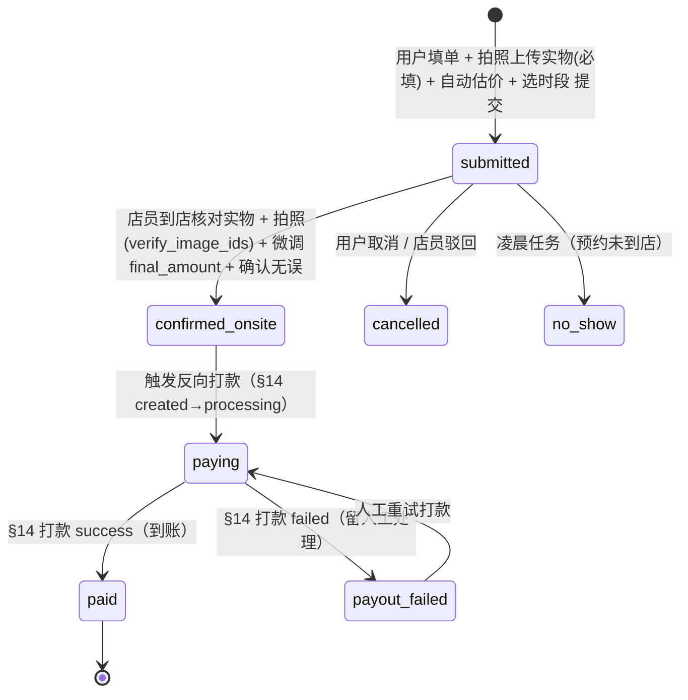

| 枚举（status）| 中文 label | 触发事件 |
|---|---|---|
| `submitted` | 待到店核对 | N5 用户提交（含 `submit_image_ids` 实物照，必填）|
| `confirmed_onsite` | 店员已确认 | N8 店员核对 + 拍照（`verify_image_ids`）+ 微调 + 确认 |
| `paying` | 打款中 | N9 触发 §14（created/processing）|
| `paid` | 已到账 | N10 §14 success |
| `cancelled` | 已取消 | N11 用户取消 / 店员驳回 |
| `no_show` | 已过期 | N12 凌晨任务（未到店）|
| `payout_failed` | 打款失败 | §14 failed（留人工，见 §14）|

### 关键节点

| # | 节点 | 角色 | 发生什么 | 数据变更 |
|---|---|---|---|---|
| N1 | U 进回收填单页 | U → S | tab「回收」→ recycle 填单页；GET `/api/recycle/price-rules` 拉价目表（品类 + 数量区间 + 单价 + 时长）| — |
| N2 | U 填产品信息 | U | 选品类（字典 `gz_recycle_category`）+ 填数量 + 描述 → 写入 `product_snapshot_json` | — |
| N2.5 | U 拍照上传实物（**必填**）| U → S | mp `chooseMedia` 拍/选实物照 → 上传腾讯云 COS（`usage_type='recycle_submit_image'`）→ 得 `gz_file_object.id` 列表 | 写 `gz_file_object`（实物照）；**至少 1 张才能提交**（前端 + 后端双校验）|
| N3 | 自动估价 + 匹配时长 | mp → S | 按 `gz_recycle_price_rule` 命中 `(category, qty 落 qty_min~qty_max)` → `estimated_amount_cent`（自动估）+ `matched_duration_minutes`（按数量自动匹配时长）| — |
| N4 | U 选到店时段 | U → S | 按匹配时长展示可约时段（时长冻结）→ 选 appt_date + slot | — |
| N5 | U 提交预约 | mp → S | 采集 mobile + wechat_id + receiver_openid（沿用 §11.N6）→ POST `/api/recycle/appointment`（**body 含 `submit_image_ids` 必填**）| 写 `gz_recycle_appointment`（appointment_no `RCY-`, status=submitted, product_snapshot_json, total_qty, matched_duration_minutes 冻结, estimated_amount_cent, appt_date/slot, **submit_image_ids 用户实物照（必填）**, mobile/wechat_id_snapshot, receiver_openid）|
| N6 | U 到店出示预约 | U → A | 用户到店给店员看预约号/二维码 | — |
| N7 | 店员核对实物 | A → S | 店员端按 appointment_no 调出预约 + 核对实物数量/品相 | — |
| N8 | 店员拍照 + 微调 + 确认 | A → S | 拍实物照（image_id FK `gz_file_object`）+ 按实物微调 `final_amount_cent`（默认= estimated，可改）+ 确认无误 | `verify_image_ids` + `final_amount_cent` + `verified_by` + `verify_time`；`status = confirmed_onsite` + ops log |
| N9 | 触发反向打款 | S | confirmed_onsite → 进入 §14：建 `gz_pay_payout_transaction`（business_type=recycle, business_order_no=appointment_no, receiver_openid, amount_cent=final_amount_cent）| `status = paying`（§14 created→processing）|
| N10 | 到账 + 发券钩子 | S | §14 打款 success 回写 `status = paid`；同事务/事务后**发 `CouponIssuanceEvent`**（`event_type='recycle_paid'`，§12 `event` 策略监听骨架消费，V1 仅留位）| `status = paid` |
| N11 | 取消 / 驳回 | U/A → S | 用户 submitted 时取消 / 店员核对后驳回（如实物与描述严重不符）| `status = cancelled` + 原因留痕 |
| N12 | no_show 凌晨任务 | S | SnailJob 扫预约日已过仍 submitted | `status = no_show` |

### 估价口径（钉死）

- **估价** = 命中 `gz_recycle_price_rule` 的 `unit_price_cent × total_qty`（区间命中，区间不重叠校验见 doc/11）
- `estimated_amount_cent`（用户端展示的预估）≠ `final_amount_cent`（店员核对实物后的实付）：实物品相决定，店员可上下微调，**微调必留痕**（verified_by + verify_time + 拍照 image_id）
- **反向打款金额 = `final_amount_cent`**（不是估价），见 §14
- 回收**反向出账独立核算**（合同 §4.1：是「店付给用户」的钱，不计入 GMV，对账中心独立记回收支出）

### 异常分支

| 异常 | 触发条件 | 回退动作 | 用户视感 |
|---|---|---|---|
| E1 数量未命中任何价目区间 | N3 qty 超出所有 rule 区间 | 提示「该数量暂不支持线上估价，请到店咨询」或按最高区间封顶（按 admin 配置）| 「请联系客服」|
| E2 实物与描述严重不符 | N8 店员核对 | 店员驳回 → N11 cancelled + 原因 | 「预约已取消，原因：…」|
| E3 店员微调幅度过大 | N8 final 与 estimated 差异 > 阈值 | 仅留痕（不强制拦截）；owner 可在审计看异常微调 | 用户看到最终金额 |
| E4 打款失败 | §14 failed | `status = payout_failed`，**留人工处理**（不自动重试无限循环）；owner 介入重试 | 「打款处理中，请耐心等待」|
| E5 receiver_openid 缺失/无效 | N9 用户未授权/openid 失效 | 拦截打款 + 提示用户补授权 | 「请重新授权微信收款」|
| E6 用户已到店但店员忘确认 | 预约日结束仍 submitted | N12 误标 no_show → owner 可后台改回 confirmed_onsite 补打款 | — |
| E7 未上传实物照 | N5 提交时 `submit_image_ids` 为空 | 前端拦截提交 + 后端二次校验拒收（必填）| 「请先拍照上传实物再提交」|

### 合同 / PRD 引用

- PRD §M10（V1.2 新增回收章，PRD v1.2 同步）
- 合同 §4.1 分成口径：回收是反向出账（店付用户），独立核算不计 GMV
- ADR-0004 mp 店员端权限下沉（核对/拍照/确认复用 openid 绑 sys_user + RBAC）

### 涉及 ticket（V1.2）

- GZ-RECYCLE-001 价目表 + 时长规则 admin（`gz_recycle_price_rule`）
- GZ-RECYCLE-002 预约单 + 自动估价 + mp 填单页（含**用户提交拍照 `submit_image_ids` 必填**，`gz_recycle_appointment`）
- GZ-RECYCLE-003 店员核对 + 拍照（`verify_image_ids`）+ 触发打款 + **回收完成发 `CouponIssuanceEvent` 钩子** + admin 预约/打款单管理（复用 ADR-0004）
- GZ-PAY-105 反向打款链路（见 §14）

### 待澄清问题

- **Q13.1**：店员微调 final_amount 是否需 owner 二次审批（防店员舞弊）？**V1.2 默认不审批**（留痕审计兜底），高额可后续加阈值审批。
- **Q13.2**：自动估价区间外（E1）走「到店咨询」还是「按最高区间封顶」？**默认到店咨询**（不线上估），admin 价目表配置决定。
- **Q13.3**：回收是否限成都一店？**默认沿用拼豆口径仅成都一店**，多店推后。

---

## §14. 反向打款时序（M10-B，商家转账到零钱 V3 — V1.2）

> V1.2 调整批次新增。回收预约 confirmed_onsite 后，店**反向打款**给用户（微信「商家转账到零钱」V3 `/v3/transfer/batches`）。**真实环境前用 mock 跑通**（仿 ADR-0003 支付 mock 范式），商户「商家转账」权限到位后切真实。
>
> 关联 ADR：**ADR-0006 反向打款**（mock 降级 / out_payout_no 幂等 / 主动查单优先）。

### 触发条件

- S：§13.N9 回收预约 confirmed_onsite 触发建打款单
- S：SnailJob 主动查单（商家转账主靠主动查单，无强回调依赖）
- A：owner 对 payout_failed 单人工重试

### 前置依赖

- §13 回收预约已 confirmed_onsite（amount = final_amount_cent）
- `gz_user.wechat_id` / receiver_openid 就绪
- `IWechatPayClient` 扩 `transferToUserWallet(req)` + `queryTransferByOutNo(outNo)`（GZ-PAY-105）
- **新依赖** `com.wechat.pay.java...transferbatch` SDK（**待 Kevin 批准**，铁律 #8）；权限到位前 `gz.pay.client.mode=mock` 跑通

### 状态机（gz_pay_payout_transaction.status，独立 PayoutStatus 枚举）

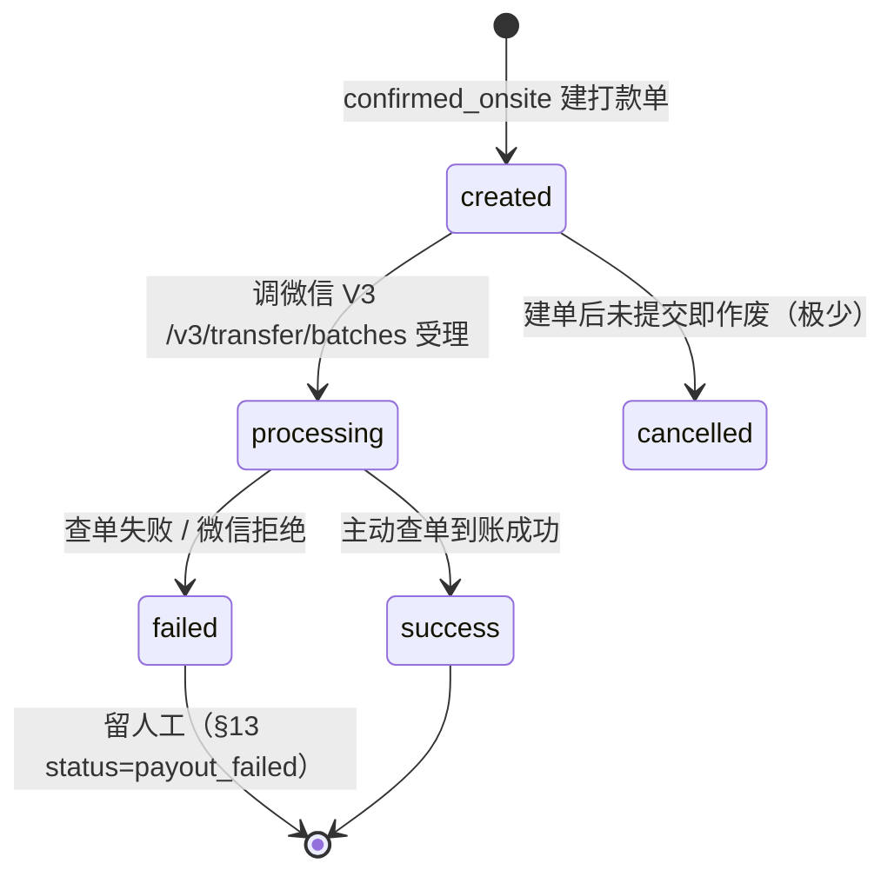

> **独立 PayoutStatus 枚举**（不复用 §6 支付的 transaction_status）：反向出账与正向收款语义相反，状态机独立。

| 枚举（status）| 中文 label | 触发事件 |
|---|---|---|
| `created` | 已创建 | N1 confirmed_onsite 建单 |
| `processing` | 转账受理中 | N2 调 V3 受理成功 |
| `success` | 转账成功 | N4 主动查单到账 |
| `failed` | 转账失败 | N5 查单失败/微信拒绝 |
| `cancelled` | 已作废 | 建单后未提交（极少）|

### 关键节点

| # | 节点 | 角色 | 发生什么 | 数据变更 |
|---|---|---|---|---|
| N1 | 建打款单 | S | §13.N9：INSERT `gz_pay_payout_transaction`（out_payout_no `PAYOUT-`, business_type=recycle, business_order_no=appointment_no, receiver_openid, amount_cent=final_amount_cent, status=created）| status=created |
| N2 | 调微信 V3 转账 | S → W | `IWechatPayClient.transferToUserWallet(req)` → POST `/v3/transfer/batches`（out_payout_no 幂等键）| 受理成功记 `payout_id` / `batch_id`（UNIQUE 幂等）；status=processing |
| N3 | 写回调日志 | S | `gz_pay_payout_callback_log`（仿 gz_pay_callback_log；商家转账主靠主动查单，回调辅助）| — |
| N4 | 主动查单 | S | SnailJob 周期 `queryTransferByOutNo(out_payout_no)` 查 processing 单 | 到账 → status=success + 回写 §13 status=paid |
| N5 | 查单失败 | S | 查到微信拒绝 / 余额不足 / 超时 | status=failed + 回写 §13 status=payout_failed（留人工）|
| N6 | owner 人工重试 | A → S | payout_failed 单 owner 在 admin「打款单管理」重试 | 新建打款单（新 out_payout_no）或修复后重发；旧失败单留痕 |

### 幂等与 mock（ADR-0006）

| 关注点 | 设计 |
|---|---|
| **幂等键** | `out_payout_no`（`PAYOUT-yyyyMMdd-序号`）+ DB UNIQUE(tenant_id, out_payout_no)；微信侧 `payout_id`/`batch_id` UNIQUE。重复触发同一 appointment 不重复转账（先查既有 created/processing/success 单）|
| **查单优先** | 商家转账**主靠主动查单**确认终态（不强依赖回调，回调仅辅助加速）|
| **mock 降级** | `gz.pay.client.mode=mock` → `transferToUserWallet` 直接返回模拟受理 + 查单模拟 success（仿 ADR-0003）；跑通 created→processing→success 全链路 + failed 分支单测 |
| **真实切换 gate** | 商户「商家转账」权限到位 + transferbatch SDK 经 Kevin 批准 → `mode=real`；上线前小额真实回归 |

### 异常分支

| 异常 | 触发条件 | 回退动作 | 用户视感 |
|---|---|---|---|
| E1 重复触发打款 | §13 confirmed_onsite 被重复触发 / 重试 | N1 先查 appointment 既有非 failed 打款单，存在则不重建（幂等）| — |
| E2 微信受理成功但查单未到账 | N2 后 processing 持续 | N4 SnailJob 持续查单直到 success/failed；不超时自动失败（转账可能延迟）| 「打款处理中」|
| E3 商户余额不足 | N2/N4 微信返回余额不足 | status=failed + 告警 owner + §13 payout_failed | owner 充值后 N6 重试 |
| E4 receiver_openid 与商户不在同主体 | 转账校验失败 | status=failed + 提示 openid 主体问题（与登录 appid 同主体，见强约束 #12）| — |
| E5 mock 模式误上线 | 配置错 `mode=mock` 在 prod | 启动校验：prod profile 强制 `mode=real`（mock 仅 dev/staging）| — |
| E6 SDK 未批准强行接真实 | 铁律 #8 | 阻断：未批准前 `mode=real` 启动报错，仅允许 mock | — |

### 合同 / PRD 引用

- PRD §M10-B（V1.2 新增反向打款，PRD v1.2 同步）
- 合同 §4.1：回收反向出账独立核算（不计 GMV，对账中心记回收支出）
- 强约束 #8 不引未批准新依赖（transferbatch SDK 待批）/ #12 商户号挂甲方主体（转账同主体）
- ADR-0003 支付 mock 范式（被本流 mock 实现参照）/ ADR-0006 反向打款

### 涉及 ticket（V1.2）

- GZ-PAY-105 反向打款链路 + mock + payout 表（`gz_pay_payout_transaction` / `gz_pay_payout_callback_log`）+ 查单 SnailJob
- GZ-RECYCLE-003 confirmed_onsite 触发打款（见 §13）

### 待澄清问题

- **Q14.1**：transferbatch SDK 依赖 **待 Kevin 批准**（铁律 #8）；批准前全 mock。
- **Q14.2**：失败单是否自动重试？**默认不自动重试**（避免重复转账风险），失败留 payout_failed 由 owner 人工 N6 重试（新 out_payout_no）。
- **Q14.3**：主动查单 SnailJob 周期？**默认 1 分钟扫一次 processing 单**，连续查 N 次仍 processing 不自动判失败（转账到账可能延迟）。

---

## §15. 微信登录 + 资料采集 + 登录态续期流（M1-C，⭐ V1.2 — chooseAvatar + nickname + sa-token 长效）

> V1.2 调整批次新增。把 §1「微信登录」的资料采集与登录态部分**升级钉死**：① 头像昵称用 **`chooseAvatar` 按钮 + `<input type=nickname>`** 一次性采集存库（`getUserProfile` 已于 2022 废弃，只返匿名「微信用户」+ 灰头像，不能用）；② **登录态 = sa-token 长效 token + 静默 `wx.login` 续期**，用户不再频繁重登；③ 微信号 `wechat_id` **无 API 可取，只能手动填**。
>
> 关联 ADR：**ADR-0009 微信资料采集 + 登录态保持**（chooseAvatar+nickname 采集范式 / sa-token 长效 + 静默续期 / 头像落 COS 不存微信临时 URL）。

### 触发条件

- U：小程序启动 / 进入需登录的页面（无 token 或 token 失效）→ 静默 `wx.login`
- U：首次进「我的」资料页 / 拼豆付款前 → 触发资料采集（头像昵称 + 微信号）
- S：业务接口返回 401（token 过期）→ 静默续期，不踢用户

### 状态机（登录态 + 资料完整度）

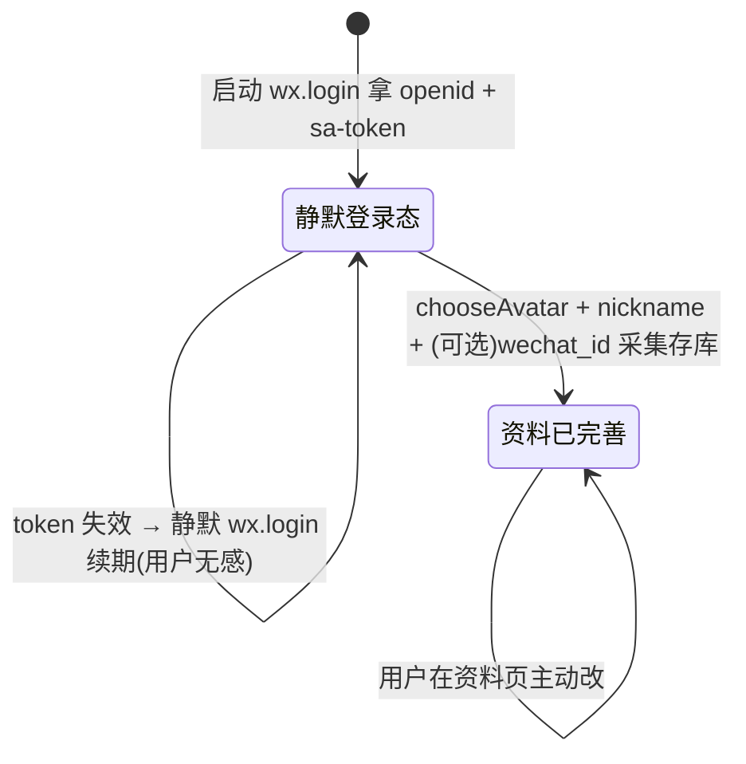

> **登录态与资料分离**：`wx.login` 静默拿 openid 即建立登录态（不需用户授权弹窗）；头像/昵称/微信号是**资料完整度**维度，按需采集，**采集一次落库之后不重复弹窗**。

### 关键节点

| # | 节点 | 角色 | 发生什么 | 数据变更 | 副作用 |
|---|---|---|---|---|---|
| N1 | 静默登录 | U → W → S | mp 启动 `wx.login()` 静默拿 `code`（无授权弹窗）→ 后端 `code2session` 拿 openid → 查/建 `gz_user` → 签 **sa-token 长效 token** | `gz_user` upsert（首次）| 返回 token，写 storage |
| N2 | token 失效静默续期 | S → mp → W → S | 业务接口 401 → mp 拦截器**静默重走 N1**（再 `wx.login` 拿新 code 换 token）→ 重放原请求 | token 刷新 | **用户无感，不踢回登录页** |
| N3 | 采集头像（chooseAvatar）| U → S | 资料页/付款前 `<button open-type="chooseAvatar">` 拿微信临时头像路径 → 上传**腾讯云 COS**（`usage_type='user_avatar'`）→ 写 `gz_user.avatar_image_id`（FK gz_file_object）+ 缓存 `avatar_url`（COS 可渲染 URL）| `gz_user.avatar_image_id` + `avatar_url` | **头像落 COS，不存微信临时 URL**（临时 URL 会失效）|
| N4 | 采集昵称（nickname）| U → S | `<input type="nickname">` 微信键盘联想 → 失焦提交 → 写 `gz_user.nickname` | `gz_user.nickname` | — |
| N5 | 填微信号（手动）| U → S | 资料页/付款前手动输入框填微信号 → 写 `gz_user.wechat_id`（**微信无 API 取微信号，只能手动填**）| `gz_user.wechat_id` | 拼豆付款前 snapshot 到 booking（§11.N6）|
| N6 | 资料页主动改 | U → S | 「我的」→ 资料完善页可重新 chooseAvatar / 改 nickname / 改 wechat_id | 更新对应字段 | — |

### 资料采集口径（钉死，ADR-0009）

- **头像**：只能 `chooseAvatar`（按钮触发）→ **上传 COS 持久化**（存 `avatar_image_id` + 缓存 `avatar_url`），**不存微信临时 URL**
- **昵称**：只能 `<input type="nickname">`（微信键盘联想），不能 `getUserProfile`（已废弃）
- **微信号**：微信**无任何 API** 可取微信号 → **用户手动填**（区别于手机号 `getPhoneNumber` 一键授权）
- **采集时机**：首次进资料页 / 拼豆付款前（缺什么补什么）；**采集一次落库不重复弹窗**
- **登录态**：sa-token 长效 + 静默 `wx.login` 续期；**token 过期不踢用户回登录页**，拦截器静默续期重放请求

### 异常分支

| 异常 | 触发条件 | 回退动作 | 用户视感 |
|---|---|---|---|
| E1 token 过期 | N2 业务接口 401 | 拦截器静默续期（N1）重放原请求 | **用户无感** |
| E2 静默续期也失败 | code2session 限流 / 网络异常 | 提示「网络繁忙，请稍后重试」；不死循环（限重试次数）| 短 toast |
| E3 用户拒绝授权头像 | N3 chooseAvatar 取消 | 保留默认占位头像，不阻断登录态；下次资料页可再采 | 头像显示默认占位 |
| E4 头像上传 COS 失败 | N3 上传异常 | 头像保 NULL（用默认占位），可重试；不阻断其他资料 | 「头像上传失败，可稍后重试」|
| E5 nickname 为空 | N4 用户未填 | 允许空（展示默认「谷子用户」）；拼豆付款不强制昵称（强制的是手机号 + 微信号）| — |
| E6 微信号未填 | N5 拼豆付款前为空 | 付款前强制补填（§11.N6 必须采集成功）；资料页非强制 | 付款前弹「请填写微信号便于门店联系」|

### 合同 / PRD 引用

- PRD §M1 §微信登录 + §M5 会员中心资料（V1.2 升资料采集 + 登录态，PRD v1.2 同步）
- 合同附件二：头像等用户素材存腾讯云 COS（国内合规）
- 强约束 #12：登录 appid 与支付/转账商户同主体

### 涉及 ticket（V1.2）

- GZ-USER-005 `gz_user.wechat_id` 字段 + mp 资料页手动录入微信号
- GZ-USER-006 微信资料完善（`chooseAvatar` + `nickname` 持久化 + 头像落 COS）+ 登录态 sa-token 长效 + 静默续期（ADR-0009）

### 待澄清问题

- **Q15.1**：sa-token 长效 token 有效期取多少？**默认 30 天**（`timeout`）+ 滑动续签；过期由静默 `wx.login` 兜底续期。具体值 ADR-0009 定。
- **Q15.2**：头像 COS 对象是否需定期清理（用户多次换头像产生孤儿对象）？**V1.2 默认不清理**（量小），后续可加 COS 生命周期规则。
- **Q15.3**：是否在 N1 静默登录即采集头像昵称？**否**（静默登录不弹窗）；资料采集独立于登录态，按需在资料页/付款前触发（缺什么补什么）。

---

## 附录 A. 状态枚举速查表（doc/11 引用基础）

> 本表是 doc/11-字段权威表.md 的字段值约束源。所有 DB enum / API contract 必须从此表派生。

### A.1 用户态

| 枚举 | 中文 label | 出现在 |
|---|---|---|
| `guest` | 未登录 | §1 |
| `browse_only` | 仅浏览模式 | §1 |
| `authorized` | 已授权登录 | §1 |
| `phone_bound` | 已绑手机号 | §1 / §3 |

### A.2 支付态（gz_pay_transaction.status）

| 枚举 | 中文 label |
|---|---|
| `created` | 已创建 |
| `pending` | 待支付 |
| `paid` | 已支付 |
| `timeout` | 支付超时 |
| `closed` | 支付关闭 |
| `failed` | 通道失败 |
| `refunding` | 退款中 |
| `refunded` | 已退款 |

### A.3 拼豆预约（gz_bean_booking.status）

| 枚举 | 中文 label | UI 同义 |
|---|---|---|
| `pending` | 已预约 | upcoming |
| `used` | 已核销 | used |
| `cancelled` | 已取消 | cancelled |
| `no_show` | 已过期 | （待 designer 补样式） |

### A.4 资讯（gz_news_article.status）

| 枚举 | 中文 label |
|---|---|
| `draft` | 草稿 |
| `scheduled` | 待定时发布 |
| `published` | 已发布 |
| `offline` | 已下架 |

### A.5 预购订单（gz_ord_order.status）

| 枚举 | 中文 label |
|---|---|
| `created` | 待支付 |
| `paid` | 已支付 |
| `cancelled` | 已取消 |
| `in_logistics` | 物流中 |
| `delivered` | 已签收 |
| `closed` | 已完成 |
| `refunded` | 已退款 |

### A.6 扭蛋（gz_gacha_draw.status / gz_gacha_order.status）

| 枚举 | 中文 label |
|---|---|
| `pending` | 待支付 |
| `drawing` | 开盒中 |
| `drawn` | 已开盒 |
| `pending_ship` | 待发货 |
| `in_logistics` | 物流中 |
| `delivered` | 已签收 |
| `refunded` | 已退款（仅 admin 人工特例，非系统自动）|

> 后端 enum / 字段命名保留 `draw` 技术语义（`gz_gacha_draw` / `drawing` / `drawn`）；UI 可见 label 用盲盒语义（开盒 / 已开盒 / 获得，禁抽奖 / 中奖 / 开奖）。

### A.7 物流（logistics_status，跨业务通用）— C1 简化为 2 态 + 终态

| 枚举 | 中文 label | 顺序 | 备注 |
|---|---|---|---|
| `in_japan` | 在日本 | L1 | 订单建单即此态；备货 / 等待发货 / 已发出但尚未到中国统一显示 |
| `in_china_dispatching` | 已发往中国 | L2 | 必伴随 `cn_carrier_code` + `cn_tracking_no` |
| `delivered` | 已签收 | L3 终态 | 用户确认 / 7 天 cron 自动 |

### A.8 对账（gz_reconciliation_*.status）

| 枚举 | 中文 label |
|---|---|
| `generating` | 生成中 |
| `generated` | 已生成 |
| `confirmed` | 已确认 |
| `settled` | 已结算 |
| `exception` | 异常 |

### A.9 业务类型（business_type，跨业务通用）

| 枚举 | 中文 label | 备注 |
|---|---|---|
| `preorder` | 预定货品 | V1.2 屏蔽入口保留代码 |
| `gacha` | 扭蛋机 | V1.2 权重放低保留做活 |
| `pindou` | 拼豆预约 | **V1.2 起产生真实支付流水**（付费前置，激活 PayBusinessType.PINDOU）|
| `recycle` | 回收预约 | **V1.2 新增**；反向出账（商家转账到零钱），独立核算不计 GMV（§14）|
| `test` | 通道测试单 | V1.0 通道 HelloWorld，不进对账 |

### A.10 扭蛋稀有度（gz_gacha_prize.rarity）

| 枚举 | 中文 label | 视觉 token |
|---|---|---|
| `SSR` | SSR | rarity-glow-ssr |
| `SR` | SR | rarity-glow-sr |
| `R` | R | rarity-glow-r |
| `N` | N | rarity-glow-n |

### A.11 文章分类（gz_news_article.category）

| 枚举 | 中文 label |
|---|---|
| `new_product` | 新品 |
| `activity` | 活动 |
| `guide` | 攻略 |
| `all`（虚拟）| 全部（仅前端 tab）|

### A.12 admin 角色（gz_sys_admin.role）

| 枚举 | 中文 label |
|---|---|
| `owner` | 主理人 |
| `staff` | 店员 |

### A.13 门店类型（gz_bean_store.type）

| 枚举 | 中文 label |
|---|---|
| `pindou` | 拼豆店（V1.0 唯一类型）|
| `guzi` | 谷子店（v2 预留）|

### A.14 拼豆付费态（gz_bean_booking.pay_status，V1.2 — §11）

| 枚举 | 中文 label | UI 同义 | 备注 |
|---|---|---|---|
| `unpaid` | 待支付 | （短暂过渡态）| **不占配额**（活跃 = pay_status IN paying/paid，ADR-0008）；实现直接置 paying |
| `paid` | 已预约 | upcoming | onPaid 后正式占配额名额 |
| `verified` | 已核销 | used | 终态 |
| `cancelled` | 已取消 | cancelled | 旁路终态 |
| `no_show` | 已过期 | （沿用 §3 designer 补样式）| 旁路终态 |
| `refunded` | 已退款 | refunded | admin 人工特例（合同 §4.5）|

> V1.2 拼豆主单业务状态由 `pay_status` 单状态机承载（ADR-0007），不再用 §3 的独立 `status`。座位类型枚举见 `gz_bean_seat_type`（`single` 单人 / `double` 双人 / `quad` 四人桌）。

### A.15 优惠券态（gz_user_coupon.status，V1.2 — §12）

| 枚举 | 中文 label | 备注 |
|---|---|---|
| `unused` | 未使用 | 发放即此态 |
| `locked` | 锁定中 | 拼豆下单占用 |
| `used` | 已使用 | 支付核销终态 |
| `expired` | 已过期 | SnailJob 到期终态 |

> 模板状态 `gz_coupon_template.status`：`active` 生效 / `paused` 暂停 / `archived` 归档。`discount_type`：V1 唯一 `cash`（代金券固定额），预留 `percentage`。

### A.16 回收预约态（gz_recycle_appointment.status，V1.2 — §13）

| 枚举 | 中文 label | 备注 |
|---|---|---|
| `submitted` | 待到店核对 | 用户提交 + 自动估价 |
| `confirmed_onsite` | 店员已确认 | 核对实物 + 微调 final_amount |
| `paying` | 打款中 | 触发 §14（created/processing）|
| `paid` | 已到账 | §14 success 终态 |
| `cancelled` | 已取消 | 用户取消 / 店员驳回 |
| `no_show` | 已过期 | 预约未到店 |
| `payout_failed` | 打款失败 | §14 failed 留人工 |

> 回收品类枚举见字典 `gz_recycle_category`（admin 价目表配置）。

### A.17 反向打款态（gz_pay_payout_transaction.status，V1.2 — §14，独立 PayoutStatus）

| 枚举 | 中文 label | 备注 |
|---|---|---|
| `created` | 已创建 | confirmed_onsite 建单 |
| `processing` | 转账受理中 | 调 V3 受理成功 |
| `success` | 转账成功 | 主动查单到账终态 |
| `failed` | 转账失败 | 留人工重试 |
| `cancelled` | 已作废 | 建单未提交（极少）|

> 独立枚举，不复用 A.2 支付态（反向出账语义相反）。`business_type='recycle'`，`business_order_no` = 回收预约 appointment_no。

---

## 附录 B. 跨流时序图（端到端用户旅程）

### B.1 V1.0 拼豆预约完整旅程（U + A 协同）

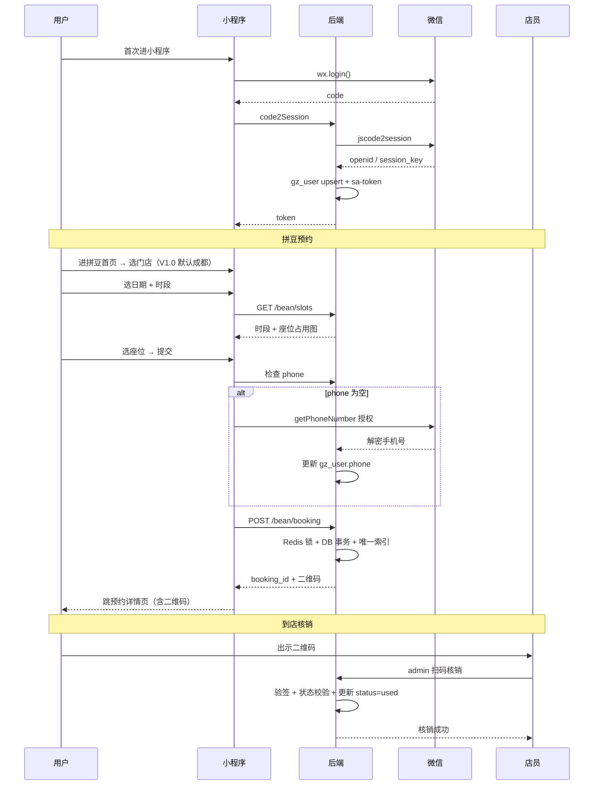

### B.2 V1.1 扭蛋抽奖完整旅程

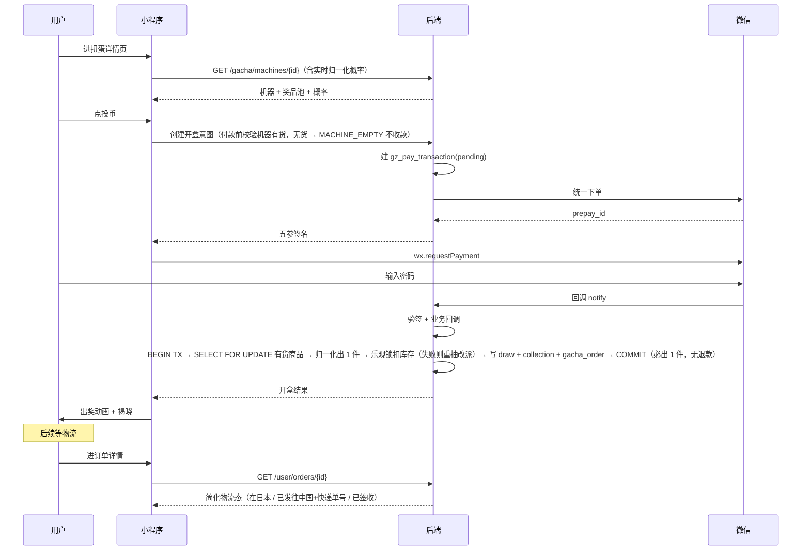

---

## 附录 C. 业务流 ↔ ticket 反查表

> 用 ticket 找 doc/10 章节用此表；用 doc/10 章节找 ticket 用各章节末尾的「涉及 ticket」段。

| Ticket | doc/10 章节 | V1.0/V1.1 |
|---|---|---|
| GZ-SYS-001 | §1 §2 §5（基础设施前置）| V1.0 |
| GZ-SYS-002 | §1 微信登录 | V1.0 |
| GZ-SYS-003 | §1 用户基础模型 | V1.0 |
| GZ-SYS-004 | （无独立流，全局浮层）| V1.0 |
| GZ-SYS-005 | §5 资讯（富文本图片）| V1.0 |
| GZ-SYS-006 | （横切，多流引用）| V1.0 |
| GZ-PAY-001 | §2 支付通道接入 | V1.0 |
| GZ-BEAN-001 ~ 010 | §3 拼豆预约 | V1.0 |
| GZ-USER-001 ~ 004 | §4 会员中心占位 | V1.0 |
| GZ-NEWS-001 ~ 004 | §5 资讯 | V1.0 |
| GZ-ADMIN-001 ~ 005 | （横切，admin 基础）| V1.0 |
| GZ-PAY-101 ~ 103 | §6 业务支付 | V1.1 |
| GZ-ORD-101 ~ 105 | §7 预定货品 | V1.1 |
| GZ-GACHA-101 ~ 107 | §8 扭蛋机 | V1.1 |
| GZ-USER-101 ~ 104 | §9 订单聚合 + 物流（C1 简化 2 态）| V1.1 |
| GZ-ADMIN-101 ~ 108 | §7 §8 §9 §10 各 admin 模块 | V1.1 |
| GZ-ADMIN-105 | §10 对账中心 | V1.1 |
| ~~GZ-ADMIN-107~~ 火花券店 | C3 裁定 V2 候选，**V1.0/V1.1 不实施** | V2 |
| GZ-ORD-110 | §7 预购下线（屏蔽入口保留代码）| V1.2 |
| GZ-GACHA-110 | §8 扭蛋权重放低（admin 调 weight）| V1.2 |
| GZ-USER-005 | §11 §15 gz_user.wechat_id + mp 资料页录入微信号 | V1.2 |
| GZ-USER-006 | §15 微信资料完善（chooseAvatar + nickname 持久化 + 头像落 COS）+ 登录态 sa-token 长效 + 静默续期 | V1.2 |
| GZ-BEAN-013 ~ 015 | §11 拼豆付费预约（座位类型配额 + 单笔单时段付费 + mp 重构）| V1.2 |
| GZ-COUPON-001 ~ 003 | §12 优惠券（代金券，发放 + 拼豆抵扣）| V1.2 |
| GZ-RECYCLE-001 ~ 003 | §13 回收预约（价目表 + 估价 + 店员核对）| V1.2 |
| GZ-PAY-105 | §14 反向打款（商家转账到零钱 + mock + 查单）| V1.2 |
| GZ-SYS-010 | tabbar 重构（拼豆/回收/我的 + 入口迁移，见 doc/12）| V1.2 |

---

## 附录 D. 全局待澄清问题（v0.2，Kevin C1-C4 裁定后收敛）

> 本表汇总各章节剩余的待澄清问题。**5/31 PRD v1.0 签字前**与甲方一次性书面确认；签字后本图升 v1.0。
>
> **v0.1 → v0.2 收敛**：5 个 ⚠️ 重大（Q7.1 / Q8.1 / Q9.1 / Q10.1 / Q3.1）+ 物流相关失效项（Q9.2 / Q9.4 / Q10.3）已随 C1-C4 裁定移除；Q3.1 拼豆 no_show 视觉缺口已转交 designer（不属于业务流权威范畴）。

### D.1 高优先级（⚠️ 重大，PRD v1.0 签字前必答）

> v0.2 已无剩余 ⚠️ 重大业务流歧义。Kevin C1-C4 已覆盖原 5 项重大；Q3.1（拼豆 no_show 视觉）已交 designer / doc/12 v0.2 处理。

### D.2 中优先级（PRD v1.0 签字时一次性书面确认，字段 / UI 细节）

| # | 问题 | 默认裁定 |
|---|---|---|
| Q1.1 | V1.0 是否实现退出登录 | 不实现，V1.1 候选 |
| Q1.2 | unionid 跨端识别 | V1.0/V1.1 都不跨端 |
| Q1.3 | 仅浏览模式可看哪些页 | 首页 / 资讯 / 拼豆首页 |
| Q2.1 | V1.0 测试单 out_trade_no 跟 V1.1 业务订单号统一？ | 统一 |
| Q2.2 | V1.0 是否做退款测试 | 做 |
| Q3.2 | 核销码：签名串嵌入 vs 短码 + 服务端 | 签名串嵌入 |
| Q3.3 | 拼豆取消时间限制 | 不限制（v2 候选）|
| Q3.4 | 拼豆 no_show 黑名单 | 不做（v2 候选）|
| Q3.5 | 核销码二维码 TTL | 无 TTL，状态判定 |
| Q3.6 | 用户换微信账号后旧预约 | 旧 openid 绑定，店员仍可核销 |
| Q4.1 | 会员中心是否有图鉴入口 | 无（属扭蛋 V1.1）|
| Q4.2 | me-profile mockup 缺口 | designer 5/29 前补 |
| Q5.1 | 资讯分类枚举固定 vs admin 扩展 | 枚举固定（v2 扩展）|
| Q5.2 | 阅读量防刷 | 不防（v2）|
| Q6.1 | 退款二级审批 | 无（owner 单点）|
| Q6.2 | 部分退款支持 | 仅全额（v2）|
| Q6.3 | 业务订单号格式 | `<域>-yyyyMMdd-序号` |
| Q7.2 | 预购 delivered vs closed 终态 | delivered 即终态 |
| Q7.3 | 购物车 V1.1 实现 | 不做（v2）|
| Q7.4 | 尾款数据契约预留 | 不预留 |
| Q8.2 | 图鉴 V1.1 范围 | 简版（按机器分组 + 集齐徽章）|
| Q8.3 | 保底机制 schema 预留 | 不预留（v2 新表）|
| Q8.4 | 集齐特典解锁功能 | 仅展示徽章 |
| Q8.5 | 「公示价值」展示 | admin 填 + 可见，空时不展示 |
| Q9.3 | 订阅消息推送 V1.1 范围 | C1 简化后：已发往中国 / 已签收 2 个节点（依赖甲方提供模板 ID）|
| Q9.5（v0.2 新增）| admin 切「已发往中国」单单切 vs 批量？ | 单单切 + 多选批量切都支持 |
| Q10.2 | 通道费 attribute 到业务线 | gz_pay_transaction.fee 按订单粒度记录 |
| Q10.4 | 业务线负流水冲抵 | 该月该线分成为 0，不倒贴 |

### D.3 v0.2 已裁定移除项（历史索引，便于追溯）

| # | 原问题 | 裁定 | 裁定日期 |
|---|---|---|---|
| Q7.1 | 预购支付模型：全款 vs 定金尾款 | **全款一次性付清**（C2 已对齐 v0.1 写法）| 2026-05-26 |
| Q8.1 | 火花券店 V1.1 做 vs v2 | **V1.0/V1.1 都不做，V2 候选**（C3）| 2026-05-26 |
| Q9.1 | 跨境物流 7 节点 PRD vs mockup | **取消 7 节点，简化为 2 态**（C1，覆盖合同 §2.3 第 4 项口头约定升级版）| 2026-05-26 |
| Q9.2 | 物流批次定义 | "批次推进"概念取消（C1 简化为单单 / 多选切换）| 2026-05-26 |
| Q9.4 | 扭蛋 + 预购批次合并推进 | 同 Q9.2 失效 | 2026-05-26 |
| Q10.1 | 退款归属月份 | **按 refunded_time 当日核算**（C4 已对齐 v0.1 写法）| 2026-05-26 |
| Q10.3 | 跨季度退款 | 同 Q10.1 失效 | 2026-05-26 |
| Q3.1 | 拼豆 no_show 状态在 mockup 缺视觉 | 字段层 4 态已 v0.1 定；UI 视觉转交 designer / doc/12 v0.2 | 2026-05-26 |

---

## 附录 E. 版本与变更

| 版本 | 日期 | 变更 |
|---|---|---|
| v0.4 | 2026-06-09 | 拼豆预约粒度修正 + 微信资料/登录态 + 优惠券多策略 + 回收用户拍照：§11 拼豆改**单笔单时段**（1 类型 + 1 时段 = 1 行 booking，删多单元累加 / `gz_bean_booking_unit` / 整单回滚；mp 选座**实时显余量**「还剩 N」/「已满」单选；防超卖按 booking 计数 vs 配额）；新增 §15 微信登录 + 资料采集（chooseAvatar + nickname 持久化）+ 登录态 sa-token 长效 + 静默续期；§12 优惠券发放改**多策略**（manual / register_window / event 回收自动发，SPI / V1 仅 manual + event 钩子）；§13 回收**用户提交拍照 submit_image_ids 必填** + 店员 verify_image_ids，回收完成发 `CouponIssuanceEvent` 钩子；附录 C 增 USER-006。关联 ADR-0007/0008（单笔单时段）/ ADR-0009（资料 + 登录态）。|
| v0.3 | 2026-06-08 | V1.2 调整批次 6 条工作流回写：新增 §11 拼豆付费预约（座位类型配额，推倒 §3）/ §12 优惠券 / §13 回收预约 / §14 反向打款；§3 标注被 §11 推倒；§7 预购标注 V1.2 屏蔽；§8 扭蛋标注权重放低保留做活；附录 A 新增 A.14-A.17 + A.9 增 recycle；附录 C 增 14 个 V1.2 ticket。关联 ADR-0006/0007/0008。|
| v0.2 | 2026-05-26 | Kevin 4 项裁定回写：C1 跨境物流 7 节点 → 简化 2 态（`in_japan` / `in_china_dispatching` / `delivered`）/ C2 预购全款已对齐 / C3 火花券店 V2 候选 / C4 退款归属当日已对齐；附录 D 高优先级 5 项 ⚠️ 重大归零；§9 整章重写；附录 A.7 物流枚举改 2 态 + 终态。|
| v0.1 | 2026-05-26 | 首次产出。10 个业务流 + 状态枚举速查表 + 跨流时序图 + ticket 反查表 + 38 个待澄清问题。基于 PRD v0.3 + 合同 SSR-GZYZ-2026-001 + 30 mockup 派生。 |

---

> **本图 v0.4 是 sensenran-guzi 项目的工程出厂蓝图。**
>
> **5/31 PRD v1.0 签字时，附录 D.2 剩余项与甲方一次性书面确认；签字后本图升 v1.0。**
>
> **5 个月后入职的新人只看本图 + doc/11-字段权威表.md + doc/12-UI-权威索引.md 即可掌握所有业务流、状态机、字段、UI 锚点 — 不需要再翻 PRD 或问 Kevin。**
