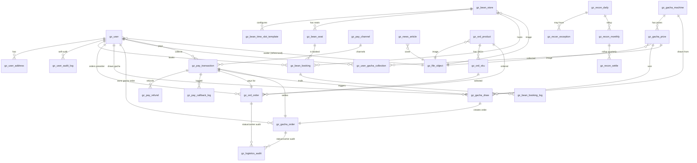

# 字段权威表 v0.2

> **本文档是 sensenran-guzi 项目"字段层"的权威**。所有业务表 DDL、Java 实体、TypeScript DTO、API 响应字段名必须从此表派生。
>
> **三权威分层**：
> - `doc/10-业务流权威图.md` — 回答「这个业务流怎么走 / 状态怎么转」
> - `doc/11-字段权威表.md` — 回答「这个字段叫什么 / 类型是什么 / 怎么算 / 怎么显示」（本文）
> - `doc/12-UI-权威索引.md` — 回答「这个页面在哪 / 长什么样 / 用哪些字段」
>
> 任何 ticket 实施前必读对应业务域章节；ticket 实施发现字段跟本表不一致 → **改本表源头**，不允许在 ticket 里偏离实现。
>
> **本版本 v0.2**：基于 doc/10 v0.2 + doc/12 v0.1 + PRD v0.3 + 合同 SSR-GZYZ-2026-001 + Kevin C1-C4 裁定（2026-05-26）+ CLAUDE.md §6 强约束派生。PRD v1.0 签字（5/31）后升 v1.0，吸收双方裁定的剩余字段歧义。

## Changelog

- **v0.2 (2026-05-26)** — 4 项 Kevin 裁定回写
  - **C1**: 跨境物流 7 节点 → 简化 2 态 + 终态。**删除 `gz_logistics_node` 表**（v0.1 §8.3）；`gz_logistics_audit` 保留作录单号 / 状态回退审计；`gz_ord_order` / `gz_gacha_order` 物流字段改为 `logistics_status` ∈ {`in_japan`, `in_china_dispatching`, `delivered`} + `cn_carrier_code` / `cn_tracking_no`（仅 L2 必填）；字典 `gz_logistics_status` 由 7 项改为 3 项 + 新增 `gz_express_carrier` 快递公司字典。
  - **C2**: 预购全款一次性付清（保持 v0.1 写法，F-D2 从待澄清移除）。
  - **C3**: 火花券店 V1.0/V1.1 不做（V2 候选，F-D4 从待澄清移除）。doc/11 新增「附录 X V2 候选实体」列字段名占位。
  - **C4**: 退款归属月份按 refunded_time 当日（保持 v0.1 写法，F-D3 从待澄清移除）。
- **v0.1 (2026-05-26)** — 首次产出

---

## 0. 文档导航与阅读约定

### 0.1 章节索引

| 章节 | 业务域 | V1.0 / V1.1 | 关键实体数 |
|---|---|---|---|
| §1 | 全局公共字段（所有业务表共有）| 全期 | 横切 |
| §2 | 用户 / 会员域（GZ-USER + GZ-SYS）| V1.0 + V1.1 | 4 |
| §3 | 拼豆预约域（GZ-BEAN）⭐ V1.0 重头 | V1.0 | 5 |
| §4 | 支付 / 资金域（GZ-PAY）| V1.0 通道 + V1.1 业务 | 4 |
| §5 | 资讯域（GZ-NEWS）| V1.0 | 4 |
| §6 | 预定货品域（GZ-ORD）| V1.1 | 4 |
| §7 | 扭蛋机域（GZ-GACHA）⭐ V1.1 重头 | V1.1 | 6 |
| §8 | 订单聚合域（GZ-USER V1.1 横切 GZ-ORD + GZ-GACHA）| V1.1 | 视图 + 物流节点表 |
| §9 | 对账中心域（GZ-ADMIN）| V1.1 | 3 |
| §10 | Admin / 系统域（ruoyi 字典扩展）| V1.0 + V1.1 | 字典 + menu_id |
| 附录 A | 状态字段统一速查表（与 doc/10 附录 A 对齐 + sys_dict 字典编码）| 横切 | — |
| 附录 B | 金额 / 时间 / ID 三类字段全局规范 | 横切 | — |
| 附录 C | 跨实体外键关系图 | 横切 | — |
| 附录 D | 全局待澄清问题（接力 doc/10 附录 D）| 横切 | — |

### 0.2 字段表统一格式

每张业务表用同一格式：

| 字段名 | 类型 | NOT NULL | 默认 | UNIQUE/IDX | 来源/谁填 | 计算口径 | 显示口径 | 关联 doc/10 / doc/12 | 备注 |
|---|---|---|---|---|---|---|---|---|---|

**列含义**：
- **来源/谁填**：U=用户 / A=甲方管理员 / S=系统 / W=微信平台 / migration=DDL 默认值
- **计算口径**：聚合字段如 `consecutive_no_show_cnt` 写"COUNT(...) WHERE ..."；非计算字段写"-"
- **显示口径**：UI 上显示什么（如 amount_cent 字段显示口径"前端除以 100 显示元 + ¥ 前缀"）；非可视字段写"-"
- **关联 doc/10 / doc/12**：字段在哪个业务流节点产生 / 在哪个页面展示

### 0.3 命名规范（CLAUDE.md §6 强约束）

| 维度 | 规范 |
|---|---|
| **表名前缀** | `gz_<域>_<表>`（如 `gz_bean_booking` / `gz_news_article`）|
| **包名** | `org.dromara.gz.<域>.{controller,service,mapper,domain,dto}`（如 `org.dromara.gz.bean.domain.GzBeanBooking`）|
| **字段命名** | DB 全 snake_case；Java 实体 camelCase（mybatis-plus 自动映射）|
| **主键 id** | `BIGINT UNSIGNED AUTO_INCREMENT`（ruoyi 默认雪花，但本项目用自增更稳）|
| **租户 id** | 所有业务表强制 `tenant_id VARCHAR(20) NOT NULL DEFAULT '1001'`，**写入由 `InjectionMetaObjectHandler.insertFill` 注入**，INSERT 语句不显式赋值 |
| **软删除** | 所有业务表强制 `del_flag CHAR(1) NOT NULL DEFAULT '0'`，**仅 2 值：`'0'`=正常 / `'2'`=删除**，对齐 ruoyi `@TableLogic`（绝不引入第三值）|

> **del_flag 权威钉死（本节为唯一真源）**：所有业务表 `del_flag` **只用 2 值**——`'0'` 正常、`'2'` 删除，对齐 ruoyi `@TableLogic`（`logic-delete-value=2` / `logic-not-delete-value=0`）。
> - **legacy 笔误说明**：现有迁移文件 `V202606011000__GZ-BEAN-002` / `V202606011200__GZ-BEAN-004` 的字段注释写的「1=删除」是 **legacy 笔误**；这两个文件已应用、按 Flyway `validate-on-migrate` 的 checksum 锁定**不可再改**，但 **DB 实际从未写过 `'1'`**，运行期一律以本节 2 值为准。新写迁移 / 实体 / 查询不得参考那两处注释。
> - **回收站归档**（D11 GZ-ADMIN-106）若需要「软归档」语义，用**独立列 `archived_flag TINYINT NOT NULL DEFAULT 0`**（`0`=正常 / `1`=已归档），**绝不复用 `del_flag` 的第三值**——归档与逻辑删除是两个正交维度。|
| **审计** | 所有业务表 `create_time / update_time / create_by / update_by` 由 mybatis-plus 自动填充，**不在业务代码里手动赋值** |
| **乐观锁** | 涉及并发扣减 / 状态推进的表（库存 / 订单状态）加 `version INT NOT NULL DEFAULT 0` |
| **UNIQUE 约束** | **必含 `tenant_id`**（多租户隔离的硬要求）|
| **枚举字段** | 业务枚举优先用 `VARCHAR(32)` 存英文 const（见附录 A），UI 显示走 `sys_dict_data` 翻译；状态机短枚举可用 `TINYINT` + 注释，但跨业务通用枚举（如 logistics_status）统一 VARCHAR |
| **金额字段** | 统一 `BIGINT` 存分（cent），UI 显示除以 100，**禁止用 DECIMAL** — 跨币种 / 跨支付通道 attribution 时统一分粒度 |
| **时间字段** | 统一 `DATETIME(3)` 北京时间（UTC+8），毫秒精度（微信 V3 回调时间戳到毫秒）|

### 0.4 与 doc/10 / doc/12 的反向链接约定

每个实体段顶部固定写：

```
**关联 doc/10**: §<编号> <业务流名>（关键节点 Nx-Nx）
**关联 doc/12**: <页面 ID-1> / <页面 ID-2> ...
**关联 ticket**: GZ-<域>-<编号>
```

字段层歧义如来自 doc/10 / doc/12 的待澄清问题，在实体末尾"待澄清"小节显式回写：
- `doc/10 Q3.1` → `doc/11 §3.5.no_show 字段口径`
- `doc/12 D4`（me-home 等级 / 签到）→ `doc/11 §2.1 gz_user 字段不出现 level / sign_in_streak / coupon_*`

### 0.5 doc/11 不是 DDL

本表是**字段层规约**，不是 SQL。DDL 在 V1.0/V1.1 ticket 实施期由 coder 写 `V<yyyyMMddHHmm>__<TICKET-ID>-<desc>.sql`，**文件内必须引用 `doc/11 §<编号>` 作为字段口径来源注释**。

---

## §1. 全局公共字段（所有业务表共有）

**关联 doc/10**: 所有章节
**关联 doc/12**: 所有 admin 列表页（create_time / update_time 列）
**关联 ticket**: 所有 DDL ticket 必须包含

所有 `gz_*` 业务表必须包含以下 9 个公共字段。**业务字段表中默认省略不写**，只在本节集中定义。

### 1.1 公共字段清单

| 字段名 | 类型 | NOT NULL | 默认 | UNIQUE/IDX | 来源/谁填 | 计算口径 | 显示口径 | 关联 doc/10/12 | 备注 |
|---|---|---|---|---|---|---|---|---|---|
| `id` | BIGINT UNSIGNED | Y | AUTO_INCREMENT | PK | S（DB AUTO） | - | admin 列表显示短 ID（前 6 位）| 全局 | 主键 |
| `tenant_id` | VARCHAR(20) | Y | `'1001'` | 所有 UNIQUE 必含 | S（`InjectionMetaObjectHandler.insertFill` 注入）| - | - | 全局 | **INSERT 不显式赋值** — CLAUDE.md §6 #2 |
| `create_time` | DATETIME(3) | Y | CURRENT_TIMESTAMP(3) | IDX | S（mybatis-plus FieldFill.INSERT）| - | 北京时间 `yyyy-MM-dd HH:mm:ss`| 全局 | 创建时间 |
| `update_time` | DATETIME(3) | Y | CURRENT_TIMESTAMP(3) ON UPDATE | - | S（FieldFill.INSERT_UPDATE）| - | 北京时间 | 全局 | 更新时间 |
| `create_by` | VARCHAR(64) | N | NULL | - | S（FieldFill.INSERT 注入当前登录态）| - | admin 用户名 / mp openid（开头 `wx:`）| 全局 | 创建者 |
| `update_by` | VARCHAR(64) | N | NULL | - | S（FieldFill.INSERT_UPDATE）| - | 同 create_by | 全局 | 更新者 |
| `del_flag` | CHAR(1) | Y | `'0'` | IDX | S | - | - | 全局 | `'0'`=正常 / `'2'`=已删；查询自动过滤（ruoyi 拦截器）|
| `version` | INT | N | `0` | - | S（mybatis-plus @Version）| - | - | 仅状态推进类表 | 乐观锁；非并发表可省略 |
| `remark` | VARCHAR(500) | N | NULL | - | A（admin 录入）| - | admin 详情显示 | 全局 | 备注（对齐 ruoyi sys_dict_data）|

### 1.2 主键策略说明

- **业务表统一用 `BIGINT UNSIGNED AUTO_INCREMENT`**（不用雪花 / UUID）。原因：
  - 单实例 + 单租户，无分库分表，自增 ID 足够
  - admin 列表查询排序友好（雪花 ID 在小时刻度上看起来"乱"）
  - 联调 / 测试时人肉读 SQL 更容易
- **业务码**（如订单号 `order_no` / 用户号 `user_no`）独立于 `id`，由业务层生成，UNIQUE 索引（见 §4.2 / §2.1）

### 1.3 多租户字段说明（CLAUDE.md §6 #2 / #3 强约束）

- V1.0 / V1.1 期间 **`tenant_id` 全部固定 `'1001'`**（甲方公司单租户）
- 类型 VARCHAR(20) 是对齐 ruoyi `TenantEntity.tenantId` 的 String 类型（不能改 BIGINT）
- 任何 UNIQUE 约束（包括 mockup 业务唯一性如「同门店同座位同时段」）**必须包含 `tenant_id`** 列在前
- INSERT 语句不显式写 `tenant_id`，由 mybatis-plus 拦截器自动注入
- 查询语句不显式过滤 `tenant_id`，由 ruoyi 自带 TenantLineInnerInterceptor 自动 append `WHERE tenant_id = ?`

### 1.4 待澄清问题

无（公共字段层规约稳定，未来如多租户开放再升 v1.0）。

---

## §2. 用户 / 会员域（GZ-USER + GZ-SYS）

**关联 doc/10**: §1 微信登录 + 实名 / §4 会员中心占位
**关联 doc/12**: MP-SYS-AUTH / MP-ME-HOME / MP-ME-PROFILE / MP-ME-ADDR-LIST / MP-ME-ADDR-EDIT / AD-SYS-USER-LIST
**关联 ticket**: GZ-SYS-002 / GZ-SYS-003 / GZ-USER-001 ~ 004

实体清单：
1. `gz_user` — 用户主表（C 端微信用户）
2. `gz_user_address` — 收货地址
3. `gz_user_audit_log` — 用户操作审计（修改昵称 / 手机号）
4. 谷币余额（V1.0 仅展示，**不实现扣减逻辑**，列字段口径但 schema 推 v2）

### 2.1 `gz_user` — 用户主表

| 字段名 | 类型 | NOT NULL | 默认 | UNIQUE/IDX | 来源/谁填 | 计算口径 | 显示口径 | 关联 doc/10/12 | 备注 |
|---|---|---|---|---|---|---|---|---|---|
| `user_no` | VARCHAR(32) | Y | - | UNIQUE(tenant_id, user_no) | S（注册时生成 `U<yyyyMMdd><6位序号>`）| - | admin 列表显示；mp 不显示 | doc/10 §1.N5 | 业务码，与 id 解耦 |
| `openid` | VARCHAR(64) | Y | - | UNIQUE(tenant_id, openid) | W → S（jscode2session 返回）| - | admin 详情显示完整；列表显示前 8 位 + `...` | doc/10 §1.N4 | 微信小程序级唯一 |
| `unionid` | VARCHAR(64) | N | NULL | IDX(tenant_id, unionid) | W → S（仅当甲方绑公众号/开放平台时返回）| - | admin 仅详情显示 | doc/10 §1.N4 / §1.Q1.2 | V1.0/V1.1 不跨端识别 |
| `session_key` | - | - | - | - | - | - | - | - | **不在 DB 表**，存 Redis `wx_session_key:{openid}` TTL 24h（doc/10 §1.N6）|
| `nickname` | VARCHAR(64) | N | NULL | - | U → W → S（微信原生授权拉取，可被用户编辑覆盖）| - | mp 我的页 / admin 列表 | doc/12 MP-ME-HOME | 默认值由微信侧给；用户编辑覆盖后不再随微信变化 |
| `avatar_url` | VARCHAR(512) | N | NULL | - | U → W → S | - | mp 我的页 / admin 列表 | doc/12 MP-ME-HOME | 微信侧 CDN URL（带 132/0 后缀控制尺寸），不下载到 OSS（节省启动费）|
| `mobile` | VARCHAR(11) | N | NULL | IDX(tenant_id, mobile) | U → W → S（拼豆预约时 getPhoneNumber 强收集）| - | admin 详情显示完整；mp 我的页脱敏 `138****2341` | doc/10 §1.N8 / §3.N6 | 拼豆触发收集；mp 可主动编辑 |
| `gender` | TINYINT | N | `0` | - | U（mp 个人资料编辑）| - | `0`=未知 / `1`=男 / `2`=女（对齐 sys_dict `sys_user_sex`）| doc/12 MP-ME-PROFILE | 可选 |
| `register_source` | VARCHAR(32) | Y | `'mp_wechat'` | - | S | - | admin 详情显示 | doc/10 §1.N5 | 注册来源；V1.0/V1.1 全为 `mp_wechat`，预留 v2 多渠道 |
| `register_time` | DATETIME(3) | Y | CURRENT_TIMESTAMP(3) | IDX | S（首次 N5 时写，不随后续登录变化）| - | admin 列表"注册时间" | doc/10 §1.N5 | 与公共字段 create_time 等价但**显式独立**，避免 create_time 被 mybatis-plus 重赋导致语义漂移 |
| `last_login_time` | DATETIME(3) | N | NULL | IDX | S（每次 §1.N6 更新）| - | admin 列表"最后登录" | doc/10 §1.N6 | 用于沉睡用户分析（v2）|
| `status` | VARCHAR(16) | Y | `'authorized'` | IDX | S | - | admin 列表显示中文 | doc/10 §1 状态机 | 见附录 A.1：`guest`（极少持久化）/ `browse_only` / `authorized` / `phone_bound`；**用户态字段，可能与登录态/手机号绑定状态同步** |
| `is_disabled` | TINYINT | Y | `0` | IDX | A（admin 后台禁用）| - | admin 列表显示 / mp 登录时检查 | doc/12 AD-SYS-USER-LIST | `0`=正常 / `1`=已禁用；禁用后 mp 端访问受限页面回到 §1.N3 引导 |

**实名相关字段（V1.0 不实现，schema 不出）**：
- `real_name` / `id_card_no` / `id_card_verified` — PRD / 合同 / doc/10 / doc/12 全部未要求 C 端实名认证；推 v2

**等级 / 签到 / 收藏 / 优惠券 / 邀请字段（doc/12 §6 D4 已裁定）**：
- ❌ `level` / `exp` / `sign_in_streak` / `coupon_cnt` / `collection_cnt` / `invite_code` / `invite_count` — V1.0 + V1.1 **不出字段**（v2 候选 PRD §6 F1/F2/F11/F13）
- mp UI 显示这些数字时统一硬编码 0 占位

**索引**：
- PK: `id`
- UNIQUE: `(tenant_id, user_no)` / `(tenant_id, openid)`
- IDX: `(tenant_id, unionid)` / `(tenant_id, mobile)` / `(tenant_id, register_time)` / `(tenant_id, last_login_time)` / `(tenant_id, status)` / `(tenant_id, is_disabled)`

### 2.2 `gz_user_address` — 收货地址

| 字段名 | 类型 | NOT NULL | 默认 | UNIQUE/IDX | 来源/谁填 | 计算口径 | 显示口径 | 关联 doc/10/12 | 备注 |
|---|---|---|---|---|---|---|---|---|---|
| `user_id` | BIGINT UNSIGNED | Y | - | IDX(tenant_id, user_id) | S | - | - | doc/10 §4.N4 | FK → gz_user.id |
| `recipient_name` | VARCHAR(32) | Y | - | - | U | - | mp 地址卡 / admin 详情 | doc/12 MP-ME-ADDR-EDIT | 收件人姓名 |
| `mobile` | VARCHAR(11) | Y | - | - | U | - | mp 地址卡完整 / admin 详情 | doc/12 MP-ME-ADDR-EDIT | 收件人手机号；可与 gz_user.mobile 不同 |
| `province` | VARCHAR(32) | Y | - | - | U（picker 选择）| - | mp 拼接 `province + city + district + detail` | doc/12 MP-ME-ADDR-EDIT | 省 |
| `city` | VARCHAR(32) | Y | - | - | U | - | 同上 | 同上 | 市 |
| `district` | VARCHAR(32) | Y | - | - | U | - | 同上 | 同上 | 区/县 |
| `detail` | VARCHAR(255) | Y | - | - | U | - | 同上 | 同上 | 详细地址 |
| `tag` | VARCHAR(16) | N | NULL | - | U | - | mp chip 显示 | doc/12 MP-ME-ADDR-EDIT | `home` / `company` / `school` / 自定义；可空 |
| `is_default` | TINYINT | Y | `0` | IDX(tenant_id, user_id, is_default) | U | - | mp "默认"绿标 | doc/12 MP-ME-ADDR-LIST | `0`=否 / `1`=是；业务层兜底唯一性（事务内先 set 全部 0 再 set 目标 1）|

**业务规则**：
- 同一用户最多 20 个地址（业务层校验，DB 不约束）
- 默认地址同一用户最多 1 个（不强制 DB UNIQUE，因为可以一个都没有；业务层兜底）

**索引**：
- PK: `id`
- IDX: `(tenant_id, user_id)` / `(tenant_id, user_id, is_default)`

### 2.3 `gz_user_audit_log` — 用户操作审计（V1.0 轻量版）

| 字段名 | 类型 | NOT NULL | 默认 | UNIQUE/IDX | 来源/谁填 | 计算口径 | 显示口径 | 关联 doc/10/12 | 备注 |
|---|---|---|---|---|---|---|---|---|---|
| `user_id` | BIGINT UNSIGNED | Y | - | IDX | S | - | - | doc/10 §4.N2 | FK → gz_user.id |
| `action_type` | VARCHAR(32) | Y | - | IDX | S | - | admin 显示中文 | - | `update_nickname` / `update_avatar` / `update_mobile` / `update_gender` |
| `before_value` | VARCHAR(255) | N | NULL | - | S | - | admin 详情显示 | - | 改前值 |
| `after_value` | VARCHAR(255) | N | NULL | - | S | - | admin 详情显示 | - | 改后值 |
| `ip` | VARCHAR(64) | N | NULL | - | S | - | admin 详情 | - | IPv4/IPv6 |

> 与 admin 操作日志 §AD-SYS-LOG 区分：本表记**用户自己的操作**；admin 操作走 ruoyi 自带 `sys_oper_log`。

### 2.4 谷币（V1.0 不实现 schema）

doc/12 §MP-ME-HOME D4 已裁定：等级 / 签到 / 优惠券 / 邀请 / 收藏全推 v2。谷币 mockup 未出现（PRD §1.1 明确不做积分商城）。**doc/11 v0.1 不出 `gz_user_balance` 表**。

如 V1.0 之后 me-home UI 显示「谷币余额」数字 → 硬编码 0 + tooltip"敬请期待"（doc/12 §MP-ME-HOME 默认处理已对齐）。

### 2.5 待澄清问题

| # | 问题 | 默认裁定 | 接力源 |
|---|---|---|---|
| **F2.1** | `gz_user.status` 字段是否要持久化「guest」状态？guest 实际是无 token 状态，DB 不可能存「guest」用户 | **DB 不存 guest**，`status` 字段默认值 `authorized`（落库即意味着授权过）；`browse_only` 是 mp 临时态不存 DB | 接力 doc/10 §1 |
| **F2.2** | `register_time` vs `create_time` 是否冗余？两者语义相同 | **保留 register_time**：业务语义稳定（不被 mybatis-plus 改）；admin 列表显示用 register_time | 新增 |
| **F2.3** | 用户切换微信账号（openid 变）→ 旧账号数据如何归并？ | **V1.0/V1.1 不归并**；旧 openid 数据保留（拼豆预约依赖二维码签名而非登录态）；账号合并推 v2 | 接力 doc/10 Q3.6 |
| **F2.4** | `gender` 字段 V1.0 是否要求填？ | **不强制**（可保持 0）；mp 个人资料编辑可选 | 新增 |
| **F2.5** | `gz_user_audit_log` V1.0 是否实现？ | **V1.0 实现 update_mobile / update_nickname 两类**（拼豆强收集场景必须可追溯）；其余 update_avatar / update_gender 推 V1.1 | 接力 doc/10 §4.N2 |

---

## §3. 拼豆预约域（GZ-BEAN）⭐ V1.0 重头

**关联 doc/10**: §3 拼豆预约全流程
**关联 doc/12**: MP-BEAN-SELECT / MP-BEAN-LIST / AD-BEAN-CONFIG / AD-BEAN-LIST
**关联 ticket**: GZ-BEAN-001 ~ 010

实体清单：
1. `gz_bean_store` — 门店（V1.0 仅成都拼豆店一家）
2. `gz_bean_time_slot_template` — 时段模板（门店级日历配置）
3. `gz_bean_seat` — 座位（门店级物理位）
4. `gz_bean_booking` — 预约单
5. `gz_bean_booking_log` — 预约状态变更日志

**重要术语澄清**（doc/12 §MP-BEAN-SELECT 与本表对齐）：
- **门店（store）**：物理位置实体，V1.0 仅一家"成都春熙路店"
- **时段模板（time_slot_template）**：门店 × 星期几 × 时段（如「成都店 + 周一 + 10:00-12:00」）— 是配置层，不是会话实例
- **场次（session，逻辑概念）**：门店 × 日期 × 时段 — 是日历实例，由"时段模板 + 具体日期"组合派生，**不独立建表**（避免数据冗余）
- **座位（seat）**：门店级物理位（如"A1"），所有时段共享同一组座位编号
- **预约单（booking）**：用户 × 门店 × 日期 × 时段 × 座位

### 3.1 `gz_bean_store` — 门店

| 字段名 | 类型 | NOT NULL | 默认 | UNIQUE/IDX | 来源/谁填 | 计算口径 | 显示口径 | 关联 doc/10/12 | 备注 |
|---|---|---|---|---|---|---|---|---|---|
| `store_no` | VARCHAR(32) | Y | - | UNIQUE(tenant_id, store_no) | A | - | admin 列表 | doc/10 §3.N2 | 业务码（如 `CD001`）|
| `name` | VARCHAR(64) | Y | - | - | A | - | mp 顶部门店卡 / admin | doc/12 MP-BEAN-SELECT | 如「成都春熙路店」|
| `type` | VARCHAR(16) | Y | `'pindou'` | - | A | - | admin 显示中文 | - | 见附录 A.13：`pindou`（V1.0 唯一）/ `guzi`（v2 预留）|
| `address` | VARCHAR(255) | Y | - | - | A | - | mp 详情 + 「导航到店」按钮 | doc/12 MP-BEAN-LIST | 完整地址 |
| `longitude` | DECIMAL(10,7) | N | NULL | - | A | - | 调 `wx.openLocation` 用 | doc/12 MP-BEAN-LIST | 经度；可空 v2 接腾讯地图 |
| `latitude` | DECIMAL(10,7) | N | NULL | - | A | - | 同上 | 同上 | 纬度 |
| `phone` | VARCHAR(20) | N | NULL | - | A | - | mp 详情 + 拨号 | doc/12 MP-BEAN-LIST | 门店电话 |
| `business_hours` | VARCHAR(255) | N | NULL | - | A | - | mp 显示「营业 10:00-22:00」| doc/12 MP-BEAN-SELECT | 人肉描述字符串（V1.0 不结构化，结构化推 v2）|
| `status` | VARCHAR(16) | Y | `'open'` | IDX | A | - | admin 显示中文 | - | `open`（营业）/ `closed`（停业）/ `maintenance`（维护中）|
| `max_advance_days` | TINYINT | Y | `14` | - | A | - | mp 日期 chip 展示天数 | doc/12 §MP-BEAN-SELECT C4 / doc/10 §3.N3 | **可配置项**：mp 端可选预约的最大天数。**默认 14**（与 mockup 一致，PRD"7 天"是旧值，已对齐 14）|

**索引**：
- PK: `id`
- UNIQUE: `(tenant_id, store_no)`
- IDX: `(tenant_id, type, status)`

**V1.0 数据**：
- 仅 1 条：`{ store_no: 'CD001', name: '成都春熙路店', type: 'pindou', status: 'open', max_advance_days: 14, ... }`

### 3.2 `gz_bean_time_slot_template` — 时段模板

| 字段名 | 类型 | NOT NULL | 默认 | UNIQUE/IDX | 来源/谁填 | 计算口径 | 显示口径 | 关联 doc/10/12 | 备注 |
|---|---|---|---|---|---|---|---|---|---|
| `store_id` | BIGINT UNSIGNED | Y | - | IDX | A | - | - | doc/10 §3.N4 | FK → gz_bean_store.id |
| `slot_name` | VARCHAR(32) | N | NULL | - | A | - | mp 时段卡 + admin | doc/12 MP-BEAN-SELECT | 「上午」/「下午」/「晚上」/ 自定义；可空时 mp 显示 `start_time-end_time` |
| `start_time` | TIME | Y | - | - | A | - | mp `10:00` 格式 | doc/12 MP-BEAN-SELECT | 时段开始 |
| `end_time` | TIME | Y | - | - | A | - | mp `12:00` 格式 | - | 时段结束（end > start）|
| `weekdays` | VARCHAR(16) | Y | `'1,2,3,4,5,6,7'` | - | A | - | admin 显示「周一-周日」| doc/12 AD-BEAN-CONFIG | 逗号分隔的 ISO 8601 星期值（1=Mon ... 7=Sun）|
| `effective_date` | DATE | N | NULL | - | A | - | admin 显示 | - | 生效日（可空表示立即）|
| `expire_date` | DATE | N | NULL | - | A | - | admin 显示 | - | 失效日（可空表示永久）|
| `enabled` | TINYINT | Y | `1` | IDX | A | - | admin switch | doc/10 §3.E4 | `0`=停用 / `1`=启用；停用后 mp 渲染时灰显 |
| `sort_no` | INT | Y | `0` | - | A | - | admin 拖拽排序 | - | 同一门店内排序 |

**索引**：
- PK: `id`
- IDX: `(tenant_id, store_id, enabled, sort_no)`

**重要语义**：
- 「场次（session）」= `(store_id, date, slot_template)` 三元组的逻辑组合，**不存表**
- mp 端拉时段（doc/10 §3.N4）= `SELECT * FROM gz_bean_time_slot_template WHERE store_id=? AND enabled=1 AND ? <@ weekdays AND ? BETWEEN effective_date AND expire_date`，再对每个时段统计该日期 + 该时段的座位占用情况

### 3.3 `gz_bean_seat` — 座位

| 字段名 | 类型 | NOT NULL | 默认 | UNIQUE/IDX | 来源/谁填 | 计算口径 | 显示口径 | 关联 doc/10/12 | 备注 |
|---|---|---|---|---|---|---|---|---|---|
| `store_id` | BIGINT UNSIGNED | Y | - | IDX | A | - | - | doc/10 §3.N5 | FK → gz_bean_store.id |
| `seat_no` | VARCHAR(16) | Y | - | UNIQUE(tenant_id, store_id, seat_no) | A | - | mp 座位卡 + admin | doc/12 MP-BEAN-SELECT | 如「A1」/「B3」 |
| `row_label` | VARCHAR(8) | N | NULL | - | A | - | admin 配置 | doc/12 AD-BEAN-CONFIG | 行标（如「A」/「B」），辅助网格渲染；可由 seat_no 派生 |
| `col_index` | TINYINT | N | NULL | - | A | - | admin 配置 | 同上 | 列序号（1-6），辅助网格渲染 |
| `enabled` | TINYINT | Y | `1` | IDX | A | - | mp / admin | doc/10 §3.E3 | `0`=停用 / `1`=启用；停用不影响已有预约 |
| `sort_no` | INT | Y | `0` | - | A | - | admin 排序 | - | 同一门店内排序 |

**索引**：
- PK: `id`
- UNIQUE: `(tenant_id, store_id, seat_no)`
- IDX: `(tenant_id, store_id, enabled)`

**V1.0 数据**：
- 24 条座位（成都店 A1-A6 / B1-B6 / C1-C6 / D1-D6，mockup booking-select 4×6 网格）

### 3.4 `gz_bean_booking` — 预约单（核心表）

| 字段名 | 类型 | NOT NULL | 默认 | UNIQUE/IDX | 来源/谁填 | 计算口径 | 显示口径 | 关联 doc/10/12 | 备注 |
|---|---|---|---|---|---|---|---|---|---|
| `booking_no` | VARCHAR(32) | Y | - | UNIQUE(tenant_id, booking_no) | S（生成 `BK-yyyyMMdd-6位序号`，如 `BK-20260615-000087`）| - | mp 详情 + 核销码内嵌 | doc/12 MP-BEAN-LIST | 业务码 |
| `user_id` | BIGINT UNSIGNED | Y | - | IDX(tenant_id, user_id) | S | - | - | doc/10 §3.N7 | FK → gz_user.id |
| `store_id` | BIGINT UNSIGNED | Y | - | IDX | S | - | mp 显示门店名 | - | FK → gz_bean_store.id；V1.0 全部 = 成都店 id |
| `seat_id` | BIGINT UNSIGNED | Y | - | - | S | - | mp 显示座位号 | - | FK → gz_bean_seat.id |
| `seat_no_snapshot` | VARCHAR(16) | Y | - | - | S（提交时 snapshot 座位号）| - | mp / admin 显示 | doc/10 §3.N7 | 防止座位被删除/改名后历史 booking 丢信息 |
| `sess_date` | DATE | Y | - | IDX(tenant_id, store_id, seat_id, sess_date, slot_start) | S | - | mp 显示 `yyyy-MM-dd` | doc/10 §3.N3 | 预约日期 |
| `slot_start` | TIME | Y | - | UNIQUE 同上 | S | - | mp 显示 `10:00` | - | 时段开始时间 |
| `slot_end` | TIME | Y | - | - | S | - | mp 显示 `12:00` | - | 时段结束时间 |
| `mobile_snapshot` | VARCHAR(11) | Y | - | - | S（提交时从 gz_user.mobile snapshot）| - | admin 显示完整 / mp 详情脱敏 | doc/10 §3.N6 | 预约时手机号快照；用户改 gz_user.mobile 不影响历史 booking |
| `status` | VARCHAR(16) | Y | `'pending'` | IDX | S（业务流推进）| - | UI label 见附录 A.3 | doc/10 §3 状态机 | `pending` / `used` / `cancelled` / `no_show` — 详见 §3.6 |
| `verify_code` | VARCHAR(128) | Y | - | UNIQUE(tenant_id, verify_code) | S（生成）| `verify_code = sign(booking_no + secret)` 截断 | - | doc/10 §3.N11 / Q3.2 | 核销码签名；二维码内嵌 booking_no + verify_code |
| `verify_time` | DATETIME(3) | N | NULL | - | S（核销时写）| - | admin 显示「店员 林姐姐 · 10:02 核销」 | doc/10 §3.N11 | 核销时间；非核销态为 NULL |
| `verified_by` | VARCHAR(64) | N | NULL | - | S（核销操作人）| - | admin 详情 | doc/10 §3.N11 | 店员 admin 用户名 |
| `cancelled_time` | DATETIME(3) | N | NULL | - | S（取消时写）| - | mp / admin | doc/10 §3.N9 | 取消时间 |
| `no_show_time` | DATETIME(3) | N | NULL | - | S（定时任务写）| - | admin 显示 | doc/10 §3.N13 | 过期标记时间 |
| `version` | INT | Y | `0` | - | S（mybatis-plus @Version）| - | - | doc/10 §3 并发 | 乐观锁，防 status 并发推进 |

**核心索引**：
- PK: `id`
- UNIQUE: `(tenant_id, booking_no)` / `(tenant_id, verify_code)`
- **UNIQUE: `(tenant_id, store_id, seat_id, sess_date, slot_start, status='pending')`** — ⚠️ MySQL 不支持部分索引带 WHERE，所以**实现方式**：
  - 方案 A（采用）：UNIQUE `(tenant_id, store_id, seat_id, sess_date, slot_start)` + 业务层在 `cancelled` / `used` / `no_show` 状态切换时，把对应 `seat_id` 字段虚拟化为 `seat_id + '_' + booking_no`（不可行，复杂）
  - 方案 B（推荐 ✅）：**`cancelled` / `used` / `no_show` 状态的 booking 同时把 `seat_id` 字段保留原值 + 增加 status 列进 UNIQUE`：UNIQUE `(tenant_id, store_id, seat_id, sess_date, slot_start, status)`，但 status='pending' 一个用户只能有一条，business 层校验「同 seat × 同 sess_date × 同 slot_start 已有 pending」即拦截**
  - 方案 C（最稳）：用「逻辑唯一」哨兵列 `dedup_token` = `pending_status ? seat_id + '|' + sess_date + '|' + slot_start : booking_no`，UNIQUE `(tenant_id, store_id, dedup_token)` — **本表 v0.1 采用方案 C**

> ⚠️ **doc/10 §3 并发控制小节里的 UNIQUE 索引描述需要在 V1.0 ticket GZ-BEAN-004 实施时按方案 C 精确化**。

### 3.5 `gz_bean_booking_log` — 预约状态变更日志

| 字段名 | 类型 | NOT NULL | 默认 | UNIQUE/IDX | 来源/谁填 | 计算口径 | 显示口径 | 关联 doc/10/12 | 备注 |
|---|---|---|---|---|---|---|---|---|---|
| `booking_id` | BIGINT UNSIGNED | Y | - | IDX | S | - | - | - | FK → gz_bean_booking.id |
| `from_status` | VARCHAR(16) | N | NULL | - | S | - | admin 详情 | - | 见附录 A.3；首次插入为 NULL |
| `to_status` | VARCHAR(16) | Y | - | - | S | - | admin 详情 | - | 同上 |
| `operator_type` | VARCHAR(16) | Y | - | - | S | - | admin 显示中文 | - | `user`（mp 用户）/ `admin`（店员）/ `system`（cron）|
| `operator_id` | VARCHAR(64) | N | NULL | - | S | - | admin 详情 | - | user_id / admin 用户名 / `cron` |
| `note` | VARCHAR(255) | N | NULL | - | S | - | admin 详情 | - | 如「店员扫码核销」/「用户取消」/「凌晨定时任务标 no_show」|

### 3.6 拼豆状态字段详细口径

**`gz_bean_booking.status` 状态机**（与 doc/10 §3 / 附录 A.3 对齐）：

| 枚举（DB 存值）| 中文 label | UI 同义（mockup）| sys_dict_data key | 触发事件 | 不可变约束 |
|---|---|---|---|---|---|
| `pending` | 已预约 | `upcoming`（mockup booking-list css class）| `gz_bean_booking_status_pending` | doc/10 §3.N7 提交成功 | 入库后只能 → `used`/`cancelled`/`no_show` |
| `used` | 已核销 | `used` | `gz_bean_booking_status_used` | doc/10 §3.N11 店员核销 | 终态 |
| `cancelled` | 已取消 | `cancelled` | `gz_bean_booking_status_cancelled` | doc/10 §3.N9 / §3.N12 用户取消 | 终态 |
| `no_show` | 已过期 | mockup 缺视觉 → designer 5/29 前补 | `gz_bean_booking_status_no_show` | doc/10 §3.N13 凌晨定时任务 | 终态 |

> ⚠️ **doc/12 §MP-BEAN-LIST + doc/10 §3 Q3.1 一致裁定**：no_show 在 mockup 缺视觉，**字段层先实现 4 态**，UI 待 designer 补 pill 样式（红边淡红底「未到店」）。

**`verify_code` 生成与校验**（doc/10 §3 Q3.2 裁定方案）：
- 生成：`verify_code = HmacSHA256(booking_no + sess_date + seat_id, app_secret)` 截断前 32 字符
- 二维码内容：`BK|{booking_no}|{verify_code}`
- 扫码核销：①后端用 booking_no 查 booking → ②用相同算法重算 verify_code 比对 → ③校验 status='pending' → ④更新 status='used' + verify_time + verified_by
- 二维码无 TTL；有效性由 status 决定（doc/10 §3 Q3.5）

### 3.7 关键 Redis Key 规则（doc/10 §3 并发）

| Key | 类型 | TTL | 用途 |
|---|---|---|---|
| `gz:bean:lock:seat:{store_id}:{seat_id}:{sess_date}:{slot_start_HHmm}` | STRING（值 `<request_id>`）| 5s | 防同时多用户抢同一座位（doc/10 §3.N7 步骤①）|
| `gz:bean:lock:user_submit:{user_id}` | STRING | 5s | 防同一用户狂点提交 |
| `gz:bean:cron:no_show:last_run` | STRING（值 `yyyy-MM-dd`）| 永久 | 定时任务幂等（doc/10 §3.N13）|

> Key 命名规范：`gz:<域>:<功能>:<...>`（与 ruoyi 自带 key 区分）

### 3.8 待澄清问题

| # | 问题 | 默认裁定 | 接力源 |
|---|---|---|---|
| **F3.1** | `max_advance_days` 默认 14 vs PRD"7 天" — 字段层是否要保留 `max_advance_days` 配置项？ | **保留**，门店级可配；默认 14 天（与 mockup 对齐）；PRD 7 天已视为旧值 | 接力 doc/12 C4 / D8 |
| **F3.2** | 唯一索引方案 C「dedup_token」实施细节 | GZ-BEAN-004 ticket 实施时 coder 写 migration，按 §3.4 末段方案 C 实现；本表 v0.1 仅规约 | 接力 doc/10 §3 并发 |
| **F3.3** | `business_hours` 是否结构化（如 JSON 存周一-周日每天起止）？ | V1.0 不结构化（人肉字符串），结构化推 v2 | 新增 |
| **F3.4** | mockup `booking-list.html` 4 tab 显示「未到店」，no_show 字段是否要 trigger 通知用户？ | V1.0 不通知（PRD §M4 §业务规则明示）；接力 doc/10 Q3.4 黑名单不做 | 接力 doc/10 Q3.4 |
| **F3.5** | `verified_by` 字段在 V1.0 仅成都一店时是否冗余？ | **保留**：admin 操作日志要追溯店员是谁（即使只有一个 staff）| 接力 doc/10 §3.N11 |

---

## §4. 支付 / 资金域（GZ-PAY）

**关联 doc/10**: §2 支付通道接入 / §6 业务支付（V1.1 业务接入）
**关联 doc/12**: MP-PAY-RESULT / MP-ORD-CONFIRM / AD-ORD-ORDERS（退款触发）
**关联 ticket**: GZ-PAY-001 / GZ-PAY-101 ~ 103

实体清单：
1. `gz_pay_channel` — 支付通道配置（V1.0 仅微信支付 V3 一条）
2. `gz_pay_transaction` — 支付订单（统一表，跨业务线 A / B / 拼豆未来）
3. `gz_pay_callback_log` — 微信回调原始流水
4. `gz_pay_refund` — 退款单（V1.1）

### 4.1 `gz_pay_channel` — 支付通道配置

| 字段名 | 类型 | NOT NULL | 默认 | UNIQUE/IDX | 来源/谁填 | 计算口径 | 显示口径 | 关联 doc/10/12 | 备注 |
|---|---|---|---|---|---|---|---|---|---|
| `channel_code` | VARCHAR(32) | Y | - | UNIQUE(tenant_id, channel_code) | A（DDL 默认插入）| - | admin 显示 | doc/10 §2 | `wechat_pay_v3`（V1.0 唯一）；预留 v2 `alipay` / `unionpay` |
| `display_name` | VARCHAR(64) | Y | - | - | A | - | admin 显示 | - | 「微信支付 V3」|
| `appid` | VARCHAR(64) | Y | - | - | A | - | - | doc/10 §2 强约束 #12 | 小程序 appid |
| `mch_id` | VARCHAR(32) | Y | - | - | A | - | admin 详情脱敏 | doc/10 §2 强约束 #12 | **甲方公司主体商户号**，避免二清 |
| `api_v3_key` | VARCHAR(64) | Y | - | - | A | - | - | doc/10 §2 N7 | APIv3 密钥；生产**走密钥管理服务**，DB 仅存引用 |
| `mch_cert_serial` | VARCHAR(128) | Y | - | - | A | - | - | doc/10 §2 N2 | 商户证书序列号 |
| `notify_url` | VARCHAR(255) | Y | - | - | A | - | - | doc/10 §2 N6 | 回调 URL，固定 `/api/pay/v3/notify` |
| `refund_notify_url` | VARCHAR(255) | Y | - | - | A | - | - | doc/10 §6 N10 | 退款回调 URL，固定 `/api/pay/v3/refund-notify` |
| `enabled` | TINYINT | Y | `1` | IDX | A | - | admin switch | - | 停用后业务侧不能用此通道 |

> ⚠️ **生产环境 `api_v3_key` / 商户证书私钥不入 DB**（用 Spring Cloud Config / Nacos / 环境变量 + KMS）。本表 schema 是占位，coder 实施时按 ruoyi `sys_config` 模式存配置引用。

### 4.2 `gz_pay_transaction` — 支付订单（统一表）

| 字段名 | 类型 | NOT NULL | 默认 | UNIQUE/IDX | 来源/谁填 | 计算口径 | 显示口径 | 关联 doc/10/12 | 备注 |
|---|---|---|---|---|---|---|---|---|---|
| `out_trade_no` | VARCHAR(64) | Y | - | UNIQUE(tenant_id, out_trade_no) | S（生成）| - | admin 列表 + mp 显示 | doc/10 §6 Q6.3 | **业务订单号格式**：`<域>-yyyyMMdd-6位序号`，如 `GACHA-20260720-000087` / `PREORD-20260720-000088` / `TEST-20260601-000001`（V1.0 通道测试用 `TEST-` 前缀，V1.1 业务统一 |
| `business_type` | VARCHAR(16) | Y | - | IDX | S | - | admin tab 切换 + 对账分类 | doc/10 §6 + §10 / 附录 A.9 | `preorder`（业务线 A）/ `gacha`（业务线 B）/ `pindou`（V1.0/V1.1 不产生支付，预留）/ `test`（V1.0 通道测试单）|
| `business_order_no` | VARCHAR(64) | N | NULL | IDX | S | - | - | doc/10 §7.N6 / §8.N6 | 业务订单业务码（如 gz_ord_order.order_no）；test 单为 NULL |
| `user_id` | BIGINT UNSIGNED | N | NULL | IDX | S | - | - | doc/10 §6.N1 | FK → gz_user.id；test 单可为 NULL |
| `openid` | VARCHAR(64) | Y | - | - | S | - | - | doc/10 §6.N2 | 重复存 openid 是因为下单调用必需此字段（不走 join 提高性能）|
| `channel_code` | VARCHAR(32) | Y | `'wechat_pay_v3'` | - | S | - | - | - | FK → gz_pay_channel.channel_code |
| `amount_cent` | BIGINT | Y | - | - | S | - | UI 显示 `amount_cent / 100` 元 + `¥` 前缀 | doc/10 §6 / 附录 B | **分单位**；如 9900 = ¥99.00 |
| `currency` | CHAR(3) | Y | `'CNY'` | - | S | - | - | - | ISO 4217；预留 v2 多币种 |
| `fee_cent` | BIGINT | N | NULL | - | W → S（回调中提取）| W 回调返回 | admin 对账列 | doc/10 §10 Q10.2 | **通道手续费**，分单位；用于 §9 对账按业务线 attribution |
| `status` | VARCHAR(16) | Y | `'created'` | IDX | S | - | UI 见附录 A.2 | doc/10 §2 / §6 状态机 | `created` / `pending` / `paid` / `timeout` / `closed` / `failed` / `refunding` / `refunded` |
| `prepay_id` | VARCHAR(64) | N | NULL | - | W → S | - | - | doc/10 §2.N3 | 微信 prepay_id；调统一下单后写 |
| `transaction_id` | VARCHAR(64) | N | NULL | UNIQUE(tenant_id, transaction_id) WHERE NOT NULL | W → S | - | admin 详情 | doc/10 §2.N7 / §6.N6 | 微信交易号；幂等基础 |
| `paid_time` | DATETIME(3) | N | NULL | IDX | W → S | - | admin 详情 + 对账 | doc/10 §2.N7 / §6 | 支付成功时间 |
| `expire_time` | DATETIME(3) | N | NULL | - | S（创建时 = NOW + 5min）| - | - | doc/10 §2.E5 | 超时关单时间 |
| `closed_time` | DATETIME(3) | N | NULL | - | S | - | admin 详情 | - | 主动关单时间 |
| `version` | INT | Y | `0` | - | S | - | - | doc/10 §6 | 乐观锁 |

**索引**：
- PK: `id`
- UNIQUE: `(tenant_id, out_trade_no)` / `(tenant_id, transaction_id)` WHERE transaction_id IS NOT NULL（MySQL 8 函数索引或业务层兜底）
- IDX: `(tenant_id, business_type, status)` / `(tenant_id, business_order_no)` / `(tenant_id, user_id)` / `(tenant_id, paid_time)` / `(tenant_id, status)`

**关键计算口径**：
- `amount_cent` = 业务侧建单时计算好（扭蛋单抽价 / 预购总额 / 测试单 1 分）
- `fee_cent` = **微信回调 raw 数据里提取**（不是按固定费率算），doc/10 §10 Q10.2 已裁定按订单粒度记录
- 退款时不更新 `amount_cent`，写独立的 `gz_pay_refund` 记录

### 4.3 `gz_pay_callback_log` — 微信回调原始流水

| 字段名 | 类型 | NOT NULL | 默认 | UNIQUE/IDX | 来源/谁填 | 计算口径 | 显示口径 | 关联 doc/10/12 | 备注 |
|---|---|---|---|---|---|---|---|---|---|
| `transaction_id` | VARCHAR(64) | N | NULL | IDX | W → S | - | - | doc/10 §2.N6 | 微信交易号 |
| `out_trade_no` | VARCHAR(64) | N | NULL | IDX | W → S | - | - | - | 业务订单号 |
| `callback_type` | VARCHAR(16) | Y | - | - | S | - | - | - | `payment` / `refund` |
| `raw_body` | TEXT | Y | - | - | W → S | - | - | doc/10 §2.E2 | 微信回调 AES-GCM 解密后的完整 body（JSON）|
| `signature` | VARCHAR(256) | N | NULL | - | W → S | - | - | doc/10 §2.E2 | 微信签名（验签后存档）|
| `process_status` | VARCHAR(16) | Y | `'received'` | IDX | S | - | - | - | `received`（已收）/ `processed`（已处理）/ `duplicated`（重复回调）/ `failed`（验签失败）|
| `process_error` | VARCHAR(500) | N | NULL | - | S | - | - | - | 处理失败原因 |

> 本表是**纯审计表**，永不更新（status 字段除外），用于事后追溯 / 微信侧争议时举证。保留 12 个月。

### 4.4 `gz_pay_refund` — 退款单（V1.1）

| 字段名 | 类型 | NOT NULL | 默认 | UNIQUE/IDX | 来源/谁填 | 计算口径 | 显示口径 | 关联 doc/10/12 | 备注 |
|---|---|---|---|---|---|---|---|---|---|
| `refund_no` | VARCHAR(64) | Y | - | UNIQUE(tenant_id, refund_no) | S | - | admin 列表 | doc/10 §6.N8 | `RF-yyyyMMdd-6位序号` |
| `transaction_id` | VARCHAR(64) | Y | - | IDX | S | - | - | doc/10 §6.N8 | FK → gz_pay_transaction.transaction_id（微信侧）|
| `out_trade_no` | VARCHAR(64) | Y | - | - | S | - | - | - | 业务订单号 |
| `wechat_refund_id` | VARCHAR(64) | N | NULL | UNIQUE WHERE NOT NULL | W → S | - | admin 详情 | doc/10 §6.N10 | 微信侧退款单号 |
| `refund_amount_cent` | BIGINT | Y | - | - | S | - | UI 元 | doc/10 §6 / 附录 B | **V1.1 仅支持全额退款**（= 原 amount_cent），部分退款推 v2（doc/10 Q6.2）|
| `reason` | VARCHAR(255) | Y | - | - | A | - | admin 详情 | - | 退款原因（owner 录入）|
| `status` | VARCHAR(16) | Y | `'refunding'` | IDX | S | - | UI | doc/10 §6 / 附录 A.2 | `refunding` / `refunded` / `failed` |
| `triggered_by` | VARCHAR(64) | Y | - | - | A | - | admin 详情 | doc/10 §6.N8 | owner admin 用户名（V1.1 仅 owner 权限触发）|
| `triggered_time` | DATETIME(3) | Y | CURRENT_TIMESTAMP(3) | - | S | - | admin 详情 | doc/10 §6.N8 | 触发时间 |
| `refunded_time` | DATETIME(3) | N | NULL | - | W → S | - | admin 详情 | doc/10 §6.N10 | 微信退款回调成功时间 |

### 4.5 支付状态字段口径

见附录 A.2。**gz_pay_transaction.status 与业务订单 status 强关联但独立**：
- 支付 paid → 业务订单也 paid（同事务推进，doc/10 §6.N6 业务回调）
- 支付 refunded → 业务订单也 refunded（doc/10 §6.N10 业务回滚）

### 4.6 4% 分成核心计算口径（合同 §4.1）

**对账中心字段口径在 §9 详细列出**。此处只声明跨表的计算源：

```
业务线 A（preorder）实际到账流水 = 
    Σ gz_pay_transaction.amount_cent WHERE business_type='preorder' AND status='paid' AND paid_time IN [本月]
  − Σ gz_pay_refund.refund_amount_cent WHERE 关联 transaction.business_type='preorder' AND refunded_time IN [本月]
  − Σ gz_pay_transaction.fee_cent WHERE business_type='preorder' AND status='paid' AND paid_time IN [本月]

业务线 B（gacha）实际到账流水 = 同上，business_type='gacha'

4% 分成 = 业务线 A 实际到账流水 × 4% + 业务线 B 实际到账流水 × 4%
（A、B 分别核算，不交叉冲抵；任一为负 → 该业务线该月分成为 0，不倒贴）
```

**关键裁定（合同 §1.5 + C4）**：
- **退款归属月份 = 退款实际发生月份（refunded_time）**，不追溯调整原订单成交月份
- 通道费 attribute 到业务线 = 按订单粒度 fee_cent 汇总（doc/10 Q10.2 待澄清）

### 4.7 待澄清问题

| # | 问题 | 默认裁定 | 接力源 |
|---|---|---|---|
| **F4.1** | `gz_pay_transaction.business_order_no` 是 FK 到具体业务订单表的业务码，类型 VARCHAR(64) 是否够长？ | **够**（业务码格式 `<域>-yyyyMMdd-6位序号` 最长 22 字符）| 新增 |
| **F4.2** | V1.0 通道测试单的 `business_type='test'` 是否要进对账？ | **不进对账**（business_type='test' 在对账中心默认 exclude）| 新增 |
| **F4.3** | `fee_cent` 在微信回调里的字段名 / 提取规则 | 微信 V3 通知 body 内 `amount.payer_total` 是用户实际支付 / `amount.total` 是订单总额；**通道费需从商户后台 API `/v3/bill/fundflowbill` 拉取并按 transaction_id 关联** — V1.1 GZ-PAY-101 实施时单独 ticket（暂记 GZ-PAY-101.b）| 接力 doc/10 Q10.2 |
| **F4.4** | 退款回调失败（doc/10 §6.E4）时 `gz_pay_refund.status` 流转？ | `refunding` → cron 主动查微信退款单 → 成功 `refunded` / 失败 `failed`；`failed` 状态可手动重试（重置回 `refunding`）| 接力 doc/10 §6.E4 |
| **F4.5** | 是否需要 `gz_pay_settle` 月度结算单表存档每季度分成实付记录？ | **V1.1 需要**（对账中心 §9 详细）| 接力 §9 |

---

## §5. 资讯域（GZ-NEWS）

**关联 doc/10**: §5 资讯发布流
**关联 doc/12**: MP-NEWS-LIST / MP-NEWS-DETAIL / AD-NEWS-LIST-EDIT
**关联 ticket**: GZ-NEWS-001 ~ 004 / GZ-SYS-005

实体清单：
1. `gz_news_article` — 资讯文章
2. `gz_news_category` — 文章分类（V1.0 枚举固定 4 类，schema 预留扩展性）
3. `gz_file_object` — 对象存储文件元数据（资讯封面 / 富文本内嵌图片 / 用户头像等共用）
4. 评论 / 点赞 / 收藏（doc/12 §6 D7 已裁定 V1.0 不出字段，仅 UI 占位）

### 5.1 `gz_news_article` — 资讯文章

| 字段名 | 类型 | NOT NULL | 默认 | UNIQUE/IDX | 来源/谁填 | 计算口径 | 显示口径 | 关联 doc/10/12 | 备注 |
|---|---|---|---|---|---|---|---|---|---|
| `article_no` | VARCHAR(32) | Y | - | UNIQUE(tenant_id, article_no) | S | - | admin 列表 | doc/10 §5.N1 | `ART-yyyyMMdd-6位序号` |
| `title` | VARCHAR(128) | Y | - | - | A | - | mp / admin | doc/12 MP-NEWS-DETAIL | 文章标题 |
| `summary` | VARCHAR(255) | N | NULL | - | A | - | mp 列表卡 + 分享卡片 | doc/12 MP-NEWS-LIST | 摘要；空时 mp 自动截取正文前 80 字 |
| `category_code` | VARCHAR(32) | Y | `'new_product'` | IDX | A（select 选择）| - | mp tab + admin 显示 | doc/12 MP-NEWS-LIST / 附录 A.11 | `new_product` / `activity` / `guide` / `announcement`（V1.0 4 类，扩展推 v2）|
| `cover_url` | VARCHAR(512) | N | NULL | - | A / S | - | **mp 渲染真源** + 分享卡 imageUrl | doc/12 MP-NEWS-LIST/DETAIL | 封面可渲染 URL（mp 列表卡 / 详情 / 分享封面直读，免 join gz_file_object）|
| `cover_file_id` | BIGINT UNSIGNED | N | NULL | - | A（admin 上传后写）| - | admin 关联 | doc/12 MP-NEWS-DETAIL | FK → gz_file_object.id；admin 上传链路（NEWS-003）写入并回填 `cover_url`；V1.0 可空 |
| `content_html` | MEDIUMTEXT | Y | - | - | A（富文本编辑器输出）| - | mp 富文本渲染 | doc/12 §5.N12 富文本白名单 | HTML 字符串，富文本节点白名单过滤后存档（不存原始未过滤）|
| `video_urls` | VARCHAR(1024) | N | NULL | - | A | - | mp 视频块 | doc/12 MP-NEWS-DETAIL | 逗号分隔的视频 URL 列表（V1.0 不转码）|
| `status` | VARCHAR(16) | Y | `'draft'` | IDX | A / S（定时发布）| - | UI 见附录 A.4 | doc/10 §5 状态机 | `draft` / `scheduled` / `published` / `offline` |
| `publish_time` | DATETIME(3) | N | NULL | IDX | S（publish 时写）| - | mp 显示 `yyyy-MM-dd` | doc/10 §5.N4 | 实际发布时间 |
| `schedule_publish_time` | DATETIME(3) | N | NULL | IDX | A | - | admin 显示 | doc/10 §5.N5 | 定时发布的 due 时间 |
| `read_count` | BIGINT UNSIGNED | Y | `0` | - | S（mp 阅读 +1）| - | mp / admin 显示 | doc/10 §5.N8 / Q5.2 | 阅读量；V1.0 不防刷 |
| `share_count` | BIGINT UNSIGNED | Y | `0` | - | S（mp 分享 +1）| - | admin 显示（不给 mp 用户看）| doc/10 §5.N9 / §5.N10 | 分享量；埋点用 |
| `is_pinned` | TINYINT | Y | `0` | IDX | A | - | mp 显示「置顶」红角标 | doc/12 MP-NEWS-LIST | `0`=否 / `1`=置顶；置顶项排序优先 |
| `sort_no` | INT | Y | `0` | - | A | - | mp 同分类内排序 | - | 倒序 |

**doc/12 §6 D7 裁定 — 评论 / 点赞 / 收藏字段不出**：
- ❌ `like_count` / `comment_count` / `is_collected` — V1.0 + V1.1 不出
- mp UI 显示点赞 / 收藏 icon 时不接逻辑（点击 toast「敬请期待」）

> ⚠️ doc/12 §MP-NEWS-LIST 提到了 `likeCount` 字段（"日期 + 阅读量 + 点赞 + 分类绿标"），这里**doc/11 v0.1 裁定不出**字段。doc/12 v0.2 需对应更新页面字段说明。

**索引**：
- PK: `id`
- UNIQUE: `(tenant_id, article_no)`
- IDX: `(tenant_id, category_code, status, publish_time)` / `(tenant_id, status, is_pinned)` / `(tenant_id, schedule_publish_time)` WHERE status='scheduled'

### 5.2 `gz_news_category` — 文章分类（V1.0 固定 4 类）

V1.0 doc/10 Q5.1 裁定：**枚举固定，admin 无分类管理 UI**。

字段层处理方式：
- **不建独立 `gz_news_category` 表**（避免空表）
- `category_code` 走 ruoyi `sys_dict_data` 字典（dict_type = `gz_news_category`）
- V1.0 字典数据见附录 A.11

**mp 端分类 tab = 5 个**（消除 ticket 卡「4 类」歧义）：
- `全部`（前端聚合，`categoryCode` 传空 → 列表不按分类过滤，**不入库、无 dict**）
- + 4 个真实 code：`new_product`(新品) / `activity`(活动) / `guide`(攻略) / `announcement`(公告)
- mp 端分类名走前端 i18n `t('news.category.xxx')`，**不读 sys_dict 的中文 name**（dict name 仅 admin 回显用）；后端 `list` 接口 `categoryId` 为空即返全部

V1.1+ 如要 admin 可扩展（doc/10 Q5.1 v2 候选）→ 建独立表 `gz_news_category` 含 `code` / `name` / `sort_no` / `enabled` 字段。

### 5.3 `gz_file_object` — 对象存储文件元数据（全局共用）

| 字段名 | 类型 | NOT NULL | 默认 | UNIQUE/IDX | 来源/谁填 | 计算口径 | 显示口径 | 关联 doc/10/12 | 备注 |
|---|---|---|---|---|---|---|---|---|---|
| `bucket` | VARCHAR(64) | Y | - | - | A → S | - | - | doc/10 §5.N2 | 对象存储 bucket 名（V1.0 单 bucket `sensenran-gz-prod`）|
| `object_key` | VARCHAR(255) | Y | - | UNIQUE(tenant_id, bucket, object_key) | A → S | - | - | doc/10 §5.N2 | 对象存储 key（如 `news/2026/06/abc.jpg`）|
| `file_name` | VARCHAR(128) | Y | - | - | A → S | - | admin 列表 | - | 原文件名 |
| `file_size` | BIGINT | Y | - | - | A → S | - | UI 显示 KB/MB | doc/10 §5.E2 | 字节数；视频 ≤ 100MB / 图片 ≤ 10MB |
| `mime_type` | VARCHAR(64) | Y | - | - | A → S | - | - | - | 如 `image/jpeg` / `video/mp4` |
| `usage_type` | VARCHAR(32) | Y | - | IDX | A → S | - | admin 筛 | - | `news_cover` / `news_inline` / `user_avatar` / `gacha_prize_image` / `preorder_product_image` / `store_image` |
| `referer_table` | VARCHAR(64) | N | NULL | - | S | - | - | - | 关联业务表名（用于反查） |
| `referer_id` | BIGINT UNSIGNED | N | NULL | - | S | - | - | - | 关联业务记录 id |

**URL 生成口径**：
- mp / admin 拿到 `gz_file_object` 后端拼接 `https://<bucket-cdn-domain>/<object_key>`（CDN 加速）
- 不在 DB 存 URL 全串（CDN 域名可能变 / OSS 迁移）

**索引**：
- PK: `id`
- UNIQUE: `(tenant_id, bucket, object_key)`
- IDX: `(tenant_id, usage_type)`

### 5.4 待澄清问题

| # | 问题 | 默认裁定 | 接力源 |
|---|---|---|---|
| **F5.1** | `content_html` 字段类型 MEDIUMTEXT（16MB）是否够？ | **够**（单文章富文本不会超 1MB）| 新增 |
| **F5.2** | `video_urls` 是逗号分隔 vs JSON 数组？ | **逗号分隔**（V1.0 单文章视频 ≤ 5 个，简单优先）| 新增 |
| **F5.3** | 富文本节点白名单是否在 DB 字段或代码 const 维护？ | **代码 const**（`doc/02-prd.md §M6` + GZ-NEWS-001 ticket AC 内文档化）| 接力 doc/10 §5.N12 |
| **F5.4** | doc/12 §MP-NEWS-LIST 中 `likeCount` 字段在 doc/11 不出 — 需 doc/12 v0.2 移除该字段引用 | doc/11 字段层不存在 like_count；doc/12 v0.2 更新 | 接力 doc/12 D7 |
| **F5.5** | `gz_file_object.usage_type` 枚举是固定还是可扩展？ | **代码枚举固定**（6 类 V1.0 已列全）；新增 usage_type 时改代码 const，不动 DB | 新增 |

---

## §6. 预定货品域（GZ-ORD，V1.1）

**关联 doc/10**: §7 预定货品全流程
**关联 doc/12**: MP-ORD-PREORDER-LIST / MP-ORD-PREORDER-DETAIL / MP-ORD-CONFIRM / AD-ORD-PRODUCTS / AD-ORD-ORDERS
**关联 ticket**: GZ-ORD-101 ~ 105 / GZ-ADMIN-101

实体清单：
1. `gz_ord_product` — 预购商品
2. `gz_ord_sku` — 商品 SKU
3. `gz_ord_order` — 预购订单（V1.1）

> 注：**C1 后无独立物流节点表**（已删 `gz_(ord_)logistics_node`）—— 跨境物流是 `gz_ord_order` 上的 2 态+终态字段（`logistics_status` / `cn_carrier_code` / `cn_tracking_no` / `cn_dispatched_at`，见 §6.3），物流推进 / 签收审计走 `gz_logistics_audit`（§8.3）。

### 6.1 `gz_ord_product` — 预购商品

| 字段名 | 类型 | NOT NULL | 默认 | UNIQUE/IDX | 来源/谁填 | 计算口径 | 显示口径 | 关联 doc/10/12 | 备注 |
|---|---|---|---|---|---|---|---|---|---|
| `product_no` | VARCHAR(32) | Y | - | UNIQUE(tenant_id, product_no) | S | - | admin 列表 | - | `PRD-yyyyMMdd-6位序号` |
| `name` | VARCHAR(128) | Y | - | - | A | - | mp / admin | doc/12 MP-ORD-PREORDER-DETAIL | 商品名 |
| `main_image_id` | BIGINT UNSIGNED | N | NULL | - | A | - | mp 列表 / 详情 | doc/12 MP-ORD-PREORDER-LIST | FK → gz_file_object.id |
| `gallery_image_ids` | VARCHAR(512) | N | NULL | - | A | - | mp 详情轮播 | doc/12 MP-ORD-PREORDER-DETAIL | 逗号分隔 file_object.id |
| `description_html` | MEDIUMTEXT | N | NULL | - | A | - | mp 详情富文本 | doc/12 MP-ORD-PREORDER-DETAIL | 富文本（复用 GZ-NEWS-003 编辑器，白名单同 §5）|
| `ip_tag` | VARCHAR(64) | N | NULL | IDX | A | - | mp 筛选 chip + 卡片标签 | doc/12 MP-ORD-PREORDER-LIST | IP / 作品标签（如 `CHIIKAWA` / `jujutsu_kaisen`）|
| `deadline_time` | DATETIME(3) | Y | - | IDX | A | - | mp 倒计时 + 截止日 chip | doc/10 §7.E1 | 预订截止时间；过此点不可下单 |
| `delivery_date_text` | VARCHAR(64) | N | NULL | - | A | - | mp 显示 | doc/10 §7.E4 | 模糊到货日（如「8 月下旬」）；与 `delivery_date_exact` 二选一 |
| `delivery_date_exact` | DATE | N | NULL | - | A | - | mp 显示 `yyyy-MM-dd` | - | 精确到货日；与 text 字段二选一 |
| `status` | VARCHAR(16) | Y | `'off_shelf'` | IDX | A | - | admin switch + UI | doc/12 AD-ORD-PRODUCTS | `on_shelf`（上架）/ `off_shelf`（下架）/ `auto_off`（自动下架，截止日到自动转此态）|
| `sales_count` | BIGINT UNSIGNED | Y | `0` | - | S（订单 paid 时 +qty）| - | mp / admin | doc/12 MP-ORD-PREORDER-LIST | 销量（已支付订单累加）|
| `sort_no` | INT | Y | `0` | - | A | - | mp 列表排序 | - | 同 IP 内排序 |
| `version` | INT | Y | `0` | - | S | - | - | - | 乐观锁（改价 / 改状态防并发）|

**索引**：
- PK: `id`
- UNIQUE: `(tenant_id, product_no)`
- IDX: `(tenant_id, status, deadline_time)` / `(tenant_id, ip_tag, status)`

### 6.2 `gz_ord_sku` — 商品 SKU

| 字段名 | 类型 | NOT NULL | 默认 | UNIQUE/IDX | 来源/谁填 | 计算口径 | 显示口径 | 关联 doc/10/12 | 备注 |
|---|---|---|---|---|---|---|---|---|---|
| `product_id` | BIGINT UNSIGNED | Y | - | IDX | S | - | - | - | FK → gz_ord_product.id |
| `sku_no` | VARCHAR(32) | Y | - | UNIQUE(tenant_id, sku_no) | S | - | admin | - | `SKU-yyyyMMdd-6位序号` |
| `spec_name` | VARCHAR(64) | Y | - | - | A | - | mp / admin | doc/12 MP-ORD-PREORDER-DETAIL | 规格名（如「标准款」/「豪华版」）|
| `price_cent` | BIGINT | Y | - | - | A | - | UI 元 + ¥ | 附录 B | 单价（分）|
| `stock_total` | INT | N | NULL | - | A | - | admin | - | 总库存（NULL = 无限）|
| `stock_remain` | INT | N | NULL | - | S（扣减 + 退款归还）| - | admin | doc/10 §7.E2 | 当前剩余（NULL = 无限）|
| `enabled` | TINYINT | Y | `1` | IDX | A | - | admin switch | - | `0`=停用 / `1`=启用 |
| `sort_no` | INT | Y | `0` | - | A | - | mp 显示顺序 | - | 同商品内排序 |
| `version` | INT | Y | `0` | - | S | - | - | doc/10 §7.N6 | 乐观锁（库存扣减用）|

**stock_remain 扣减口径**（doc/10 §7.N6）：
```sql
UPDATE gz_ord_sku 
SET stock_remain = stock_remain - ?, version = version + 1 
WHERE id = ? AND (stock_remain IS NULL OR stock_remain >= ?) AND version = ?
```
- 影响行数 = 0 → 库存不足或并发冲突 → 业务层抛 E2
- 影响行数 = 1 → 扣减成功

### 6.3 `gz_ord_order` — 预购订单

| 字段名 | 类型 | NOT NULL | 默认 | UNIQUE/IDX | 来源/谁填 | 计算口径 | 显示口径 | 关联 doc/10/12 | 备注 |
|---|---|---|---|---|---|---|---|---|---|
| `order_no` | VARCHAR(64) | Y | - | UNIQUE(tenant_id, order_no) | S | - | mp / admin | doc/10 §7.N6 / §6 Q6.3 | `PREORD-yyyyMMdd-6位序号` |
| `user_id` | BIGINT UNSIGNED | Y | - | IDX | S | - | - | - | FK → gz_user.id |
| `product_id` | BIGINT UNSIGNED | Y | - | IDX | S | - | - | - | FK → gz_ord_product.id |
| `sku_id` | BIGINT UNSIGNED | Y | - | - | S | - | - | - | FK → gz_ord_sku.id |
| `product_snapshot_json` | JSON | Y | - | - | S（下单时 snapshot）| - | mp 订单详情商品块 | doc/10 §7.N6 | snapshot 商品名 / 主图 file_id / IP / 截止日 / 到货日 文案；防商品下架后丢信息 |
| `sku_snapshot_json` | JSON | Y | - | - | S | - | mp 订单详情规格 | doc/10 §7.N6 | snapshot 规格名 + 单价（分）|
| `qty` | INT | Y | - | - | U | - | mp / admin | doc/12 MP-ORD-CONFIRM | 数量 |
| `total_amount_cent` | BIGINT | Y | - | - | S | `= sku_snapshot.price_cent × qty` | UI 元 | 附录 B | 订单总额（分）|
| `address_snapshot_json` | JSON | Y | - | - | S | - | mp 订单详情地址块 | doc/10 §7.N6 | snapshot recipient / mobile / 完整地址 |
| `business_status` | VARCHAR(16) | Y | `'created'` | IDX | S（业务流推进）| - | UI 见附录 A.5 | doc/10 §7 状态机 | `created` / `paid` / `cancelled` / `in_logistics` / `delivered` / `closed` / `refunded` |
| `logistics_status` | VARCHAR(20) | Y | `'in_japan'` | IDX | S（物流流程推进）| - | UI 见附录 A.7 | doc/10 §9 物流状态（C1）| `in_japan` / `in_china_dispatching` / `delivered`（独立字段，与 business_status 并行；C1 简化 2 态 + 终态）|
| `pay_transaction_id` | VARCHAR(64) | N | NULL | UNIQUE WHERE NOT NULL | S | - | - | - | FK → gz_pay_transaction.transaction_id（微信侧）|
| `paid_time` | DATETIME(3) | N | NULL | IDX | S | - | mp / admin | doc/10 §7.N8 | 支付时间 |
| `delivered_time` | DATETIME(3) | N | NULL | - | S | - | mp / admin | doc/10 §9.N5 / N6 | 签收时间 |
| `cancelled_time` | DATETIME(3) | N | NULL | - | S | - | admin | - | 取消时间 |
| `cn_carrier_code` | VARCHAR(32) | N | NULL | - | A | - | mp 详情显示快递公司中文名（通过 sys_dict `gz_express_carrier` 翻译）| doc/10 §9.N2 / 强约束 #15 | 国内快递公司编码（如 `yto` / `sf` / `zto`）；进入 `in_china_dispatching` 时甲方必录 |
| `cn_tracking_no` | VARCHAR(64) | N | NULL | IDX | A | - | mp 详情 + 「复制单号」按钮 | doc/10 §9.N2 | 国内快递单号；用户自行去对应快递公司官网/小程序查询；**系统不抓轨迹 / 不存物流明细**（C1）|
| `cn_dispatched_at` | DATETIME(3) | N | NULL | IDX | S（admin 推进到 `in_china_dispatching` 时写）| - | admin 详情 | doc/10 §9.N2 | **7 天自动签收时钟锚点**：物流态首次进入 `in_china_dispatching` 时写当前时间；自动签收 cron 锚到本字段（见 §6.3 末段）；回退/改单号不重置 |
| `user_note` | VARCHAR(255) | N | NULL | - | U | - | admin | doc/12 MP-ORD-CONFIRM | 用户下单备注 |
| `version` | INT | Y | `0` | - | S | - | - | - | 乐观锁（状态推进）|

**索引**：
- PK: `id`
- UNIQUE: `(tenant_id, order_no)` / `(tenant_id, pay_transaction_id)` WHERE NOT NULL
- IDX: `(tenant_id, user_id, paid_time DESC)` / `(tenant_id, business_status)` / `(tenant_id, logistics_status)` / `(tenant_id, product_id, paid_time)` / `(tenant_id, cn_tracking_no)` / `(tenant_id, logistics_status, cn_dispatched_at)`（自动签收 cron 扫描用）

**关键计算口径**：
- `total_amount_cent` = `sku_snapshot_json.price_cent * qty`（**不依赖 gz_ord_sku 当前价格**，下单时锁定）
- 业务订单只跟踪「业务态」`business_status`；物流态 `logistics_status` 独立（与扭蛋订单共用语义，便于 §8 订单聚合）

> **时间字段命名钉死（全表统一，消除 paid_at/delivered_at 混用）**：支付成功时间一律 `paid_time`、签收时间一律 `delivered_time`、国内派送起算时间一律 `cn_dispatched_at`（动作类事件用 `_at`，业务态时间点用 `_time`，对齐附录 B.3）。`gz_ord_order` / `gz_gacha_order` / `gz_pay_transaction` 三表同名同义，**禁止出现 `paid_at` / `delivered_at`**。

#### snapshot 字段清单（GZ-ORD-101 AC 8 / ORD-104 落单契约 — 钉死）

ORD-104 下单时把以下字段完整写进 `gz_ord_order.product_snapshot_json` / `sku_snapshot_json`（**JSON 列不散列**，强约束 #12），防商品下架 / 改名 / 调价 / SKU 软停用后历史订单显示异常（决策 D4）。来源派生自 GZ-ORD-101 落的 `gz_ord_product` / `gz_ord_sku`。

**`product_snapshot_json`**（≥ 6 项；商品派生）：

| snapshot key | 类型 | 来源字段（gz_ord_product）| 说明 |
|---|---|---|---|
| `product_id` | string | `id` | 反查锚点（仅审计；展示不依赖）|
| `product_no` | string | `product_no` | 业务码 |
| `name` | string | `name` | 商品名（订单卡主标题）|
| `main_image_id` | string | `main_image_id` | 主图 file_id（**不存裸 url**，前端换签名 URL；强约束 #2）|
| `ip_tag` | string\|null | `ip_tag` | IP 标签（订单卡标签）|
| `delivery_date_text` | string\|null | `delivery_date_text` | 到货日文案（与 exact 二选一，下单锁定哪个就存哪个）|
| `delivery_date_exact` | date\|null | `delivery_date_exact` | 精确到货日（与 text 二选一）|

**`sku_snapshot_json`**（≥ 2 项；SKU 派生）：

| snapshot key | 类型 | 来源字段（gz_ord_sku）| 说明 |
|---|---|---|---|
| `sku_id` | string | `id` | 反查锚点 |
| `sku_no` | string | `sku_no` | 业务码 |
| `spec_name` | string | `spec_name` | 规格名（订单卡规格位）|
| `price_cent` | long | `price_cent` | 下单时单价（分）— `total_amount_cent = price_cent × qty` 的乘数，**不随 SKU 后续调价变化** |

> ORD-104 落单时：① 调 `IGzOrdSkuService.tryDeductStock(skuId, qty)` 扣库存（乐观锁，doc/11 §6.2）；② 同事务把上述两组字段序列化进 `*_snapshot_json`；③ 调 PAY-101 建 `gz_pay_transaction`（`business_type='preorder'`）。`qty` 落 `gz_ord_order.qty`（不进 snapshot）。

### 6.4 物流字段说明（C1 简化后）

v0.2 取消 v0.1 的 `gz_ord_logistics_node` / `gz_logistics_node` 物流节点历史表（详见 §8）。预购订单的物流相关字段全部内联在 `gz_ord_order` 上：
- `logistics_status` — 2 态 + 终态（`in_japan` / `in_china_dispatching` / `delivered`）
- `cn_carrier_code` — `in_china_dispatching` 后必填
- `cn_tracking_no` — 同上
- `cn_dispatched_at` — 进入 `in_china_dispatching` 时写，自动签收时钟锚点

物流回退 / 改单号的审计走 `gz_logistics_audit`（§8.3）。

**7 天自动签收 cron 口径（锚 `cn_dispatched_at`）**：
- 触发条件：`logistics_status = 'in_china_dispatching' AND cn_dispatched_at IS NOT NULL AND cn_dispatched_at <= NOW() - INTERVAL <gz.delivery.auto_sign_days> DAY`（天数走 `sys_config` `gz.delivery.auto_sign_days`，默认 7）
- 推进动作（同事务）：`logistics_status → 'delivered'` + `business_status → 'delivered'` + 写 `delivered_time = NOW()` + 写 `gz_logistics_audit`（`action_type='auto_delivered'` / `operator_id='system'`）
- 锚点选 `cn_dispatched_at` 而非 `paid_time`/`create_time`：日本段时长不可控，只有进入国内派送才开始计 7 天自动签收时钟
- 框架：SnailJob `@JobExecutor` 薄壳 + 可单测 service（CLAUDE.md memory `scheduler-is-snailjob`）；任务名 / CRON 写进 reports + testing-human 由人在 SnailJob 控制台注册（**禁止** Flyway INSERT sys_job）
- 扭蛋订单 `gz_gacha_order` 自动签收同口径，锚自身 `cn_dispatched_at`（见 §7.4）

### 6.5 待澄清问题

| # | 问题 | 默认裁定 | 接力源 |
|---|---|---|---|
| **F6.1** | `delivery_date_text` 和 `delivery_date_exact` 二选一如何在 DB 约束？ | **业务层校验**（DB 不约束 — 复杂 CHECK 约束跨 MySQL 版本兼容性差）；admin 编辑表单二选一切换 | 新增 |
| **F6.2** | `address_snapshot_json` 是否要包含 receiver_id 反查源地址？ | **不要**（snapshot 是为了脱离源记录，反查就破坏 snapshot 语义）| 新增 |
| **F6.3** | 预购订单是否支持「分单发货」？ | **不支持**（V1.1 一单一货，分单推 v2）| 新增 |
| **F6.4** | doc/10 Q7.2 已签收 vs 已完成终态裁定 | **`delivered` 即终态**，UI 显示「已完成」；不维护独立 `closed` 状态 | 接力 doc/10 Q7.2 |
| **F6.5** | doc/10 Q7.3 购物车不做 — 字段是否预留 cart 表 | **不预留**（V1.1 不做购物车，预留无意义）| 接力 doc/10 Q7.3 |

---

## §7. 扭蛋机域（GZ-GACHA）⭐ V1.1 重头

**关联 doc/10**: §8 扭蛋机抽奖全流程
**关联 doc/12**: MP-GACHA-LIST / MP-GACHA-DETAIL / MP-GACHA-DRAW / MP-GACHA-HISTORY / MP-ME-COLLECTION / AD-GACHA-POOL
**关联 ticket**: GZ-GACHA-101 ~ 107 / GZ-ADMIN-102 / GZ-ADMIN-107（待裁定）

实体清单：
1. `gz_gacha_machine` — 扭蛋机
2. `gz_gacha_prize` — 奖品
3. `gz_gacha_draw` — 抽奖记录
4. `gz_gacha_order` — 衍生订单（待发货）
5. `gz_user_gacha_collection` — 用户图鉴
6. ~~`gz_gacha_spark_*`（火花券）~~ — C3 已裁定 **V2 候选**，doc/11 v0.2 不出字段（占位见附录 X）

### 7.1 `gz_gacha_machine` — 扭蛋机

| 字段名 | 类型 | NOT NULL | 默认 | UNIQUE/IDX | 来源/谁填 | 计算口径 | 显示口径 | 关联 doc/10/12 | 备注 |
|---|---|---|---|---|---|---|---|---|---|
| `machine_no` | VARCHAR(32) | Y | - | UNIQUE(tenant_id, machine_no) | S | - | admin | - | `GM-yyyyMMdd-6位序号` |
| `name` | VARCHAR(128) | Y | - | - | A | - | mp / admin | doc/12 MP-GACHA-LIST | 机器名 |
| `cover_image_id` | BIGINT UNSIGNED | N | NULL | - | A | - | mp 卡 / 详情 banner | doc/12 MP-GACHA-LIST | FK → gz_file_object |
| `single_price_cent` | BIGINT | Y | - | - | A | - | UI 元 | 附录 B | 单抽价（分）|
| `ten_pack_price_cent` | BIGINT | N | NULL | - | A | - | UI 元 + 立省 chip | doc/12 MP-GACHA-DETAIL | 十连价（可空表示不支持十连）；UI 显示立省 = 10×single - ten_pack |
| `ip_tag` | VARCHAR(64) | N | NULL | IDX | A | - | mp 筛选 chip | doc/12 MP-GACHA-LIST | IP 标签 |
| `status` | VARCHAR(16) | Y | `'off_shelf'` | IDX | A | - | UI | doc/10 §8 | `on_shelf` / `off_shelf` / `auto_off`（库存抢空自动）|
| `online_time` | DATETIME(3) | N | NULL | - | A | - | mp 倒计时下架 | doc/12 MP-GACHA-DETAIL | 上架时间 |
| `offline_time` | DATETIME(3) | N | NULL | - | A | - | mp 倒计时下架 | doc/12 MP-GACHA-DETAIL | 计划下架时间（到点自动 → `auto_off`）|
| `sales_count` | BIGINT UNSIGNED | Y | `0` | - | S | - | mp / admin | - | 累计抽奖次数 |
| `version` | INT | Y | `0` | - | S | - | - | - | 乐观锁 |

**保底机制字段**（doc/10 Q8.3 裁定不预留 schema）：
- ❌ `guarantee_threshold` / `guarantee_item_id` — V1.1 不做保底，**字段不出**（推 v2 时通过新增 `gz_gacha_pity` 表实现）

### 7.2 `gz_gacha_prize` — 奖品

| 字段名 | 类型 | NOT NULL | 默认 | UNIQUE/IDX | 来源/谁填 | 计算口径 | 显示口径 | 关联 doc/10/12 | 备注 |
|---|---|---|---|---|---|---|---|---|---|
| `machine_id` | BIGINT UNSIGNED | Y | - | IDX | S | - | - | - | FK → gz_gacha_machine.id |
| `prize_no` | VARCHAR(32) | Y | - | UNIQUE(tenant_id, prize_no) | S | - | admin | - | `PRZ-yyyyMMdd-6位序号` |
| `name` | VARCHAR(128) | Y | - | - | A | - | mp / admin | doc/12 MP-GACHA-DETAIL | 奖品名 |
| `image_id` | BIGINT UNSIGNED | N | NULL | - | A | - | mp 奖品网格 / 抽奖揭晓 | - | FK → gz_file_object |
| `rarity` | VARCHAR(8) | Y | - | IDX | A | - | UI 稀有度 chip + 边框 + 光晕 | doc/12 MP-GACHA-DETAIL / 附录 A.10 | `SSR` / `SR` / `R` / `N`（**仅展示，不影响事务**）|
| `weight` | INT | Y | - | - | A | - | admin 配置；mp 概率公示走「实时归一化」（即 `weight / Σ weight 仍有库存 × 100%`）| doc/10 §8.N3 | 概率权重整数（≥0）；不强制总和 100 |
| `stock_initial` | INT | Y | - | - | A | - | admin | - | 初始库存 |
| `stock_remain` | INT | Y | - | - | S（事务扣减）| - | mp 库存条 / admin | doc/10 §8.N6 | 当前剩余；扣减用 SELECT FOR UPDATE |
| `reference_value_cent` | BIGINT | N | NULL | - | A | - | mp 抽奖记录显示「价值 ¥XX」 | doc/10 §8 Q8.5 | 公示参考价（分）；可空 → mp 不显示该字段 |
| `enabled` | TINYINT | Y | `1` | IDX | A | - | admin | - | `0`=临时下架（不参与抽奖）/ `1`=参与抽奖 |
| `version` | INT | Y | `0` | - | S | - | - | doc/10 §8.N6 | 乐观锁兜底（主用 SELECT FOR UPDATE）|

**索引**：
- PK: `id`
- UNIQUE: `(tenant_id, prize_no)`
- IDX: `(tenant_id, machine_id, enabled, stock_remain)` — 查在池有库存奖品

**计算口径**（doc/10 §8.N3 概率公示）：
```
P(prize_i) = weight_i / Σ weight_j 
  where j ∈ {prizes WHERE machine_id=? AND enabled=1 AND stock_remain>0}
```
mp 端实时计算并展示。

### 7.3 `gz_gacha_draw` — 抽奖记录

| 字段名 | 类型 | NOT NULL | 默认 | UNIQUE/IDX | 来源/谁填 | 计算口径 | 显示口径 | 关联 doc/10/12 | 备注 |
|---|---|---|---|---|---|---|---|---|---|
| `draw_no` | VARCHAR(32) | Y | - | UNIQUE(tenant_id, draw_no) | S | - | admin / mp | doc/10 §8.N6 | `DRW-yyyyMMdd-6位序号` |
| `user_id` | BIGINT UNSIGNED | Y | - | IDX | S | - | - | - | FK → gz_user.id |
| `machine_id` | BIGINT UNSIGNED | Y | - | IDX | S | - | mp / admin | - | FK → gz_gacha_machine.id |
| `prize_id` | BIGINT UNSIGNED | Y | - | IDX | S | - | mp 抽奖记录 | doc/10 §8.N6 | 中奖奖品 id |
| `pay_transaction_id` | VARCHAR(64) | Y | - | UNIQUE(tenant_id, pay_transaction_id) | S | - | - | doc/10 §8.N6 | **幂等关键**：每笔支付仅触发一次抽奖事务 |
| `machine_snapshot_json` | JSON | Y | - | - | S（事务内 snapshot）| - | mp 历史显示 | doc/10 §8.N6 | snapshot 机器名 + 封面 file_id；防机器改名 / 下架后历史抽奖丢信息 |
| `prize_snapshot_json` | JSON | Y | - | - | S | - | mp 历史中奖物显示 | doc/10 §8.N6 / §8.E7 | snapshot 奖品名 / 封面 file_id / 稀有度 / 公示价值 |
| `draw_amount_cent` | BIGINT | Y | - | - | S | `= machine.single_price_cent`（单抽场景）| UI 元 | - | 本次抽奖金额；十连场景另开 ticket，本表 v0.1 仅单抽 |
| `drawn_time` | DATETIME(3) | Y | CURRENT_TIMESTAMP(3) | IDX | S | - | mp / admin | doc/10 §8.N6 | 抽奖完成时间 |

**索引**：
- PK: `id`
- UNIQUE: `(tenant_id, draw_no)` / `(tenant_id, pay_transaction_id)` — 幂等
- IDX: `(tenant_id, user_id, drawn_time DESC)` / `(tenant_id, machine_id)` / `(tenant_id, prize_id)`

### 7.4 `gz_gacha_order` — 衍生订单（待发货）

| 字段名 | 类型 | NOT NULL | 默认 | UNIQUE/IDX | 来源/谁填 | 计算口径 | 显示口径 | 关联 doc/10/12 | 备注 |
|---|---|---|---|---|---|---|---|---|---|
| `order_no` | VARCHAR(64) | Y | - | UNIQUE(tenant_id, order_no) | S | - | mp / admin | doc/10 §8.N6 | `GACHA-yyyyMMdd-6位序号` |
| `draw_id` | BIGINT UNSIGNED | Y | - | UNIQUE(tenant_id, draw_id) | S | - | - | - | FK → gz_gacha_draw.id；一抽一单 |
| `user_id` | BIGINT UNSIGNED | Y | - | IDX | S | - | - | - | FK → gz_user.id |
| `machine_snapshot_json` | JSON | Y | - | - | S | - | mp 订单详情 | - | 同 gz_gacha_draw |
| `prize_snapshot_json` | JSON | Y | - | - | S | - | mp 订单详情 | - | 同 gz_gacha_draw |
| `total_amount_cent` | BIGINT | Y | - | - | S | `= draw_amount_cent` | UI 元 | - | 订单金额 |
| `address_snapshot_json` | JSON | N | NULL | - | S（用户在订单详情补地址）| - | mp 订单详情 | doc/12 MP-ORD-DETAIL | 中奖后用户可补地址（与预购订单不同：扭蛋下单时不强制选地址，doc/12 §MP-ORD-CONFIRM 仅预购走 confirm） |
| `business_status` | VARCHAR(16) | Y | `'pending_ship'` | IDX | S | - | UI 见附录 A.6 | doc/10 §8 状态机 | `pending_ship` / `in_logistics` / `delivered` / `refunded` |
| `logistics_status` | VARCHAR(20) | Y | `'in_japan'` | IDX | S | - | UI 见附录 A.7 | doc/10 §9（C1）| 同 §6.3 字段口径（2 态 + 终态）|
| `pay_transaction_id` | VARCHAR(64) | Y | - | UNIQUE(tenant_id, pay_transaction_id) | S | - | - | - | FK |
| `paid_time` | DATETIME(3) | Y | - | - | S | - | mp / admin | doc/10 §8.N6 | 支付时间（= 抽奖时间）|
| `delivered_time` | DATETIME(3) | N | NULL | - | S | - | mp / admin | doc/10 §9.N5 | 签收时间 |
| `cn_carrier_code` | VARCHAR(32) | N | NULL | - | A | - | mp 复制单号 | doc/10 §9.N2 | 同 §6.3 |
| `cn_tracking_no` | VARCHAR(64) | N | NULL | IDX | A | - | mp 复制单号 | doc/10 §9.N2 | 同 §6.3 |
| `cn_dispatched_at` | DATETIME(3) | N | NULL | IDX | S（admin 推进到 `in_china_dispatching` 时写）| - | admin 详情 | doc/10 §9.N2 | **7 天自动签收时钟锚点**，同 §6.3；自动签收 cron 锚本字段（口径见 §6.4 末段）|
| `version` | INT | Y | `0` | - | S | - | - | - | 乐观锁 |

### 7.5 `gz_user_gacha_collection` — 用户图鉴（V1.1）

doc/10 §8.N9 + doc/12 MP-ME-COLLECTION 裁定：V1.1 简版图鉴（按机器分组 + 集齐徽章），无积分 / 奖励机制（doc/10 Q8.4）。

| 字段名 | 类型 | NOT NULL | 默认 | UNIQUE/IDX | 来源/谁填 | 计算口径 | 显示口径 | 关联 doc/10/12 | 备注 |
|---|---|---|---|---|---|---|---|---|---|
| `user_id` | BIGINT UNSIGNED | Y | - | UNIQUE(tenant_id, user_id, machine_id, prize_id) | S | - | - | doc/10 §8.N9 | FK → gz_user.id |
| `machine_id` | BIGINT UNSIGNED | Y | - | - | S | - | mp 图鉴按机器分组 | - | FK → gz_gacha_machine.id |
| `prize_id` | BIGINT UNSIGNED | Y | - | - | S | - | mp 图鉴格子 | - | FK → gz_gacha_prize.id |
| `first_drawn_time` | DATETIME(3) | Y | CURRENT_TIMESTAMP(3) | - | S（首次中奖时插入；后续重复中奖只 +count）| - | mp 图鉴显示 | doc/10 §8.N9 | 首次获得时间 |
| `drawn_count` | INT | Y | `1` | - | S | - | mp 显示 ×N 角标 | - | 累计中奖次数（重复中奖 +1）|

**索引**：
- PK: `id`
- UNIQUE: `(tenant_id, user_id, machine_id, prize_id)` — 每用户每奖品一条
- IDX: `(tenant_id, user_id)` / `(tenant_id, user_id, machine_id)`

**徽章 / 集齐特典字段**（doc/10 Q8.4 + doc/12 C9 裁定）：
- 徽章「集齐 = 该 user × machine 下所有 prize_id 都有 collection 记录」— **DB 层不维护「徽章拿到了没」字段**，mp / admin 实时 COUNT 计算
- 集齐奖励是「徽章展示」不是「实物奖励」（doc/10 Q8.4）— **DB 不出 reward 字段**

### 7.6 火花券店字段（C3 已裁定 V2 候选）

**doc/11 v0.2 不出字段**：
- ❌ `gz_gacha_spark_*` 全部不实现 — V1.0/V1.1 均不出
- mockup `gacha-spark-shop.html` 留作 V2 视觉参考
- V2 候选实体字段名占位见**附录 X**（不展开完整字段）

### 7.7 待澄清问题

| # | 问题 | 默认裁定 | 接力源 |
|---|---|---|---|
| **F7.1** | 十连抽如何字段化？mockup gacha-detail.html 有十连价 | V1.1 ticket GZ-GACHA-104 单独考虑：每次抽奖记 1 条 `gz_gacha_draw`（十连 = 10 条），用 `parent_draw_no` 字段串联（**本表 v0.1 不出 parent_draw_no**，待 ticket 实施时确认是否需要）| 新增 |
| **F7.2** | `gz_gacha_order.address_snapshot_json` 何时由用户补全？ | 抽中后 mp 订单详情有「补地址」按钮（地址簿选）→ 写 snapshot；如不补，物流推进到 L6 时甲方端必须催 | 新增 |
| **F7.3** | doc/10 §8.E1 自动退款触发时 `gz_gacha_draw` 是否要写？ | **不写**（事务整体回滚，gz_gacha_draw / gz_gacha_order 都没插入）；只写 `gz_pay_refund` + 推用户通知 | 接力 doc/10 §8.E1 |
| **F7.4** | doc/12 §MP-GACHA-LIST 「今日扭蛋墙」FOMO 滚动展示其他用户中奖的数据来源 | V1.1 实时拉「最近 24h SSR / SR 中奖记录脱敏」（show `138****2341`）；不建独立表，从 `gz_gacha_draw` JOIN `gz_user` 查 | 接力 doc/12 §MP-GACHA-LIST |
| **F7.5** | 「公示价值」单位是元还是分？mockup 显示「价值 ¥299」 | **分（cent）**，UI 除以 100；与所有金额字段一致（附录 B）| 接力 doc/10 Q8.5 |

---

## §8. 订单聚合域（V1.1 横切，跨 §6 + §7）

**关联 doc/10**: §9 跨业务订单聚合 + 跨境物流（C1 简化）
**关联 doc/12**: MP-ORD-LIST / MP-ORD-DETAIL / AD-ORD-ORDERS
**关联 ticket**: GZ-USER-101 ~ 104 / GZ-ADMIN-103 ~ 104

实体清单（C1 后瘦身）：
1. `gz_unified_order_view` — 统一订单视图（**逻辑视图，service 层 UNION 实现；不存物理表、不建 MySQL VIEW**）
2. `gz_logistics_audit` — 物流操作审计（admin 切换状态 / 录单号 / 改单号 / 回退态 / 用户签收 / 自动签收）

> **C1 删除项**：v0.1 §8.3 `gz_logistics_node`（物流节点历史表）已删除。简化为 2 态 + 终态后，状态流转直接维护在 `gz_ord_order.logistics_status` / `gz_gacha_order.logistics_status` 字段；不再需要单独的节点历史表（用户视角无时间线 UI 展示）。

### 8.1 `gz_unified_order_view` — 统一订单视图

doc/10 §9 + doc/12 §MP-ORD-LIST 已定：跨业务订单聚合。**逻辑视图，service 层 UNION 实现**——不建 MySQL `CREATE VIEW`，由 `GzUnifiedOrderService` 在 service 层用 `gz_ord_order` + `gz_gacha_order` 两个 mapper 各查再 UNION（或单条 SQL `UNION ALL` 写在 mapper XML），返回统一 VO `GzUnifiedOrderVo`。

> **为什么不建物理 VIEW**：① 多租户 `tenant_id` 过滤靠 ruoyi `TenantLineInnerInterceptor` 在 mapper 层 append `WHERE tenant_id=?`，物理 VIEW 绕过拦截器需手工兜底，易漏租户隔离；② `del_flag` 软删过滤同理走 `@TableLogic`；③ Flyway 管 VIEW DDL 变更（改字段要新建时间戳迁移）比改 service 重；④ V1.1 数据量小，service 层 UNION + 内存分页足够。**VO 字段名必须与本表「VO 字段对齐表」严格一致**（mp 端 GET `/api/user/orders` 返回字段以此为准）。

**VO 字段对齐表**（`GzUnifiedOrderVo`；mp 端 GET `/api/user/orders` 接口返回字段必须与本表字段名一致）：

| 字段名 | 类型 | 来源（UNION 分支）| 计算口径 | 显示口径 | 关联 doc/10/12 |
|---|---|---|---|---|---|
| `order_no` | VARCHAR(64) | preorder 分支：`gz_ord_order.order_no` ; gacha 分支：`gz_gacha_order.order_no` | - | mp 订单号 | doc/10 §9 |
| `business_type` | VARCHAR(16) | 字面量 `'preorder'` / `'gacha'` | - | mp tab 切换 / UI biz chip | doc/12 MP-ORD-LIST |
| `user_id` | BIGINT UNSIGNED | 同名字段 | - | - | - |
| `product_snapshot_json` | JSON | preorder 分支：直接取 `gz_ord_order.product_snapshot_json`；**gacha 分支：合并 `prize_snapshot_json` + `machine_snapshot_json`** | 见下「gacha 分支合并规则」 | mp 订单卡商品块 | doc/12 MP-ORD-LIST |
| `total_amount_cent` | BIGINT | 同名字段 | - | UI 元 | 附录 B |
| `business_status` | VARCHAR(16) | 同名字段 | - | UI 业务状态 pill | doc/10 §9 |
| `logistics_status` | VARCHAR(20) | 同名字段 | - | UI 物流状态 chip（C1 简化）| 附录 A.7 |
| `cn_carrier_code` | VARCHAR(32) | 同名字段 | - | mp 详情快递公司中文（sys_dict 翻译）| - |
| `cn_tracking_no` | VARCHAR(64) | 同名字段 | - | mp 详情 + 复制按钮 | - |
| `address_snapshot_json` | JSON | 同名字段（gacha 可能为 NULL，未补地址前）| - | mp 详情地址块 | - |
| `paid_time` | DATETIME(3) | 同名字段 | - | mp 时间 | - |
| `delivered_time` | DATETIME(3) | 同名字段 | - | mp 时间 | - |
| `created_at` | DATETIME(3) | create_time | - | mp 列表排序 + 显示 | - |

**service 层实现（不建物理 VIEW）**：
- `GzUnifiedOrderService.listByUser(userId, businessType?)` 分别查 `gz_ord_order`（贴 `business_type='preorder'`）+ `gz_gacha_order`（贴 `business_type='gacha'`），各自映射成 `GzUnifiedOrderVo` 后合并、按 `created_at DESC` 排序、内存分页。
- `tenant_id` / `del_flag` 过滤由 ruoyi `TenantLineInnerInterceptor` + `@TableLogic` 在各自 mapper 自动加（service 不手写）。
- mp tab 筛选：「全部」= 不传 `businessType`；「扭蛋」= `businessType='gacha'`（只查 `gz_gacha_order`）；「预购」= `businessType='preorder'`（只查 `gz_ord_order`）；**不出「拼豆」tab**（拼豆走独立「我的预约」入口，§3）。

**gacha 分支 `product_snapshot_json` 合并规则（钉死）**：扭蛋订单没有 preorder 的商品/SKU snapshot，统一订单卡需展示的字段从 `gz_gacha_order.prize_snapshot_json` + `machine_snapshot_json` 合并出**恰好 5 个字段**，对齐 preorder product_snapshot 的展示语义：

| 合并后字段 | 取值来源 | 说明 |
|---|---|---|
| `name` | `prize_snapshot_json.name` | 奖品名（订单卡主标题）|
| `cover` | `prize_snapshot_json.image_id` | 奖品图 `image_id`（FK gz_file_object；前端换签名 URL）；为空回退 `machine_snapshot_json.cover_image_id` |
| `spec` | `prize_snapshot_json.rarity` 文案化 | 规格位展示稀有度（如「SSR」），对齐 preorder 的 sku spec 位 |
| `machine` | `machine_snapshot_json.name` | 来源扭蛋机名（订单卡副标题/来源标签）|
| `rarity` | `prize_snapshot_json.rarity` | 稀有度 enum（`SSR`/`SR`/`R`/`N`，前端上稀有度色 token）|

> 该 5 字段集是 `product_snapshot_json` 在 gacha 分支的**唯一 schema**；preorder 分支保留各自原 product_snapshot 结构。mp 订单卡渲染读 `name` / `cover` / `spec` 即可，`machine` / `rarity` 供来源标签与稀有度边框。

**doc/12 §MP-ORD-LIST D3 裁定**：**不出「拼豆」tab**（拼豆预约不进订单视图，独立"我的预约"入口走 §3）。

### 8.2 business_status → UI 统一状态映射（C1 后简化）

doc/12 §MP-ORD-LIST mockup 用了 4 个状态 chip（待支付 / 待发货 / 运输中 / 已完成），这是**用户视角的统一状态**，需要从各业务的 business_status + logistics_status 映射过来。

**映射规则**（mp 端兜底逻辑，不入 DB）：

| user-facing 状态 chip | preorder business_status + logistics_status | gacha business_status + logistics_status |
|---|---|---|
| 「待支付」| `created` | （扭蛋无此态 — 必须先支付才有 draw + order）|
| 「待发货」| `paid` + `in_japan` | `pending_ship` + `in_japan` |
| 「运输中」| `in_logistics` + `in_china_dispatching` | `in_logistics` + `in_china_dispatching` |
| 「已完成」| `delivered`（logistics_status = `delivered`）| `delivered` |
| 「已取消」| `cancelled` | （扭蛋无取消，仅退款）|
| 「已退款」| `refunded` | `refunded` |

### 8.3 `gz_logistics_audit` — 物流操作审计

doc/10 §9.N2 / N8 / N9 — **admin 物流推进（切状态 / 录单号 / 改单号 / owner 回退态）与用户签收 / 自动签收都进本表**，每次一条审计。这是物流态变更的唯一审计源（C1 删除节点历史表后，时间线由本表 + 订单内联字段还原）。

| 字段名 | 类型 | NOT NULL | 默认 | UNIQUE/IDX | 来源/谁填 | 计算口径 | 显示口径 | 关联 doc/10/12 | 备注 |
|---|---|---|---|---|---|---|---|---|---|
| `business_type` | VARCHAR(16) | Y | - | IDX | S | - | - | doc/10 §9 | `preorder` / `gacha` |
| `business_order_no` | VARCHAR(64) | Y | - | IDX(tenant_id, business_type, business_order_no, operated_time) | S | - | - | - | 关联 gz_ord_order.order_no / gz_gacha_order.order_no |
| `action_type` | VARCHAR(32) | Y | - | IDX | S | - | admin 显示中文 | doc/10 §9.N2 / N8 / N9 | `status_forward`（admin 向前推进）/ `status_rollback`（owner 回退）/ `carrier_set`（首次录单号）/ `carrier_update`（改单号）/ `user_confirmed`（**用户主动签收**，C 端「确认收货」）/ `auto_delivered`（**7 天自动签收 cron**，§6.4）|
| `from_status` | VARCHAR(20) | N | NULL | - | S | - | admin 详情 | - | 物流状态变更前；非状态类操作可为 NULL |
| `to_status` | VARCHAR(20) | N | NULL | - | S | - | admin 详情 | - | 物流状态变更后；非状态类操作可为 NULL |
| `from_carrier_code` | VARCHAR(32) | N | NULL | - | S | - | admin 详情 | doc/10 §9.N9 | 改单号场景下原快递公司编码 |
| `from_tracking_no` | VARCHAR(64) | N | NULL | - | S | - | admin 详情 | doc/10 §9.N9 | 改单号场景下原单号 |
| `to_carrier_code` | VARCHAR(32) | N | NULL | - | S | - | admin 详情 | doc/10 §9.N2 / N9 | 新快递公司编码 |
| `to_tracking_no` | VARCHAR(64) | N | NULL | - | S | - | admin 详情 | doc/10 §9.N2 / N9 | 新单号 |
| `reason` | VARCHAR(500) | N | NULL | - | A | - | admin 详情 | doc/10 §9.E1 | owner 回退态时**必填**；其余操作可空 |
| `operator_type` | VARCHAR(16) | Y | `'admin'` | - | S | - | admin 显示中文 | - | `admin`（店员/owner 物流推进）/ `user`（C 端用户签收）/ `system`（自动签收 cron）|
| `operator_id` | VARCHAR(64) | Y | - | - | S | - | admin 审计 | - | 兼容三类操作人（VARCHAR）：admin 操作 = admin 用户名；用户签收 = `gz_user.user_no`（或 user_id 字符串）；系统操作（auto_delivered）= 固定字面量 `system` |
| `operated_time` | DATETIME(3) | Y | CURRENT_TIMESTAMP(3) | IDX | S | - | admin | - | 操作时间 |

**索引**：
- PK: `id`
- IDX: `(tenant_id, business_type, business_order_no, operated_time)` — 拉单个订单的操作历史
- IDX: `(tenant_id, action_type, operated_time)` — admin 按操作类型筛

### 8.4 待澄清问题

| # | 问题 | 默认裁定 | 接力源 |
|---|---|---|---|
| **F8.1** | `gz_unified_order_view` 是 MySQL VIEW 还是物化表？ | **都不是 → 逻辑视图，service 层 UNION 实现**（§8.1）；物理 VIEW 绕过 ruoyi 租户/软删拦截器，物化表 V1.1 数据量小没必要；性能瓶颈出现时再评估物化表 | 接力 doc/10 §9 |
| **F8.2** | doc/12 §MP-ORD-LIST mockup 4 tab 含「拼豆」与 PRD 3 tab 不一致 | **裁定 3 tab + 独立「我的预约」**（PRD + doc/10 §9 已对齐）；doc/12 v0.2 改 mockup | 接力 doc/12 D3 |
| **F8.3**（v0.2 重写）| C1 简化后「运输中」chip 状态判定 | mp 列表卡显示「运输中」= `logistics_status = 'in_china_dispatching'`；详情页除显示「已发往中国」外还展示快递公司 + 单号 + 复制按钮 | 接力 doc/10 §9（C1）|
| **F8.5** | doc/10 §9 Q9.3 订阅消息推送是否需要字段记录推送状态 | V1.1 简版：cron 触发推送，**不记 DB**（推失败 retry 3 次后 ops log）；如要可追溯，新增 `gz_notify_log` 表（推 V1.2）| 接力 doc/10 Q9.3 |

> v0.1 F8.4（gz_logistics_node 批量 INSERT）已随表删除而失效。

---

## §9. 对账中心域（V1.1，合同 §4.1 兑现核心）

**关联 doc/10**: §10 对账中心流
**关联 doc/12**: AD-ADMIN-FINANCE
**关联 ticket**: GZ-ADMIN-105 / GZ-ADMIN-106

实体清单：
1. `gz_recon_daily` — 每日跑批对账
2. `gz_recon_monthly` — 月度对账单
3. `gz_recon_exception` — 对账异常
4. `gz_recon_settle` — 季度结算记录（V1.1 必有，4.5 起接力）

### 9.1 `gz_recon_daily` — 每日跑批对账

| 字段名 | 类型 | NOT NULL | 默认 | UNIQUE/IDX | 来源/谁填 | 计算口径 | 显示口径 | 关联 doc/10/12 | 备注 |
|---|---|---|---|---|---|---|---|---|---|
| `business_day` | DATE | Y | - | UNIQUE(tenant_id, business_day, business_type) | S（cron 02:00 跑批前一日）| - | admin 列表 | doc/10 §10.N1 | 业务日（北京时间）|
| `business_type` | VARCHAR(16) | Y | - | - | S | - | admin 业务线 tab | 附录 A.9 | `preorder` / `gacha`（**`test` 不进对账** doc/11 F4.2）|
| `system_gmv_cent` | BIGINT | Y | `0` | - | S | SUM(gz_pay_transaction.amount_cent WHERE business_type=? AND status='paid' AND DATE(paid_time)=?) | UI 元 | doc/10 §10 / 合同 §4.1 | 系统侧 GMV |
| `system_refund_cent` | BIGINT | Y | `0` | - | S | SUM(gz_pay_refund.refund_amount_cent WHERE 关联 transaction.business_type=? AND DATE(refunded_time)=?) | UI 元 | doc/10 §10（C4 已裁定）| **退款按 refunded_time 当日归属**（不追溯成交日）|
| `system_fee_cent` | BIGINT | Y | `0` | - | S | SUM(gz_pay_transaction.fee_cent WHERE business_type=? AND status='paid' AND DATE(paid_time)=?) | UI 元 | doc/10 §10 Q10.2 | 通道费 |
| `system_settle_cent` | BIGINT | Y | `0` | - | S | `system_gmv_cent - system_refund_cent - system_fee_cent` | UI 元 红强调 | 合同 §1.5 | **实际到账流水**（合同核心口径）|
| `channel_gmv_cent` | BIGINT | N | NULL | - | A / S | A 人工录入 or 调微信 V3 `/v3/bill` API | UI 元 | doc/10 §10.N1 | 微信商户后台 GMV，用于比对 |
| `channel_fee_cent` | BIGINT | N | NULL | - | A / S | 同上 | UI 元 | - | 商户后台通道费 |
| `diff_gmv_cent` | BIGINT | N | NULL | - | S | `system_gmv_cent - channel_gmv_cent` | UI 红字（非 0 时）| doc/10 §10.E1 | 差异（应为 0）|
| `diff_fee_cent` | BIGINT | N | NULL | - | S | `system_fee_cent - channel_fee_cent` | 同上 | 同上 | 差异 |
| `status` | VARCHAR(16) | Y | `'generating'` | IDX | S | - | UI 见附录 A.8 | doc/10 §10 | `generating` / `generated` / `exception` |

**索引**：
- PK: `id`
- UNIQUE: `(tenant_id, business_day, business_type)` — 每日每业务线一条
- IDX: `(tenant_id, business_day)` / `(tenant_id, status)`

### 9.2 `gz_recon_monthly` — 月度对账单

| 字段名 | 类型 | NOT NULL | 默认 | UNIQUE/IDX | 来源/谁填 | 计算口径 | 显示口径 | 关联 doc/10/12 | 备注 |
|---|---|---|---|---|---|---|---|---|---|
| `business_month` | VARCHAR(7) | Y | - | UNIQUE(tenant_id, business_month, business_type) | S（每月 1 日跑批前月）| - | admin 列表 | doc/10 §10.N2 | `yyyy-MM` 格式 |
| `business_type` | VARCHAR(16) | Y | - | - | S | - | admin 业务线 tab | - | 同 §9.1 |
| `gmv_cent` | BIGINT | Y | `0` | - | S | SUM(gz_recon_daily.system_gmv_cent WHERE business_month) | UI 元 绿 | 合同 §4.1 / 4.2 | 当月 GMV |
| `refund_cent` | BIGINT | Y | `0` | - | S | SUM(gz_recon_daily.system_refund_cent) | UI 元 黄 | 同上 | 当月退款 |
| `channel_fee_cent` | BIGINT | Y | `0` | - | S | SUM(gz_recon_daily.system_fee_cent) | UI 元 紫 | 同上 | 当月通道费 |
| `settle_cent` | BIGINT | Y | `0` | - | S | `gmv_cent - refund_cent - channel_fee_cent`（**任一业务线负则该业务线该月该字段 = 0**，doc/10 Q10.4）| UI 元 红强调 | 合同 §4.1 | **实际到账流水** |
| `commission_rate_bp` | INT | Y | `400` | - | S | - | UI 显示 `4%` | 合同 §4.1.1 | 分成比例（千分之，400 = 4%）；预留 v2 重谈 |
| `commission_cent` | BIGINT | Y | `0` | - | S | `settle_cent × commission_rate_bp / 10000`（向下取整到分）| UI 元 红 | 合同 §4.1 | 乙方应得分成 |
| `status` | VARCHAR(16) | Y | `'generated'` | IDX | S | - | UI 见附录 A.8 | doc/10 §10 | `generating` / `generated` / `confirmed` / `settled` / `exception` |
| `confirmed_by` | VARCHAR(64) | N | NULL | - | A | - | admin | doc/10 §10.N3 | 甲方确认人（合同 §4.2.2 微信回复"确认"视为书面）|
| `confirmed_time` | DATETIME(3) | N | NULL | - | A | - | admin | - | 确认时间 |
| `settled_time` | DATETIME(3) | N | NULL | - | A | - | admin | doc/10 §10.N4 | 季度合并支付时间 |
| `excel_export_object_key` | VARCHAR(255) | N | NULL | - | A | - | admin 下载链接 | doc/10 §10.N5 | 导出 Excel 文件 OSS key（合同 §4.2.1 必含明细颗粒度）|

**索引**：
- PK: `id`
- UNIQUE: `(tenant_id, business_month, business_type)`
- IDX: `(tenant_id, status)`

### 9.3 `gz_recon_exception` — 对账异常

| 字段名 | 类型 | NOT NULL | 默认 | UNIQUE/IDX | 来源/谁填 | 计算口径 | 显示口径 | 关联 doc/10/12 | 备注 |
|---|---|---|---|---|---|---|---|---|---|
| `business_day` | DATE | Y | - | IDX | S | - | admin | doc/10 §10.N6 | 异常发生日 |
| `business_type` | VARCHAR(16) | Y | - | - | S | - | - | - | 同 §9.1 |
| `exception_type` | VARCHAR(32) | Y | - | IDX | S | - | admin 显示中文 | doc/10 §10.E1-E4 | `gmv_diff` / `refund_missing` / `fee_diff` / `transaction_orphan` / `refund_orphan` |
| `transaction_id` | VARCHAR(64) | N | NULL | IDX | S | - | admin 跳转详情 | - | 关联具体支付订单 |
| `detail_json` | JSON | Y | - | - | S | - | admin 详情 | - | 异常详细数据（系统侧 vs 通道侧 diff）|
| `handled` | TINYINT | Y | `0` | IDX | A | - | admin switch | doc/10 §10.E1 | `0`=未处理 / `1`=已处理 |
| `handled_by` | VARCHAR(64) | N | NULL | - | A | - | admin | - | 处理人 |
| `handled_time` | DATETIME(3) | N | NULL | - | A | - | admin | - | 处理时间 |
| `handled_note` | VARCHAR(500) | N | NULL | - | A | - | admin | - | 处理备注 |

### 9.4 `gz_recon_settle` — 季度结算记录

| 字段名 | 类型 | NOT NULL | 默认 | UNIQUE/IDX | 来源/谁填 | 计算口径 | 显示口径 | 关联 doc/10/12 | 备注 |
|---|---|---|---|---|---|---|---|---|---|
| `quarter` | VARCHAR(7) | Y | - | UNIQUE(tenant_id, quarter) | S（每季度末月 15 日前跑批）| - | admin | doc/10 §10.N4 | `yyyy-Q1`/`Q2`/`Q3`/`Q4` |
| `commission_total_cent` | BIGINT | Y | `0` | - | S | SUM(gz_recon_monthly.commission_cent WHERE quarter)（A + B 业务线相加）| UI 元 红 | 合同 §4.2.3 | 季度分成合计 |
| `maintenance_total_cent` | BIGINT | Y | `0` | - | S | `300000 × 3` = `900000`（¥3000 × 3 月）| UI 元 | 合同 §4.6 | 月度维护费 × 3 |
| `payable_total_cent` | BIGINT | Y | `0` | - | S | `commission_total_cent + maintenance_total_cent` | UI 元 红强调 | 合同 §4.6.3 | 季度应付合计 |
| `paid_amount_cent` | BIGINT | N | NULL | - | A | - | admin | - | 实际到账 |
| `paid_time` | DATETIME(3) | N | NULL | - | A | - | admin | doc/10 §10.N4 | 实际支付时间 |
| `invoice_no` | VARCHAR(64) | N | NULL | - | A | - | admin | 合同 §4.7 | 乙方发票号 |
| `invoice_amount_cent` | BIGINT | N | NULL | - | A | - | admin | 合同 §4.7 | 发票金额 |
| `status` | VARCHAR(16) | Y | `'pending'` | IDX | A | - | UI | - | `pending` / `paid` / `invoiced` / `closed` |

### 9.5 待澄清问题

| # | 问题 | 默认裁定 | 接力源 |
|---|---|---|---|
| **F9.2** | doc/10 Q10.2 通道费 fee_cent 来源 — 微信回调能否拿到 fee | **微信回调 V3 通知 body 内不直接含 fee_cent**；需要：① 调 `/v3/pay/transactions/id/{transaction_id}` 拿不到 fee；② 每日跑批拉 `/v3/bill/fundflowbill`（结算账单）按 transaction_id 关联 fee。**字段保留**，V1.1 GZ-PAY-101.b 拉账单 ticket | 接力 doc/10 Q10.2 / F4.3 |
| **F9.3** | doc/10 Q10.4 业务线负流水 — 计算口径 `settle_cent = MAX(0, gmv - refund - fee)` 已写在 §9.2 | 字段层已落，PRD v1.0 签字时甲方书面确认 | 接力 doc/10 Q10.4 |
| **F9.4** | `commission_rate_bp` 400（4%）字段是否要在 DB 配置而非硬编码？ | **DB 配置**（合同 §4.3 重谈机制存在，硬编码改起来麻烦）；走 `sys_config` 字典 `gz.commission.rate.preorder` / `gz.commission.rate.gacha` | 接力 合同 §4.3 |
| **F9.5** | Excel 导出格式合同 §4.2.1 必含字段 — DDL 层不影响，但 Excel 生成代码必须含「订单号 / 金额 / 时间 / 状态 / 通道费明细」5 列 | 字段层不约束，GZ-ADMIN-105 ticket AC 必含此规约 | 接力 doc/10 §10.N5 |

> v0.1 F9.1（退款归属月份）已在 C4 裁定，从本节移除。

---

## §10. Admin / 系统域（ruoyi 字典扩展 + menu_id）

**关联 doc/12**: AD-SYS-LOGIN / AD-SYS-DASHBOARD / AD-SYS-USERS / 所有 admin 页
**关联 ticket**: GZ-ADMIN-001 ~ 005 / GZ-SYS-006

本节**不重复 ruoyi 自带表**（`sys_user` / `sys_role` / `sys_dept` / `sys_menu` / `sys_dict_data` / `sys_oper_log` 等），只列 sensenran 业务**扩展用法**。

### 10.1 ruoyi 自带表的使用约定

| ruoyi 表 | sensenran 用法 |
|---|---|
| `sys_user` | admin 账号（owner / staff 两级，doc/12 §AD-SYS-USERS）；**C 端用户独立用 gz_user 表**，两者不混 |
| `sys_role` | 角色表，V1.0 仅 `owner` / `staff` 两条；mp 端无角色概念 |
| `sys_dept` | 部门表，V1.0 用于"门店"概念（每个 admin 用户关联 1 个 dept = 关联 1 个门店）；V1.0 单店时只有 1 条 |
| `sys_menu` | 菜单 + 按钮权限，按 §10.3 menu_id 分段 |
| `sys_dict_data` | 业务枚举值翻译（中英文），sensenran 新增 dict 见 §10.2 |
| `sys_oper_log` | admin 操作审计（资讯发布 / 用户禁用 / 概率改动等）；**用户自己的操作走 `gz_user_audit_log`** |
| `sys_config` | 全局配置（如 4% 分成比例 / 通道费率 / API 密钥引用），sensenran 新增 config 见 §10.4 |

### 10.2 sensenran 新增字典（sys_dict_data）

V1.0 / V1.1 落库的字典清单：

| dict_type | dict_label | dict_value | 用途 | 关联实体 |
|---|---|---|---|---|
| `gz_user_status` | 未登录/仅浏览/已授权/已绑手机号 | `guest`/`browse_only`/`authorized`/`phone_bound` | gz_user.status UI 翻译 | §2.1 / 附录 A.1 |
| `gz_pay_status` | 已创建/待支付/已支付/支付超时/支付关闭/通道失败/退款中/已退款 | `created`/`pending`/`paid`/`timeout`/`closed`/`failed`/`refunding`/`refunded` | gz_pay_transaction.status | §4.2 / 附录 A.2 |
| `gz_bean_booking_status` | 已预约/已核销/已取消/已过期 | `pending`/`used`/`cancelled`/`no_show` | gz_bean_booking.status | §3.4 / 附录 A.3 |
| `gz_news_status` | 草稿/待定时发布/已发布/已下架 | `draft`/`scheduled`/`published`/`offline` | gz_news_article.status | §5.1 / 附录 A.4 |
| `gz_news_category` | 新品/活动/攻略/公告 | `new_product`/`activity`/`guide`/`announcement` | gz_news_article.category_code | §5.2 / 附录 A.11 |
| `gz_ord_business_status` | 待支付/已支付/已取消/物流中/已签收/已完成/已退款 | `created`/`paid`/`cancelled`/`in_logistics`/`delivered`/`closed`/`refunded` | gz_ord_order.business_status | §6.3 / 附录 A.5 |
| `gz_gacha_business_status` | 待支付/抽奖中/已开奖/待发货/物流中/已签收/已退款 | `pending`/`drawing`/`drawn`/`pending_ship`/`in_logistics`/`delivered`/`refunded` | gz_gacha_draw + gz_gacha_order business_status | §7.3 / §7.4 / 附录 A.6 |
| `gz_logistics_status` | 在日本/已发往中国/已签收 | `in_japan`/`in_china_dispatching`/`delivered` | 跨业务通用（C1 简化）| 附录 A.7 |
| `gz_express_carrier` | 圆通速递/顺丰速运/中通快递/韵达速递/京东快递/EMS/德邦/极兔速递/其他 | `yto`/`sf`/`zto`/`yunda`/`jd`/`ems`/`debang`/`jitu`/`other` | gz_ord_order.cn_carrier_code / gz_gacha_order.cn_carrier_code（C1 新增）| §6.3 / §7.4 |
| `gz_recon_status` | 生成中/已生成/已确认/已结算/异常 | `generating`/`generated`/`confirmed`/`settled`/`exception` | gz_recon_* status | §9 / 附录 A.8 |
| `gz_business_type` | 预定货品/扭蛋机/拼豆/测试 | `preorder`/`gacha`/`pindou`/`test` | 跨表通用 business_type | 附录 A.9 |
| `gz_gacha_rarity` | SSR/SR/R/N | `SSR`/`SR`/`R`/`N` | gz_gacha_prize.rarity | §7.2 / 附录 A.10 |
| `gz_store_type` | 拼豆店/谷子店 | `pindou`/`guzi` | gz_bean_store.type | §3.1 / 附录 A.13 |
| `gz_admin_role` | 主理人/店员 | `owner`/`staff` | sys_user 关联 sys_role 的额外业务字段（V1.0 单店时 staff 几乎等价 owner，预留多店）| 附录 A.12 |
| `gz_file_usage_type` | 资讯封面/资讯内嵌/用户头像/扭蛋奖品/预购商品/门店图片 | `news_cover`/`news_inline`/`user_avatar`/`gacha_prize_image`/`preorder_product_image`/`store_image` | gz_file_object.usage_type | §5.3 |

### 10.3 sensenran 新增 menu_id 分段（CLAUDE.md §6 #6 强约束）

| menu_id 段 | 业务域 | V1.0 占用 | V1.1 占用 |
|---|---|---|---|
| **5000-5099** | GZ-SYS（系统底座）| 5001 用户管理(C端) / 5002 操作日志 / 5003 文件管理 | — |
| **5100-5199** | GZ-PAY（支付）| 5101 通道测试 | 5102 业务订单 / 5103 退款单 |
| **6000-6099** | GZ-BEAN（拼豆 ⭐）| 6001 门店 / 6002 座位 / 6003 时段 / 6004 预约列表 / 6005 核销 | — |
| **7000-7099** | GZ-USER（会员）| 7001 收货地址（admin 看）| 7002 订单聚合（admin 看）|
| **8000-8099** | GZ-NEWS（资讯）| 8001 文章列表 / 8002 编辑器 / 8003 分类（V1.0 字典）| 8004 分类管理（v2 升级）|
| **9000-9099** | GZ-ORD（预购 V1.1）| — | 9001 商品 / 9002 SKU / 9003 订单 |
| **10000-10099** | GZ-GACHA（扭蛋 V1.1）| — | 10001 机器 / 10002 奖品池 / 10003 抽奖记录 / 10004 图鉴 |
| **11000-11099** | GZ-ADMIN（管理后台扩展）| 11001 数据看板 / 11002 管理员账号 | 11003 物流批次 / 11004 对账中心 / 11005 季度结算 / 11006 软删除回收站 |

DDL ticket 实施时按段位分配具体 menu_id，**新增 menu_id 必须严格落在段内**。

### 10.4 sensenran 新增 sys_config

| config_key | config_value | 用途 |
|---|---|---|
| `gz.commission.rate.preorder` | `400` | 业务线 A 分成比例（千分之，400 = 4%）|
| `gz.commission.rate.gacha` | `400` | 业务线 B 分成比例 |
| `gz.commission.maintenance.monthly.cent` | `300000` | 月度维护费 ¥3000（合同 §4.6）|
| `gz.bean.max_advance_days.default` | `14` | 预约最远提前天数（门店级可覆盖 §3.1）|
| `gz.bean.lock_ttl_sec` | `5` | Redis 抢座锁 TTL |
| `gz.pay.timeout_min` | `5` | 支付订单超时分钟数 |
| `gz.delivery.auto_sign_days` | `7` | 国内派送 N 天后自动签收 |
| `gz.gacha.normalize_realtime` | `true` | 概率公示是否实时归一化（合规要求始终 true）|
| `gz.tenant.id.default` | `1001` | V1.0/V1.1 默认租户 |

### 10.5 待澄清问题

| # | 问题 | 默认裁定 | 接力源 |
|---|---|---|---|
| **F10.1** | menu_id 跳过 dongjiaoshan 的 1xxx-4xxx 段，从 5000 起 | **正确**（CLAUDE.md §6 #6 已分段，本项目业务域少 ≤ 4 个 V1.0 域，5000 起足够留扩展空间）| 接力 CLAUDE.md §6 |
| **F10.2** | sys_dict 是否要 admin 自助编辑 UI？ | V1.0/V1.1 沿用 ruoyi 自带「字典管理」页（admin 用 owner 角色才能改）；业务字典改动前必须知会 coder（DDL 也用相同枚举）| 新增 |
| **F10.3** | `gz_admin_role` 是放在 sys_role 表里还是新建 gz_admin_role 表？ | **放 sys_role 表里**（role_key = `owner` / `staff`）；附加业务字段（如 staff 关联门店）通过 `sys_user.dept_id` 实现（dept = 门店）| 接力 §10.1 |
| **F10.4** | sys_oper_log 跟 gz_bean_booking_log / gz_logistics_audit 重叠吗？ | **不重叠**：sys_oper_log 记 admin 的 HTTP 请求级日志（粗粒度）；业务表 _log 记业务态变更（细粒度，含 before/after 字段值）；两者并存 | 新增 |
| ~~F10.5~~ | ~~物流字典 7 节点 vs mockup 8 节点~~ | **v0.2 已随 C1 失效**：物流字典简化为 3 项（in_japan / in_china_dispatching / delivered）；mockup `order-detail.html` 由 designer 重画对齐 | 接力 C1 |

---

## 附录 A. 状态字段统一速查表（与 doc/10 附录 A 对齐 + sys_dict 字典编码）

### A.1 用户态（gz_user.status）

| 枚举 | 中文 label | sys_dict_data dict_value | sys_dict_data dict_label | DB 持久化 | 备注 |
|---|---|---|---|---|---|
| `guest` | 未登录 | guest | 未登录 | ❌ 不存（无 token 不可能存数据库）| 仅 mp 端临时态 |
| `browse_only` | 仅浏览模式 | browse_only | 仅浏览模式 | ❌ 不存 | 仅 mp 端临时态 |
| `authorized` | 已授权登录 | authorized | 已授权登录 | ✅ 默认值 | 持久化 |
| `phone_bound` | 已绑手机号 | phone_bound | 已绑手机号 | ✅ | 持久化 |

dict_type = `gz_user_status`

### A.2 支付（gz_pay_transaction.status）

| 枚举 | 中文 label | 备注 |
|---|---|---|
| `created` | 已创建 | 业务侧建预订单 |
| `pending` | 待支付 | 调统一下单后 |
| `paid` | 已支付 | 微信回调 + 验签 |
| `timeout` | 支付超时 | 5min 未支付 |
| `closed` | 支付关闭 | 业务侧主动关单 |
| `failed` | 通道失败 | 微信侧错误 |
| `refunding` | 退款中 | admin 触发 |
| `refunded` | 已退款 | 微信退款回调成功 |

dict_type = `gz_pay_status`

### A.3 拼豆预约（gz_bean_booking.status）

| 枚举 | 中文 label | UI 同义（mockup）| 备注 |
|---|---|---|---|
| `pending` | 已预约 | `upcoming`（mockup css class）| 待核销 |
| `used` | 已核销 | `used` | 终态 |
| `cancelled` | 已取消 | `cancelled` | 终态 |
| `no_show` | 已过期 | （mockup 缺视觉 待补）| 终态 |

dict_type = `gz_bean_booking_status`

### A.4 资讯（gz_news_article.status）

| 枚举 | 中文 label |
|---|---|
| `draft` | 草稿 |
| `scheduled` | 待定时发布 |
| `published` | 已发布 |
| `offline` | 已下架 |

dict_type = `gz_news_status`

### A.5 预购订单（gz_ord_order.business_status）

| 枚举 | 中文 label | mp 「统一」chip 映射 |
|---|---|---|
| `created` | 待支付 | 待支付 |
| `paid` | 已支付 | 待发货（logistics_status = `in_japan`）|
| `cancelled` | 已取消 | 已取消 |
| `in_logistics` | 物流中 | 运输中（logistics_status = `in_china_dispatching`）|
| `delivered` | 已签收 | 已完成（V1.1 即终态，不维护独立 closed — doc/10 Q7.2 + §6.5 F6.4）|
| `refunded` | 已退款 | 已退款 |

dict_type = `gz_ord_business_status`

### A.6 扭蛋（gz_gacha_draw.status / gz_gacha_order.business_status）

| 枚举 | 中文 label | 阶段 | mp 「统一」chip 映射 |
|---|---|---|---|
| `pending` | 待支付 | 支付阶段（极少持久化）| - |
| `drawing` | 抽奖中 | 事务进行中（< 200ms，UI 不渲染）| - |
| `drawn` | 已开奖 | 中奖物锁定（gz_gacha_draw 状态）| - |
| `pending_ship` | 待发货 | gz_gacha_order 初态 | 待发货 |
| `in_logistics` | 物流中 | gz_gacha_order | 运输中 |
| `delivered` | 已签收 | 终态 | 已完成 |
| `refunded` | 已退款 | 终态 | 已退款 |

dict_type = `gz_gacha_business_status`

### A.7 物流（logistics_status，跨业务通用 — gz_ord_order / gz_gacha_order）C1 简化为 2 态 + 终态

| 枚举 | 中文 label | 顺序 | 谁触发 | 必填关联字段 |
|---|---|---|---|---|
| `in_japan` | 在日本 | L1 | 系统（订单建单即此态）+ 甲方手动维持 | - |
| `in_china_dispatching` | 已发往中国 | L2 | 甲方手动切换 | **必填** `cn_carrier_code` + `cn_tracking_no` |
| `delivered` | 已签收 | L3（终态）| 系统 7 天 cron 自动 / 用户主动确认 | - |

dict_type = `gz_logistics_status`

### A.8 对账（gz_recon_*.status）

| 枚举 | 中文 label |
|---|---|
| `generating` | 生成中 |
| `generated` | 已生成 |
| `confirmed` | 已确认（甲方书面）|
| `settled` | 已结算（季度合并支付）|
| `exception` | 异常 |

dict_type = `gz_recon_status`

### A.9 业务类型（business_type，跨业务通用）

| 枚举 | 中文 label | 是否进对账 |
|---|---|---|
| `preorder` | 预定货品 | ✅（业务线 A）|
| `gacha` | 扭蛋机 | ✅（业务线 B）|
| `pindou` | 拼豆预约 | ❌（非交易，走 §4.6 月度维护费 ¥3000）|
| `test` | 测试单 | ❌（V1.0 通道测试，对账排除）|

dict_type = `gz_business_type`

### A.10 扭蛋稀有度（gz_gacha_prize.rarity）

| 枚举 | 中文 label | tokens.md token |
|---|---|---|
| `SSR` | SSR | `--rarity-glow-ssr` / `--r-ssr` |
| `SR` | SR | `--rarity-glow-sr` / `--r-sr` |
| `R` | R | `--rarity-glow-r` / `--r-r` |
| `N` | N | `--rarity-glow-n` / `--r-n` |

dict_type = `gz_gacha_rarity`

### A.11 文章分类（gz_news_article.category_code）

| 枚举 | 中文 label |
|---|---|
| `new_product` | 新品 |
| `activity` | 活动 |
| `guide` | 攻略 |
| `announcement` | 公告 |

dict_type = `gz_news_category`

V1.0 固定 4 类，admin 无管理 UI；扩展推 v2（doc/10 Q5.1）。

### A.12 admin 角色（sys_user 关联 sys_role 的 role_key）

| 枚举 | 中文 label |
|---|---|
| `owner` | 主理人 |
| `staff` | 店员 |

dict_type = `gz_admin_role`（仅用于 admin 显示翻译，权限走 ruoyi 自带 sys_role）

### A.13 门店类型（gz_bean_store.type）

| 枚举 | 中文 label | V1.0/V1.1 |
|---|---|---|
| `pindou` | 拼豆店 | V1.0 唯一类型 |
| `guzi` | 谷子店 | v2 预留 |

dict_type = `gz_store_type`

---

## 附录 B. 金额 / 时间 / ID 三类字段全局规范

### B.1 金额字段（cent / 分单位）

- **DB 类型**：`BIGINT`（永远不用 DECIMAL — 浮点精度问题）
- **单位**：分（cent / fen）
- **命名**：必须以 `_cent` 结尾（如 `amount_cent` / `fee_cent` / `total_amount_cent`）
- **币种**：默认 `CNY` 人民币；多币种字段独立 `currency CHAR(3)`（ISO 4217）
- **UI 显示**：前端除以 100 转元 + `¥` 前缀，保留 2 位小数（`¥99.00`）
- **聚合**：`SUM(amount_cent)` 直接累加，不溢出（BIGINT max ≈ 92 亿亿，单店 GMV 无忧）
- **0 vs NULL**：业务态字段 `0` 表示"无金额"（如未抽中无奖品）；`NULL` 仅用于"未知"（如通道费微信回调前）

### B.2 时间字段

- **DB 类型**：`DATETIME(3)`（毫秒精度，匹配微信 V3 回调时间戳）
- **时区**：北京时间（UTC+8），DB connection 强制 `serverTimezone=Asia/Shanghai`
- **三种语义分别用**：
  - **DATETIME(3)** — 系统级时间点（create_time / paid_time / verify_time 等），含时分秒毫秒
  - **DATE** — 业务日（如 `sess_date` / `business_day` / `business_month` 当作 yyyy-MM 不存 DATE 用 VARCHAR(7)），不含时分秒
  - **TIME** — 时段时间（如 `slot_start` / `slot_end`），仅 HH:mm:ss
- **API 序列化**：JSON 字段统一 ISO 8601 + 时区偏移（如 `2026-06-15T14:32:45.123+08:00`）；DATE 类型序列化为 `yyyy-MM-dd`
- **UI 显示**：admin 表格 `yyyy-MM-dd HH:mm:ss`；mp 列表 `MM-dd HH:mm`；mp 倒计时用相对时间组件

### B.3 ID 字段

- **主键 `id`**：`BIGINT UNSIGNED AUTO_INCREMENT`，单库单表
- **业务码**：每个业务实体有独立业务码字段（user_no / booking_no / order_no / draw_no ...），格式 `<前缀>-yyyyMMdd-6位日内序号`，UNIQUE INDEX
  - 前缀清单：`U`（用户）/ `BK`（拼豆预约）/ `ART`（文章）/ `PRD`（预购商品）/ `SKU`（SKU）/ `PREORD`（预购订单）/ `GACHA`（扭蛋订单）/ `GM`（扭蛋机）/ `PRZ`（奖品）/ `DRW`（抽奖记录）/ `RF`（退款单）/ `TEST`（V1.0 通道测试单）/ `CD`（门店编号，V1.0 单条）
  - 日内序号：每日凌晨重置为 1，业务层用 Redis `INCR gz:seq:{prefix}:{yyyyMMdd}` 生成
- **外键**：FK 字段用 `<表名前缀>_id`（如 `user_id` / `store_id` / `seat_id`）类型与目标 PK 一致（BIGINT UNSIGNED）
- **微信侧 ID**：保留微信原始字段名（`openid` / `unionid` / `transaction_id` / `prepay_id`）

### B.4 命名约定速查

| 后缀 | 含义 | 示例 |
|---|---|---|
| `_id` | 主键 / 外键 BIGINT | user_id / store_id |
| `_no` | 业务码 VARCHAR | user_no / order_no |
| `_cent` | 金额（分） BIGINT | amount_cent / fee_cent |
| `_time` | 具体时间点 DATETIME(3) | create_time / paid_time |
| `_date` | 业务日 DATE | sess_date / business_day |
| `_at` | 同 `_time`（API/视图层）| created_at（仅 view 用）|
| `_snapshot_json` | JSON 快照 | product_snapshot_json |
| `_flag` | TINYINT 0/1 标志 | del_flag |
| `_count` | BIGINT UNSIGNED 累加计数 | read_count / share_count |
| `_remain` | INT 当前剩余 | stock_remain |
| `_status` | VARCHAR 状态枚举 | business_status / logistics_status |
| `_url` | VARCHAR URL 完整串 | avatar_url（仅微信原始 URL 用）|
| `_html` | TEXT 富文本 | content_html / description_html |

---

## 附录 C. 跨实体外键关系图



**关键关系说明**：
- `gz_user` 是 C 端用户根，关联拼豆 / 预购 / 扭蛋 / 图鉴所有业务
- `gz_pay_transaction` 是支付根，三类业务（预购 / 扭蛋 / V1.0 测试）共用
- `gz_logistics_audit` 跨业务复用记录 admin 状态切换 / 录单号 / 改单号 / 回退态，`(business_type, business_order_no)` 联合定位业务订单
- 物流状态本身（`logistics_status` / `cn_carrier_code` / `cn_tracking_no`）已内联在 `gz_ord_order` / `gz_gacha_order` 表上（C1 简化后不再有独立节点历史表）
- `gz_unified_order_view` 是逻辑视图（不在 ER 图，service 层由 gz_ord_order + gz_gacha_order UNION 派生，不建物理 VIEW）
- 物理外键 vs 业务外键：DB 层**不建 FOREIGN KEY 约束**（与 ruoyi 风格一致 + 业务层校验更灵活），仅靠 IDX + 业务代码维护一致性

---

## 附录 D. 全局待澄清问题（v0.2，Kevin C1-C4 裁定后收敛）

> 本表汇总 doc/11 字段层视角剩余的歧义。**5/31 PRD v1.0 签字前**与甲方一次性书面确认；签字后本表升 v1.0。
>
> **v0.1 → v0.2 收敛**：F-D1（物流 7 节点）/ F-D2（预购定金尾款）/ F-D3（退款归属月份）/ F-D4（火花券店）4 个 ⚠️ 重大已被 C1-C4 裁定；F-D5（拼豆 no_show 视觉缺口）转交 designer / doc/12 v0.2（字段层 4 态已 v0.1 定）。

### D.1 高优先级（⚠️ 重大，PRD v1.0 签字前必答）

> v0.2 已无剩余 ⚠️ 重大字段层歧义。Kevin C1-C4 已覆盖原 F-D1/F-D2/F-D3/F-D4；F-D5（no_show 视觉）转 designer 处理，字段层不受阻。

### D.2 中优先级（PRD v1.0 签字时一次性书面确认 + 默认裁定已落字段层）

| # | 问题 | 字段层默认裁定 | 接力源 |
|---|---|---|---|
| **F-D6** | me-home 等级 / 签到 / 收藏 / 优惠券 / 邀请字段 | **全不出**（gz_user 无 level / sign_in_streak / coupon_cnt / collection_cnt / invite_code，§2.1）| doc/12 D4 |
| **F-D7** | news-detail 点赞 / 收藏 / 评论字段 | **全不出**（gz_news_article 无 like_count / comment_count / is_collected，§5.1）；doc/12 v0.2 移除 likeCount 引用 | doc/12 D7 / §5.4 F5.4 |
| **F-D8** | 「智能粘贴」字段 | **不出字段**（mp 端 wx.chooseAddress 调用，无 DB 字段；doc/11 §2.2 gz_user_address 无 smart_paste 字段）| doc/12 C8 |
| **F-D9** | 图鉴徽章 / 集齐奖励字段 | **不出字段**（DB 层不维护"徽章拿到没"，实时 COUNT 计算，§7.5）| doc/10 Q8.4 / doc/12 C9 |
| **F-D10** | 「集齐特典」奖励规则字段 | **奖励 = 徽章展示**（doc/10 Q8.4），无 reward 字段 | doc/10 Q8.4 |
| **F-D11** | 预约日期最远天数 7 vs 14 | **`max_advance_days` 字段默认 14**，门店级可配（§3.1 / §10.4）| doc/10 §3.N3 / doc/12 C4 D8 |
| **F-D12** | 订单聚合 tab 数：3 tab vs 4 tab（mockup 含拼豆）| **3 tab**（拼豆走独立"我的预约"入口）；gz_unified_order_view 无 pindou 分支（§8.1）| doc/12 D3 / §8.4 F8.2 |
| **F-D13** | unionid 跨端识别字段 | **保留字段但 V1.0/V1.1 不依赖**（gz_user.unionid 可空，§2.1）| doc/10 Q1.2 |
| **F-D14** | 业务订单号格式 | **`<域>-yyyyMMdd-6位序号`**（附录 B.3）| doc/10 Q6.3 |
| **F-D15** | 部分退款字段 | **V1.1 仅全额退款**，`gz_pay_refund.refund_amount_cent = 原 amount_cent`；部分退款推 v2（§4.4）| doc/10 Q6.2 |
| **F-D16** | 退款二级审批字段 | **无**（owner 单点触发 + ops log 审计，§4.4）| doc/10 Q6.1 |
| **F-D17** | 保底机制字段预留 | **不预留**（gz_gacha_machine 无 guarantee_threshold / guarantee_item_id，§7.1）| doc/10 Q8.3 |
| **F-D18** | 订阅消息推送状态字段 | V1.1 简版不记 DB，cron retry 3 次后 ops log；推 V1.2 新增 `gz_notify_log` 表（§8.4 F8.5）| doc/10 Q9.3 |
| **F-D19** | 业务线负流水冲抵 | **该月该线 commission_cent = MAX(0, settle_cent × rate)**（§9.2）| doc/10 Q10.4 |
| **F-D20** | 通道费 attribute 字段来源 | **每日跑批 V3 资金账单 `/v3/bill/fundflowbill` 按 transaction_id 关联 fee_cent**（§9.5 F9.2，V1.1 GZ-PAY-101.b 单独 ticket）| doc/10 Q10.2 / §4.7 F4.3 |
| **F-D21** | 4% 分成比例是否硬编码 | **DB 配置**（`sys_config.gz.commission.rate.*`，§10.4 / §9.5 F9.4）；合同 §4.3 重谈条款生效时 admin 改 sys_config | 合同 §4.3 |
| **F-D22** | 业务订单号 V1.0 测试单 `TEST-` 是否进对账 | **不进对账**（gz_recon_daily 排除 business_type='test'）| §4.7 F4.2 |
| **F-D31**（v0.2 新增）| C1 后 admin 切换 `in_china_dispatching` 必填 `cn_carrier_code + cn_tracking_no` — DB 层是否要 CHECK 约束 | **业务层校验**（admin 表单 disabled + service 层 assert）；DB 不加 CHECK（跨 MySQL 版本兼容性差）| 接力 doc/10 §9.N2 |
| **F-D32**（v0.2 新增）| `gz_express_carrier` 字典首批入库的快递公司清单是否够 | 已列 8 家主流 + `other` 兜底（圆通 / 顺丰 / 中通 / 韵达 / 京东 / EMS / 德邦 / 极兔），实施时如发现遗漏 admin 端可手动增字典项 | 新增 |

### D.3 低优先级（实施期可调整）

| # | 问题 | 默认裁定 |
|---|---|---|
| **F-D23** | `gz_user.session_key` 是否入 DB | 不入 DB（Redis TTL 24h） |
| **F-D24** | `gz_news_category` 表 V1.0 是否建 | 不建（走 sys_dict_data） |
| **F-D25** | `gz_gacha_machine.ten_pack_price_cent` 字段 | 保留（可空），V1.1 GZ-GACHA-104 ticket 实施时决定是否启用十连 |
| **F-D26** | `gz_unified_order_view` 是 VIEW 还是物化表 | 都不是 → 逻辑视图，service 层 UNION 实现（§8.1；不建物理 VIEW，避免绕过租户/软删拦截器） |
| **F-D27** | 物理 FK 约束 | 不建（与 ruoyi 一致，业务层校验） |
| **F-D28** | `gz_user_audit_log` V1.0 实现范围 | 仅 update_mobile / update_nickname 两类 |
| **F-D29** | 业务字典是否 admin 自助编辑 | 沿用 ruoyi 字典管理（owner 角色可改） |
| **F-D30** | `business_hours` 是否结构化 | V1.0 字符串，结构化推 v2 |

### D.4 v0.2 已裁定移除项（历史索引，便于追溯）

| # | 原问题 | 裁定 | 裁定日期 |
|---|---|---|---|
| F-D1 | 跨境物流 7 节点 vs mockup 8 节点 | **取消 7 节点，简化为 2 态 + 终态**（C1，覆盖合同 §2.3 第 4 项口头约定升级版）| 2026-05-26 |
| F-D2 | 预购支付模型：全款 vs 定金尾款 | **全款一次性付清**（C2 已对齐 v0.1 写法）| 2026-05-26 |
| F-D3 | 退款归属月份 | **按 refunded_time 当日核算**（C4 已对齐 v0.1 写法）| 2026-05-26 |
| F-D4 | 火花券店 | **V1.0/V1.1 都不做，V2 候选**（C3，附录 X 占位）| 2026-05-26 |
| F-D5 | 拼豆 no_show mockup 视觉缺口 | 字段层 4 态已 v0.1 定；UI 视觉转交 designer / doc/12 v0.2 | 2026-05-26 |

---

## 附录 X. V2 候选实体（不实现，仅占位）

> 本附录列出已知的 V2 候选业务实体的**字段名级占位**。**v0.2 / V1.0 / V1.1 都不实现**，DDL 不出，代码不写。仅供未来 V2 启动时有起点 — 避免被 mockup / 客户口头需求"冷启动"困住。
>
> 列字段名 + 一句用途，不展开类型 / NOT NULL / UNIQUE / 计算口径等完整字段表（实现时本附录升级为正式 §章节）。

### X.1 火花券店（接力 C3，mockup `gacha-spark-shop.html`）

> 触发条件：用户重复抽中同一奖品时累积"火花券"，可在火花商店兑换扭蛋奖品 / 实物礼品。

| 实体 | 用途占位 |
|---|---|
| `gz_gacha_spark_balance` | 用户火花券余额（`user_id` / `balance` / `last_grant_time`）|
| `gz_gacha_spark_log` | 火花券获取 / 消耗流水（`user_id` / `change_type` `grant` 获取 / `redeem` 兑换 / `expire` 过期 / `delta` / `balance_after` / `related_draw_no` / `related_redeem_no`） |
| `gz_gacha_spark_product` | 火花商店兑换商品池（`product_no` / `name` / `image_id` / `spark_required` 兑换火花数 / `stock_remain` / `rarity` / `enabled`） |
| `gz_gacha_spark_redeem` | 兑换记录（`redeem_no` / `user_id` / `spark_product_id` / `spark_cost` / `prize_snapshot_json` / `status` / `address_snapshot_json` / `delivered_time`）|
| sys_dict `gz_spark_change_type` | 火花券流水类型字典 |

### X.2 会员等级 / 经验 / 签到（接力 doc/12 D4）

| 实体 | 用途占位 |
|---|---|
| `gz_user_level` | 用户等级 + 经验值（`user_id` / `level` / `exp` / `level_up_time` / `next_level_exp_threshold`）|
| `gz_user_level_config` | 等级配置（`level` / `exp_threshold` / `benefits_json`）|
| `gz_user_signin_log` | 签到流水（`user_id` / `signin_date` / `streak_days` / `exp_gained`）|
| sys_config `gz.user.level.*` | 等级体系开关 / 经验规则 |

### X.3 优惠券（接力 doc/12 D4）

| 实体 | 用途占位 |
|---|---|
| `gz_coupon_template` | 优惠券模板（`template_no` / `name` / `discount_type` `cash`/`percent` / `discount_value` / `min_amount` / `valid_days` / `total_quota` / `issued_count`）|
| `gz_user_coupon` | 用户已领券（`user_id` / `template_id` / `coupon_no` / `status` `unused`/`used`/`expired` / `gained_time` / `used_time` / `expire_time` / `related_order_no`）|

### X.4 邀请好友（接力 doc/12 D4）

| 实体 | 用途占位 |
|---|---|
| `gz_user_invite` | 邀请关系（`inviter_user_id` / `invitee_user_id` / `invite_code` / `reward_status` / `reward_granted_time`）|

### X.5 资讯点赞 / 收藏 / 评论（接力 doc/12 D7）

| 实体 | 用途占位 |
|---|---|
| `gz_news_like` | 点赞（`user_id` / `article_id` / `liked_time`）|
| `gz_news_collection` | 收藏（`user_id` / `article_id` / `collected_time`）|
| `gz_news_comment` | 评论（`user_id` / `article_id` / `parent_comment_id` / `content` / `status` `pending`/`approved`/`rejected` / `audit_by` / `audit_time`）— **需配套审核机制** |

### X.6 扭蛋保底（接力 doc/10 Q8.3）

| 实体 | 用途占位 |
|---|---|
| `gz_gacha_pity` | 用户保底计数（`user_id` / `machine_id` / `consecutive_misses` / `last_miss_time`）|
| sys_config `gz.gacha.pity.threshold.*` | 各机器保底阈值（如「N 抽必出 SSR」）|

### X.7 物流轨迹自动抓取（接力 doc/10 §9 C1 强约束 #15）

> C1 明确 V1.0/V1.1 都不做。如未来接快递鸟 / 快递 100 等第三方：

| 实体 | 用途占位 |
|---|---|
| `gz_logistics_trace` | 轨迹快照（`business_order_no` / `carrier_code` / `tracking_no` / `trace_node` / `trace_time` / `raw_payload`）|
| sys_config `gz.logistics.tracker.*` | 第三方接入配置 |

### X.8 多门店拼豆 / 跨城排班（接力合同 §2.3 第 7 项）

> V1.0/V1.1 仅成都一店。如未来甲方开新店，复用 §3 字段表 +：

| 实体 | 用途占位 |
|---|---|
| `gz_bean_staff` | 店员配置（`store_id` / `staff_user_id` / `role` / `available_weekdays`）|
| `gz_bean_blackout_date` | 节假日 / 临时停业（`store_id` / `date` / `reason`）|

---

## 附录 E. 版本与变更

| 版本 | 日期 | 变更 |
|---|---|---|
| v0.2 | 2026-05-26 | Kevin 4 项裁定回写。C1：删除 `gz_logistics_node` 表 / `gz_logistics_audit` 重写为 4 类操作（status_forward / status_rollback / carrier_set / carrier_update）/ 物流字段重命名 `domestic_*` → `cn_*` + 加 `cn_carrier_code` / 字典 `gz_logistics_status` 7 项 → 3 项 / 新增 `gz_express_carrier` 字典；C2/C3/C4 保持 v0.1 字段定义不动；附录 D 高优先级归零，新增 F-D31/F-D32（C1 衍生细节）；新增**附录 X V2 候选实体**列 8 类占位字段名（火花券 / 会员等级 / 优惠券 / 邀请 / 资讯互动 / 保底 / 物流轨迹 / 多门店）。|
| v0.1 | 2026-05-26 | 首次产出。10 个业务域 + 全局公共字段 + 30 个实体（不含 ruoyi 自带）+ 状态枚举速查表 + 金额/时间/ID 三类规范 + ER 图 + 30 个待澄清问题（其中 5 个 ⚠️ 重大 PRD v1.0 必答）。基于 doc/10 v0.1 + doc/12 v0.1 + PRD v0.3 + 合同 SSR-GZYZ-2026-001 + CLAUDE.md §6 强约束派生。 |

---

> **本表 v0.2 是 sensenran-guzi 项目的字段层出厂蓝图。**
>
> **5/31 PRD v1.0 签字时，附录 D.2 剩余项与甲方一次性书面确认；签字后本表升 v1.0。**
>
> **5 个月后入职的新人只看 doc/10 + 本表 + doc/12 即可掌握所有业务流、状态机、字段、UI 锚点 — 不需要再翻 PRD 或问 Kevin。**
