# 字段权威表 v0.5

> **本文档是 sensenran-guzi 项目"字段层"的权威**。所有业务表 DDL、Java 实体、TypeScript DTO、API 响应字段名必须从此表派生。
>
> **三权威分层**：
> - `doc/10-业务流权威图.md` — 回答「这个业务流怎么走 / 状态怎么转」
> - `doc/11-字段权威表.md` — 回答「这个字段叫什么 / 类型是什么 / 怎么算 / 怎么显示」（本文）
> - `doc/12-UI-权威索引.md` — 回答「这个页面在哪 / 长什么样 / 用哪些字段」
>
> 任何 ticket 实施前必读对应业务域章节；ticket 实施发现字段跟本表不一致 → **改本表源头**，不允许在 ticket 里偏离实现。
>
> **本版本 v0.2**：基于 doc/10 v0.2 + doc/12 v0.1 + PRD v0.3 + 合同 SSR-GZYZ-2026-001 + Kevin C1-C4 裁定（2026-05-26）+ CLAUDE.md §6 强约束派生。PRD v1.0 签字（5/31）后升 v1.0，吸收双方裁定的剩余字段歧义。

## Changelog

- **v0.7 (2026-06-30)** — 拼豆「下单选桌型档 + 桌型逐格配额防超卖 + 核销时店员现场分座」（ADR-0016，GZ-BEAN-034~037）。**§3 / §3.6**：下单维度 = 桌型档（mp 不显具体座位、不选座，提交 `seatTypeConfigId`、`seat_id` 下单 NULL）；防超卖 = 对 `(store, seat_type_config_id, sess_date)` 区间内**每个 1h 格** `COUNT(活跃) FOR UPDATE ≥ slotCapacity` 则拒（`QUOTA_FULL`），逐格升序加锁 + 显式 `REPEATABLE_READ`；活跃口径 `status IN('pending','used') AND pay_status IN('paying','paid')`（pending 与 used 都计配额）。可用性接口 `seat-map`（座位维度）→ `type-slots`（桌型档维度 `GzBeanTypeSlotVO`）。**§3.6 核销分座**：核销入参加 `seatId`，店员从该店该桌型空闲物理座挑一个 → 校验本店/启用/桌型匹配/区间未占（Redis seat 锁 + FOR UPDATE）→ 写 `seat_id`/`seat_no_snapshot`；新单未分座核销报 `SEAT_REQUIRED`(4021)、桌型不符 `SEAT_TYPE_MISMATCH`(4022)。**§3.5**：`seat_id`/`seat_no_snapshot` 改可空（核销时写）；`verify_code` 签名因子 seat_id→seat_type（`signByType`），存量旧自选座单（seat_id 非空）核销仍用 seat_id 验签兼容。**§3.1**：`gz_bean_store` 加 `near_end_minutes`（默认 30，门店级看板阈值，取代全局 sys_config 单值）。**§3.12 看板分两区**：①物理座位区（已分座 used 计时 + canExtend 排满信号）+ ②待分座区（已付未核销未分座单，店员从此分座）；admin 轮询 diff 主动弹窗。保留前 N 名免费（§3.11）/ 逐格计价（§3.4b）/ 放座延时（§3.12）/ 付费双状态机（ADR-0007）不变。
- **v0.6 (2026-06-25)** — 拼豆座位类型「去字典自定义 + 整桌/按座双模式 + 按星期价格」（ADR-0014，GZ-BEAN-018~021）。**§3.4**：`gz_bean_seat_type_config` 升级为门店自定义类型主数据——加 `name`（自定义显示名，取代字典 label，UNIQUE 同店不重名）/ `book_mode`（whole 整桌·不可拆 / seat 按座·可拼桌）/ `capacity`（每桌座位数）；`seat_type` 降级为门店内稳定 code（新行后端自动生成 `st<id>`）；字典 `gz_bean_seat_type` 退役保留不删；`quantity` = 桌/单位数，每格配额分母 = `seat?quantity×capacity:quantity`。**§3.4b 新增** `gz_bean_seat_type_price`（类型×星期→覆盖价，稀疏，回退基础价；仅星期级无日期维度）。**§3.5**：`gz_bean_booking` 加 `seat_type_config_id`（FK，逐格防超卖计数维度，新索引 `idx_gz_bean_booking_overlap_cfg`）+ `book_mode_snapshot`；`amount_cent` = 按星期生效价 × 连续小时数。**§3.6**：逐格计数维度 seat_type→seat_type_config_id，分母 quantity→slotCapacity（按 book_mode）。mp 余量 VO 加 seatTypeConfigId/bookMode、unitPriceCent=生效价；下单入参 seatType→seatTypeConfigId。
- **v0.5 (2026-06-23)** — V1.2 拼豆 1h 区间 + 回收去估价批回写（ADR-0011 / ADR-0012）。**拼豆（§3）**：预约粒度 = 1 座位类型 + **1 个连续 1h 区间**（一行 `gz_bean_booking` 存区间，`slot_start`/`slot_end` 承载整段、无新列），金额 = 单价 × 连续小时数；`gz_bean_seat_type_config.quantity` 语义 = **每 1h 格独立配额**，防超卖改**逐格区间重叠 `COUNT FOR UPDATE`**（新增 `idx_gz_bean_booking_overlap`），余量 VO 去 `remaining/quantity/activeCount` 只下发布尔 `full`；`gz_bean_time_slot_template` 改**整点营业窗口**（系统按 1h 切格，午休多窗口断档）。**门店（§3.1）**：支持多门店（后台 CRUD + mp 自选，无按门店数据/权限隔离），合同 §2.3 单店口径待客户书面追认。**回收（§12）**：去估价（`estimated_amount_cent` 新单恒 0、`price_rule` 估价停用保留不删、admin 入口隐藏、final_amount 软上限去倍数档）；新增 `gz_recycle_ip`（IP 主数据 CRUD）+ `gz_recycle_qty_range`（数量桶 code/label/duration_minutes，桶 → 预计回收时长）；`product_snapshot_json` 改单对象 schema `{categories,ipIds,ipNames,customIps,qtyBucketCode,qtyBucketLabel}`（parse 兼容旧数组）；到店档 `arrivalSlot`(morning/afternoon)→`slot_start`/`slot_end` 映射；聚合详情 VO 拆三段（提交/复核/转账）+ 顾客窄 / 店员-admin 全量双 VO 可见性矩阵；到店核销二维码 `RecycleQrSigner`（`RC|` 前缀，核销不限本店）。
- **v0.4 (2026-06-09)** — 拼豆预约粒度修正回写：**一笔预约 = 1 座位类型 + 1 时段**（用户可多次预约 = 多行 booking），**删除 `gz_bean_booking_unit` 多单元子表设计**。`gz_bean_booking` 改回单笔单时段（sess_date / slot_start / slot_end 直接挂主表 + `seat_type` + `seat_type_snapshot` + `amount_cent` 单笔金额），去 `total_amount_cent` 累加语义。余量口径改「按 booking 计数」：可用量 = `quantity − COUNT(活跃 booking WHERE store+seat_type+date+slot)`，mp 选座实时显「还剩 N 个单人座 / 已满」。优惠券加可扩展发放策略（`gz_coupon_template.issue_strategy` + `issue_config_json`，SPI / V1 仅 manual）。gz_user 头像昵称 chooseAvatar + nickname 一次性采集持久化（getUserProfile 已废弃），头像存 COS 加 `avatar_image_id`；登录态见 ADR-0009。
- **v0.3 (2026-06-09)** — V1.2 调整批次回写：拼豆改类型配额模型 + 付费前置（§3 新增 `gz_bean_seat_type_config`，`gz_bean_seat` 标废弃，`gz_bean_booking` 加付费列）；附录 X.3 优惠券占位升正式 §11 优惠券域（`gz_coupon_template` / `gz_user_coupon`）；新增 §12 回收预约域（`gz_recycle_price_rule` / `gz_recycle_appointment`）；§4 支付域加反向打款（§4.8 `gz_pay_payout_transaction` / `gz_pay_payout_callback_log`，激活 `business_type=pindou`）；§2.1 gz_user 加 `wechat_id`；附录 A 补 6 类新枚举；menu 段加 GZ-COUPON 12000 / GZ-RECYCLE 13000。
- **v0.2 (2026-05-26)** — 4 项 Kevin 裁定回写
  - **C1**: 跨境物流 7 节点 → 简化 2 态 + 终态。**删除 `gz_logistics_node` 表**（v0.1 §8.3）；`gz_logistics_audit` 保留作录单号 / 状态回退审计；`gz_ord_order` / `gz_gacha_order` 物流字段改为 `logistics_status` ∈ {`in_japan`, `in_china_dispatching`, `delivered`} + `cn_carrier_code` / `cn_tracking_no`（仅 L2 必填）；字典 `gz_logistics_status` 由 7 项改为 3 项 + 新增 `gz_express_carrier` 快递公司字典。
  - **C2**: 预购全款一次性付清（保持 v0.1 写法，F-D2 从待澄清移除）。
  - **C3**: 火花券店 V1.0/V1.1 不做（V2 候选，F-D4 从待澄清移除）。doc/11 新增「附录 X V2 候选实体」列字段名占位。
  - **C4**: 退款归属月份按 refunded_time 当日（保持 v0.1 写法，F-D3 从待澄清移除）。
- **v0.1 (2026-05-26)** — 首次产出

---

## 0. 文档导航与阅读约定

### 0.1 章节索引

| 章节 | 业务域 | V1.0 / V1.1 | 关键实体数 |
|---|---|---|---|
| §1 | 全局公共字段（所有业务表共有）| 全期 | 横切 |
| §2 | 用户 / 会员域（GZ-USER + GZ-SYS）| V1.0 + V1.1 + V1.2 | 4 |
| §3 | 拼豆预约域（GZ-BEAN）⭐ V1.0 重头 / 下单选桌型档 + 桌型逐格配额防超卖 + 核销时店员现场分座 + 桌型×星期×1h 格逐格求和计价 + 付费 + 1h 区间连续多选 + 计时看板分两区 + 前 N 名免费 | V1.0 + V1.2 | 7 |
| §4 | 支付 / 资金域（GZ-PAY）/ V1.2 反向打款 | V1.0 通道 + V1.1 业务 + V1.2 反向打款 | 6 |
| §5 | 资讯域（GZ-NEWS）| V1.0 | 4 |
| §6 | 预定货品域（GZ-ORD）| V1.1 | 4 |
| §7 | 扭蛋机域（GZ-GACHA）⭐ V1.1 重头 | V1.1 | 6 |
| §8 | 订单聚合域（GZ-USER V1.1 横切 GZ-ORD + GZ-GACHA）| V1.1 | 视图 + 物流节点表 |
| §9 | 对账中心域（GZ-ADMIN）| V1.1 | 3 |
| §10 | Admin / 系统域（ruoyi 字典扩展）| V1.0 + V1.1 + V1.2 | 字典 + menu_id |
| §11 | 优惠券域（GZ-COUPON）| V1.2 | 2 |
| §12 | 回收预约域（GZ-RECYCLE，V1.2 去估价 + 单份多选 + 到店核销码）| V1.2 | 4 |
| 附录 A | 状态字段统一速查表（与 doc/10 附录 A 对齐 + sys_dict 字典编码）| 横切 | — |
| 附录 B | 金额 / 时间 / ID 三类字段全局规范 | 横切 | — |
| 附录 C | 跨实体外键关系图 | 横切 | — |
| 附录 D | 全局待澄清问题（接力 doc/10 附录 D）| 横切 | — |

### 0.2 字段表统一格式

每张业务表用同一格式：

| 字段名 | 类型 | NOT NULL | 默认 | UNIQUE/IDX | 来源/谁填 | 计算口径 | 显示口径 | 关联 doc/10 / doc/12 | 备注 |
|---|---|---|---|---|---|---|---|---|---|

**列含义**：
- **来源/谁填**：U=用户 / A=甲方管理员 / S=系统 / W=微信平台 / migration=DDL 默认值
- **计算口径**：聚合字段如 `consecutive_no_show_cnt` 写"COUNT(...) WHERE ..."；非计算字段写"-"
- **显示口径**：UI 上显示什么（如 amount_cent 字段显示口径"前端除以 100 显示元 + ¥ 前缀"）；非可视字段写"-"
- **关联 doc/10 / doc/12**：字段在哪个业务流节点产生 / 在哪个页面展示

### 0.3 命名规范（CLAUDE.md §6 强约束）

| 维度 | 规范 |
|---|---|
| **表名前缀** | `gz_<域>_<表>`（如 `gz_bean_booking` / `gz_news_article`）|
| **包名** | `org.dromara.gz.<域>.{controller,service,mapper,domain,dto}`（如 `org.dromara.gz.bean.domain.GzBeanBooking`）|
| **字段命名** | DB 全 snake_case；Java 实体 camelCase（mybatis-plus 自动映射）|
| **主键 id** | `BIGINT UNSIGNED AUTO_INCREMENT`（ruoyi 默认雪花，但本项目用自增更稳）|
| **租户 id** | 所有业务表强制 `tenant_id VARCHAR(20) NOT NULL DEFAULT '1001'`，**写入由 `InjectionMetaObjectHandler.insertFill` 注入**，INSERT 语句不显式赋值 |
| **软删除** | 所有业务表强制 `del_flag CHAR(1) NOT NULL DEFAULT '0'`，**仅 2 值：`'0'`=正常 / `'2'`=删除**，对齐 ruoyi `@TableLogic`（绝不引入第三值）|

> **del_flag 权威钉死（本节为唯一真源）**：所有业务表 `del_flag` **只用 2 值**——`'0'` 正常、`'2'` 删除，对齐 ruoyi `@TableLogic`（`logic-delete-value=2` / `logic-not-delete-value=0`）。
> - **legacy 笔误说明**：现有迁移文件 `V202606011000__GZ-BEAN-002` / `V202606011200__GZ-BEAN-004` 的字段注释写的「1=删除」是 **legacy 笔误**；这两个文件已应用、按 Flyway `validate-on-migrate` 的 checksum 锁定**不可再改**，但 **DB 实际从未写过 `'1'`**，运行期一律以本节 2 值为准。新写迁移 / 实体 / 查询不得参考那两处注释。
> - **回收站归档**（D11 GZ-ADMIN-106）若需要「软归档」语义，用**独立列 `archived_flag TINYINT NOT NULL DEFAULT 0`**（`0`=正常 / `1`=已归档），**绝不复用 `del_flag` 的第三值**——归档与逻辑删除是两个正交维度。|
| **审计** | 所有业务表 `create_time / update_time / create_by / update_by` 由 mybatis-plus 自动填充，**不在业务代码里手动赋值** |
| **乐观锁** | 涉及并发扣减 / 状态推进的表（库存 / 订单状态）加 `version INT NOT NULL DEFAULT 0` |
| **UNIQUE 约束** | **必含 `tenant_id`**（多租户隔离的硬要求）|
| **枚举字段** | 业务枚举优先用 `VARCHAR(32)` 存英文 const（见附录 A），UI 显示走 `sys_dict_data` 翻译；状态机短枚举可用 `TINYINT` + 注释，但跨业务通用枚举（如 logistics_status）统一 VARCHAR |
| **金额字段** | 统一 `BIGINT` 存分（cent），UI 显示除以 100，**禁止用 DECIMAL** — 跨币种 / 跨支付通道 attribution 时统一分粒度 |
| **时间字段** | 统一 `DATETIME(3)` 北京时间（UTC+8），毫秒精度（微信 V3 回调时间戳到毫秒）|

### 0.4 与 doc/10 / doc/12 的反向链接约定

每个实体段顶部固定写：

```
**关联 doc/10**: §<编号> <业务流名>（关键节点 Nx-Nx）
**关联 doc/12**: <页面 ID-1> / <页面 ID-2> ...
**关联 ticket**: GZ-<域>-<编号>
```

字段层歧义如来自 doc/10 / doc/12 的待澄清问题，在实体末尾"待澄清"小节显式回写：
- `doc/10 Q3.1` → `doc/11 §3.8.no_show 字段口径`
- `doc/12 D4`（me-home 等级 / 签到）→ `doc/11 §2.1 gz_user 字段不出现 level / sign_in_streak / coupon_*`

### 0.5 doc/11 不是 DDL

本表是**字段层规约**，不是 SQL。DDL 在 V1.0/V1.1 ticket 实施期由 coder 写 `V<yyyyMMddHHmm>__<TICKET-ID>-<desc>.sql`，**文件内必须引用 `doc/11 §<编号>` 作为字段口径来源注释**。

---

## §1. 全局公共字段（所有业务表共有）

**关联 doc/10**: 所有章节
**关联 doc/12**: 所有 admin 列表页（create_time / update_time 列）
**关联 ticket**: 所有 DDL ticket 必须包含

所有 `gz_*` 业务表必须包含以下 9 个公共字段。**业务字段表中默认省略不写**，只在本节集中定义。

### 1.1 公共字段清单

| 字段名 | 类型 | NOT NULL | 默认 | UNIQUE/IDX | 来源/谁填 | 计算口径 | 显示口径 | 关联 doc/10/12 | 备注 |
|---|---|---|---|---|---|---|---|---|---|
| `id` | BIGINT UNSIGNED | Y | AUTO_INCREMENT | PK | S（DB AUTO） | - | admin 列表显示短 ID（前 6 位）| 全局 | 主键 |
| `tenant_id` | VARCHAR(20) | Y | `'1001'` | 所有 UNIQUE 必含 | S（`InjectionMetaObjectHandler.insertFill` 注入）| - | - | 全局 | **INSERT 不显式赋值** — CLAUDE.md §6 #2 |
| `create_time` | DATETIME(3) | Y | CURRENT_TIMESTAMP(3) | IDX | S（mybatis-plus FieldFill.INSERT）| - | 北京时间 `yyyy-MM-dd HH:mm:ss`| 全局 | 创建时间 |
| `update_time` | DATETIME(3) | Y | CURRENT_TIMESTAMP(3) ON UPDATE | - | S（FieldFill.INSERT_UPDATE）| - | 北京时间 | 全局 | 更新时间 |
| `create_by` | VARCHAR(64) | N | NULL | - | S（FieldFill.INSERT 注入当前登录态）| - | admin 用户名 / mp openid（开头 `wx:`）| 全局 | 创建者 |
| `update_by` | VARCHAR(64) | N | NULL | - | S（FieldFill.INSERT_UPDATE）| - | 同 create_by | 全局 | 更新者 |
| `del_flag` | CHAR(1) | Y | `'0'` | IDX | S | - | - | 全局 | `'0'`=正常 / `'2'`=已删；查询自动过滤（ruoyi 拦截器）|
| `version` | INT | N | `0` | - | S（mybatis-plus @Version）| - | - | 仅状态推进类表 | 乐观锁；非并发表可省略 |
| `remark` | VARCHAR(500) | N | NULL | - | A（admin 录入）| - | admin 详情显示 | 全局 | 备注（对齐 ruoyi sys_dict_data）|

### 1.2 主键策略说明

- **业务表统一用 `BIGINT UNSIGNED AUTO_INCREMENT`**（不用雪花 / UUID）。原因：
  - 单实例 + 单租户，无分库分表，自增 ID 足够
  - admin 列表查询排序友好（雪花 ID 在小时刻度上看起来"乱"）
  - 联调 / 测试时人肉读 SQL 更容易
- **业务码**（如订单号 `order_no` / 用户号 `user_no`）独立于 `id`，由业务层生成，UNIQUE 索引（见 §4.2 / §2.1）

### 1.3 多租户字段说明（CLAUDE.md §6 #2 / #3 强约束）

- V1.0 / V1.1 期间 **`tenant_id` 全部固定 `'1001'`**（甲方公司单租户）
- 类型 VARCHAR(20) 是对齐 ruoyi `TenantEntity.tenantId` 的 String 类型（不能改 BIGINT）
- 任何 UNIQUE 约束（包括 mockup 业务唯一性如「同门店同座位同时段」）**必须包含 `tenant_id`** 列在前
- INSERT 语句不显式写 `tenant_id`，由 mybatis-plus 拦截器自动注入
- 查询语句不显式过滤 `tenant_id`，由 ruoyi 自带 TenantLineInnerInterceptor 自动 append `WHERE tenant_id = ?`

### 1.4 待澄清问题

无（公共字段层规约稳定，未来如多租户开放再升 v1.0）。

---

## §2. 用户 / 会员域（GZ-USER + GZ-SYS）

**关联 doc/10**: §1 微信登录 + 实名 / §4 会员中心占位
**关联 doc/12**: MP-SYS-AUTH / MP-ME-HOME / MP-ME-PROFILE / MP-ME-ADDR-LIST / MP-ME-ADDR-EDIT / AD-SYS-USER-LIST
**关联 ticket**: GZ-SYS-002 / GZ-SYS-003 / GZ-USER-001 ~ 004

实体清单：
1. `gz_user` — 用户主表（C 端微信用户）
2. `gz_user_address` — 收货地址
3. `gz_user_audit_log` — 用户操作审计（修改昵称 / 手机号）
4. 谷币余额（V1.0 仅展示，**不实现扣减逻辑**，列字段口径但 schema 推 v2）

### 2.1 `gz_user` — 用户主表

| 字段名 | 类型 | NOT NULL | 默认 | UNIQUE/IDX | 来源/谁填 | 计算口径 | 显示口径 | 关联 doc/10/12 | 备注 |
|---|---|---|---|---|---|---|---|---|---|
| `user_no` | VARCHAR(32) | Y | - | UNIQUE(tenant_id, user_no) | S（注册时生成 `U<yyyyMMdd><6位序号>`）| - | admin 列表显示；mp 不显示 | doc/10 §1.N5 | 业务码，与 id 解耦 |
| `openid` | VARCHAR(64) | Y | - | UNIQUE(tenant_id, **app_id**, openid) | W → S（jscode2session 返回）| - | admin 详情显示完整；列表显示前 8 位 + `...` | doc/10 §1.N4 | **只在单个 appid 内唯一** —— 唯一键必须带 `app_id`，否则两个小程序 openid 撞上即串户 |
| `app_id` | VARCHAR(32) | Y | `'wx2f8b93e09703f07d'` | UNIQUE(tenant_id, app_id, openid) | S（登录时按请求 clientid 解析出的小程序 appid）| - | admin 不单独显示（来源看 `register_source`）| doc/10 §1.N5 / ADR-0019 §4 | 所属小程序。同一自然人在两个小程序 = **两条独立记录**，订单 / 券 / 会员权益互不可见（一期不做 unionid 合并）。DEFAULT 用于存量回填 + 非登录写入点（如代客「线下散客」占位用户）兜底 |
| `unionid` | VARCHAR(64) | N | NULL | IDX(tenant_id, unionid) | W → S（仅当甲方绑公众号/开放平台时返回）| - | admin 仅详情显示 | doc/10 §1.N4 / §1.Q1.2 | V1.0/V1.1 不跨端识别 |
| `session_key` | - | - | - | - | - | - | - | - | **不在 DB 表**，存 Redis `wx_session_key:{openid}` TTL 24h（doc/10 §1.N6）|
| `nickname` | VARCHAR(64) | N | NULL | - | U → S（**`<input type="nickname">` 一次性采集**，可后续编辑覆盖）| - | mp 我的页 / admin 列表 | doc/12 MP-ME-HOME / ADR-0009 | **V1.2 改采集口径**：`getUserProfile` 已废弃（2022），昵称改用微信 `<input type="nickname">` 键盘联想一次性采集存库；用户编辑覆盖后不随微信变化 |
| `avatar_image_id` | BIGINT UNSIGNED | N | NULL | - | U → S（chooseAvatar 后上传 COS 写回）| - | admin 关联；mp 经 `avatar_url` 渲染 | doc/12 MP-ME-HOME / ADR-0009 | **V1.2 新增**：FK → gz_file_object.id；`<button open-type="chooseAvatar">` 拿到临时头像 → 上传腾讯云 COS（`usage_type='user_avatar'`）→ 存 file_object id（**头像落 COS 不存微信临时 URL**，临时 URL 会失效）|
| `avatar_url` | VARCHAR(512) | N | NULL | - | S（由 `avatar_image_id` 对应 COS 对象拼 CDN URL 缓存）| `= https://<cos-cdn>/<object_key>` | mp 我的页 / admin 列表（渲染真源）| doc/12 MP-ME-HOME / ADR-0009 | **V1.2 改语义**：不再存微信 CDN 临时 URL；改存 `avatar_image_id` 对应 COS 对象的可渲染 URL（免每次 join）。`avatar_image_id` 为 NULL（未采集）时可空 |
| `mobile` | VARCHAR(11) | N | NULL | IDX(tenant_id, mobile) | U → W → S（拼豆预约时 getPhoneNumber 强收集）| - | admin 详情显示完整；mp 我的页脱敏 `138****2341` | doc/10 §1.N8 / §3.N6 | 拼豆触发收集；mp 可主动编辑 |
| `wechat_id` | VARCHAR(64) | N | NULL | - | U（**手动填**）| - | admin 详情/列表显示完整；mp 资料页可编辑 | doc/10 §3 拼豆付款前采集 | **微信不开放 API 查微信号**，只能用户手动填；拼豆 V1.2 付款前采集（与 getPhoneNumber 手机号并列），便于门店联系到人；mp 我的资料页可主动录入/编辑 |
| `gender` | TINYINT | N | `0` | - | U（mp 个人资料编辑）| - | `0`=未知 / `1`=男 / `2`=女（对齐 sys_dict `sys_user_sex`）| doc/12 MP-ME-PROFILE | 可选 |
| `register_source` | VARCHAR(32) | Y | `'mp_wechat'` | - | S（取自该小程序配置 `wx.miniapp.apps.<clientid>.register-source`）| - | admin 详情 / 列表显示 | doc/10 §1.N5 / ADR-0019 §4 | 注册来源，**按小程序区分**：谷子宇宙 `mp_wechat`（历史值不变）/ 日本拼团 `mp_wechat_jp` / 后台代客建的占位用户 `admin`。dev 两个小程序 appid 都是 `wxMOCK`，此时本字段是唯一能分辨来源的列 |
| `register_time` | DATETIME(3) | Y | CURRENT_TIMESTAMP(3) | IDX | S（首次 N5 时写，不随后续登录变化）| - | admin 列表"注册时间" | doc/10 §1.N5 | 与公共字段 create_time 等价但**显式独立**，避免 create_time 被 mybatis-plus 重赋导致语义漂移 |
| `last_login_time` | DATETIME(3) | N | NULL | IDX | S（每次 §1.N6 更新）| - | admin 列表"最后登录" | doc/10 §1.N6 | 用于沉睡用户分析（v2）|
| `status` | VARCHAR(16) | Y | `'authorized'` | IDX | S | - | admin 列表显示中文 | doc/10 §1 状态机 | 见附录 A.1：`guest`（极少持久化）/ `browse_only` / `authorized` / `phone_bound`；**用户态字段，可能与登录态/手机号绑定状态同步** |
| `is_disabled` | TINYINT | Y | `0` | IDX | A（admin 后台禁用）| - | admin 列表显示 / mp 登录时检查 | doc/12 AD-SYS-USER-LIST | `0`=正常 / `1`=已禁用；禁用后 mp 端访问受限页面回到 §1.N3 引导 |

**实名相关字段（V1.0 不实现，schema 不出）**：
- `real_name` / `id_card_no` / `id_card_verified` — PRD / 合同 / doc/10 / doc/12 全部未要求 C 端实名认证；推 v2

**等级 / 签到 / 收藏 / 优惠券 / 邀请字段（doc/12 §6 D4 已裁定）**：
- ❌ `level` / `exp` / `sign_in_streak` / `coupon_cnt` / `collection_cnt` / `invite_code` / `invite_count` — V1.0 + V1.1 **不出字段**（v2 候选 PRD §6 F1/F2/F11/F13）
- mp UI 显示这些数字时统一硬编码 0 占位

**微信资料采集 + 登录态口径（V1.2，ADR-0009）**：
- **头像 / 昵称一次性采集持久化**：`getUserProfile` 已于 2022 废弃（只返匿名「微信用户」+ 灰头像）。改用 ① `<button open-type="chooseAvatar">` 拿临时头像 → 上传腾讯云 COS（`gz_file_object` `usage_type='user_avatar'`）→ 写 `avatar_image_id` + 缓存 `avatar_url`；② `<input type="nickname">` 微信键盘联想采集 → 写 `nickname`。**采集一次落库，之后不重复弹窗**；用户可在资料页主动改。
- **微信号 `wechat_id`**：微信**无 API 可取微信号**，只能用户**手动填**（区别于手机号 `getPhoneNumber` 一键授权）；拼豆付款前采集（§3.5 `wechat_id_snapshot`），资料页可编辑。
- **登录态保持**：登录态 = 后端 sa-token **长效 token**；mp 启动校验本地 token，失效则**静默 `wx.login` → `code2session` 续期**（openid 静默可得，**无需用户手动重登**）。`session_key` 存 Redis（§2.1 注），业务 token 有效期独立于 `session_key`。详见 ADR-0009。

**索引**：
- PK: `id`
- UNIQUE: `(tenant_id, user_no)` / `(tenant_id, openid)`
- IDX: `(tenant_id, unionid)` / `(tenant_id, mobile)` / `(tenant_id, register_time)` / `(tenant_id, last_login_time)` / `(tenant_id, status)` / `(tenant_id, is_disabled)`

### 2.2 `gz_user_address` — 收货地址

| 字段名 | 类型 | NOT NULL | 默认 | UNIQUE/IDX | 来源/谁填 | 计算口径 | 显示口径 | 关联 doc/10/12 | 备注 |
|---|---|---|---|---|---|---|---|---|---|
| `user_id` | BIGINT UNSIGNED | Y | - | IDX(tenant_id, user_id) | S | - | - | doc/10 §4.N4 | FK → gz_user.id |
| `recipient_name` | VARCHAR(32) | Y | - | - | U | - | mp 地址卡 / admin 详情 | doc/12 MP-ME-ADDR-EDIT | 收件人姓名 |
| `mobile` | VARCHAR(11) | Y | - | - | U | - | mp 地址卡完整 / admin 详情 | doc/12 MP-ME-ADDR-EDIT | 收件人手机号；可与 gz_user.mobile 不同 |
| `province` | VARCHAR(32) | Y | - | - | U（picker 选择）| - | mp 拼接 `province + city + district + detail` | doc/12 MP-ME-ADDR-EDIT | 省 |
| `city` | VARCHAR(32) | Y | - | - | U | - | 同上 | 同上 | 市 |
| `district` | VARCHAR(32) | Y | - | - | U | - | 同上 | 同上 | 区/县 |
| `detail` | VARCHAR(255) | Y | - | - | U | - | 同上 | 同上 | 详细地址 |
| `tag` | VARCHAR(16) | N | NULL | - | U | - | mp chip 显示 | doc/12 MP-ME-ADDR-EDIT | `home` / `company` / `school` / 自定义；可空 |
| `is_default` | TINYINT | Y | `0` | IDX(tenant_id, user_id, is_default) | U | - | mp "默认"绿标 | doc/12 MP-ME-ADDR-LIST | `0`=否 / `1`=是；业务层兜底唯一性（事务内先 set 全部 0 再 set 目标 1）|

**业务规则**：
- 同一用户最多 20 个地址（业务层校验，DB 不约束）
- 默认地址同一用户最多 1 个（不强制 DB UNIQUE，因为可以一个都没有；业务层兜底）

**索引**：
- PK: `id`
- IDX: `(tenant_id, user_id)` / `(tenant_id, user_id, is_default)`

### 2.3 `gz_user_audit_log` — 用户操作审计（V1.0 轻量版）

| 字段名 | 类型 | NOT NULL | 默认 | UNIQUE/IDX | 来源/谁填 | 计算口径 | 显示口径 | 关联 doc/10/12 | 备注 |
|---|---|---|---|---|---|---|---|---|---|
| `user_id` | BIGINT UNSIGNED | Y | - | IDX | S | - | - | doc/10 §4.N2 | FK → gz_user.id |
| `action_type` | VARCHAR(32) | Y | - | IDX | S | - | admin 显示中文 | - | `update_nickname` / `update_avatar` / `update_mobile` / `update_gender` |
| `before_value` | VARCHAR(255) | N | NULL | - | S | - | admin 详情显示 | - | 改前值 |
| `after_value` | VARCHAR(255) | N | NULL | - | S | - | admin 详情显示 | - | 改后值 |
| `ip` | VARCHAR(64) | N | NULL | - | S | - | admin 详情 | - | IPv4/IPv6 |

> 与 admin 操作日志 §AD-SYS-LOG 区分：本表记**用户自己的操作**；admin 操作走 ruoyi 自带 `sys_oper_log`。

### 2.4 谷币（V1.0 不实现 schema）

doc/12 §MP-ME-HOME D4 已裁定：等级 / 签到 / 优惠券 / 邀请 / 收藏全推 v2。谷币 mockup 未出现（PRD §1.1 明确不做积分商城）。**doc/11 v0.1 不出 `gz_user_balance` 表**。

如 V1.0 之后 me-home UI 显示「谷币余额」数字 → 硬编码 0 + tooltip"敬请期待"（doc/12 §MP-ME-HOME 默认处理已对齐）。

### 2.5 待澄清问题

| # | 问题 | 默认裁定 | 接力源 |
|---|---|---|---|
| **F2.1** | `gz_user.status` 字段是否要持久化「guest」状态？guest 实际是无 token 状态，DB 不可能存「guest」用户 | **DB 不存 guest**，`status` 字段默认值 `authorized`（落库即意味着授权过）；`browse_only` 是 mp 临时态不存 DB | 接力 doc/10 §1 |
| **F2.2** | `register_time` vs `create_time` 是否冗余？两者语义相同 | **保留 register_time**：业务语义稳定（不被 mybatis-plus 改）；admin 列表显示用 register_time | 新增 |
| **F2.3** | 用户切换微信账号（openid 变）→ 旧账号数据如何归并？ | **V1.0/V1.1 不归并**；旧 openid 数据保留（拼豆预约依赖二维码签名而非登录态）；账号合并推 v2 | 接力 doc/10 Q3.6 |
| **F2.4** | `gender` 字段 V1.0 是否要求填？ | **不强制**（可保持 0）；mp 个人资料编辑可选 | 新增 |
| **F2.5** | `gz_user_audit_log` V1.0 是否实现？ | **V1.0 实现 update_mobile / update_nickname 两类**（拼豆强收集场景必须可追溯）；其余 update_avatar / update_gender 推 V1.1 | 接力 doc/10 §4.N2 |
| **F2.6**（V1.2 新增）| 头像存 COS（`avatar_image_id`）还是直接存微信临时 URL？ | **存 COS**：chooseAvatar 拿到的是临时文件路径，会失效；上传腾讯云 COS（合同附件二指定）存 `avatar_image_id` FK gz_file_object，`avatar_url` 缓存可渲染 CDN URL。不存微信临时 URL | 接力 ADR-0009 |
| **F2.7**（V1.2 新增）| 登录态多久过期 / 如何续期免重登？ | sa-token 长效 token（具体时长 ADR-0009 定，建议 30 天）；mp 启动校验，失效**静默 `wx.login` + `code2session` 续期**（openid 静默可得），用户无感不重登 | 接力 ADR-0009 |

---

## §3. 拼豆预约域（GZ-BEAN）⭐ V1.0 重头

**关联 doc/10**: §3 拼豆预约全流程（下单选桌型档 + 配额防超卖 + 付费前置 + 1h 区间连续多选 + 核销时店员现场分座 + 店内计时看板 + 前 N 名免费）
**关联 doc/12**: MP-BEAN-SELECT / MP-BEAN-LIST / AD-BEAN-CONFIG / AD-BEAN-TYPE-CONFIG / AD-BEAN-BOARD / AD-BEAN-LIST
**关联 ticket**: GZ-BEAN-001 ~ 010 / GZ-BEAN-013 ~ 017 / GZ-BEAN-022 ~ 037
**关联 ADR**: ADR-0007（拼豆付费状态机）/ ADR-0011（1h 区间连续多选：一行存区间）/ ADR-0014（座位类型去字典自定义 + 按星期价）/ ADR-0016（下单选桌型档 + 桌型逐格配额防超卖 + 核销时店员现场分座 + 计时看板分两区 + 门店级 near_end 阈值 + 前 N 名免费）

实体清单：
1. `gz_bean_store` — 门店（支持多门店，后台 CRUD + mp 自选；门店级 `near_end_minutes` 看板阈值）
2. `gz_bean_time_slot_template` — 营业时段窗口（门店级，整点边界，系统按 1h 切格）
3. `gz_bean_seat` — **物理座位目录表**：每座一行带稳定身份（编号 + 桌型 + 分区），挂在桌型 `gz_bean_seat_type_config` 之下；**店员核销时现场分座的物理座位池**（下单不绑座）
4. `gz_bean_seat_type_config` — **桌型 / 分区定义**：门店 × 桌型 → 名称 + 订法（整桌/按座）+ 每桌座位数 + 基础单价（分/小时）；**下单维度 + 防超卖配额维度**；其下挂物理座位
5. `gz_bean_booking` — 预约单（**一行 = 1 桌型档 + 1 个连续 1h 区间**，跨 N 格；金额 = 区间逐格求和 Σ 格价；`seat_id` 下单为 NULL，核销时店员分座写入）
6. `gz_bean_booking_log` — 预约状态变更日志
7. `gz_bean_free_promo` — 前 N 名免费促销配置（每门店一行，周期可配 + 名额 N + 促销起止）

> **⚠️ 拼豆模型（下单选桌型档 + 核销时店员现场分座）**：拼豆预约用「**线上锁桌型容量、到店由店员落座**」——用户先选连续 1h 区间，再选一个**桌型档**（`gz_bean_seat_type_config` 一行：单人 / 双人 / 四人桌；mp 不显示具体座位编号、不选具体座位）。桌型档挂物理座位（`gz_bean_seat`，§3.3）：admin 按桌型配名称 + 订法 + 每桌座位数 + 基础单价（分/小时）+ 桌数，系统**按桌型批量生成**带编号的物理座位（数量 = `slotCapacity`，§3.3），作为店员核销时的分座池。
> **预约粒度 = 1 桌型档 + 1 个连续 1h 区间**：用户在某日选**连续若干格**（如 14:00–17:00 = 3 格，不可跳选、午休 gap 不可跨桥接）+ 一个桌型档。**一笔预约落成一行 `gz_bean_booking`**，用 `slot_start`（区间起整点）+ `slot_end`（区间止整点）承载整段（**无子表、无新列**）；金额 = **区间逐格求和** `amount_cent = Σ_{格 gi ∈ [slot_start, slot_end)} 格价(当天星期, gi 起整点)`（各 1h 格可不同价，不再单价×N，见 §3.4b）。一段一个核销码、一笔支付、整段取消。
> **防超卖 = 桌型档逐格配额计数**：一个桌型档在任一 1h 格的活跃 booking 数最多 = `slotCapacity(config)`（`book_mode='seat' ? quantity×capacity : quantity`，= 该桌型物理座位数）。下单事务内对区间内**每个 1h 格**升序 `COUNT(活跃) FOR UPDATE ≥ slotCapacity` → 满则整笔拒单。口径见 §3.6。下单不绑具体座位（`seat_id=NULL`）；具体座位在核销时由店员现场分配（§3.6 核销分座）。

**重要术语澄清**（doc/12 §MP-BEAN-SELECT 与本表对齐）：
- **门店（store）**：物理位置实体；支持多门店（后台 CRUD + mp 自选），**无按门店的数据/权限隔离**
- **营业时段窗口（time_slot_template）**：门店 × 星期几 × **整点营业窗口**（如「成都店 + 周一-周日 + 10:00-13:00」），系统按 1h 切成格序列；午休断档用多个窗口表达（如 10:00–13:00 + 14:00–22:00）。是配置层，不是会话实例
- **1h 格（slot，逻辑概念）**：营业窗口 `[s, e)` 按 1h 切出的可约单位 `[gi, gi+1h)`（起止落整点）；座位占用以 1h 格为最小粒度，**不独立建表**
- **场次（session，逻辑概念）**：门店 × 日期 × 1h 格 — 由「营业窗口 + 具体日期」派生，**不独立建表**
- **桌型档（seat_type_config）**：门店级桌型 / 分区定义（名称 + 订法 `whole`/`seat` + 每桌座位数 + 基础单价），其下挂物理座位；**是下单维度 + 计价 / 订法维度 + 逐格配额防超卖维度**
- **物理座位（seat，gz_bean_seat 一行）**：有稳定编号身份的具体座位 / 桌；**下单不选**（mp 不显编号），是**店员核销时现场分座的物理座位池**；该桌型物理座位数 = `slotCapacity` 配额（构造一致，§3.3 / 取舍 C）
- **预约单（booking）**：用户 × 门店 × **1 桌型档 × 1 个连续 1h 区间** + 金额（= 区间逐格求和 Σ 格价）+ 付费状态。`seat_id` 下单为 NULL、核销分座后写入。一笔预约一行（**无子表**）

### 3.1 `gz_bean_store` — 门店

> **多门店口径（V1.2，ADR-0011 配套设计稿 doc/15 §3）**：拼豆 + 回收**支持多门店** —— 后台 admin 门店 CRUD（[gz-bean/store/index.vue](../code/main/plus-ui/src/views/gz-bean/store/index.vue)）+ mp 用户自选（`BizStoreSelector`，拼豆/回收共享全局门店态）。**不做按门店的数据/权限隔离**：店员 / admin 看全部门店数据，核销不限本店（`GzAdminUserStoreMapper` 门店绑定保留但不用于数据过滤）。
> ⚠️ 合同 §2.3 原写「拼豆预约 V1.0 仅成都一家门店」，多店放开口径**待客户书面追认**（Kevin 动作，非代码项）。

| 字段名 | 类型 | NOT NULL | 默认 | UNIQUE/IDX | 来源/谁填 | 计算口径 | 显示口径 | 关联 doc/10/12 | 备注 |
|---|---|---|---|---|---|---|---|---|---|
| `store_no` | VARCHAR(32) | Y | - | UNIQUE(tenant_id, store_no) | A | - | admin 列表 | doc/10 §3.N2 | 业务码（如 `CD001`）|
| `name` | VARCHAR(64) | Y | - | - | A | - | mp 顶部门店卡 / admin | doc/12 MP-BEAN-SELECT | 如「成都春熙路店」|
| `type` | VARCHAR(16) | Y | `'pindou'` | - | A | - | admin 显示中文 | - | 见附录 A.13：`pindou` / `guzi`（v2 预留）|
| `address` | VARCHAR(255) | Y | - | - | A | - | mp 详情 + 「导航到店」按钮 | doc/12 MP-BEAN-LIST | 完整地址 |
| `longitude` | DECIMAL(10,7) | N | NULL | - | A | - | 调 `wx.openLocation` 用 | doc/12 MP-BEAN-LIST | 经度；可空 v2 接腾讯地图 |
| `latitude` | DECIMAL(10,7) | N | NULL | - | A | - | 同上 | 同上 | 纬度 |
| `phone` | VARCHAR(20) | N | NULL | - | A | - | mp 详情 + 拨号 | doc/12 MP-BEAN-LIST | 门店电话 |
| `business_hours` | VARCHAR(255) | N | NULL | - | A | - | mp 显示「营业 10:00-22:00」| doc/12 MP-BEAN-SELECT | 人肉描述字符串（V1.0 不结构化，结构化推 v2）|
| `status` | VARCHAR(16) | Y | `'open'` | IDX | A | - | admin 显示中文 | - | `open`（营业）/ `closed`（停业）/ `maintenance`（维护中）|
| `max_advance_days` | TINYINT | Y | `14` | - | A | - | mp 日期 chip 展示天数 | doc/12 §MP-BEAN-SELECT C4 / doc/10 §3.N3 | **可配置项**：mp 端可选预约的最大天数。**默认 14**（与 mockup 一致，PRD"7 天"是旧值，已对齐 14）|
| `near_end_minutes` | INT | Y | `30` | - | A | - | admin 门店配置 | doc/10 §3.N15 / §3.12 | **门店级计时看板「临近结束」高亮阈值（分钟）**：使用中单 `remainingMinutes ≤ 本值` → 看板高亮 + admin 弹窗提醒（§3.12，ADR-0016）。**门店各自设置**（甲方「店家自己设 30/40/20」），取代全局单值 sys_config |

**索引**：
- PK: `id`
- UNIQUE: `(tenant_id, store_no)`
- IDX: `(tenant_id, type, status)`

**seed 数据**：成都两家门店占位（`CD001` 成都春熙路店 / `CD002`，`type='pindou'` `status='open'` `max_advance_days=14` `near_end_minutes=30`），甲方可在 admin 增删改。

### 3.2 `gz_bean_time_slot_template` — 营业时段窗口（整点边界，系统按 1h 切格）

| 字段名 | 类型 | NOT NULL | 默认 | UNIQUE/IDX | 来源/谁填 | 计算口径 | 显示口径 | 关联 doc/10/12 | 备注 |
|---|---|---|---|---|---|---|---|---|---|
| `store_id` | BIGINT UNSIGNED | Y | - | IDX | A | - | - | doc/10 §3.N4 | FK → gz_bean_store.id |
| `slot_name` | VARCHAR(32) | N | NULL | - | A | - | admin 配置标注 | doc/12 AD-BEAN-CONFIG | 窗口名（「上午营业」/「午后营业」/ 自定义）；**仅 admin 标注用**，mp 不按窗口单选（mp 按系统切出的 1h 格选）|
| `start_time` | TIME | Y | - | - | A | - | admin `10:00` | doc/12 AD-BEAN-CONFIG | 营业窗口起；**必须整点**（分=0、秒=0），admin 表单 + 后端保存校验拦截非整点（ADR-0011 §1）|
| `end_time` | TIME | Y | - | - | A | - | admin `13:00` | - | 营业窗口止；**必须整点**且 end > start。窗口 `[start, end)` 由系统按 1h 切成格序列 |
| `weekdays` | VARCHAR(16) | Y | `'1,2,3,4,5,6,7'` | - | A | - | admin 显示「周一-周日」| doc/12 AD-BEAN-CONFIG | 逗号分隔的 ISO 8601 星期值（1=Mon ... 7=Sun）|
| `effective_date` | DATE | N | NULL | - | A | - | admin 显示 | - | 生效日（可空表示立即）|
| `expire_date` | DATE | N | NULL | - | A | - | admin 显示 | - | 失效日（可空表示永久）|
| `enabled` | TINYINT | Y | `1` | IDX | A | - | admin switch | doc/10 §3.E4 | `0`=停用 / `1`=启用；停用后 mp 渲染时灰显 |
| `sort_no` | INT | Y | `0` | - | A | - | admin 拖拽排序 | - | 同一门店内排序 |

**索引**：
- PK: `id`
- IDX: `(tenant_id, store_id, enabled, sort_no)`

**重要语义（1h 切格，ADR-0011 §1）**：
- admin 配的是**整点营业窗口**，不是直接预约单位。一店一天的营业用**一个或多个窗口**表达；午休断档用多窗口（如 10:00–13:00 + 14:00–22:00，午休 13:00–14:00 不在任何窗口 → 该格不生成、不可跨窗口桥接）。
- 系统在余量查询时把每个启用窗口按 1h **切成格序列**：窗口 `[s, e)` → `[s, s+1h)`, `[s+1h, s+2h)`, …, `[e-1h, e)`；每格 `slot_start`=格起整点、`slot_end`=格起+1h。整点约束保证无残格。
- mp 端拉格（doc/10 §3.N4）= 按 `store_id + enabled=1 + weekdays 命中 + effective/expire 命中` 拉启用窗口 → 切 1h 格 → 用户选定连续区间后，按区间对每个启用桌型档算 `full`（该桌型在区间内任一格配额满即不可点，见 §3.4 type-slots 接口）。
- seed（demo 占位，甲方上线前在 admin 调）：CD001 / CD002 各两窗口「上午营业 10:00–13:00 + 午后营业 14:00–22:00」（午休 13–14 断窗）。

### 3.3 `gz_bean_seat` — 物理座位目录表（每座一行带稳定身份，挂桌型之下）

> **物理座位口径（ADR-0016）**：每个具体物理座位 / 桌 = 本表一行，带**稳定编号身份**，挂在桌型 `gz_bean_seat_type_config`（§3.4）之下，继承该桌型的 `book_mode` / `capacity` / 价格。**下单不选具体座位**（mp 不显编号、不渲染座位图）；本表是**店员核销时现场分座的物理座位池**——店员从该店该桌型的空闲物理座挑一个绑给预约（§3.6 核销分座），booking 核销后才写 `seat_id` + 编号快照。
> **编号规则 = `book_mode` 自然映射**：`whole` 整桌订（如双人桌）→ 一张桌 = 一个物理座位，按桌编号（如「D1」）；`seat` 按座订（如四人桌拼桌）→ 一个座位 = 一个物理座位，按座编号（同桌聚合「Q1-1」「Q1-2」，`table_no='Q1'`）。
> **admin 按桌型批量生成 + 配额一致性**：座位类型配置页提供「按桌型批量生成物理座位」——填桌型 + 桌数（`quantity`），系统按 `book_mode` 自动生成带编号的物理座位（`whole` 生成 `quantity` 个桌单元；`seat` 生成 `quantity × capacity` 个座位，按 `table_no` 分组）。生成后可单独停用 / 调编号 / 调分区，admin 不逐个手画。**生成数量 = `slotCapacity(config)` = 防超卖配额**（ADR-0016 取舍 C：`config.quantity` 是桌数真源，保证核销时必有空座可分）。
>
> ⚠️ **两个数会自己漂开，所以保存桌型时自动对齐（GZ-BEAN-055）**：`quantity` 改了**不会动本表**
> （桌型配置服务原本全文不碰座位表），而批量生成**只增不减**。放任不管会朝两个方向漂：
> - **配额 > 物理座位** → 小程序卖得出，核销时店员**没座可分**（客人已付款）；
> - **配额 < 物理座位** → 多出来的计时格**线上永远卖不掉**，只能走代客 walk-in。
>
> 因此 `insertByBo` / `updateByBo` 保存成功后会**自动**把座位单元对齐到 `expectedCells`
> （`GzBeanSeatTypeConfigServiceImpl.alignSeatUnits` → `IGzBeanSeatService.syncSeatUnits`）。
> **对不齐就抛异常回滚整个保存** —— 存下一个「配置说 8、看板只有 6」的配置比保存失败更糟。
> 只在数量类字段真变了或已有错位时才动座位（改价格 / 改名字不碰座位表，否则会出现
> 「因为某个座位挂着预约连改价都保存不了」）；停用的桌型不生成座位。
>
> **admin 不暴露这个机制**：桌型列表只显示一个只读「看板格数」（`boardCells`），
> 没有「同步」按钮、新建也不问编号前缀（后端 `resolveFreePrefix` 自己挑不撞号的）。
> 让店员去理解「配额 vs 计时格」再手动对齐，是把系统内部的不一致外包给使用者 —— 甲方已明确否决。
> 编号前缀在**补齐**时从该桌型已有座位反推（≥2 个取最长公共前缀 / 恰好 1 个去掉末尾 `1`），
> 推错会造出与原批凑不成桌的孤立编号。
>
> 🚨 **移除座位的铁律**：`selectBoard` 是「遍历座位 → 取该座的单」，②待分座区只收 `seat_id IS NULL` 的单 —— 所以**移除一个还挂着活跃单的座位，那笔已付款单会从看板上彻底消失**（两个区都不显示，店员再也看不见客人）。删除 / 停用 / 同步缩减三条路径**一律先过活跃单闸**（`status IN ('pending','used')` × `pay_status IN ('paying','paid')` × `sess_date >= 今天`）：删除与停用**拒绝并点名座位编号**，同步缩减**跳过该座并回报**。任何新增的「移除座位」路径都必须过这道闸。
>
> **`book_mode` 在已生成座位后不可改**：整桌 `S1` 与按座 `Q1-1` 编号规则不同，改了会让同步把整批旧座判成多余。要改先清空该桌型座位。
>
> **软删座位仍占 `seat_no`**（`uk_tenant_store_seat_no` 不含 `del_flag`），所以生成/同步命中软删行走**原地复活**（复用原 id，不制造新行）。判定用「`del_flag` 非未删值即已删」，**不要写死删除值**——全局配的是 `logicDeleteValue: 1`（曾写死 `'2'` 导致复活分支从未触发，删过的座位再也生成不回来且不报错）。

| 字段名 | 类型 | NOT NULL | 默认 | UNIQUE/IDX | 来源/谁填 | 计算口径 | 显示口径 | 关联 doc/10/12 | 备注 |
|---|---|---|---|---|---|---|---|---|---|
| `store_id` | BIGINT UNSIGNED | Y | - | IDX | A | - | - | doc/10 §3.N5 | FK → gz_bean_store.id |
| `seat_type_config_id` | BIGINT UNSIGNED | N | NULL | IDX(tenant_id, store_id, seat_type_config_id, enabled) | A/S | - | （内部）| §3.4 | **FK → gz_bean_seat_type_config.id**：座位所属桌型，继承 `book_mode`/`capacity`/价格；核销分座时校验「座位桌型 = 预约桌型」（§3.6）。NULL = legacy 停用座（旧 A1-B5 无 config 关联，停用不参与分座）|
| `seat_no` | VARCHAR(16) | Y | - | UNIQUE(tenant_id, store_id, seat_no) | A/S | - | admin 核销分座选座 + 看板标签 | doc/12 AD-BEAN-BOARD | 座位/桌编号（显示标签），编号规则见上 `book_mode` 映射。mp 下单不显（核销时店员据此选座）|
| `table_no` | VARCHAR(16) | N | NULL | - | A/S | - | admin 分座轻分组 | doc/12 AD-BEAN-BOARD | **同桌聚合标识**：`seat` 模式把同一张物理桌的多座聚成一组供 admin 分座/看板轻分组渲染（如四人桌「Q1」下挂 Q1-1..Q1-4）；`whole` 可空。仅视觉聚合 |
| `zone` | VARCHAR(16) | N | NULL | - | A | - | admin 分区分组 | doc/12 AD-BEAN-BOARD | **分区标签**（如「靠窗区」「大厅」），admin 分座 / 看板分区分组渲染用 |
| `row_label` | VARCHAR(8) | N | NULL | - | A/S | - | admin 配置 | doc/12 AD-BEAN-CONFIG | 行标，座位排序定位辅助；自动生成时按桌型顺序填（量小不做影院图，仅排序用）|
| `col_index` | TINYINT | N | NULL | - | A/S | - | admin 配置 | 同上 | 列序号，座位排序定位辅助 |
| `enabled` | TINYINT | Y | `1` | IDX | A | - | mp / admin | doc/10 §3.E3 | `0`=停用（坏了 / 撤桌） / `1`=启用；停用不影响已有预约 |
| `sort_no` | INT | Y | `0` | - | A | - | admin 排序 | - | 店内 / 同桌内排序 |

**索引**：
- PK: `id`
- UNIQUE: `(tenant_id, store_id, seat_no)`
- IDX: `(tenant_id, store_id, enabled)` / `idx_gz_bean_seat_config (tenant_id, store_id, seat_type_config_id, enabled)`（核销分座按店 × 桌型 × 启用拉空闲物理座）

**seed 数据（demo 物理座位，ADR-0016，admin 可调 / 重新生成）**：
- CD001：single8 → S1..S8（按桌）/ double4 → D1..D4（按桌）/ quad2 → Q1-1..Q1-4、Q2-1..Q2-4（按座，`table_no=Q1/Q2`），共 20 单元
- CD002：single6 / double3 / quad1，共 13 单元
- 旧 10 条 legacy 座位（A1-A5/B1-B5，仅 CD001，无 config 关联，`seat_type_config_id` NULL）保留不 DROP 但停用（`enabled=0`），不参与分座（核销分座以 `config_id NOT NULL` 过滤兜底）

### 3.4 `gz_bean_seat_type_config` — 桌型 / 分区定义（ADR-0014 去字典自定义）

门店**自定义**桌型 / 分区主数据；其下挂 §3.3 物理座位（本表是**下单维度 + 计价 / 订法 / 批量生成维度 + 逐格配额防超卖维度**）。admin 自由增删桌型：自填名称 + 选订法（整桌 / 按座）+ 每桌座位数 + 桌数 + 基础单价。**去字典（ADR-0014）**：桌型不再走 sys_dict `gz_bean_seat_type`（字典退役、保留不删），桌型真源 = 本表行自身（`id`）。

| 字段名 | 类型 | NOT NULL | 默认 | UNIQUE/IDX | 来源/谁填 | 计算口径 | 显示口径 | 关联 doc/10/12 | 备注 |
|---|---|---|---|---|---|---|---|---|---|
| `store_id` | BIGINT UNSIGNED | Y | - | UNIQUE(tenant_id, store_id, seat_type) | A | - | - | doc/12 AD-BEAN-CONFIG | FK → gz_bean_store.id |
| `seat_type` | VARCHAR(16) | Y | - | UNIQUE 同上 | S | - | （admin 不展示/不编辑）| 附录 A.14 | **V1.2.x 降级为门店内稳定 code**（旧 `single/double/quad`；新行后端自动生成 `st<id>`）。去字典后仅作旧数据兼容 + 历史 booking 反查。**字典 `gz_bean_seat_type` 退役**（ADR-0014 §1）|
| `name` | VARCHAR(32) | Y | `''` | UNIQUE(tenant_id, store_id, name) | A | - | mp 类型卡 + admin 列表/表单主字段 | doc/12 MP-BEAN-SELECT | **V1.2.x 新增**：自定义显示名（取代字典 label，如「靠窗单人位」「四人共享桌」）；同店不重名 |
| `book_mode` | VARCHAR(8) | Y | `'whole'` | - | A | - | mp/admin 标签「整桌 / 拼桌·按座」| ADR-0014 §2 | **V1.2.x 新增**：订法 `whole`=整桌（不可拆座，如双人桌）/ `seat`=按座（可拼桌，如四人桌只订一个位子）。⚠️ **该桌型已生成座位单元后不可改**（两种订法编号规则不同，改了会让同步把整批旧座判成多余）——要改先清空该桌型座位 |
| `capacity` | INT | Y | `1` | - | A | - | admin 配置 | ADR-0014 §2 | 每桌座位数；`seat` 模式批量生成时每桌生成 `capacity` 个座位单元（§3.3）；`whole` 模式仅展示用（标「2 人桌」）|
| `quantity` | INT | Y | `0` | - | A | - | admin 配置 | §3.3 批量生成 / §3.6 防超卖 | 该桌型在该门店的**桌数**（桌数真源）。**既是批量生成物理座位的数量**（`whole` 生成 `quantity` 个桌单元 / `seat` 生成 `quantity × capacity` 个座位，§3.3）**也是逐格配额防超卖分母**：`slotCapacity = book_mode='seat' ? quantity×capacity : quantity`，每 1h 格活跃单数 ≤ `slotCapacity`（§3.6）。⚠️ **保存该桌型时会自动把 §3.3 的物理座位对齐到本列**（对不齐则整单回滚，不存自相矛盾的配置）——店员只填这一个数，admin 不暴露「同步」动作，详见 §3.3 抬头 |
| `price_cent` | BIGINT | Y | `0` | - | A | - | UI 元 + ¥（mp 类型卡基础单价，元/小时）| 附录 B / §3.4b | 该类型**基础单价（分/小时）**；语义随 book_mode（whole=整桌/小时，seat=每座/小时）。是 §3.4b 格价 3 级回退的最后一级兜底。下单金额 = **区间逐格求和** `Σ 格价`（ADR-0015 §3.1，各格价见 §3.4b）|
| `day_pass_quota` | INT | Y | `0` | - | A | - | admin 配置；`0` 时 mp 不出该桌型的包天套餐 | ADR-0017 / §3.4c | 该桌型开放几个**包天名额**（`0`=不开放包天）；上界 = `slotCapacity`（超界无意义）。包天单被逐格配额同时计入，名额 cap 另由 `countActiveDayPassForUpdate` 串行化 |
| `day_pass_price_cent` | BIGINT | Y | `0` | - | A | - | UI 元 + ¥（mp 包天卡价，元/天）| 附录 B / §3.4c | 该桌型**基础包天价（分/天）**，固定价不按小时计、不逐格求和。是 §3.4c 包天价 2 级回退的兜底级——平日 / 周末不同价在 §3.4c 按星期覆盖 |
| `enabled` | TINYINT | Y | `1` | IDX | A | - | admin switch | doc/10 §3.E4 | `0`=停用（**退役**：看板 / 座位批量生成 / walk-in 全部消失）/ `1`=启用 |
| `mp_visible` | TINYINT | Y | `1` | - | A | - | admin「用途」单选；列表只对临时桌渲 tag | ADR-0023 | **是否对小程序开放**：`1`=正常桌型（存量全部）/ `0`=**临时桌**（看板有格 + 可 walk-in 计时 + 可承接线上单现场分座，但小程序不展示不可订）。⚠️ **与 `enabled` 正交，不要合并**：`enabled` = 是否存在，`mp_visible` = 对哪个渠道开放 |
| `sort_no` | INT | Y | `0` | - | A | - | mp / admin 类型展示顺序 | - | 同门店内排序 |

**索引**：
- PK: `id`
- UNIQUE: `(tenant_id, store_id, seat_type)` — code 唯一；`(tenant_id, store_id, name)`（`uk_gz_bean_stc_name`）— 同店不重名（ADR-0014）
- IDX: `(tenant_id, store_id, enabled, sort_no)`（`mp_visible` 不建索引 —— 单店桌型个位数行，多一个布尔谓词无需索引支持）

> **`mp_visible` 的过滤边界（ADR-0023 §2，改这里之前先读它）**：
> **加过滤（仅小程序可订面 6 处）**：`selectTypeSlotAvailability`（mp 桌型目录唯一源头）/ `selectDayPassOptions` /
> `selectSeatMap` / `submitPaid` / `submitPaidGroup` / `submitDayPass`，外加 admin **实时余量表**
> （配额关闭扣的是 mp 可订量，而 walk-in 故意绕过配额闸 → 给临时桌摆 stepper 是拨了不生效的假开关）。
> **绝对不加**：`selectBoard`（**功能本体**）/ `walkInCreate` / `adminCreateBooking` / 座位批量生成 /
> 核销分座·排位·改派·放座·延时 / 座位 CRUD / admin 桌型 list·listByStore·detail / **营业额聚合**
> （临时桌上的现金 walk-in 是真钱，过滤掉是对账事故）。
>
> **分座闸放开（ADR-0023 §3）**：核销分座 / 排位 / 改派三处强校验 + 两处候选查询，
> 从「同桌型」放宽为「**同桌型 ∪ 本店临时桌**」。**booking 自身的 `seat_type_config_id` /
> `seat_type_snapshot` 保持不变** —— 钱仍算在客人买的桌型上，营业额口径不受影响。
> 看板上 `seatTypeConfigId` / `typeName` / `bookMode` / `mpVisible` 一律取**座位所属**桌型档
> （不是 booking 自身）—— 跨桌型分座后二者会分叉，看板是座位视角。

> **防超卖口径（桌型档逐格配额计数）**：一个桌型档在任一 1h 格的活跃 booking 数最多 = `slotCapacity(config)`（`book_mode='seat' ? quantity×capacity : quantity`，= 该桌型物理座位数）。下单事务内对区间内**每个 1h 格**升序 `COUNT(活跃) FOR UPDATE`，任一格满（≥ `slotCapacity`）即整笔拒单（业务码 `QUOTA_FULL`），全格未满放行。并发靠逐格 FOR UPDATE 升序加锁（交叠区间锁序一致无死锁）+ 方法级显式 `@Transactional(isolation=REPEATABLE_READ)`（RR 下 COUNT...FOR UPDATE 间隙锁串行化同格并发 INSERT）。口径详见 §3.6。`seat_type_config_id` 是下单 + 计价 + book_mode 快照来源 + **防超卖配额维度**；具体座位（`seat_id`）核销时才绑（§3.6 核销分座）。

**可用性接口 VO `GzBeanTypeSlotVO`（桌型档维度，ADR-0016）**：`GET /app/gz/bean/booking/type-slots?storeId&sessDate&slotStart&slotEnd` 返回该店当日各启用桌型档的可订状态（mp 桌型档卡渲染，不显具体座位），每档一行 = `{ seatTypeConfigId（提交回传 + mp 选中 key）, typeName（config.name 自定义名）, bookMode（whole/seat，mp 标签）, capacity, priceCent（分，**该桌型所选区间总价** = 逐格求和 Σ 格价(当天星期, 各 1h 格)，§3.4b 三级回退取格价；区间未选时为 null/预览）, full（Boolean，该桌型在 `[slotStart,slotEnd)` 内任一格配额满 = 区间内某格活跃单数 ≥ `slotCapacity`）}`。区间未选时可先返回「当日各桌型是否有任意可约格」供预览（`priceCent` 可 null），选定区间后精确算 `full` + 逐格求和总价。mp 只看桌型档「可订 / 已满」布尔，不显余量数字、不显具体座位。提交 `paid-submit` 入参用 `seatTypeConfigId`（桌型档，**不传 seat_id**）+ `slotStart` / `slotEnd`（区间）。

### 3.4b `gz_bean_seat_type_price` — 座位类型按星期 × 1h 格价格（ADR-0015 §3.1，细化 ADR-0014 §3）

某座位类型「**桌型 × 星期 × 1h 格**」的覆盖价；稀疏存储：只对要改的「星期 × 格」插行，没插行的格下单逐级回退。admin 在座位类型页「**星期 × 1h 格价格网格**」弹窗配置（覆盖式保存：未传的「星期 × 格」删除其覆盖行）。**仅星期级 + 整点格级，无独立日期维度**——节假日特价靠临时改对应星期、过后清空（ADR-0014 §3）。

| 字段名 | 类型 | NOT NULL | 默认 | UNIQUE/IDX | 来源/谁填 | 计算口径 | 显示口径 | 关联 doc/10/12 | 备注 |
|---|---|---|---|---|---|---|---|---|---|
| `seat_type_config_id` | BIGINT UNSIGNED | Y | - | UNIQUE(tenant_id, seat_type_config_id, weekday, slot_start) / IDX | A | - | - | §3.4 | FK → gz_bean_seat_type_config.id |
| `weekday` | TINYINT | Y | - | UNIQUE 同上 | A | - | admin「周一-周日」| - | ISO 8601 星期 1=Mon..7=Sun |
| `slot_start` | TIME | N | NULL | UNIQUE 同上 | A | - | admin「整天默认」/ 「14:00」| - | **该「桌型 × 星期」的格定位**：`NULL` = **整天默认价**（该星期所有未单独配格的格回退到这一行，向后兼容仅星期级配置）；`HH:00:00` = **该 1h 格的覆盖价**（仅对该整点起的格生效）。UNIQUE 含本列 → 同「桌型 × 星期」可有 1 行 NULL 整天默认 + 若干行逐格覆盖 |
| `price_cent` | BIGINT | Y | - | - | A | - | UI 元 + ¥ | 附录 B | 该「桌型 × 星期 × 格（或整天默认）」的单价（分/小时格）；语义随 config.book_mode |

**索引**：PK `id`；UNIQUE `(tenant_id, seat_type_config_id, weekday, slot_start)`（`uk_gz_bean_stp`）；IDX `(tenant_id, seat_type_config_id)`

**生效价 3 级回退（ADR-0015 §3.1）**：某 `(weekday w, 小时格起整点 h)` 的**格价** =
1. `price(config_id, w, slot_start=h)` — 该「桌型 × 星期 × 该 1h 格」覆盖价（命中优先）；否则
2. `price(config_id, w, slot_start=NULL)` — 该「桌型 × 星期」整天默认价；否则
3. `config.price_cent`（§3.4 基础价）兜底。

**区间金额 = 逐格求和**：`amount_cent = Σ_{格 gi ∈ [slot_start, slot_end)} 格价(当天星期 w, gi 起整点)`。**不再单价×N**（各 1h 格可不同价，不能用单一单价乘小时数）。一行区间在同一天 = 同一星期 `w`，逐格各取生效价后求和。每单恒占 1 单位，seat 模式不乘座数。type-slots 的 `priceCent` = 该桌型所选区间的这个求和总价。

### 3.4c `gz_bean_day_pass_price` — 包天套餐按星期价（GZ-BEAN-053）

某座位类型「**桌型 × 星期**」的包天覆盖价；稀疏存储：只对要改的星期插行，没插行的星期回退 `§3.4 config.day_pass_price_cent` 基础包天价。包天买断全天、**无 1h 格维度**，所以只有星期一层（不像 §3.4b 还有 `slot_start`）。admin 在座位类型页「星期价格网格」弹窗的「**包天**」列配置（覆盖式保存：未传的星期删除其覆盖行；仅 `day_pass_quota > 0` 的桌型显示该列）。**仅星期级，无独立日期维度**——平日 / 周末不同价即在对应星期填不同数；节假日特价靠临时改对应星期、过后清空。

| 字段名 | 类型 | NOT NULL | 默认 | UNIQUE/IDX | 来源/谁填 | 计算口径 | 显示口径 | 关联 doc/10/12 | 备注 |
|---|---|---|---|---|---|---|---|---|---|
| `seat_type_config_id` | BIGINT UNSIGNED | Y | - | UNIQUE(tenant_id, seat_type_config_id, weekday) / IDX | A | - | - | §3.4 | FK → gz_bean_seat_type_config.id |
| `weekday` | TINYINT | Y | - | UNIQUE 同上 | A | - | admin「周一-周日」| - | ISO 8601 星期 1=Mon..7=Sun |
| `price_cent` | BIGINT | Y | - | - | A | - | UI 元 + ¥ | 附录 B | 该「桌型 × 星期」的包天固定价（分/天）；**不按小时计、不逐格求和** |

**索引**：PK `id`；UNIQUE `(tenant_id, seat_type_config_id, weekday)`（`uk_gz_bean_dpp`）；IDX `(tenant_id, seat_type_config_id)`

**生效包天价 2 级回退**：某桌型 + 某日 `sess_date`（其 ISO 星期 = `w`）的包天价 =
1. `day_pass_price(config_id, w)` — 该「桌型 × 星期」覆盖价（命中优先）；否则
2. `config.day_pass_price_cent`（§3.4 基础包天价）兜底。

**生效点**：① mp 包天可选列表 `GET /app/gz/bean/booking/day-pass-options?storeId&sessDate` 的 `dayPassPriceCent` / `dayPassPriceYuan`（按所选日期的星期算，换日期自动重取）；② `submitDayPass` 下单定价 → snapshot 进 `gz_bean_booking.amount_cent`（下单后价格再改不影响已下单）。**覆盖式保存必须物理删**（`uk_gz_bean_dpp` 不含 `del_flag`，软删残留会撞 DuplicateKey，同 §3.4b）。

### 3.5 `gz_bean_booking` — 预约单（核心表，一行 = 1 桌型档 + 1 个连续 1h 区间）

> **一行存区间（ADR-0011 §2）**：一行 booking = 「1 用户 × 1 门店 × 1 桌型档 × 1 个连续 1h 区间」+ 金额（= **区间逐格求和** Σ 格价，§3.4b）。`seat_type_config_id` / `sess_date` / `slot_start`（区间起整点）/ `slot_end`（区间止整点）直接挂主表（**无子表**）；区间跨 N = `(slot_end − slot_start)` 小时 个 1h 格（如 `14:00..17:00` = 3 格）。一段一个核销码、一笔支付、整段取消。`seat_id` 下单为 NULL，**核销时店员现场分座写入**（§3.6 核销分座）。

| 字段名 | 类型 | NOT NULL | 默认 | UNIQUE/IDX | 来源/谁填 | 计算口径 | 显示口径 | 关联 doc/10/12 | 备注 |
|---|---|---|---|---|---|---|---|---|---|
| `booking_no` | VARCHAR(32) | Y | - | UNIQUE(tenant_id, booking_no) | S（生成 `BK<yyyyMMdd><6位序号>`，如 `BK20260615000087`，**无连字符**，同 user_no 风格 = 实现口径）| - | mp 详情 + 核销码内嵌 | doc/12 MP-BEAN-LIST | 业务码 |
| `user_id` | BIGINT UNSIGNED | Y | - | IDX(tenant_id, user_id) | S | - | - | doc/10 §3.N7 | FK → gz_user.id |
| `store_id` | BIGINT UNSIGNED | Y | - | IDX | S | - | mp 显示门店名 | §3.1 | FK → gz_bean_store.id（多门店，用户自选）|
| `seat_id` | BIGINT UNSIGNED | N | NULL | IDX(tenant_id, store_id, seat_id, sess_date, slot_start, slot_end) `idx_gz_bean_booking_seat_overlap` | S（核销分座时写）| - | （内部）| §3.3 / §3.6 | **本笔预约的物理座位** FK → gz_bean_seat.id；**下单为 NULL，核销时店员现场分座写入**（ADR-0016 §3 核销分座）。索引供分座时校验「该座该区间未被占」（防两店员分到同座）+ 存量旧自选座单（seat_id 非空）核销验签兼容 |
| `seat_no_snapshot` | VARCHAR(16) | N | NULL | - | S（核销分座时 snapshot seat.seat_no）| - | mp / admin 显示座位编号 | doc/10 §3.N11 | **下单为 NULL，核销分座时写**：分座座位编号快照；防座位改编号后历史单丢信息。核销前 mp 仅显桌型档名 |
| `seat_type` | VARCHAR(16) | Y | - | IDX | S | - | （不直接展示）| - | 本笔预约的桌型 code（写 config.seat_type `st<id>`，ADR-0014）；仅兼容 + 历史 booking 反查。旧免费单迁移置 `single` 兜底 |
| `seat_type_snapshot` | VARCHAR(32) | Y | - | - | S（下单时 snapshot config.name）| - | mp / admin 显示 | doc/10 §3.N7 | **桌型显示名快照**（下单时取 config.name，如「靠窗单人位」）；防改名后历史单丢信息。具体座位编号在 `seat_no_snapshot`（核销分座时写），admin 详情可拼「靠窗单人位 · S1」展示 |
| `seat_type_config_id` | BIGINT UNSIGNED | N | NULL | IDX(tenant_id, store_id, seat_type_config_id, sess_date, slot_start, slot_end) `idx_gz_bean_booking_overlap_cfg` | S | - | （内部）| §3.4 / §3.6 / ADR-0016 | FK → gz_bean_seat_type_config.id；**下单维度 + 计价 / `book_mode` / 容量快照来源 + 逐格配额防超卖维度**（§3.6 对该列逐格 COUNT...FOR UPDATE）。下单必填（提交入参 `seatTypeConfigId`）。旧单迁移按 store_id+seat_type 回填 |
| `book_mode_snapshot` | VARCHAR(8) | Y | `'whole'` | - | S（下单 snapshot config.book_mode）| - | mp / admin 显示「整桌/按座」| ADR-0014 §2 | 下单时订法快照；防 config 后续改模式丢历史信息 |
| `sess_date` | DATE | Y | - | IDX 同 seat_type | S | - | mp 显示 `yyyy-MM-dd` | doc/10 §3.N3 | 本笔预约日期 |
| `slot_start` | TIME | Y | - | IDX 同 seat_type | S | - | mp 显示 `14:00` | ADR-0011 §2 | **区间起整点**（含）；一行承载整段连续区间 |
| `slot_end` | TIME | Y | - | IDX 同 seat_type | S | - | mp 显示 `17:00` | ADR-0011 §2 | **区间止整点**（不含；= 最后一个 1h 格的 end）；区间跨 N = `(slot_end − slot_start)` 小时 个 1h 格 |
| `mobile_snapshot` | VARCHAR(11) | Y | - | - | S（提交时从 gz_user.mobile snapshot）| - | admin 显示完整 / mp 详情脱敏 | doc/10 §3.N6 | 预约时手机号快照；用户改 gz_user.mobile 不影响历史 booking |
| `wechat_id_snapshot` | VARCHAR(64) | N | NULL | - | S（提交时从 gz_user.wechat_id snapshot）| - | admin 显示完整 | doc/10 §3 付款前采集 | **V1.2 新增**：付款前采集的微信号快照；用户改 gz_user.wechat_id 不影响历史 booking |
| `amount_cent` | BIGINT | Y | `0` | - | S | `= Σ_{格 gi ∈ [slot_start, slot_end)} 格价(当天星期, gi 起整点)`（区间逐格求和）| UI 元 + ¥ | 附录 B / doc/10 §3 付费 / ADR-0015 §3.1 | 本笔预约金额（分）= **区间逐格求和**：对区间内每个 1h 格按「桌型×星期×格」3 级回退取格价（§3.4b：格覆盖价 ?? 整天默认 ?? 基础价）后相加（各格可不同价，**不再单价×N**）。每单恒占 1 单位，seat 模式不乘座数。下单时锁定 |
| `discount_amount_cent` | BIGINT | Y | `0` | - | S | `= 命中优惠券 amount_snapshot_cent`（下限不超 amount_cent）| UI 元（减号）| §11 优惠券 / 附录 B | **V1.2 新增**：优惠券抵扣额（分）；未用券为 0 |
| `coupon_id` | BIGINT UNSIGNED | N | NULL | IDX | S | - | mp 订单显示券名 | §11 `gz_user_coupon` | **V1.2 新增**：FK → gz_user_coupon.id；未用券为 NULL。下单锁券、支付核销（§11） |
| `out_trade_no` | VARCHAR(64) | N | NULL | UNIQUE(tenant_id, out_trade_no) WHERE NOT NULL | S | - | admin / mp | §4.2 `gz_pay_transaction` | **V1.2 新增**：关联支付单 `gz_pay_transaction.out_trade_no`（`business_type='pindou'`）；实付 = `amount_cent − discount_amount_cent`（下限 0）。免费单（实付 0）或未付为 NULL |
| `status` | VARCHAR(16) | Y | `'pending'` | IDX | S（业务流推进）| - | UI label 见附录 A.3 | doc/10 §3 状态机 | 业务态：`pending` / `used` / `cancelled` / `no_show` — 详见 §3.8。**与付费态 `pay_status` 正交并行**（ADR-0007）|
| `pay_status` | VARCHAR(16) | Y | `'unpaid'` | IDX | S（支付流推进）| - | UI label 见附录 A.15 | doc/10 §3 付费 / ADR-0007 | **V1.2 新增**付费状态机：`unpaid` / `paying` / `paid` / `pay_closed` / `refunded`；与 `status` 关系见 §3.8 + ADR-0007 |
| `verify_code` | VARCHAR(128) | Y | - | UNIQUE(tenant_id, verify_code) | S（生成）| `verify_code = HmacSHA256(booking_no + sess_date + seat_type)` 截断 | - | doc/10 §3.N11 / Q3.2 | 核销码签名（因子含 `seat_type`，下单时无具体座位，ADR-0016 `signByType`）；二维码内嵌 booking_no + verify_code。存量旧自选座单（seat_id 非空）仍用 seat_id 验签兼容（§3.8）|
| `verify_time` | DATETIME(3) | N | NULL | - | S（核销时写）| - | admin 显示「店员 林姐姐 · 10:02 核销」 | doc/10 §3.N11 | 核销时间；非核销态为 NULL |
| `verified_by` | VARCHAR(64) | N | NULL | - | S（核销操作人）| - | admin 详情 | doc/10 §3.N11 | 店员 admin 用户名 |
| `cancelled_time` | DATETIME(3) | N | NULL | - | S（取消时写）| - | mp / admin | doc/10 §3.N9 | 取消时间 |
| `no_show_time` | DATETIME(3) | N | NULL | - | S（定时任务写）| - | admin 显示 | doc/10 §3.N13 | 过期标记时间 |
| `actual_end_time` | DATETIME(3) | N | NULL | - | S（提前放座 / 延时后写）| - | 看板 / admin | §3.12 | **实际离场 / 放座时刻**（计时看板用，ADR-0016）；NULL = 未放座，按计划 `slot_end` 占用 |
| `actual_end_slot` | TIME | N | NULL | - | S（`ceil(actual_end_time → 整点格)`）| `actual_end_time` 向上取整到整点格 | （内部）| §3.6 / §3.12 | **占用止界整点格**；防超卖逐格配额计数 + 核销分座区间判断用 `COALESCE(actual_end_slot, slot_end)`（放座后该桌型剩余格配额立即释放）|
| `is_free` | TINYINT | Y | `0` | IDX(tenant_id, store_id, is_free, create_time) `idx_gz_bean_booking_free_promo` | S | - | mp / admin 标「本单免费」| §3.11 | **前 N 名免费标记**（ADR-0015）：`1`=免费单（`amount_cent=0`，实付 0，不计 GMV）/ `0`=正常单 |
| `version` | INT | Y | `0` | - | S（mybatis-plus @Version）| - | - | doc/10 §3 并发 | 乐观锁，防 status 并发推进 |

**核心索引**：
- PK: `id`
- UNIQUE: `(tenant_id, booking_no)` / `(tenant_id, verify_code)` / `(tenant_id, out_trade_no)` WHERE NOT NULL
- IDX: `(tenant_id, user_id)` / `(tenant_id, store_id)` / `(tenant_id, status)` / `(tenant_id, pay_status)` / `(tenant_id, coupon_id)`
- IDX: `idx_gz_bean_booking_overlap_cfg (tenant_id, store_id, seat_type_config_id, sess_date, slot_start, slot_end)` — **桌型档逐格配额防超卖核心索引**（ADR-0016，下单事务内对该桌型逐格 COUNT(活跃) FOR UPDATE）
- IDX: `idx_gz_bean_booking_seat_overlap (tenant_id, store_id, seat_id, sess_date, slot_start, slot_end)` — **核销分座冲突校验索引**（ADR-0016，分座时锁 (店, 物理座, 日期) 活跃单判区间未占，防两店员分到同座）+ 存量旧自选座单反查
- IDX: `idx_gz_bean_booking_free_promo (tenant_id, store_id, is_free, create_time)` — **前 N 名免费周期桶计数索引**（按 (店, 免费标记, 下单时间) 统计桶内已发免费数，§3.11）

> ⚠️ **唯一约束语义（桌型档逐格配额防超卖，ADR-0016）**：「不可超约」由 §3.6 的**桌型档逐格配额计数**保证（下单事务内对该桌型每个 1h 格 `COUNT(活跃) FOR UPDATE ≥ slotCapacity` 则整笔拒单），**不依赖 booking 主单上的 dedup 唯一索引**。旧 `dedup_token` 唯一约束（基于具体 `seat_id` + 单一 slot）对当前模型停用（下单不绑座、区间无单一 `slot_start` 可唯一化），列 + 约束**保留不删**（旧数据 + destructive 红线）。一笔预约一行 booking（一行存区间），**无子表**。具体并发口径见 §3.6。

### 3.6 拼豆桌型档逐格配额防超卖 + 核销分座口径（一行存区间，无子表，ADR-0016）

一笔预约 = 一行 `gz_bean_booking`（1 桌型档 `seat_type_config_id` × 1 个连续 1h 区间 `[slot_start, slot_end)`，跨 N 格）。**无计费单元子表**。下单只锁桌型容量、`seat_id=NULL`；具体物理座位在核销时由店员现场分配。

**活跃 booking 定义（ADR-0007 沿用，⚠️ 配额铁律）**：「活跃」= `status IN ('pending','used') AND pay_status IN ('paying','paid')`，止界 `COALESCE(actual_end_slot, slot_end)`。**`pending` 与 `used` 都计配额**——`pending`（已付 / 付款中待到店占计划格）与 `used`（已核销占走 1 物理座、未放座）都必须占配额额度；漏算 `used`（沿用旧 pending-only 口径）会导致核销后退出配额却仍占物理座 → 下单层超卖（付款后无座可分）。`cancelled` / `no_show` / `pay_closed` / `refunded` 的 booking **释放配额**。

**下单防超卖（事务内，逐格 FOR UPDATE 升序 + REPEATABLE_READ）**：方法级显式 `@Transactional(isolation=REPEATABLE_READ)`；对请求区间内每个 1h 格 `gi`（**升序**，交叠区间锁序一致、无死锁），统计该桌型该格活跃单数：
```sql
-- 对区间内每个 1h 格 gi（升序），统计该桌型该格活跃单数并加锁
-- 占用止界 = COALESCE(actual_end_slot, slot_end)：未放座按计划 slot_end，已提前放座按 actual_end_slot
SELECT COUNT(*) FROM gz_bean_booking
 WHERE store_id=? AND seat_type_config_id=? AND sess_date=?
   AND slot_start <= ?                              -- gi（该格起整点，<= 表示该单覆盖到本格）
   AND COALESCE(actual_end_slot, slot_end) > ?      -- gi（该单占用止界越过本格起 → 覆盖本格）
   AND status IN('pending','used') AND pay_status IN('paying','paid') AND del_flag='0'
 FOR UPDATE;
-- 任一格 COUNT >= slotCapacity(config) → 该桌型该格已满，整笔回滚拒单（业务码 QUOTA_FULL）
-- 全格 COUNT < slotCapacity → 放行，INSERT 一行区间 booking（seat_id=NULL，pay_status=paying / 免费单 paid）
```
（`slotCapacity = book_mode='seat' ? quantity×capacity : quantity`，= 该桌型物理座位数；某格是否被某单覆盖 = `slot_start <= gi < COALESCE(actual_end_slot, slot_end)`。）

RR 下 `COUNT...FOR UPDATE` 靠间隙锁串行化并发同格 INSERT（COUNT 命中 0 行也锁索引区段）；**显式声明 RR 锁死该前提**，即便连接默认被切 RC 也不退化为可超发。逐格升序加锁保证交叠区间锁序一致无死锁。提前放座（§3.12）写 `actual_end_slot` 后，该桌型 `actual_end_slot` 之后的格配额立即释放可再约。**下单不用 Redis config 锁**（逐格 FOR UPDATE + RR 已是正确性真源；Redis seat 锁仅核销分座用）。

**核销分座（店员现场给预约绑物理座位，事务内）**：核销（`doVerify` / 扫码）入参增加 `seatId`（店员从该店该桌型空闲物理座挑一个）。核销事务内校验：
1. 座位存在 + 属本店 + `enabled=1` + `seat_type_config_id` = 预约 `seat_type_config_id`（桌型不符 → `SEAT_TYPE_MISMATCH` 4022）；
2. **该物理座该预约区间未被占**：Redis seat 锁 `gz:bean:lock:seat:*` + 对 `(store, seat_id, sess_date)` 活跃单 `FOR UPDATE` 判区间重叠（占用止界 `COALESCE(actual_end_slot, slot_end)`，命中 → 该座已占，报 `SEAT_TAKEN`(4002)，店员改派别座）；
3. 通过 → 写 `booking.seat_id / seat_no_snapshot`，同时 `status` pending→used、`verify_time` 照写。
- **新单未带 `seatId` 核销 → 报 `SEAT_REQUIRED`（4021）**（新模型核销必须分座）。
- **计时窗 = 预约时段 `[slot_start, slot_end]`**（核销激活）。倒计时锚 `slot_end`，**起算点 = `max(now, slot_start)`**：晚到不顺延（`now > slot_start` 从 now 起算，与 no_show cron / 防超卖区间口径一致）；早到不超发（`now < slot_start` 从 slot_start 起算，`remainingMinutes` 永不超过预约时长 —— 否则核销早于时段开始时 `slot_end − now` 超发，实测 09:32 核销订 14:00–15:00 显 327min 的 bug）。

**mp 桌型档显示**：type-slots 接口（§3.4「可用性接口 VO」）对每个启用桌型档只返布尔 `full`（该桌型在所选区间内任一格配额满）；mp **桌型档卡**渲染「可订 / 已满」（`full` → 灰显不可点）。mp 不显具体座位、不显余量数字。并发口径详见 ADR-0016（V1 小量，逐格 FOR UPDATE + RR 足够；高并发升级 Redis 预占，§3.9）。

### 3.7 `gz_bean_booking_log` — 预约状态变更日志

| 字段名 | 类型 | NOT NULL | 默认 | UNIQUE/IDX | 来源/谁填 | 计算口径 | 显示口径 | 关联 doc/10/12 | 备注 |
|---|---|---|---|---|---|---|---|---|---|
| `booking_id` | BIGINT UNSIGNED | Y | - | IDX | S | - | - | - | FK → gz_bean_booking.id |
| `from_status` | VARCHAR(16) | N | NULL | - | S | - | admin 详情 | - | 见附录 A.3；首次插入为 NULL |
| `to_status` | VARCHAR(16) | Y | - | - | S | - | admin 详情 | - | 同上 |
| `operator_type` | VARCHAR(16) | Y | - | - | S | - | admin 显示中文 | - | `user`（mp 用户）/ `admin`（店员）/ `system`（cron）|
| `operator_id` | VARCHAR(64) | N | NULL | - | S | - | admin 详情 | - | user_id / admin 用户名 / `cron` |
| `note` | VARCHAR(255) | N | NULL | - | S | - | admin 详情 | - | 如「店员扫码核销」/「用户取消」/「凌晨定时任务标 no_show」|

### 3.8 拼豆状态字段详细口径

**`gz_bean_booking.status` 业务状态机**（与 doc/10 §3 / 附录 A.3 对齐；V1.2 与 `pay_status` 正交并行）：

| 枚举（DB 存值）| 中文 label | UI 同义（mockup）| sys_dict_data key | 触发事件 | 不可变约束 |
|---|---|---|---|---|---|
| `pending` | 已预约 | `upcoming`（mockup booking-list css class）| `gz_bean_booking_status_pending` | doc/10 §3.N7 提交成功（V1.2：支付成功后才入 pending）| 入库后只能 → `used`/`cancelled`/`no_show` |
| `used` | 已核销 | `used` | `gz_bean_booking_status_used` | doc/10 §3.N11 店员核销 | 终态 |
| `cancelled` | 已取消 | `cancelled` | `gz_bean_booking_status_cancelled` | doc/10 §3.N9 / §3.N12 用户取消 | 终态 |
| `no_show` | 已过期 | mockup 缺视觉 → designer 补 | `gz_bean_booking_status_no_show` | doc/10 §3.N13 凌晨定时任务 | 终态 |

> ⚠️ **doc/12 §MP-BEAN-LIST + doc/10 §3 Q3.1 一致裁定**：no_show 在 mockup 缺视觉，**字段层先实现 4 态**，UI 待 designer 补 pill 样式（红边淡红底「未到店」）。

**`gz_bean_booking.pay_status` 付费状态机（V1.2 新增，详 ADR-0007）**（与附录 A.15 对齐）：

| 枚举（DB 存值）| 中文 label | sys_dict_data key | 触发事件 | 流转 |
|---|---|---|---|---|
| `unpaid` | 待支付 | `gz_bean_pay_status_unpaid` | 下单建主单（实付 > 0 且未发起支付）| → `paying` / `pay_closed` |
| `paying` | 支付中 | `gz_bean_pay_status_paying` | 发起 JSAPI 支付（建 `gz_pay_transaction` business_type=pindou）| → `paid` / `pay_closed` |
| `paid` | 已支付 | `gz_bean_pay_status_paid` | 微信回调成功（PayCallbackHandler onPaid）| 终态（除 admin 特例退款 → `refunded`）|
| `pay_closed` | 支付关闭 | `gz_bean_pay_status_pay_closed` | 支付超时 / 用户放弃 / 配额已被抢占未成单 | 终态（释放该桌型配额；主单 status 同步 → `cancelled`）|
| `refunded` | 已退款 | `gz_bean_pay_status_refunded` | admin 人工特例退款（合同，未来 ticket）| 终态 |

> **status 与 pay_status 关系（ADR-0007 钉死）**：
> - **付费前置**：用户提交预约（1 桌型档 1 连续区间）→ 先校验该桌型区间配额未满（§3.6 逐格配额）→ 锁券（如选）→ 建 booking `status='pending'` + `pay_status='unpaid'`（`seat_id=NULL`）→ 发起支付 `pay_status='paying'`；**支付成功（`pay_status='paid'`）后该 booking 才正式占配额/可核销**。`pay_status='paying'`/`'paid'` 期间该 booking 在它覆盖的区间内占该桌型一格配额（§3.6）。
> - **免费单兜底**：若实付为 0（门店该桌型 `price_cent=0` 且无券需求，或命中前 N 名免费 §3.11）→ 不建支付单，`pay_status` 直接置 `paid`（`out_trade_no` 留 NULL），`status='pending'`。
> - **支付关闭（超时/放弃）**：`pay_status → 'pay_closed'`，booking `status → 'cancelled'`，释放该桌型配额 + 回滚锁定的券（§11 `locked → unused`）。
> - **核销**：仅 `pay_status='paid'` 的 pending 单可被店员核销，核销时**店员传 `seatId` 现场分座**（§3.6 核销分座，写 `seat_id`/`seat_no_snapshot`，`status → 'used'`，`pay_status` 不变）。

**`verify_code` 生成与校验**（签名因子 = 业务码 + 日期 + 桌型，不含 slot / 具体座位，ADR-0016）：

- 生成（`QrCodeSigner.signByType`）：`verify_code = HmacSHA256(booking_no + sess_date + seat_type, app_secret)` 截断前 32 字符。下单时无具体座位 → 用桌型 code 签。**签名因子不含 slot，区间变化不影响**——一段连续区间预约仍只 1 个核销码（ADR-0011 §2 / doc/15a §A.4）
- 二维码内容：`BK|{booking_no}|{verify_code}`
- 扫码核销：①后端用 booking_no 查 booking → ②`verifyByQrPayload` 判别：**`seat_id` 非空（存量旧自选座单）→ 用 seat_id 验签兼容 / 否则 → `signByType` 重算桌型签名** 比对 → ③校验 `status='pending'` 且 `pay_status='paid'`（V1.2 必须已支付）→ ④店员传 `seatId` 现场分座（§3.6，新单未传报 `SEAT_REQUIRED` 4021、桌型不符报 `SEAT_TYPE_MISMATCH` 4022）→ 写 `seat_id`/`seat_no_snapshot` + 更新 status='used' + verify_time + verified_by
- 二维码无 TTL；有效性由 status 决定（doc/10 §3 Q3.5）

### 3.9 关键 Redis Key 规则（doc/10 §3 并发）

| Key | 类型 | TTL | 用途 |
|---|---|---|---|
| `gz:bean:lock:seat:{store_id}:{seat_id}:{sess_date}` | STRING（值 `<request_id>`）| 5s | **核销分座**时防两店员并发分到同一物理座位（配合 §3.6 核销分座 `(store, seat_id, sess_date)` 活跃单 `FOR UPDATE` + 区间判占，ADR-0016）|
| `gz:bean:lock:free_promo:{store_id}:{bucket}` | STRING（值 `<request_id>`）| 5s | 串行化前 N 名免费名额发放，防超发（桶内 `COUNT(is_free) FOR UPDATE`，§3.11）|
| `gz:bean:lock:user_submit:{user_id}` | STRING | 5s | 防同一用户狂点提交 |
| `gz:bean:cron:no_show:last_run` | STRING（值 `yyyy-MM-dd`）| 永久 | 定时任务幂等（doc/10 §3.N13）|

> Key 命名规范：`gz:<域>:<功能>:<...>`（与 ruoyi 自带 key 区分）。`gz:bean:lock:quota:*`（基于桌型配额）已废弃。

### 3.10 待澄清问题

| # | 问题 | 默认裁定 | 接力源 |
|---|---|---|---|
| **F3.1** | `max_advance_days` 默认 14 vs PRD"7 天" — 字段层是否要保留 `max_advance_days` 配置项？ | **保留**，门店级可配；默认 14 天（与 mockup 对齐）；PRD 7 天已视为旧值 | 接力 doc/12 C4 / D8 |
| **F3.2** | 防超卖 / 并发实施细节 | 桌型档逐格配额计数（一行存区间，无子表）：§3.6 对 `(store, seat_type_config_id, sess_date)` 逐格 `COUNT(活跃) FOR UPDATE ≥ slotCapacity`（占用止界 `COALESCE(actual_end_slot, slot_end)`），满即拒（`QUOTA_FULL`）；逐格升序 FOR UPDATE + REPEATABLE_READ。核销分座用 Redis `gz:bean:lock:seat:*` + seat_id 区间判占。`dedup_token` 唯一约束停用、列保留不删 | 接力 ADR-0016 |
| **F3.3** | `business_hours` 是否结构化（如 JSON 存周一-周日每天起止）？ | V1.0 不结构化（人肉字符串），结构化推 v2 | 新增 |
| **F3.4** | mockup `booking-list.html` 4 tab 显示「未到店」，no_show 字段是否要 trigger 通知用户？ | V1.0 不通知（PRD §M4 §业务规则明示）；接力 doc/10 Q3.4 黑名单不做 | 接力 doc/10 Q3.4 |
| **F3.5** | `verified_by` 字段是否冗余？ | **保留**：admin 操作日志要追溯核销店员是谁（多店多 staff 必需）| 接力 doc/10 §3.N11 |
| **F3.6**（V1.2 新增）| 拼豆付费 `business_type=pindou` 是否计 4% 分成？ | **留待 D15 对账定**（§4.6）。拼豆原为月度维护费覆盖（附录 A.9）；V1.2 激活付费后是否纳入 GMV 计分成由甲方与 Kevin 书面确认 | 接力 §4.6 |
| **F3.7** | 旧 booking / 旧 10 条 A1-A5/B1-B5 座位如何处理？ | **旧座位不迁**：legacy A1-A5/B1-B5（仅 CD001）无 config 关联，`seat_type_config_id` NULL，停用（`enabled=0`）保留不 DROP，不参与新预约；新 demo 座位单元按 seed config 重新生成（§3.3）。旧 booking 原地可读 / 可核销（区间 = 1 块退化形态），无数据迁移 | 接力 ADR-0015 §F15.6 |
| **F15.1**（ADR-0015）| 延时是否线上补付？ | **V1 不补付**（operational 延时，差额线下 / 门店政策，§3.12）；线上超时计费列 V2 | 接力 ADR-0015 |
| **F15.2**（ADR-0015）| 免费名额取消后是否回收？ | **不回收**（防刷，已发即占名额，桶计数含 cancelled 的 is_free 单，§3.11）| 接力 ADR-0015 |
| **F15.5**（ADR-0016）| 计时看板「临近结束」阈值 | **门店级列 `gz_bean_store.near_end_minutes`**，默认 30 分钟，**各门店 admin 各自设置**（取代全局 sys_config 单值，§3.1 / §3.12）| 接力 ADR-0016 |

### 3.11 `gz_bean_free_promo` — 前 N 名免费促销配置（每门店一行，ADR-0015 §4）

每门店一行的促销发放配置：可配周期内（每天 / 每周 / 每 N 天）拼豆预约的前 N 笔免费，mp 显眼提示「还剩 X 名」，用尽后显真实价格。用于前期宣传引流。

| 字段名 | 类型 | NOT NULL | 默认 | UNIQUE/IDX | 来源/谁填 | 计算口径 | 显示口径 | 关联 doc/10/12 | 备注 |
|---|---|---|---|---|---|---|---|---|---|
| `store_id` | BIGINT UNSIGNED | Y | - | UNIQUE(tenant_id, store_id) | A | - | - | §3.1 | FK → gz_bean_store.id；每门店一行 |
| `period_type` | VARCHAR(8) | Y | `'day'` | - | A | - | admin 显示中文 | - | 周期类型：`day`（每天）/ `week`（每周，ISO 周一起）/ `days`（每 N 天滚动）|
| `period_days` | INT | Y | `1` | - | A | - | admin 配置 | - | `period_type='days'` 时的滚动周期天数 N；其余类型忽略 |
| `anchor_date` | DATE | N | NULL | - | A | - | admin 配置 | - | `days` 滚动周期锚点起算日（计算当前周期桶用）|
| `free_count` | INT | Y | `0` | - | A | - | mp banner「还剩 X 名」/ admin | doc/12 MP-BEAN-SELECT | 每周期免费名额 N |
| `start_date` | DATE | N | NULL | - | A | - | admin 配置 | - | 促销活动窗口起（可空 = 不限）；超窗口促销失效 |
| `end_date` | DATE | N | NULL | - | A | - | admin 配置 | - | 促销活动窗口止（可空 = 不限）|
| `enabled` | TINYINT | Y | `0` | IDX | A | - | admin switch | - | 总开关 `0`=关 / `1`=开 |

**索引**：PK `id`；UNIQUE `(tenant_id, store_id)`（`uk_gz_bean_free_promo_store`）；IDX `(tenant_id, enabled)`

**周期桶（period bucket）**：把名额按周期切桶——`day` 桶 = 下单当天日期；`week` 桶 = 下单日所在自然周（ISO 周一起）；`days` 桶 = `floor((下单日 − anchor_date) / period_days)`。「前 N 名」= 同一桶内**按下单时间先后**前 N 笔。

**发放（下单事务内，原子，不超发）**：命中促销（`enabled=1` + 当天在 `[start_date, end_date]` 窗口内）→ 取当前周期桶 → Redis 锁 `gz:bean:lock:free_promo:{store_id}:{bucket}`（5s）串行化 → 桶内 `COUNT(*) FROM gz_bean_booking WHERE store_id=? AND is_free=1 AND <桶时间范围> AND del_flag='0'` 比对 `free_count` → 未满则本单 `is_free=1` + `amount_cent=0`（免费覆盖一切桌型价 / 区间小时数），实付 0 → 复用「实付≤0 直接 `pay_status='paid'`、不建支付单、即时生成核销码」（§3.8）；已满或未命中则正常计价付款。

**名额不回收（防刷）**：免费名额按下单先后发放，取消后**不还回桶**——桶内计数口径 = `is_free=1 AND del_flag='0'`（**含 cancelled / no_show**，已发即占名额，防「下单占免费 → 取消 → 再刷」）。免费单仍需到店核销（`status='pending'` + `pay_status='paid'`，扫码核销同付费单）。

**mp 促销提示**：`GET /app/gz/bean/free-promo/status?storeId` 返回 `{ enabled, freeCount, remaining（= free_count − 桶内已发，下限 0）, periodLabel（「今日」/「本周」/「本周期」）}`。`remaining>0` → 首页 / 拼豆页 banner「本店前 N 名免费，还剩 X 名」+ 桌型档选择页价格区标「本单免费」；`remaining<=0` 或促销关 → 不显 banner、显真实价格。「还剩 X 名」是促销话术（引流紧迫感数字），与 §3.6 桌型档配额 `full` 布尔无关。

**GMV / 分成**：`is_free=1` 单 `amount_cent=0`、实付 0，**不计入 4% 分成的 GMV 流水**（与合同 §4.1「实际到账流水」口径一致，免费单本就不产生到账）。

### 3.12 店内计时看板字段口径（分两区，ADR-0016）

**时间语义并存**：预约时（线上）锁定计划时段 `[slot_start, slot_end)`（防超卖按 §3.6 桌型档逐格配额）；到店后（店内实时）核销（`verify_time`）= 入座 / 计时起点 + 店员现场分物理座，看板以核销为起点显实际占用与倒计时。

**新增 booking 列语义**（字段定义见 §3.5）：
- `actual_end_time` —— 实际离场 / 放座时刻（提前放座或延时后写；NULL = 未放座，按计划 `slot_end` 占用）。
- `actual_end_slot` —— `actual_end_time` 向上取整到整点格的占用止界，供 §3.6 逐格配额计数 + 核销分座区间判断 `COALESCE(actual_end_slot, slot_end)`。

**计时看板分两区（admin / 店员）**：`GET /app/gz/bean/board?storeId&sessDate` 返回两区——
- **① 物理座位区**（按 `seat_id` 行）：已核销分座的单（使用中 / 临近结束 / 已超时）+ 空闲物理座（idle）+ 放座 / 延时操作；near_end 行派生 `canExtend`（该座紧邻后续 1 格是否被占，批量算无 N+1，`false`→提示客人收尾 / `true`→可问延时）。
- **② 待分座区**（按 booking 列）：已付款未核销未分座单（`pending`+`paid` 且 `seat_id` NULL，按桌型 + 时段 + 数量聚合）。店员核销动作 = 从②挑单 → 给它分①里一个空闲物理座（§3.6 核销分座）。

**① 物理座位区状态判定**：

| 状态 | 判定 |
|---|---|
| 空闲 | 当前时刻无已分座活跃 booking 覆盖该物理座 |
| 使用中 | 已核销分座（`status='used'`，`seat_id` 有值），当前时刻 < 计划 `slot_end`；返 `remainingMinutes`（到 `slot_end` 倒计时）|
| 临近结束 | 使用中且 `remainingMinutes ≤ 阈值`（**门店级 `gz_bean_store.near_end_minutes`，默认 30**，§3.1）→ 高亮 + admin 弹窗提醒 |
| 已超时 | 已核销且当前时刻 > `slot_end` 且未放座 |

**主动提醒（ADR-0016）**：admin 看板前端轮询（30s）diff 出新进入 near_end 的座 → `ElNotification` + 去重（不上 WebSocket）。客人微信订阅消息提醒后置 V1.2（受平台一次性授权规则限制，不承诺必达）。

**店内操作（看板①区上对某座当前单）**：
- **提前放座**：写 `actual_end_time=now` + `actual_end_slot=ceil(now→整点)` → 该桌型 `actual_end_slot` 之后的格配额立即释放可再约（§3.6 计数 / 判占收紧到 `actual_end_slot`）。不改 `status`（仍 `used`）。
- **延时**：把 `slot_end` 往后推 K 个整点格 → 先按 §3.6 校验该桌型新增格配额未满（满则拒绝延时）→ 通过则 `UPDATE slot_end`。**V1 延时不走线上补付**（差额线下结算 / 门店政策；线上超时补付列 V2）。
- 看板数据 admin（plus-ui，owner / 店员）+ mp 店员端（`bean/timing-board.vue`，ADR-0004 mp 管理端地基）。

---

## §4. 支付 / 资金域（GZ-PAY）

**关联 doc/10**: §2 支付通道接入 / §6 业务支付（V1.1 业务接入）/ 反向打款（V1.2）
**关联 doc/12**: MP-PAY-RESULT / MP-ORD-CONFIRM / AD-ORD-ORDERS（退款触发）
**关联 ticket**: GZ-PAY-001 / GZ-PAY-101 ~ 103 / GZ-PAY-105（V1.2 反向打款）
**关联 ADR**: ADR-0003（支付通道 mock 降级）/ ADR-0006（反向打款 mock 降级 / 幂等 / 查单优先）

实体清单：
1. `gz_pay_channel` — 支付通道配置（V1.0 仅微信支付 V3 一条）
2. `gz_pay_transaction` — 支付订单（统一表，跨业务线 A / B / 拼豆 V1.2 激活）
3. `gz_pay_callback_log` — 微信回调原始流水
4. `gz_pay_refund` — 退款单（V1.1）
5. `gz_pay_payout_transaction` — **反向打款单（V1.2 新增）**：商家转账到零钱（回收返现）
6. `gz_pay_payout_callback_log` — **反向打款回调流水（V1.2 新增）**

### 4.1 `gz_pay_channel` — 支付通道配置

| 字段名 | 类型 | NOT NULL | 默认 | UNIQUE/IDX | 来源/谁填 | 计算口径 | 显示口径 | 关联 doc/10/12 | 备注 |
|---|---|---|---|---|---|---|---|---|---|
| `channel_code` | VARCHAR(32) | Y | - | UNIQUE(tenant_id, channel_code) | A（DDL 默认插入）| - | admin 显示 | doc/10 §2 | `wechat_pay_v3`（V1.0 唯一）；预留 v2 `alipay` / `unionpay` |
| `display_name` | VARCHAR(64) | Y | - | - | A | - | admin 显示 | - | 「微信支付 V3」|
| `appid` | VARCHAR(64) | Y | - | - | A | - | - | doc/10 §2 强约束 #12 | 小程序 appid |
| `mch_id` | VARCHAR(32) | Y | - | - | A | - | admin 详情脱敏 | doc/10 §2 强约束 #12 | **甲方公司主体商户号**，避免二清 |
| `api_v3_key` | VARCHAR(64) | Y | - | - | A | - | - | doc/10 §2 N7 | APIv3 密钥；生产**走密钥管理服务**，DB 仅存引用 |
| `mch_cert_serial` | VARCHAR(128) | Y | - | - | A | - | - | doc/10 §2 N2 | 商户证书序列号 |
| `notify_url` | VARCHAR(255) | Y | - | - | A | - | - | doc/10 §2 N6 | 回调 URL，固定 `/api/pay/v3/notify` |
| `refund_notify_url` | VARCHAR(255) | Y | - | - | A | - | - | doc/10 §6 N10 | 退款回调 URL，固定 `/api/pay/v3/refund-notify` |
| `enabled` | TINYINT | Y | `1` | IDX | A | - | admin switch | - | 停用后业务侧不能用此通道 |

> ⚠️ **生产环境 `api_v3_key` / 商户证书私钥不入 DB**（用 Spring Cloud Config / Nacos / 环境变量 + KMS）。本表 schema 是占位，coder 实施时按 ruoyi `sys_config` 模式存配置引用。

### 4.2 `gz_pay_transaction` — 支付订单（统一表）

| 字段名 | 类型 | NOT NULL | 默认 | UNIQUE/IDX | 来源/谁填 | 计算口径 | 显示口径 | 关联 doc/10/12 | 备注 |
|---|---|---|---|---|---|---|---|---|---|
| `out_trade_no` | VARCHAR(64) | Y | - | UNIQUE(tenant_id, out_trade_no) | S（生成）| - | admin 列表 + mp 显示 | doc/10 §6 Q6.3 | **业务订单号格式**：`<域>-yyyyMMdd-6位序号`，如 `GACHA-20260720-000087` / `PREORD-20260720-000088` / `TEST-20260601-000001`（V1.0 通道测试用 `TEST-` 前缀，V1.1 业务统一 |
| `business_type` | VARCHAR(16) | Y | - | IDX | S | - | admin tab 切换 + 对账分类 | doc/10 §6 + §10 / 附录 A.9 | `preorder`（业务线 A）/ `gacha`（业务线 B）/ `pindou`（**激活付费** — 拼豆按座所属桌型生效价 × 小时数付款，`business_order_no` = `gz_bean_booking.booking_no`；是否计 4% 分成留待 D15 对账定，见 §4.6）/ `test`（V1.0 通道测试单）|
| `business_order_no` | VARCHAR(64) | N | NULL | IDX | S | - | - | doc/10 §7.N6 / §8.N6 | 业务订单业务码（如 gz_ord_order.order_no）；test 单为 NULL |
| `user_id` | BIGINT UNSIGNED | N | NULL | IDX | S | - | - | doc/10 §6.N1 | FK → gz_user.id；test 单可为 NULL |
| `openid` | VARCHAR(64) | Y | - | - | S | - | - | doc/10 §6.N2 | 重复存 openid 是因为下单调用必需此字段（不走 join 提高性能）|
| `channel_code` | VARCHAR(32) | Y | `'wechat_pay_v3'` | - | S | - | - | - | FK → gz_pay_channel.channel_code |
| `amount_cent` | BIGINT | Y | - | - | S | - | UI 显示 `amount_cent / 100` 元 + `¥` 前缀 | doc/10 §6 / 附录 B | **分单位**；如 9900 = ¥99.00 |
| `currency` | CHAR(3) | Y | `'CNY'` | - | S | - | - | - | ISO 4217；预留 v2 多币种 |
| `fee_cent` | BIGINT | N | NULL | - | W → S（回调中提取）| W 回调返回 | admin 对账列 | doc/10 §10 Q10.2 | **通道手续费**，分单位；用于 §9 对账按业务线 attribution |
| `status` | VARCHAR(16) | Y | `'created'` | IDX | S | - | UI 见附录 A.2 | doc/10 §2 / §6 状态机 | `created` / `pending` / `paid` / `timeout` / `closed` / `failed` / `refunding` / `refunded` |
| `prepay_id` | VARCHAR(64) | N | NULL | - | W → S | - | - | doc/10 §2.N3 | 微信 prepay_id；调统一下单后写 |
| `transaction_id` | VARCHAR(64) | N | NULL | UNIQUE(tenant_id, transaction_id) WHERE NOT NULL | W → S | - | admin 详情 | doc/10 §2.N7 / §6.N6 | 微信交易号；幂等基础 |
| `paid_time` | DATETIME(3) | N | NULL | IDX | W → S | - | admin 详情 + 对账 | doc/10 §2.N7 / §6 | 支付成功时间 |
| `expire_time` | DATETIME(3) | N | NULL | - | S（创建时 = NOW + 5min）| - | - | doc/10 §2.E5 | 超时关单时间 |
| `closed_time` | DATETIME(3) | N | NULL | - | S | - | admin 详情 | - | 主动关单时间 |
| `version` | INT | Y | `0` | - | S | - | - | doc/10 §6 | 乐观锁 |

**索引**：
- PK: `id`
- UNIQUE: `(tenant_id, out_trade_no)` / `(tenant_id, transaction_id)` WHERE transaction_id IS NOT NULL（MySQL 8 函数索引或业务层兜底）
- IDX: `(tenant_id, business_type, status)` / `(tenant_id, business_order_no)` / `(tenant_id, user_id)` / `(tenant_id, paid_time)` / `(tenant_id, status)`

**关键计算口径**：
- `amount_cent` = 业务侧建单时计算好（扭蛋单抽价 / 预购总额 / 测试单 1 分）
- `fee_cent` = **微信回调 raw 数据里提取**（不是按固定费率算），doc/10 §10 Q10.2 已裁定按订单粒度记录
- 退款时不更新 `amount_cent`，写独立的 `gz_pay_refund` 记录

### 4.3 `gz_pay_callback_log` — 微信回调原始流水

| 字段名 | 类型 | NOT NULL | 默认 | UNIQUE/IDX | 来源/谁填 | 计算口径 | 显示口径 | 关联 doc/10/12 | 备注 |
|---|---|---|---|---|---|---|---|---|---|
| `transaction_id` | VARCHAR(64) | N | NULL | IDX | W → S | - | - | doc/10 §2.N6 | 微信交易号 |
| `out_trade_no` | VARCHAR(64) | N | NULL | IDX | W → S | - | - | - | 业务订单号 |
| `callback_type` | VARCHAR(16) | Y | - | - | S | - | - | - | `payment` / `refund` |
| `raw_body` | TEXT | Y | - | - | W → S | - | - | doc/10 §2.E2 | 微信回调 AES-GCM 解密后的完整 body（JSON）|
| `signature` | VARCHAR(256) | N | NULL | - | W → S | - | - | doc/10 §2.E2 | 微信签名（验签后存档）|
| `process_status` | VARCHAR(16) | Y | `'received'` | IDX | S | - | - | - | `received`（已收）/ `processed`（已处理）/ `duplicated`（重复回调）/ `failed`（验签失败）|
| `process_error` | VARCHAR(500) | N | NULL | - | S | - | - | - | 处理失败原因 |

> 本表是**纯审计表**，永不更新（status 字段除外），用于事后追溯 / 微信侧争议时举证。保留 12 个月。

### 4.4 `gz_pay_refund` — 退款单（V1.1）

| 字段名 | 类型 | NOT NULL | 默认 | UNIQUE/IDX | 来源/谁填 | 计算口径 | 显示口径 | 关联 doc/10/12 | 备注 |
|---|---|---|---|---|---|---|---|---|---|
| `refund_no` | VARCHAR(64) | Y | - | UNIQUE(tenant_id, refund_no) | S | - | admin 列表 | doc/10 §6.N8 | `RF-yyyyMMdd-6位序号` |
| `transaction_id` | VARCHAR(64) | Y | - | IDX | S | - | - | doc/10 §6.N8 | FK → gz_pay_transaction.transaction_id（微信侧）|
| `out_trade_no` | VARCHAR(64) | Y | - | - | S | - | - | - | 业务订单号 |
| `wechat_refund_id` | VARCHAR(64) | N | NULL | UNIQUE WHERE NOT NULL | W → S | - | admin 详情 | doc/10 §6.N10 | 微信侧退款单号 |
| `refund_amount_cent` | BIGINT | Y | - | - | S | - | UI 元 | doc/10 §6 / 附录 B | **V1.1 仅支持全额退款**（= 原 amount_cent），部分退款推 v2（doc/10 Q6.2）|
| `reason` | VARCHAR(255) | Y | - | - | A | - | admin 详情 | - | 退款原因（owner 录入）|
| `status` | VARCHAR(16) | Y | `'refunding'` | IDX | S | - | UI | doc/10 §6 / 附录 A.2 | `refunding` / `refunded` / `failed` |
| `triggered_by` | VARCHAR(64) | Y | - | - | A | - | admin 详情 | doc/10 §6.N8 | owner admin 用户名（V1.1 仅 owner 权限触发）|
| `triggered_time` | DATETIME(3) | Y | CURRENT_TIMESTAMP(3) | - | S | - | admin 详情 | doc/10 §6.N8 | 触发时间 |
| `refunded_time` | DATETIME(3) | N | NULL | - | W → S | - | admin 详情 | doc/10 §6.N10 | 微信退款回调成功时间 |

### 4.5 支付状态字段口径

见附录 A.2。**gz_pay_transaction.status 与业务订单 status 强关联但独立**：
- 支付 paid → 业务订单也 paid（同事务推进，doc/10 §6.N6 业务回调）
- 支付 refunded → 业务订单也 refunded（doc/10 §6.N10 业务回滚）

### 4.6 4% 分成核心计算口径（合同 §4.1）

**对账中心字段口径在 §9 详细列出**。此处只声明跨表的计算源：

```
业务线 A（preorder）实际到账流水 = 
    Σ gz_pay_transaction.amount_cent WHERE business_type='preorder' AND status='paid' AND paid_time IN [本月]
  − Σ gz_pay_refund.refund_amount_cent WHERE 关联 transaction.business_type='preorder' AND refunded_time IN [本月]
  − Σ gz_pay_transaction.fee_cent WHERE business_type='preorder' AND status='paid' AND paid_time IN [本月]

业务线 B（gacha）实际到账流水 = 同上，business_type='gacha'

4% 分成 = 业务线 A 实际到账流水 × 4% + 业务线 B 实际到账流水 × 4%
（A、B 分别核算，不交叉冲抵；任一为负 → 该业务线该月分成为 0，不倒贴）
```

**关键裁定（合同 §1.5 + C4）**：
- **退款归属月份 = 退款实际发生月份（refunded_time）**，不追溯调整原订单成交月份
- 通道费 attribute 到业务线 = 按订单粒度 fee_cent 汇总（doc/10 Q10.2 待澄清）

**V1.2 补注（拼豆付费 + 回收反向出账）**：
- **拼豆付费**（`business_type='pindou'`，§4.2）：V1.2 起拼豆按座位类型单价收款，是否纳入 GMV 计 4% 分成**留待 D15 对账定**（原口径拼豆走月度维护费 ¥3000 覆盖，附录 A.9）。在甲方书面确认前，对账中心默认**不计 pindou 进 A/B 业务线流水**；如确认计入则作为独立第三条业务线或并入约定线（D15 ADMIN-105 落地）。
- **回收反向出账**（`gz_pay_payout_transaction`，§4.8）：回收返现是**资金出账**（平台→用户），**独立核算，不计 GMV、不参与 4% 分成**（分成是对到账流水的对价，出账不冲抵 A/B 业务线）。回收业务的成本/收益核算（如有）单列，不进 §9 对账中心的 GMV 口径。

### 4.7 待澄清问题

| # | 问题 | 默认裁定 | 接力源 |
|---|---|---|---|
| **F4.1** | `gz_pay_transaction.business_order_no` 是 FK 到具体业务订单表的业务码，类型 VARCHAR(64) 是否够长？ | **够**（业务码格式 `<域>-yyyyMMdd-6位序号` 最长 22 字符）| 新增 |
| **F4.2** | V1.0 通道测试单的 `business_type='test'` 是否要进对账？ | **不进对账**（business_type='test' 在对账中心默认 exclude）| 新增 |
| **F4.3** | `fee_cent` 在微信回调里的字段名 / 提取规则 | 微信 V3 通知 body 内 `amount.payer_total` 是用户实际支付 / `amount.total` 是订单总额；**通道费需从商户后台 API `/v3/bill/fundflowbill` 拉取并按 transaction_id 关联** — V1.1 GZ-PAY-101 实施时单独 ticket（暂记 GZ-PAY-101.b）| 接力 doc/10 Q10.2 |
| **F4.4** | 退款回调失败（doc/10 §6.E4）时 `gz_pay_refund.status` 流转？ | `refunding` → cron 主动查微信退款单 → 成功 `refunded` / 失败 `failed`；`failed` 状态可手动重试（重置回 `refunding`）| 接力 doc/10 §6.E4 |
| **F4.5** | 是否需要 `gz_pay_settle` 月度结算单表存档每季度分成实付记录？ | **V1.1 需要**（对账中心 §9 详细）| 接力 §9 |

### 4.8 `gz_pay_payout_transaction` — 反向打款单（V1.2，商家转账到零钱）

微信支付 V3「商家转账」（平台 → 用户零钱），承载回收返现等反向出账。**独立 PayoutStatus 枚举**（与正向支付 `gz_pay_transaction.status` 不复用）。商户「商家转账」权限到位前走 mock（仿 ADR-0003 / ADR-0006，`gz.pay.client.mode` 控制 real/mock）。主靠主动查单（商家转账无实时回调保证）。

| 字段名 | 类型 | NOT NULL | 默认 | UNIQUE/IDX | 来源/谁填 | 计算口径 | 显示口径 | 关联 doc/10/12 | 备注 |
|---|---|---|---|---|---|---|---|---|---|
| `out_payout_no` | VARCHAR(64) | Y | - | UNIQUE(tenant_id, out_payout_no) | S（生成 `PAYOUT-yyyyMMdd-6位序号`）| - | admin 列表 + mp | ADR-0006 | 业务出账单号；幂等基础 |
| `business_type` | VARCHAR(16) | Y | `'recycle'` | IDX | S | - | admin 业务线 | 附录 A.9 | `recycle`（V1.2 唯一反向出账业务）；预留扩展 |
| `business_order_no` | VARCHAR(64) | Y | - | IDX | S | - | admin 跳转关联单 | §12 `gz_recycle_appointment` | = `gz_recycle_appointment.appointment_no` |
| `user_id` | BIGINT UNSIGNED | Y | - | IDX | S | - | - | §2.1 | FK → gz_user.id（收款用户）|
| `receiver_openid` | VARCHAR(64) | Y | - | - | S | - | - | doc/10 反向打款 | 收款人 openid（商家转账必需，从预约单快照取）|
| `amount_cent` | BIGINT | Y | - | - | S | `= gz_recycle_appointment.final_amount_cent`（店员核对后定额）| UI 元 + ¥ | 附录 B | 转账金额（分）|
| `status` | VARCHAR(16) | Y | `'created'` | IDX | S | - | UI 见附录 A.16 | doc/10 反向打款 / ADR-0006 | **独立 PayoutStatus**：`created` / `processing` / `success` / `failed` / `cancelled` |
| `payout_id` | VARCHAR(64) | N | NULL | - | W → S | - | admin 详情 | ADR-0006 | 微信侧转账单号（受理后返回）|
| `batch_id` | VARCHAR(64) | N | NULL | UNIQUE(tenant_id, batch_id) WHERE NOT NULL | S | - | - | ADR-0006 | **幂等关键**：转账批次号；UNIQUE 防同一出账重复转账（重复请求命中同 batch_id 不二次转账）|
| `transferred_time` | DATETIME(3) | N | NULL | IDX | W → S | - | admin 详情 | doc/10 反向打款 | 转账成功时间（查单/回调确认 success 时写）|
| `fail_reason` | VARCHAR(500) | N | NULL | - | W → S | - | admin 详情 | ADR-0006 | 失败原因（`failed` 时写）；可重试（重置 `created`）|
| `version` | INT | Y | `0` | - | S | - | - | - | 乐观锁（状态推进）|

**索引**：
- PK: `id`
- UNIQUE: `(tenant_id, out_payout_no)` / `(tenant_id, batch_id)` WHERE NOT NULL
- IDX: `(tenant_id, business_type, status)` / `(tenant_id, business_order_no)` / `(tenant_id, user_id)` / `(tenant_id, status)` / `(tenant_id, transferred_time)`

> **状态机口径（ADR-0006）**：`created`（建出账单）→ `processing`（已受理，调商家转账 API 成功返回）→ `success`（查单/回调确认到账）；旁路 `failed`（受理失败 / 查单失败，可重试）/ `cancelled`（店员取消未受理的出账）。**主动查单优先**（`processing` 状态 SnailJob 周期查单确认 success/failed），回调为辅。`out_payout_no` + `batch_id` 双重幂等：同一回收单不重复转账。

### 4.9 `gz_pay_payout_callback_log` — 反向打款回调流水（V1.2）

仿 §4.3 `gz_pay_callback_log`。商家转账主靠主动查单，回调为辅；本表记录收到的回调原始流水用于审计。

| 字段名 | 类型 | NOT NULL | 默认 | UNIQUE/IDX | 来源/谁填 | 计算口径 | 显示口径 | 关联 doc/10/12 | 备注 |
|---|---|---|---|---|---|---|---|---|---|
| `out_payout_no` | VARCHAR(64) | N | NULL | IDX | W → S | - | - | §4.8 | 业务出账单号 |
| `payout_id` | VARCHAR(64) | N | NULL | IDX | W → S | - | - | §4.8 | 微信侧转账单号 |
| `callback_type` | VARCHAR(16) | Y | `'payout'` | - | S | - | - | - | `payout`（转账结果通知）|
| `raw_body` | TEXT | Y | - | - | W → S | - | - | ADR-0006 | 回调 AES-GCM 解密后完整 body（JSON）；mock 模式存模拟 body |
| `signature` | VARCHAR(256) | N | NULL | - | W → S | - | - | - | 微信签名（验签后存档）|
| `process_status` | VARCHAR(16) | Y | `'received'` | IDX | S | - | - | - | `received` / `processed` / `duplicated` / `failed` |
| `process_error` | VARCHAR(500) | N | NULL | - | S | - | - | - | 处理失败原因 |

> 纯审计表，永不更新（process_status 除外）。保留 12 个月。

### 4.10 反向打款待澄清问题（V1.2）

| # | 问题 | 默认裁定 | 接力源 |
|---|---|---|---|
| **F4.6** | 商家转账 SDK 依赖（`com.wechat.pay.java...transferbatch`）是否引入？ | **新依赖，待 Kevin 批准**（铁律 8）；权限到位前 mock（`gz.pay.client.mode=mock`，ADR-0006）；real 实现接 V3 `/v3/transfer/batches` | 接力 spec 风险 1 / ADR-0006 |
| **F4.7** | 商家转账有无可靠回调？ | **以主动查单为准**（`processing` 态 SnailJob 周期查 `queryTransferByOutNo`），回调仅辅助；`gz_pay_payout_callback_log` 存档备查 | 接力 ADR-0006 |
| **F4.8** | `receiver_openid` 是否需 mp 端用户授权？ | 用户为本小程序登录用户，`openid` 已有（§2.1）；商家转账到零钱用本商户 appid 下 openid，无需额外授权（权限到位后核对真实接口要求）| 新增 |

---

## §5. 资讯域（GZ-NEWS）

**关联 doc/10**: §5 资讯发布流
**关联 doc/12**: MP-NEWS-LIST / MP-NEWS-DETAIL / AD-NEWS-LIST-EDIT
**关联 ticket**: GZ-NEWS-001 ~ 004 / GZ-SYS-005

实体清单：
1. `gz_news_article` — 资讯文章
2. `gz_news_category` — 文章分类（V1.0 枚举固定 4 类，schema 预留扩展性）
3. `gz_file_object` — 对象存储文件元数据（资讯封面 / 富文本内嵌图片 / 用户头像等共用）
4. 评论 / 点赞 / 收藏（doc/12 §6 D7 已裁定 V1.0 不出字段，仅 UI 占位）

### 5.1 `gz_news_article` — 资讯文章

| 字段名 | 类型 | NOT NULL | 默认 | UNIQUE/IDX | 来源/谁填 | 计算口径 | 显示口径 | 关联 doc/10/12 | 备注 |
|---|---|---|---|---|---|---|---|---|---|
| `article_no` | VARCHAR(32) | Y | - | UNIQUE(tenant_id, article_no) | S | - | admin 列表 | doc/10 §5.N1 | `ART-yyyyMMdd-6位序号` |
| `title` | VARCHAR(128) | Y | - | - | A | - | mp / admin | doc/12 MP-NEWS-DETAIL | 文章标题 |
| `summary` | VARCHAR(255) | N | NULL | - | A | - | mp 列表卡 + 分享卡片 | doc/12 MP-NEWS-LIST | 摘要；空时 mp 自动截取正文前 80 字 |
| `category_code` | VARCHAR(32) | Y | `'new_product'` | IDX | A（select 选择）| - | mp tab + admin 显示 | doc/12 MP-NEWS-LIST / 附录 A.11 | `new_product` / `activity` / `guide` / `announcement`（V1.0 4 类，扩展推 v2）|
| `cover_url` | VARCHAR(512) | N | NULL | - | A / S | - | **mp 渲染真源** + 分享卡 imageUrl | doc/12 MP-NEWS-LIST/DETAIL | 封面可渲染 URL（mp 列表卡 / 详情 / 分享封面直读，免 join gz_file_object）|
| `cover_file_id` | BIGINT UNSIGNED | N | NULL | - | A（admin 上传后写）| - | admin 关联 | doc/12 MP-NEWS-DETAIL | FK → gz_file_object.id；admin 上传链路（NEWS-003）写入并回填 `cover_url`；V1.0 可空 |
| `content_html` | MEDIUMTEXT | Y | - | - | A（富文本编辑器输出）| - | mp 富文本渲染 | doc/12 §5.N12 富文本白名单 | HTML 字符串，富文本节点白名单过滤后存档（不存原始未过滤）|
| `video_urls` | VARCHAR(1024) | N | NULL | - | A | - | mp 视频块 | doc/12 MP-NEWS-DETAIL | 逗号分隔的视频 URL 列表（V1.0 不转码）|
| `status` | VARCHAR(16) | Y | `'draft'` | IDX | A / S（定时发布）| - | UI 见附录 A.4 | doc/10 §5 状态机 | `draft` / `scheduled` / `published` / `offline` |
| `publish_time` | DATETIME(3) | N | NULL | IDX | S（publish 时写）| - | mp 显示 `yyyy-MM-dd` | doc/10 §5.N4 | 实际发布时间 |
| `schedule_publish_time` | DATETIME(3) | N | NULL | IDX | A | - | admin 显示 | doc/10 §5.N5 | 定时发布的 due 时间 |
| `read_count` | BIGINT UNSIGNED | Y | `0` | - | S（mp 阅读 +1）| - | mp / admin 显示 | doc/10 §5.N8 / Q5.2 | 阅读量；V1.0 不防刷 |
| `share_count` | BIGINT UNSIGNED | Y | `0` | - | S（mp 分享 +1）| - | admin 显示（不给 mp 用户看）| doc/10 §5.N9 / §5.N10 | 分享量；埋点用 |
| `is_pinned` | TINYINT | Y | `0` | IDX | A | - | mp 显示「置顶」红角标 | doc/12 MP-NEWS-LIST | `0`=否 / `1`=置顶；置顶项排序优先 |
| `sort_no` | INT | Y | `0` | - | A | - | mp 同分类内排序 | - | 倒序 |

**doc/12 §6 D7 裁定 — 评论 / 点赞 / 收藏字段不出**：
- ❌ `like_count` / `comment_count` / `is_collected` — V1.0 + V1.1 不出
- mp UI 显示点赞 / 收藏 icon 时不接逻辑（点击 toast「敬请期待」）

> ⚠️ doc/12 §MP-NEWS-LIST 提到了 `likeCount` 字段（"日期 + 阅读量 + 点赞 + 分类绿标"），这里**doc/11 v0.1 裁定不出**字段。doc/12 v0.2 需对应更新页面字段说明。

**索引**：
- PK: `id`
- UNIQUE: `(tenant_id, article_no)`
- IDX: `(tenant_id, category_code, status, publish_time)` / `(tenant_id, status, is_pinned)` / `(tenant_id, schedule_publish_time)` WHERE status='scheduled'

### 5.2 `gz_news_category` — 文章分类（V1.0 固定 4 类）

V1.0 doc/10 Q5.1 裁定：**枚举固定，admin 无分类管理 UI**。

字段层处理方式：
- **不建独立 `gz_news_category` 表**（避免空表）
- `category_code` 走 ruoyi `sys_dict_data` 字典（dict_type = `gz_news_category`）
- V1.0 字典数据见附录 A.11

**mp 端分类 tab = 5 个**（消除 ticket 卡「4 类」歧义）：
- `全部`（前端聚合，`categoryCode` 传空 → 列表不按分类过滤，**不入库、无 dict**）
- + 4 个真实 code：`new_product`(新品) / `activity`(活动) / `guide`(攻略) / `announcement`(公告)
- mp 端分类名走前端 i18n `t('news.category.xxx')`，**不读 sys_dict 的中文 name**（dict name 仅 admin 回显用）；后端 `list` 接口 `categoryId` 为空即返全部

V1.1+ 如要 admin 可扩展（doc/10 Q5.1 v2 候选）→ 建独立表 `gz_news_category` 含 `code` / `name` / `sort_no` / `enabled` 字段。

### 5.3 `gz_file_object` — 对象存储文件元数据（全局共用）

| 字段名 | 类型 | NOT NULL | 默认 | UNIQUE/IDX | 来源/谁填 | 计算口径 | 显示口径 | 关联 doc/10/12 | 备注 |
|---|---|---|---|---|---|---|---|---|---|
| `bucket` | VARCHAR(64) | Y | - | - | A → S | - | - | doc/10 §5.N2 | 对象存储 bucket 名（V1.0 单 bucket `sensenran-gz-prod`）|
| `object_key` | VARCHAR(255) | Y | - | UNIQUE(tenant_id, bucket, object_key) | A → S | - | - | doc/10 §5.N2 | 对象存储 key（如 `news/2026/06/abc.jpg`）|
| `file_name` | VARCHAR(128) | Y | - | - | A → S | - | admin 列表 | - | 原文件名 |
| `file_size` | BIGINT | Y | - | - | A → S | - | UI 显示 KB/MB | doc/10 §5.E2 | 字节数；视频 ≤ 100MB / 图片 ≤ 10MB |
| `mime_type` | VARCHAR(64) | Y | - | - | A → S | - | - | - | 如 `image/jpeg` / `video/mp4` |
| `usage_type` | VARCHAR(32) | Y | - | IDX | A → S | - | admin 筛 | - | `news_cover` / `news_inline` / `user_avatar` / `gacha_prize_image` / `preorder_product_image` / `store_image` |
| `referer_table` | VARCHAR(64) | N | NULL | - | S | - | - | - | 关联业务表名（用于反查） |
| `referer_id` | BIGINT UNSIGNED | N | NULL | - | S | - | - | - | 关联业务记录 id |

**URL 生成口径**：
- mp / admin 拿到 `gz_file_object` 后端拼接 `https://<bucket-cdn-domain>/<object_key>`（CDN 加速）
- 不在 DB 存 URL 全串（CDN 域名可能变 / OSS 迁移）

**索引**：
- PK: `id`
- UNIQUE: `(tenant_id, bucket, object_key)`
- IDX: `(tenant_id, usage_type)`

### 5.4 待澄清问题

| # | 问题 | 默认裁定 | 接力源 |
|---|---|---|---|
| **F5.1** | `content_html` 字段类型 MEDIUMTEXT（16MB）是否够？ | **够**（单文章富文本不会超 1MB）| 新增 |
| **F5.2** | `video_urls` 是逗号分隔 vs JSON 数组？ | **逗号分隔**（V1.0 单文章视频 ≤ 5 个，简单优先）| 新增 |
| **F5.3** | 富文本节点白名单是否在 DB 字段或代码 const 维护？ | **代码 const**（`doc/02-prd.md §M6` + GZ-NEWS-001 ticket AC 内文档化）| 接力 doc/10 §5.N12 |
| **F5.4** | doc/12 §MP-NEWS-LIST 中 `likeCount` 字段在 doc/11 不出 — 需 doc/12 v0.2 移除该字段引用 | doc/11 字段层不存在 like_count；doc/12 v0.2 更新 | 接力 doc/12 D7 |
| **F5.5** | `gz_file_object.usage_type` 枚举是固定还是可扩展？ | **代码枚举固定**（6 类 V1.0 已列全）；新增 usage_type 时改代码 const，不动 DB | 新增 |

---

## §6. 预定货品域（GZ-ORD，V1.1）

**关联 doc/10**: §7 预定货品全流程
**关联 doc/12**: MP-ORD-PREORDER-LIST / MP-ORD-PREORDER-DETAIL / MP-ORD-CONFIRM / AD-ORD-PRODUCTS / AD-ORD-ORDERS
**关联 ticket**: GZ-ORD-101 ~ 105 / GZ-ADMIN-101

实体清单：
1. `gz_ord_product` — 预购商品
2. `gz_ord_sku` — 商品 SKU
3. `gz_ord_order` — 预购订单（V1.1）

> 注：**C1 后无独立物流节点表**（已删 `gz_(ord_)logistics_node`）—— 跨境物流是 `gz_ord_order` 上的 2 态+终态字段（`logistics_status` / `cn_carrier_code` / `cn_tracking_no` / `cn_dispatched_at`，见 §6.3），物流推进 / 签收审计走 `gz_logistics_audit`（§8.3）。

### 6.1 `gz_ord_product` — 预购商品

| 字段名 | 类型 | NOT NULL | 默认 | UNIQUE/IDX | 来源/谁填 | 计算口径 | 显示口径 | 关联 doc/10/12 | 备注 |
|---|---|---|---|---|---|---|---|---|---|
| `product_no` | VARCHAR(32) | Y | - | UNIQUE(tenant_id, product_no) | S | - | admin 列表 | - | `PRD-yyyyMMdd-6位序号` |
| `name` | VARCHAR(128) | Y | - | - | A | - | mp / admin | doc/12 MP-ORD-PREORDER-DETAIL | 商品名 |
| `main_image_id` | BIGINT UNSIGNED | N | NULL | - | A | - | mp 列表 / 详情 | doc/12 MP-ORD-PREORDER-LIST | FK → gz_file_object.id |
| `gallery_image_ids` | VARCHAR(512) | N | NULL | - | A | - | mp 详情轮播 | doc/12 MP-ORD-PREORDER-DETAIL | 逗号分隔 file_object.id |
| `description_html` | MEDIUMTEXT | N | NULL | - | A | - | mp 详情富文本 | doc/12 MP-ORD-PREORDER-DETAIL | 富文本（复用 GZ-NEWS-003 编辑器，白名单同 §5）|
| `ip_tag` | VARCHAR(64) | N | NULL | IDX | A | - | mp 筛选 chip + 卡片标签 | doc/12 MP-ORD-PREORDER-LIST | IP / 作品标签（如 `CHIIKAWA` / `jujutsu_kaisen`）|
| `deadline_time` | DATETIME(3) | Y | - | IDX | A | - | mp 倒计时 + 截止日 chip | doc/10 §7.E1 | 预订截止时间；过此点不可下单 |
| `delivery_date_text` | VARCHAR(64) | N | NULL | - | A | - | mp 显示 | doc/10 §7.E4 | 模糊到货日（如「8 月下旬」）；与 `delivery_date_exact` 二选一 |
| `delivery_date_exact` | DATE | N | NULL | - | A | - | mp 显示 `yyyy-MM-dd` | - | 精确到货日；与 text 字段二选一 |
| `status` | VARCHAR(16) | Y | `'off_shelf'` | IDX | A | - | admin switch + UI | doc/12 AD-ORD-PRODUCTS | `on_shelf`（上架）/ `off_shelf`（下架）/ `auto_off`（自动下架，截止日到自动转此态）|
| `sales_count` | BIGINT UNSIGNED | Y | `0` | - | S（订单 paid 时 +qty）| - | mp / admin | doc/12 MP-ORD-PREORDER-LIST | 销量（已支付订单累加）|
| `sort_no` | INT | Y | `0` | - | A | - | mp 列表排序 | - | 同 IP 内排序 |
| `version` | INT | Y | `0` | - | S | - | - | - | 乐观锁（改价 / 改状态防并发）|

**索引**：
- PK: `id`
- UNIQUE: `(tenant_id, product_no)`
- IDX: `(tenant_id, status, deadline_time)` / `(tenant_id, ip_tag, status)`

### 6.2 `gz_ord_sku` — 商品 SKU

| 字段名 | 类型 | NOT NULL | 默认 | UNIQUE/IDX | 来源/谁填 | 计算口径 | 显示口径 | 关联 doc/10/12 | 备注 |
|---|---|---|---|---|---|---|---|---|---|
| `product_id` | BIGINT UNSIGNED | Y | - | IDX | S | - | - | - | FK → gz_ord_product.id |
| `sku_no` | VARCHAR(32) | Y | - | UNIQUE(tenant_id, sku_no) | S | - | admin | - | `SKU-yyyyMMdd-6位序号` |
| `spec_name` | VARCHAR(64) | Y | - | - | A | - | mp / admin | doc/12 MP-ORD-PREORDER-DETAIL | 规格名（如「标准款」/「豪华版」）|
| `price_cent` | BIGINT | Y | - | - | A | - | UI 元 + ¥ | 附录 B | 单价（分）|
| `stock_total` | INT | N | NULL | - | A | - | admin | - | 总库存（NULL = 无限）|
| `stock_remain` | INT | N | NULL | - | S（扣减 + 退款归还）| - | admin | doc/10 §7.E2 | 当前剩余（NULL = 无限）|
| `enabled` | TINYINT | Y | `1` | IDX | A | - | admin switch | - | `0`=停用 / `1`=启用 |
| `sort_no` | INT | Y | `0` | - | A | - | mp 显示顺序 | - | 同商品内排序 |
| `version` | INT | Y | `0` | - | S | - | - | doc/10 §7.N6 | 乐观锁（库存扣减用）|

**stock_remain 扣减口径**（doc/10 §7.N6）：
```sql
UPDATE gz_ord_sku 
SET stock_remain = stock_remain - ?, version = version + 1 
WHERE id = ? AND (stock_remain IS NULL OR stock_remain >= ?) AND version = ?
```
- 影响行数 = 0 → 库存不足或并发冲突 → 业务层抛 E2
- 影响行数 = 1 → 扣减成功

### 6.3 `gz_ord_order` — 预购订单

| 字段名 | 类型 | NOT NULL | 默认 | UNIQUE/IDX | 来源/谁填 | 计算口径 | 显示口径 | 关联 doc/10/12 | 备注 |
|---|---|---|---|---|---|---|---|---|---|
| `order_no` | VARCHAR(64) | Y | - | UNIQUE(tenant_id, order_no) | S | - | mp / admin | doc/10 §7.N6 / §6 Q6.3 | `PREORD-yyyyMMdd-6位序号` |
| `user_id` | BIGINT UNSIGNED | Y | - | IDX | S | - | - | - | FK → gz_user.id |
| `product_id` | BIGINT UNSIGNED | Y | - | IDX | S | - | - | - | FK → gz_ord_product.id |
| `sku_id` | BIGINT UNSIGNED | Y | - | - | S | - | - | - | FK → gz_ord_sku.id |
| `product_snapshot_json` | JSON | Y | - | - | S（下单时 snapshot）| - | mp 订单详情商品块 | doc/10 §7.N6 | snapshot 商品名 / 主图 file_id / IP / 截止日 / 到货日 文案；防商品下架后丢信息 |
| `sku_snapshot_json` | JSON | Y | - | - | S | - | mp 订单详情规格 | doc/10 §7.N6 | snapshot 规格名 + 单价（分）|
| `qty` | INT | Y | - | - | U | - | mp / admin | doc/12 MP-ORD-CONFIRM | 数量 |
| `total_amount_cent` | BIGINT | Y | - | - | S | `= sku_snapshot.price_cent × qty` | UI 元 | 附录 B | 订单总额（分）|
| `address_snapshot_json` | JSON | Y | - | - | S | - | mp 订单详情地址块 | doc/10 §7.N6 | snapshot recipient / mobile / 完整地址 |
| `business_status` | VARCHAR(16) | Y | `'created'` | IDX | S（业务流推进）| - | UI 见附录 A.5 | doc/10 §7 状态机 | `created` / `paid` / `cancelled` / `in_logistics` / `delivered` / `closed` / `refunded` |
| `logistics_status` | VARCHAR(20) | Y | `'in_japan'` | IDX | S（物流流程推进）| - | UI 见附录 A.7 | doc/10 §9 物流状态（C1）| `in_japan` / `in_china_dispatching` / `delivered`（独立字段，与 business_status 并行；C1 简化 2 态 + 终态）|
| `pay_transaction_id` | VARCHAR(64) | N | NULL | UNIQUE WHERE NOT NULL | S | - | - | - | FK → gz_pay_transaction.transaction_id（微信侧）|
| `paid_time` | DATETIME(3) | N | NULL | IDX | S | - | mp / admin | doc/10 §7.N8 | 支付时间 |
| `delivered_time` | DATETIME(3) | N | NULL | - | S | - | mp / admin | doc/10 §9.N5 / N6 | 签收时间 |
| `cancelled_time` | DATETIME(3) | N | NULL | - | S | - | admin | - | 取消时间 |
| `cn_carrier_code` | VARCHAR(32) | N | NULL | - | A | - | mp 详情显示快递公司中文名（通过 sys_dict `gz_express_carrier` 翻译）| doc/10 §9.N2 / 强约束 #15 | 国内快递公司编码（如 `yto` / `sf` / `zto`）；进入 `in_china_dispatching` 时甲方必录 |
| `cn_tracking_no` | VARCHAR(64) | N | NULL | IDX | A | - | mp 详情 + 「复制单号」按钮 | doc/10 §9.N2 | 国内快递单号；用户自行去对应快递公司官网/小程序查询；**系统不抓轨迹 / 不存物流明细**（C1）|
| `cn_dispatched_at` | DATETIME(3) | N | NULL | IDX | S（admin 推进到 `in_china_dispatching` 时写）| - | admin 详情 | doc/10 §9.N2 | **7 天自动签收时钟锚点**：物流态首次进入 `in_china_dispatching` 时写当前时间；自动签收 cron 锚到本字段（见 §6.3 末段）；回退/改单号不重置 |
| `user_note` | VARCHAR(255) | N | NULL | - | U | - | admin | doc/12 MP-ORD-CONFIRM | 用户下单备注 |
| `version` | INT | Y | `0` | - | S | - | - | - | 乐观锁（状态推进）|

**索引**：
- PK: `id`
- UNIQUE: `(tenant_id, order_no)` / `(tenant_id, pay_transaction_id)` WHERE NOT NULL
- IDX: `(tenant_id, user_id, paid_time DESC)` / `(tenant_id, business_status)` / `(tenant_id, logistics_status)` / `(tenant_id, product_id, paid_time)` / `(tenant_id, cn_tracking_no)` / `(tenant_id, logistics_status, cn_dispatched_at)`（自动签收 cron 扫描用）

**关键计算口径**：
- `total_amount_cent` = `sku_snapshot_json.price_cent * qty`（**不依赖 gz_ord_sku 当前价格**，下单时锁定）
- 业务订单只跟踪「业务态」`business_status`；物流态 `logistics_status` 独立（与扭蛋订单共用语义，便于 §8 订单聚合）

> **时间字段命名钉死（全表统一，消除 paid_at/delivered_at 混用）**：支付成功时间一律 `paid_time`、签收时间一律 `delivered_time`、国内派送起算时间一律 `cn_dispatched_at`（动作类事件用 `_at`，业务态时间点用 `_time`，对齐附录 B.3）。`gz_ord_order` / `gz_gacha_order` / `gz_pay_transaction` 三表同名同义，**禁止出现 `paid_at` / `delivered_at`**。

#### snapshot 字段清单（GZ-ORD-101 AC 8 / ORD-104 落单契约 — 钉死）

ORD-104 下单时把以下字段完整写进 `gz_ord_order.product_snapshot_json` / `sku_snapshot_json`（**JSON 列不散列**，强约束 #12），防商品下架 / 改名 / 调价 / SKU 软停用后历史订单显示异常（决策 D4）。来源派生自 GZ-ORD-101 落的 `gz_ord_product` / `gz_ord_sku`。

**`product_snapshot_json`**（≥ 6 项；商品派生）：

| snapshot key | 类型 | 来源字段（gz_ord_product）| 说明 |
|---|---|---|---|
| `product_id` | string | `id` | 反查锚点（仅审计；展示不依赖）|
| `product_no` | string | `product_no` | 业务码 |
| `name` | string | `name` | 商品名（订单卡主标题）|
| `main_image_id` | string | `main_image_id` | 主图 file_id（**不存裸 url**，前端换签名 URL；强约束 #2）|
| `ip_tag` | string\|null | `ip_tag` | IP 标签（订单卡标签）|
| `delivery_date_text` | string\|null | `delivery_date_text` | 到货日文案（与 exact 二选一，下单锁定哪个就存哪个）|
| `delivery_date_exact` | date\|null | `delivery_date_exact` | 精确到货日（与 text 二选一）|

**`sku_snapshot_json`**（≥ 2 项；SKU 派生）：

| snapshot key | 类型 | 来源字段（gz_ord_sku）| 说明 |
|---|---|---|---|
| `sku_id` | string | `id` | 反查锚点 |
| `sku_no` | string | `sku_no` | 业务码 |
| `spec_name` | string | `spec_name` | 规格名（订单卡规格位）|
| `price_cent` | long | `price_cent` | 下单时单价（分）— `total_amount_cent = price_cent × qty` 的乘数，**不随 SKU 后续调价变化** |

> ORD-104 落单时：① 调 `IGzOrdSkuService.tryDeductStock(skuId, qty)` 扣库存（乐观锁，doc/11 §6.2）；② 同事务把上述两组字段序列化进 `*_snapshot_json`；③ 调 PAY-101 建 `gz_pay_transaction`（`business_type='preorder'`）。`qty` 落 `gz_ord_order.qty`（不进 snapshot）。

### 6.4 物流字段说明（C1 简化后）

v0.2 取消 v0.1 的 `gz_ord_logistics_node` / `gz_logistics_node` 物流节点历史表（详见 §8）。预购订单的物流相关字段全部内联在 `gz_ord_order` 上：
- `logistics_status` — 2 态 + 终态（`in_japan` / `in_china_dispatching` / `delivered`）
- `cn_carrier_code` — `in_china_dispatching` 后必填
- `cn_tracking_no` — 同上
- `cn_dispatched_at` — 进入 `in_china_dispatching` 时写，自动签收时钟锚点

物流回退 / 改单号的审计走 `gz_logistics_audit`（§8.3）。

**7 天自动签收 cron 口径（锚 `cn_dispatched_at`）**：
- 触发条件：`logistics_status = 'in_china_dispatching' AND cn_dispatched_at IS NOT NULL AND cn_dispatched_at <= NOW() - INTERVAL <gz.delivery.auto_sign_days> DAY`（天数走 `sys_config` `gz.delivery.auto_sign_days`，默认 7）
- 推进动作（同事务）：`logistics_status → 'delivered'` + `business_status → 'delivered'` + 写 `delivered_time = NOW()` + 写 `gz_logistics_audit`（`action_type='auto_delivered'` / `operator_id='system'`）
- 锚点选 `cn_dispatched_at` 而非 `paid_time`/`create_time`：日本段时长不可控，只有进入国内派送才开始计 7 天自动签收时钟
- 框架：SnailJob `@JobExecutor` 薄壳 + 可单测 service（CLAUDE.md memory `scheduler-is-snailjob`）；任务名 / CRON 写进 reports + testing-human 由人在 SnailJob 控制台注册（**禁止** Flyway INSERT sys_job）
- 扭蛋订单 `gz_gacha_order` 自动签收同口径，锚自身 `cn_dispatched_at`（见 §7.4）

### 6.5 待澄清问题

| # | 问题 | 默认裁定 | 接力源 |
|---|---|---|---|
| **F6.1** | `delivery_date_text` 和 `delivery_date_exact` 二选一如何在 DB 约束？ | **业务层校验**（DB 不约束 — 复杂 CHECK 约束跨 MySQL 版本兼容性差）；admin 编辑表单二选一切换 | 新增 |
| **F6.2** | `address_snapshot_json` 是否要包含 receiver_id 反查源地址？ | **不要**（snapshot 是为了脱离源记录，反查就破坏 snapshot 语义）| 新增 |
| **F6.3** | 预购订单是否支持「分单发货」？ | **不支持**（V1.1 一单一货，分单推 v2）| 新增 |
| **F6.4** | doc/10 Q7.2 已签收 vs 已完成终态裁定 | **`delivered` 即终态**，UI 显示「已完成」；不维护独立 `closed` 状态 | 接力 doc/10 Q7.2 |
| **F6.5** | doc/10 Q7.3 购物车不做 — 字段是否预留 cart 表 | **不预留**（V1.1 不做购物车，预留无意义）| 接力 doc/10 Q7.3 |

---

## §7. 扭蛋机域（GZ-GACHA）⭐ V1.1 重头

**关联 doc/10**: §8 扭蛋机抽奖全流程
**关联 doc/12**: MP-GACHA-LIST / MP-GACHA-DETAIL / MP-GACHA-DRAW / MP-GACHA-HISTORY / MP-ME-COLLECTION / AD-GACHA-POOL
**关联 ticket**: GZ-GACHA-101 ~ 107 / GZ-ADMIN-102 / GZ-ADMIN-107（待裁定）

实体清单：
1. `gz_gacha_product` — 产品库（跨机器共享主数据：名/图/参考价）
2. `gz_gacha_machine` — 扭蛋机
3. `gz_gacha_prize` — 投放线（机器×产品，承载稀有度/权重/库存/启用）
4. `gz_gacha_draw` — 抽奖记录
5. `gz_gacha_order` — 衍生订单（待发货）
6. `gz_user_gacha_collection` — 用户图鉴
7. ~~`gz_gacha_spark_*`（火花券）~~ — C3 已裁定 **V2 候选**，doc/11 v0.2 不出字段（占位见附录 X）

**产品库 / 投放线模型**（ADR-0013）：产品固有属性（名/图/参考价）入 `gz_gacha_product`，一处编辑全局机器实时生效；`gz_gacha_prize` 是「机器×产品」投放线，承载该产品在该机器的稀有度/权重/库存/启用（每台独立）。展示层运行时 join 产品库取名/图/参考价，稀有度取投放线。抽奖事务/快照不变（快照已隔离历史）。

### 7.0 `gz_gacha_product` — 产品库（ADR-0013）

跨机器共享主数据，承载产品「固有属性」（名/图/参考价/IP 标签）。改一处、所有引用机器实时生效（展示层走 join 取值）。一个产品可投放进多台机器（每台投放线参数独立，见 §7.2）。

| 字段名 | 类型 | NOT NULL | 默认 | UNIQUE/IDX | 来源/谁填 | 计算口径 | 显示口径 | 关联 doc/10/12 | 备注 |
|---|---|---|---|---|---|---|---|---|---|
| `product_no` | VARCHAR(32) | Y | - | UNIQUE(tenant_id, product_no) | S | - | admin | - | `GPRD-yyyyMMdd-6位序号` |
| `name` | VARCHAR(128) | Y | - | - | A | - | mp / admin | doc/12 MP-GACHA-DETAIL / AD-GACHA-POOL | 产品名 |
| `image_id` | BIGINT UNSIGNED | N | NULL | - | A | - | mp 奖品网格 / 抽奖揭晓 / admin | - | FK → gz_file_object（禁存裸 url）|
| `reference_value_cent` | BIGINT | N | NULL | - | A | - | mp 抽奖记录显示「价值 ¥XX」 | doc/10 §8 Q8.5 | 公示参考价（分）；可空 → mp 不显示该字段 |
| `ip_tag` | VARCHAR(64) | N | NULL | IDX | A | - | admin 产品库筛选 | - | IP 标签 |
| `enabled` | TINYINT | Y | `1` | - | A | - | admin | - | `1`=可投放 / `0`=停用（停用不能再加入新机器；已投放线不受影响）|
| `version` | INT | Y | `0` | - | S | - | - | - | 乐观锁 |

**索引**：
- PK: `id`
- UNIQUE: `(tenant_id, product_no)`
- IDX: `(tenant_id, ip_tag)`

**业务码生成**：`GPRD-yyyyMMdd-` + 当日最大序号 + 1。

**删除守卫**：产品被任一在用投放线引用（`gz_gacha_prize WHERE product_id=? AND del_flag='0'`）时拒删，提示「产品已被机器投放，请先从奖品池移除后再删除」。

### 7.1 `gz_gacha_machine` — 扭蛋机

| 字段名 | 类型 | NOT NULL | 默认 | UNIQUE/IDX | 来源/谁填 | 计算口径 | 显示口径 | 关联 doc/10/12 | 备注 |
|---|---|---|---|---|---|---|---|---|---|
| `machine_no` | VARCHAR(32) | Y | - | UNIQUE(tenant_id, machine_no) | S | - | admin | - | `GM-yyyyMMdd-6位序号` |
| `name` | VARCHAR(128) | Y | - | - | A | - | mp / admin | doc/12 MP-GACHA-LIST | 机器名 |
| `cover_image_id` | BIGINT UNSIGNED | N | NULL | - | A | - | mp 卡 / 详情 banner | doc/12 MP-GACHA-LIST | FK → gz_file_object |
| `single_price_cent` | BIGINT | Y | - | - | A | - | UI 元 | 附录 B | 单抽价（分）|
| `ten_pack_price_cent` | BIGINT | N | NULL | - | A | - | UI 元 + 立省 chip | doc/12 MP-GACHA-DETAIL | 十连价（可空表示不支持十连）；UI 显示立省 = 10×single - ten_pack |
| `ip_tag` | VARCHAR(64) | N | NULL | IDX | A | - | mp 筛选 chip | doc/12 MP-GACHA-LIST | IP 标签 |
| `status` | VARCHAR(16) | Y | `'off_shelf'` | IDX | A | - | UI | doc/10 §8 | `on_shelf` / `off_shelf` / `auto_off`（整机所有商品售罄时防御性自动下架；运营保证补货，**无用户侧退款**）|
| `online_time` | DATETIME(3) | N | NULL | - | A | - | mp 倒计时下架 | doc/12 MP-GACHA-DETAIL | 上架时间 |
| `offline_time` | DATETIME(3) | N | NULL | - | A | - | mp 倒计时下架 | doc/12 MP-GACHA-DETAIL | 计划下架时间（到点自动 → `auto_off`）|
| `sales_count` | BIGINT UNSIGNED | Y | `0` | - | S | - | mp / admin | - | 累计抽奖次数 |
| `version` | INT | Y | `0` | - | S | - | - | - | 乐观锁 |

**保底机制字段**（doc/10 Q8.3 裁定不预留 schema）：
- ❌ `guarantee_threshold` / `guarantee_item_id` — V1.1 不做保底，**字段不出**（推 v2 时通过新增 `gz_gacha_pity` 表实现）

### 7.2 `gz_gacha_prize` — 投放线（机器×产品，ADR-0013）

「某产品在某机器的投放参数」，每台独立。同一产品在 A 机可标 SSR、B 机可标 SR。名/图/参考价**不在本表**，运行时 join `gz_gacha_product`（§7.0）取值。

| 字段名 | 类型 | NOT NULL | 默认 | UNIQUE/IDX | 来源/谁填 | 计算口径 | 显示口径 | 关联 doc/10/12 | 备注 |
|---|---|---|---|---|---|---|---|---|---|
| `machine_id` | BIGINT UNSIGNED | Y | - | IDX | S | - | - | - | FK → gz_gacha_machine.id；新增必传，编辑不可改 |
| `product_id` | BIGINT UNSIGNED | Y | - | UNIQUE(tenant_id, machine_id, product_id) | A | - | - | §7.0 | FK 语义 → gz_gacha_product.id；新增必传（选产品），编辑不可改 |
| `prize_no` | VARCHAR(32) | Y | - | UNIQUE(tenant_id, prize_no) | S | - | admin | - | `PRZ-yyyyMMdd-6位序号`（系统生成）|
| `rarity` | VARCHAR(8) | Y | - | IDX | A | - | UI 稀有度 chip + 边框 + 光晕 | doc/12 MP-GACHA-DETAIL / 附录 A.10 | `SSR` / `SR` / `R` / `N`（**按机器可调，仅展示，不影响事务**）|
| `weight` | INT | Y | - | - | A | - | admin 配置（**仅后台驱动抽奖，不对 C 端公示**）| doc/10 §8.N6 | 概率权重整数（≥0）；不强制总和 100 |
| `stock_initial` | INT | Y | - | - | A | - | admin | - | 初始库存（按机器）|
| `stock_remain` | INT | Y | - | - | S（事务扣减）| - | mp 库存条 / admin | doc/10 §8.N6 | 当前剩余（按机器；运营盘点 / 稀有度限量 / 展示用）；扣减用 SELECT FOR UPDATE + 乐观锁；=0 时从随机池剔除（其他有货商品照常出），**永不触发退款** |
| `enabled` | TINYINT | Y | `1` | IDX | A | - | admin | - | `0`=本机临时下架（不参与抽奖）/ `1`=参与抽奖 |
| `version` | INT | Y | `0` | - | S | - | - | doc/10 §8.N6 | 乐观锁兜底（主用 SELECT FOR UPDATE）|

**已删字段**（ADR-0013 搬到 §7.0 产品库，改 join 取值）：`name` / `image_id` / `reference_value_cent`。

**索引**：
- PK: `id`
- UNIQUE: `(tenant_id, prize_no)` / `(tenant_id, machine_id, product_id)` — 同一产品在一台机器只投放一次（再投放=改已有线的权重/库存）
- IDX: `(tenant_id, machine_id, enabled, stock_remain)` — 查在池有库存投放线（抽奖候选）

**展示字段来源**（运行时 join，批量 `mapByIds` 避免 N+1）：
- `productName` / `imageId` / `referenceValueCent` ← `gz_gacha_product`（§7.0）
- `rarity` / `weight` / `stock_initial` / `stock_remain` / `enabled` ← 本表（投放线）

**概率**：weight 仅后台归一化驱动抽奖事务（doc/10 §8.N6），**不对 C 端公示**（ADR-0013 §7，甲方拍板）。

### 7.3 `gz_gacha_draw` — 抽奖记录

| 字段名 | 类型 | NOT NULL | 默认 | UNIQUE/IDX | 来源/谁填 | 计算口径 | 显示口径 | 关联 doc/10/12 | 备注 |
|---|---|---|---|---|---|---|---|---|---|
| `draw_no` | VARCHAR(32) | Y | - | UNIQUE(tenant_id, draw_no) | S | - | admin / mp | doc/10 §8.N6 | `DRW-yyyyMMdd-6位序号` |
| `user_id` | BIGINT UNSIGNED | Y | - | IDX | S | - | - | - | FK → gz_user.id |
| `machine_id` | BIGINT UNSIGNED | Y | - | IDX | S | - | mp / admin | - | FK → gz_gacha_machine.id |
| `prize_id` | BIGINT UNSIGNED | Y | - | IDX | S | - | mp 抽奖记录 | doc/10 §8.N6 | 中奖奖品 id |
| `pay_transaction_id` | VARCHAR(64) | Y | - | UNIQUE(tenant_id, pay_transaction_id) | S | - | - | doc/10 §8.N6 | **幂等关键**：每笔支付仅触发一次抽奖事务 |
| `machine_snapshot_json` | JSON | Y | - | - | S（事务内 snapshot）| - | mp 历史显示 | doc/10 §8.N6 | snapshot 机器名 + 封面 file_id；防机器改名 / 下架后历史抽奖丢信息 |
| `prize_snapshot_json` | JSON | Y | - | - | S | - | mp 历史中奖物显示 | doc/10 §8.N6 / §8.E7 | snapshot 奖品名 / 封面 file_id / 稀有度 / 公示价值 |
| `draw_amount_cent` | BIGINT | Y | - | - | S | `= machine.single_price_cent`（单抽场景）| UI 元 | - | 本次抽奖金额；十连场景另开 ticket，本表 v0.1 仅单抽 |
| `drawn_time` | DATETIME(3) | Y | CURRENT_TIMESTAMP(3) | IDX | S | - | mp / admin | doc/10 §8.N6 | 抽奖完成时间 |

**索引**：
- PK: `id`
- UNIQUE: `(tenant_id, draw_no)` / `(tenant_id, pay_transaction_id)` — 幂等
- IDX: `(tenant_id, user_id, drawn_time DESC)` / `(tenant_id, machine_id)` / `(tenant_id, prize_id)`

### 7.4 `gz_gacha_order` — 衍生订单（待发货）

| 字段名 | 类型 | NOT NULL | 默认 | UNIQUE/IDX | 来源/谁填 | 计算口径 | 显示口径 | 关联 doc/10/12 | 备注 |
|---|---|---|---|---|---|---|---|---|---|
| `order_no` | VARCHAR(64) | Y | - | UNIQUE(tenant_id, order_no) | S | - | mp / admin | doc/10 §8.N6 | `GACHA-yyyyMMdd-6位序号` |
| `draw_id` | BIGINT UNSIGNED | Y | - | UNIQUE(tenant_id, draw_id) | S | - | - | - | FK → gz_gacha_draw.id；一抽一单 |
| `user_id` | BIGINT UNSIGNED | Y | - | IDX | S | - | - | - | FK → gz_user.id |
| `machine_snapshot_json` | JSON | Y | - | - | S | - | mp 订单详情 | - | 同 gz_gacha_draw |
| `prize_snapshot_json` | JSON | Y | - | - | S | - | mp 订单详情 | - | 同 gz_gacha_draw |
| `total_amount_cent` | BIGINT | Y | - | - | S | `= draw_amount_cent` | UI 元 | - | 订单金额 |
| `address_snapshot_json` | JSON | N | NULL | - | S（用户在订单详情补地址）| - | mp 订单详情 | doc/12 MP-ORD-DETAIL | 中奖后用户可补地址（与预购订单不同：扭蛋下单时不强制选地址，doc/12 §MP-ORD-CONFIRM 仅预购走 confirm） |
| `business_status` | VARCHAR(16) | Y | `'pending_ship'` | IDX | S | - | UI 见附录 A.6 | doc/10 §8 状态机 | `pending_ship` / `in_logistics` / `delivered` / `refunded`（**`refunded` 仅 admin 人工特例退款可达，扭蛋域无系统自动退款；开盒失败走重抽而非建单退款**）|
| `logistics_status` | VARCHAR(20) | Y | `'in_japan'` | IDX | S | - | UI 见附录 A.7 | doc/10 §9（C1）| 同 §6.3 字段口径（2 态 + 终态）|
| `pay_transaction_id` | VARCHAR(64) | Y | - | UNIQUE(tenant_id, pay_transaction_id) | S | - | - | - | FK |
| `paid_time` | DATETIME(3) | Y | - | - | S | - | mp / admin | doc/10 §8.N6 | 支付时间（= 抽奖时间）|
| `delivered_time` | DATETIME(3) | N | NULL | - | S | - | mp / admin | doc/10 §9.N5 | 签收时间 |
| `cn_carrier_code` | VARCHAR(32) | N | NULL | - | A | - | mp 复制单号 | doc/10 §9.N2 | 同 §6.3 |
| `cn_tracking_no` | VARCHAR(64) | N | NULL | IDX | A | - | mp 复制单号 | doc/10 §9.N2 | 同 §6.3 |
| `cn_dispatched_at` | DATETIME(3) | N | NULL | IDX | S（admin 推进到 `in_china_dispatching` 时写）| - | admin 详情 | doc/10 §9.N2 | **7 天自动签收时钟锚点**，同 §6.3；自动签收 cron 锚本字段（口径见 §6.4 末段）|
| `version` | INT | Y | `0` | - | S | - | - | - | 乐观锁 |

### 7.5 `gz_user_gacha_collection` — 用户图鉴（V1.1）

doc/10 §8.N9 + doc/12 MP-ME-COLLECTION 裁定：V1.1 简版图鉴（按机器分组 + 集齐徽章），无积分 / 奖励机制（doc/10 Q8.4）。

| 字段名 | 类型 | NOT NULL | 默认 | UNIQUE/IDX | 来源/谁填 | 计算口径 | 显示口径 | 关联 doc/10/12 | 备注 |
|---|---|---|---|---|---|---|---|---|---|
| `user_id` | BIGINT UNSIGNED | Y | - | UNIQUE(tenant_id, user_id, machine_id, prize_id) | S | - | - | doc/10 §8.N9 | FK → gz_user.id |
| `machine_id` | BIGINT UNSIGNED | Y | - | - | S | - | mp 图鉴按机器分组 | - | FK → gz_gacha_machine.id |
| `prize_id` | BIGINT UNSIGNED | Y | - | - | S | - | mp 图鉴格子 | - | FK → gz_gacha_prize.id |
| `first_drawn_time` | DATETIME(3) | Y | CURRENT_TIMESTAMP(3) | - | S（首次中奖时插入；后续重复中奖只 +count）| - | mp 图鉴显示 | doc/10 §8.N9 | 首次获得时间 |
| `drawn_count` | INT | Y | `1` | - | S | - | mp 显示 ×N 角标 | - | 累计中奖次数（重复中奖 +1）|

**索引**：
- PK: `id`
- UNIQUE: `(tenant_id, user_id, machine_id, prize_id)` — 每用户每奖品一条
- IDX: `(tenant_id, user_id)` / `(tenant_id, user_id, machine_id)`

**徽章 / 集齐特典字段**（doc/10 Q8.4 + doc/12 C9 裁定）：
- 徽章「集齐 = 该 user × machine 下所有 prize_id 都有 collection 记录」— **DB 层不维护「徽章拿到了没」字段**，mp / admin 实时 COUNT 计算
- 集齐奖励是「徽章展示」不是「实物奖励」（doc/10 Q8.4）— **DB 不出 reward 字段**

### 7.6 火花券店字段（C3 已裁定 V2 候选）

**doc/11 v0.2 不出字段**：
- ❌ `gz_gacha_spark_*` 全部不实现 — V1.0/V1.1 均不出
- mockup `gacha-spark-shop.html` 留作 V2 视觉参考
- V2 候选实体字段名占位见**附录 X**（不展开完整字段）

### 7.7 待澄清问题

| # | 问题 | 默认裁定 | 接力源 |
|---|---|---|---|
| **F7.1** | 十连抽如何字段化？mockup gacha-detail.html 有十连价 | V1.1 ticket GZ-GACHA-104 单独考虑：每次抽奖记 1 条 `gz_gacha_draw`（十连 = 10 条），用 `parent_draw_no` 字段串联（**本表 v0.1 不出 parent_draw_no**，待 ticket 实施时确认是否需要）| 新增 |
| **F7.2** | `gz_gacha_order.address_snapshot_json` 何时由用户补全？ | 抽中后 mp 订单详情有「补地址」按钮（地址簿选）→ 写 snapshot；如不补，物流推进到 L6 时甲方端必须催 | 新增 |
| **F7.3** | 开盒事务里某商品被并发抢空（乐观锁扣减 affected=0）如何处理？ | **不退款、不回滚整单**：把该商品移出候选 → 重新归一化 + 重抽（有界重试），**必出 1 件**后正常 INSERT `gz_gacha_draw` / `gz_gacha_order`（doc/10 §8.E5）。扭蛋域**无系统自动退款**，**不写 `gz_pay_refund`**；缺货在付款前 N4 拦截（`MACHINE_EMPTY` 不收款）| 接力 doc/10 §8.E5 |
| **F7.4** | doc/12 §MP-GACHA-LIST 「今日扭蛋墙」FOMO 滚动展示其他用户中奖的数据来源 | V1.1 实时拉「最近 24h SSR / SR 中奖记录脱敏」（show `138****2341`）；不建独立表，从 `gz_gacha_draw` JOIN `gz_user` 查 | 接力 doc/12 §MP-GACHA-LIST |
| **F7.5** | 「公示价值」单位是元还是分？mockup 显示「价值 ¥299」 | **分（cent）**，UI 除以 100；与所有金额字段一致（附录 B）| 接力 doc/10 Q8.5 |

---

## §8. 订单聚合域（V1.1 横切，跨 §6 + §7）

**关联 doc/10**: §9 跨业务订单聚合 + 跨境物流（C1 简化）
**关联 doc/12**: MP-ORD-LIST / MP-ORD-DETAIL / AD-ORD-ORDERS
**关联 ticket**: GZ-USER-101 ~ 104 / GZ-ADMIN-103 ~ 104

实体清单（C1 后瘦身）：
1. `gz_unified_order_view` — 统一订单视图（**逻辑视图，service 层 UNION 实现；不存物理表、不建 MySQL VIEW**）
2. `gz_logistics_audit` — 物流操作审计（admin 切换状态 / 录单号 / 改单号 / 回退态 / 用户签收 / 自动签收）

> **C1 删除项**：v0.1 §8.3 `gz_logistics_node`（物流节点历史表）已删除。简化为 2 态 + 终态后，状态流转直接维护在 `gz_ord_order.logistics_status` / `gz_gacha_order.logistics_status` 字段；不再需要单独的节点历史表（用户视角无时间线 UI 展示）。

### 8.1 `gz_unified_order_view` — 统一订单视图

doc/10 §9 + doc/12 §MP-ORD-LIST 已定：跨业务订单聚合。**逻辑视图，service 层 UNION 实现**——不建 MySQL `CREATE VIEW`，由 `GzUnifiedOrderService` 在 service 层用 `gz_ord_order` + `gz_gacha_order` 两个 mapper 各查再 UNION（或单条 SQL `UNION ALL` 写在 mapper XML），返回统一 VO `GzUnifiedOrderVo`。

> **为什么不建物理 VIEW**：① 多租户 `tenant_id` 过滤靠 ruoyi `TenantLineInnerInterceptor` 在 mapper 层 append `WHERE tenant_id=?`，物理 VIEW 绕过拦截器需手工兜底，易漏租户隔离；② `del_flag` 软删过滤同理走 `@TableLogic`；③ Flyway 管 VIEW DDL 变更（改字段要新建时间戳迁移）比改 service 重；④ V1.1 数据量小，service 层 UNION + 内存分页足够。**VO 字段名必须与本表「VO 字段对齐表」严格一致**（mp 端 GET `/api/user/orders` 返回字段以此为准）。

**VO 字段对齐表**（`GzUnifiedOrderVo`；mp 端 GET `/api/user/orders` 接口返回字段必须与本表字段名一致）：

| 字段名 | 类型 | 来源（UNION 分支）| 计算口径 | 显示口径 | 关联 doc/10/12 |
|---|---|---|---|---|---|
| `order_no` | VARCHAR(64) | preorder 分支：`gz_ord_order.order_no` ; gacha 分支：`gz_gacha_order.order_no` | - | mp 订单号 | doc/10 §9 |
| `business_type` | VARCHAR(16) | 字面量 `'preorder'` / `'gacha'` | - | mp tab 切换 / UI biz chip | doc/12 MP-ORD-LIST |
| `user_id` | BIGINT UNSIGNED | 同名字段 | - | - | - |
| `product_snapshot_json` | JSON | preorder 分支：直接取 `gz_ord_order.product_snapshot_json`；**gacha 分支：合并 `prize_snapshot_json` + `machine_snapshot_json`** | 见下「gacha 分支合并规则」 | mp 订单卡商品块 | doc/12 MP-ORD-LIST |
| `total_amount_cent` | BIGINT | 同名字段 | - | UI 元 | 附录 B |
| `business_status` | VARCHAR(16) | 同名字段 | - | UI 业务状态 pill | doc/10 §9 |
| `logistics_status` | VARCHAR(20) | 同名字段 | - | UI 物流状态 chip（C1 简化）| 附录 A.7 |
| `cn_carrier_code` | VARCHAR(32) | 同名字段 | - | mp 详情快递公司中文（sys_dict 翻译）| - |
| `cn_tracking_no` | VARCHAR(64) | 同名字段 | - | mp 详情 + 复制按钮 | - |
| `address_snapshot_json` | JSON | 同名字段（gacha 可能为 NULL，未补地址前）| - | mp 详情地址块 | - |
| `paid_time` | DATETIME(3) | 同名字段 | - | mp 时间 | - |
| `delivered_time` | DATETIME(3) | 同名字段 | - | mp 时间 | - |
| `created_at` | DATETIME(3) | create_time | - | mp 列表排序 + 显示 | - |

**service 层实现（不建物理 VIEW）**：
- `GzUnifiedOrderService.listByUser(userId, businessType?)` 分别查 `gz_ord_order`（贴 `business_type='preorder'`）+ `gz_gacha_order`（贴 `business_type='gacha'`），各自映射成 `GzUnifiedOrderVo` 后合并、按 `created_at DESC` 排序、内存分页。
- `tenant_id` / `del_flag` 过滤由 ruoyi `TenantLineInnerInterceptor` + `@TableLogic` 在各自 mapper 自动加（service 不手写）。
- mp tab 筛选：「全部」= 不传 `businessType`；「扭蛋」= `businessType='gacha'`（只查 `gz_gacha_order`）；「预购」= `businessType='preorder'`（只查 `gz_ord_order`）；**不出「拼豆」tab**（拼豆走独立「我的预约」入口，§3）。

**gacha 分支 `product_snapshot_json` 合并规则（钉死）**：扭蛋订单没有 preorder 的商品/SKU snapshot，统一订单卡需展示的字段从 `gz_gacha_order.prize_snapshot_json` + `machine_snapshot_json` 合并出**恰好 5 个字段**，对齐 preorder product_snapshot 的展示语义：

| 合并后字段 | 取值来源 | 说明 |
|---|---|---|
| `name` | `prize_snapshot_json.name` | 奖品名（订单卡主标题）|
| `cover` | `prize_snapshot_json.image_id` | 奖品图 `image_id`（FK gz_file_object；前端换签名 URL）；为空回退 `machine_snapshot_json.cover_image_id` |
| `spec` | `prize_snapshot_json.rarity` 文案化 | 规格位展示稀有度（如「SSR」），对齐 preorder 的 sku spec 位 |
| `machine` | `machine_snapshot_json.name` | 来源扭蛋机名（订单卡副标题/来源标签）|
| `rarity` | `prize_snapshot_json.rarity` | 稀有度 enum（`SSR`/`SR`/`R`/`N`，前端上稀有度色 token）|

> 该 5 字段集是 `product_snapshot_json` 在 gacha 分支的**唯一 schema**；preorder 分支保留各自原 product_snapshot 结构。mp 订单卡渲染读 `name` / `cover` / `spec` 即可，`machine` / `rarity` 供来源标签与稀有度边框。

**doc/12 §MP-ORD-LIST D3 裁定**：**不出「拼豆」tab**（拼豆预约不进订单视图，独立"我的预约"入口走 §3）。

### 8.2 business_status → UI 统一状态映射（C1 后简化）

doc/12 §MP-ORD-LIST mockup 用了 4 个状态 chip（待支付 / 待发货 / 运输中 / 已完成），这是**用户视角的统一状态**，需要从各业务的 business_status + logistics_status 映射过来。

**映射规则**（mp 端兜底逻辑，不入 DB）：

| user-facing 状态 chip | preorder business_status + logistics_status | gacha business_status + logistics_status |
|---|---|---|
| 「待支付」| `created` | （扭蛋无此态 — 必须先支付才有 draw + order）|
| 「待发货」| `paid` + `in_japan` | `pending_ship` + `in_japan` |
| 「运输中」| `in_logistics` + `in_china_dispatching` | `in_logistics` + `in_china_dispatching` |
| 「已完成」| `delivered`（logistics_status = `delivered`）| `delivered` |
| 「已取消」| `cancelled` | （扭蛋无取消，仅退款）|
| 「已退款」| `refunded` | `refunded` |

### 8.3 `gz_logistics_audit` — 物流操作审计

doc/10 §9.N2 / N8 / N9 — **admin 物流推进（切状态 / 录单号 / 改单号 / owner 回退态）与用户签收 / 自动签收都进本表**，每次一条审计。这是物流态变更的唯一审计源（C1 删除节点历史表后，时间线由本表 + 订单内联字段还原）。

| 字段名 | 类型 | NOT NULL | 默认 | UNIQUE/IDX | 来源/谁填 | 计算口径 | 显示口径 | 关联 doc/10/12 | 备注 |
|---|---|---|---|---|---|---|---|---|---|
| `business_type` | VARCHAR(16) | Y | - | IDX | S | - | - | doc/10 §9 | `preorder` / `gacha` |
| `business_order_no` | VARCHAR(64) | Y | - | IDX(tenant_id, business_type, business_order_no, operated_time) | S | - | - | - | 关联 gz_ord_order.order_no / gz_gacha_order.order_no |
| `action_type` | VARCHAR(32) | Y | - | IDX | S | - | admin 显示中文 | doc/10 §9.N2 / N8 / N9 | `status_forward`（admin 向前推进）/ `status_rollback`（owner 回退）/ `carrier_set`（首次录单号）/ `carrier_update`（改单号）/ `user_confirmed`（**用户主动签收**，C 端「确认收货」）/ `auto_delivered`（**7 天自动签收 cron**，§6.4）|
| `from_status` | VARCHAR(20) | N | NULL | - | S | - | admin 详情 | - | 物流状态变更前；非状态类操作可为 NULL |
| `to_status` | VARCHAR(20) | N | NULL | - | S | - | admin 详情 | - | 物流状态变更后；非状态类操作可为 NULL |
| `from_carrier_code` | VARCHAR(32) | N | NULL | - | S | - | admin 详情 | doc/10 §9.N9 | 改单号场景下原快递公司编码 |
| `from_tracking_no` | VARCHAR(64) | N | NULL | - | S | - | admin 详情 | doc/10 §9.N9 | 改单号场景下原单号 |
| `to_carrier_code` | VARCHAR(32) | N | NULL | - | S | - | admin 详情 | doc/10 §9.N2 / N9 | 新快递公司编码 |
| `to_tracking_no` | VARCHAR(64) | N | NULL | - | S | - | admin 详情 | doc/10 §9.N2 / N9 | 新单号 |
| `reason` | VARCHAR(500) | N | NULL | - | A | - | admin 详情 | doc/10 §9.E1 | owner 回退态时**必填**；其余操作可空 |
| `operator_type` | VARCHAR(16) | Y | `'admin'` | - | S | - | admin 显示中文 | - | `admin`（店员/owner 物流推进）/ `user`（C 端用户签收）/ `system`（自动签收 cron）|
| `operator_id` | VARCHAR(64) | Y | - | - | S | - | admin 审计 | - | 兼容三类操作人（VARCHAR）：admin 操作 = admin 用户名；用户签收 = `gz_user.user_no`（或 user_id 字符串）；系统操作（auto_delivered）= 固定字面量 `system` |
| `operated_time` | DATETIME(3) | Y | CURRENT_TIMESTAMP(3) | IDX | S | - | admin | - | 操作时间 |

**索引**：
- PK: `id`
- IDX: `(tenant_id, business_type, business_order_no, operated_time)` — 拉单个订单的操作历史
- IDX: `(tenant_id, action_type, operated_time)` — admin 按操作类型筛

### 8.4 待澄清问题

| # | 问题 | 默认裁定 | 接力源 |
|---|---|---|---|
| **F8.1** | `gz_unified_order_view` 是 MySQL VIEW 还是物化表？ | **都不是 → 逻辑视图，service 层 UNION 实现**（§8.1）；物理 VIEW 绕过 ruoyi 租户/软删拦截器，物化表 V1.1 数据量小没必要；性能瓶颈出现时再评估物化表 | 接力 doc/10 §9 |
| **F8.2** | doc/12 §MP-ORD-LIST mockup 4 tab 含「拼豆」与 PRD 3 tab 不一致 | **裁定 3 tab + 独立「我的预约」**（PRD + doc/10 §9 已对齐）；doc/12 v0.2 改 mockup | 接力 doc/12 D3 |
| **F8.3**（v0.2 重写）| C1 简化后「运输中」chip 状态判定 | mp 列表卡显示「运输中」= `logistics_status = 'in_china_dispatching'`；详情页除显示「已发往中国」外还展示快递公司 + 单号 + 复制按钮 | 接力 doc/10 §9（C1）|
| **F8.5** | doc/10 §9 Q9.3 订阅消息推送是否需要字段记录推送状态 | V1.1 简版：cron 触发推送，**不记 DB**（推失败 retry 3 次后 ops log）；如要可追溯，新增 `gz_notify_log` 表（推 V1.2）| 接力 doc/10 Q9.3 |

> v0.1 F8.4（gz_logistics_node 批量 INSERT）已随表删除而失效。

---

## §9. 对账中心域（V1.1，合同 §4.1 兑现核心）

**关联 doc/10**: §10 对账中心流
**关联 doc/12**: AD-ADMIN-FINANCE
**关联 ticket**: GZ-ADMIN-105 / GZ-ADMIN-106

实体清单：
1. `gz_recon_daily` — 每日跑批对账
2. `gz_recon_monthly` — 月度对账单
3. `gz_recon_exception` — 对账异常
4. `gz_recon_settle` — 季度结算记录（V1.1 必有，4.5 起接力）

### 9.1 `gz_recon_daily` — 每日跑批对账

| 字段名 | 类型 | NOT NULL | 默认 | UNIQUE/IDX | 来源/谁填 | 计算口径 | 显示口径 | 关联 doc/10/12 | 备注 |
|---|---|---|---|---|---|---|---|---|---|
| `business_day` | DATE | Y | - | UNIQUE(tenant_id, business_day, business_type) | S（cron 02:00 跑批前一日）| - | admin 列表 | doc/10 §10.N1 | 业务日（北京时间）|
| `business_type` | VARCHAR(16) | Y | - | - | S | - | admin 业务线 tab | 附录 A.9 | `preorder` / `gacha`（**`test` 不进对账** doc/11 F4.2）|
| `system_gmv_cent` | BIGINT | Y | `0` | - | S | SUM(gz_pay_transaction.amount_cent WHERE business_type=? AND status='paid' AND DATE(paid_time)=?) | UI 元 | doc/10 §10 / 合同 §4.1 | 系统侧 GMV |
| `system_refund_cent` | BIGINT | Y | `0` | - | S | SUM(gz_pay_refund.refund_amount_cent WHERE 关联 transaction.business_type=? AND DATE(refunded_time)=?) | UI 元 | doc/10 §10（C4 已裁定）| **退款按 refunded_time 当日归属**（不追溯成交日）|
| `system_fee_cent` | BIGINT | Y | `0` | - | S | SUM(gz_pay_transaction.fee_cent WHERE business_type=? AND status='paid' AND DATE(paid_time)=?) | UI 元 | doc/10 §10 Q10.2 | 通道费 |
| `system_settle_cent` | BIGINT | Y | `0` | - | S | `system_gmv_cent - system_refund_cent - system_fee_cent` | UI 元 红强调 | 合同 §1.5 | **实际到账流水**（合同核心口径）|
| `channel_gmv_cent` | BIGINT | N | NULL | - | A / S | A 人工录入 or 调微信 V3 `/v3/bill` API | UI 元 | doc/10 §10.N1 | 微信商户后台 GMV，用于比对 |
| `channel_fee_cent` | BIGINT | N | NULL | - | A / S | 同上 | UI 元 | - | 商户后台通道费 |
| `diff_gmv_cent` | BIGINT | N | NULL | - | S | `system_gmv_cent - channel_gmv_cent` | UI 红字（非 0 时）| doc/10 §10.E1 | 差异（应为 0）|
| `diff_fee_cent` | BIGINT | N | NULL | - | S | `system_fee_cent - channel_fee_cent` | 同上 | 同上 | 差异 |
| `status` | VARCHAR(16) | Y | `'generating'` | IDX | S | - | UI 见附录 A.8 | doc/10 §10 | `generating` / `generated` / `exception` |

**索引**：
- PK: `id`
- UNIQUE: `(tenant_id, business_day, business_type)` — 每日每业务线一条
- IDX: `(tenant_id, business_day)` / `(tenant_id, status)`

### 9.2 `gz_recon_monthly` — 月度对账单

| 字段名 | 类型 | NOT NULL | 默认 | UNIQUE/IDX | 来源/谁填 | 计算口径 | 显示口径 | 关联 doc/10/12 | 备注 |
|---|---|---|---|---|---|---|---|---|---|
| `business_month` | VARCHAR(7) | Y | - | UNIQUE(tenant_id, business_month, business_type) | S（每月 1 日跑批前月）| - | admin 列表 | doc/10 §10.N2 | `yyyy-MM` 格式 |
| `business_type` | VARCHAR(16) | Y | - | - | S | - | admin 业务线 tab | - | 同 §9.1 |
| `gmv_cent` | BIGINT | Y | `0` | - | S | SUM(gz_recon_daily.system_gmv_cent WHERE business_month) | UI 元 绿 | 合同 §4.1 / 4.2 | 当月 GMV |
| `refund_cent` | BIGINT | Y | `0` | - | S | SUM(gz_recon_daily.system_refund_cent) | UI 元 黄 | 同上 | 当月退款 |
| `channel_fee_cent` | BIGINT | Y | `0` | - | S | SUM(gz_recon_daily.system_fee_cent) | UI 元 紫 | 同上 | 当月通道费 |
| `settle_cent` | BIGINT | Y | `0` | - | S | `gmv_cent - refund_cent - channel_fee_cent`（**任一业务线负则该业务线该月该字段 = 0**，doc/10 Q10.4）| UI 元 红强调 | 合同 §4.1 | **实际到账流水** |
| `commission_rate_bp` | INT | Y | `400` | - | S | - | UI 显示 `4%` | 合同 §4.1.1 | 分成比例（千分之，400 = 4%）；预留 v2 重谈 |
| `commission_cent` | BIGINT | Y | `0` | - | S | `settle_cent × commission_rate_bp / 10000`（向下取整到分）| UI 元 红 | 合同 §4.1 | 乙方应得分成 |
| `status` | VARCHAR(16) | Y | `'generated'` | IDX | S | - | UI 见附录 A.8 | doc/10 §10 | `generating` / `generated` / `confirmed` / `settled` / `exception` |
| `confirmed_by` | VARCHAR(64) | N | NULL | - | A | - | admin | doc/10 §10.N3 | 甲方确认人（合同 §4.2.2 微信回复"确认"视为书面）|
| `confirmed_time` | DATETIME(3) | N | NULL | - | A | - | admin | - | 确认时间 |
| `settled_time` | DATETIME(3) | N | NULL | - | A | - | admin | doc/10 §10.N4 | 季度合并支付时间 |
| `excel_export_object_key` | VARCHAR(255) | N | NULL | - | A | - | admin 下载链接 | doc/10 §10.N5 | 导出 Excel 文件 OSS key（合同 §4.2.1 必含明细颗粒度）|

**索引**：
- PK: `id`
- UNIQUE: `(tenant_id, business_month, business_type)`
- IDX: `(tenant_id, status)`

### 9.3 `gz_recon_exception` — 对账异常

| 字段名 | 类型 | NOT NULL | 默认 | UNIQUE/IDX | 来源/谁填 | 计算口径 | 显示口径 | 关联 doc/10/12 | 备注 |
|---|---|---|---|---|---|---|---|---|---|
| `business_day` | DATE | Y | - | IDX | S | - | admin | doc/10 §10.N6 | 异常发生日 |
| `business_type` | VARCHAR(16) | Y | - | - | S | - | - | - | 同 §9.1 |
| `exception_type` | VARCHAR(32) | Y | - | IDX | S | - | admin 显示中文 | doc/10 §10.E1-E4 | `gmv_diff` / `refund_missing` / `fee_diff` / `transaction_orphan` / `refund_orphan` |
| `transaction_id` | VARCHAR(64) | N | NULL | IDX | S | - | admin 跳转详情 | - | 关联具体支付订单 |
| `detail_json` | JSON | Y | - | - | S | - | admin 详情 | - | 异常详细数据（系统侧 vs 通道侧 diff）|
| `handled` | TINYINT | Y | `0` | IDX | A | - | admin switch | doc/10 §10.E1 | `0`=未处理 / `1`=已处理 |
| `handled_by` | VARCHAR(64) | N | NULL | - | A | - | admin | - | 处理人 |
| `handled_time` | DATETIME(3) | N | NULL | - | A | - | admin | - | 处理时间 |
| `handled_note` | VARCHAR(500) | N | NULL | - | A | - | admin | - | 处理备注 |

### 9.4 `gz_recon_settle` — 季度结算记录

| 字段名 | 类型 | NOT NULL | 默认 | UNIQUE/IDX | 来源/谁填 | 计算口径 | 显示口径 | 关联 doc/10/12 | 备注 |
|---|---|---|---|---|---|---|---|---|---|
| `quarter` | VARCHAR(7) | Y | - | UNIQUE(tenant_id, quarter) | S（每季度末月 15 日前跑批）| - | admin | doc/10 §10.N4 | `yyyy-Q1`/`Q2`/`Q3`/`Q4` |
| `commission_total_cent` | BIGINT | Y | `0` | - | S | SUM(gz_recon_monthly.commission_cent WHERE quarter)（A + B 业务线相加）| UI 元 红 | 合同 §4.2.3 | 季度分成合计 |
| `maintenance_total_cent` | BIGINT | Y | `0` | - | S | `300000 × 3` = `900000`（¥3000 × 3 月）| UI 元 | 合同 §4.6 | 月度维护费 × 3 |
| `payable_total_cent` | BIGINT | Y | `0` | - | S | `commission_total_cent + maintenance_total_cent` | UI 元 红强调 | 合同 §4.6.3 | 季度应付合计 |
| `paid_amount_cent` | BIGINT | N | NULL | - | A | - | admin | - | 实际到账 |
| `paid_time` | DATETIME(3) | N | NULL | - | A | - | admin | doc/10 §10.N4 | 实际支付时间 |
| `invoice_no` | VARCHAR(64) | N | NULL | - | A | - | admin | 合同 §4.7 | 乙方发票号 |
| `invoice_amount_cent` | BIGINT | N | NULL | - | A | - | admin | 合同 §4.7 | 发票金额 |
| `status` | VARCHAR(16) | Y | `'pending'` | IDX | A | - | UI | - | `pending` / `paid` / `invoiced` / `closed` |

### 9.5 待澄清问题

| # | 问题 | 默认裁定 | 接力源 |
|---|---|---|---|
| **F9.2** | doc/10 Q10.2 通道费 fee_cent 来源 — 微信回调能否拿到 fee | **微信回调 V3 通知 body 内不直接含 fee_cent**；需要：① 调 `/v3/pay/transactions/id/{transaction_id}` 拿不到 fee；② 每日跑批拉 `/v3/bill/fundflowbill`（结算账单）按 transaction_id 关联 fee。**字段保留**，V1.1 GZ-PAY-101.b 拉账单 ticket | 接力 doc/10 Q10.2 / F4.3 |
| **F9.3** | doc/10 Q10.4 业务线负流水 — 计算口径 `settle_cent = MAX(0, gmv - refund - fee)` 已写在 §9.2 | 字段层已落，PRD v1.0 签字时甲方书面确认 | 接力 doc/10 Q10.4 |
| **F9.4** | `commission_rate_bp` 400（4%）字段是否要在 DB 配置而非硬编码？ | **DB 配置**（合同 §4.3 重谈机制存在，硬编码改起来麻烦）；走 `sys_config` 字典 `gz.commission.rate.preorder` / `gz.commission.rate.gacha` | 接力 合同 §4.3 |
| **F9.5** | Excel 导出格式合同 §4.2.1 必含字段 — DDL 层不影响，但 Excel 生成代码必须含「订单号 / 金额 / 时间 / 状态 / 通道费明细」5 列 | 字段层不约束，GZ-ADMIN-105 ticket AC 必含此规约 | 接力 doc/10 §10.N5 |

> v0.1 F9.1（退款归属月份）已在 C4 裁定，从本节移除。

---

## §10. Admin / 系统域（ruoyi 字典扩展 + menu_id）

**关联 doc/12**: AD-SYS-LOGIN / AD-SYS-DASHBOARD / AD-SYS-USERS / 所有 admin 页
**关联 ticket**: GZ-ADMIN-001 ~ 005 / GZ-SYS-006

本节**不重复 ruoyi 自带表**（`sys_user` / `sys_role` / `sys_dept` / `sys_menu` / `sys_dict_data` / `sys_oper_log` 等），只列 sensenran 业务**扩展用法**。

### 10.1 ruoyi 自带表的使用约定

| ruoyi 表 | sensenran 用法 |
|---|---|
| `sys_user` | admin 账号（owner / staff 两级，doc/12 §AD-SYS-USERS）；**C 端用户独立用 gz_user 表**，两者不混 |
| `sys_role` | 角色表，V1.0 仅 `owner` / `staff` 两条；mp 端无角色概念 |
| `sys_dept` | 部门表，V1.0 用于"门店"概念（每个 admin 用户关联 1 个 dept = 关联 1 个门店）；V1.0 单店时只有 1 条 |
| `sys_menu` | 菜单 + 按钮权限，按 §10.3 menu_id 分段 |
| `sys_dict_data` | 业务枚举值翻译（中英文），sensenran 新增 dict 见 §10.2 |
| `sys_oper_log` | admin 操作审计（资讯发布 / 用户禁用 / 概率改动等）；**用户自己的操作走 `gz_user_audit_log`** |
| `sys_config` | 全局配置（如 4% 分成比例 / 通道费率 / API 密钥引用），sensenran 新增 config 见 §10.4 |

### 10.2 sensenran 新增字典（sys_dict_data）

V1.0 / V1.1 落库的字典清单：

| dict_type | dict_label | dict_value | 用途 | 关联实体 |
|---|---|---|---|---|
| `gz_user_status` | 未登录/仅浏览/已授权/已绑手机号 | `guest`/`browse_only`/`authorized`/`phone_bound` | gz_user.status UI 翻译 | §2.1 / 附录 A.1 |
| `gz_pay_status` | 已创建/待支付/已支付/支付超时/支付关闭/通道失败/退款中/已退款 | `created`/`pending`/`paid`/`timeout`/`closed`/`failed`/`refunding`/`refunded` | gz_pay_transaction.status | §4.2 / 附录 A.2 |
| `gz_bean_booking_status` | 已预约/已核销/已取消/已过期 | `pending`/`used`/`cancelled`/`no_show` | gz_bean_booking.status | §3.5 / §3.8 / 附录 A.3 |
| `gz_news_status` | 草稿/待定时发布/已发布/已下架 | `draft`/`scheduled`/`published`/`offline` | gz_news_article.status | §5.1 / 附录 A.4 |
| `gz_news_category` | 新品/活动/攻略/公告 | `new_product`/`activity`/`guide`/`announcement` | gz_news_article.category_code | §5.2 / 附录 A.11 |
| `gz_ord_business_status` | 待支付/已支付/已取消/物流中/已签收/已完成/已退款 | `created`/`paid`/`cancelled`/`in_logistics`/`delivered`/`closed`/`refunded` | gz_ord_order.business_status | §6.3 / 附录 A.5 |
| `gz_gacha_business_status` | 待支付/抽奖中/已开奖/待发货/物流中/已签收/已退款 | `pending`/`drawing`/`drawn`/`pending_ship`/`in_logistics`/`delivered`/`refunded` | gz_gacha_draw + gz_gacha_order business_status | §7.3 / §7.4 / 附录 A.6 |
| `gz_logistics_status` | 在日本/已发往中国/已签收 | `in_japan`/`in_china_dispatching`/`delivered` | 跨业务通用（C1 简化）| 附录 A.7 |
| `gz_express_carrier` | 圆通速递/顺丰速运/中通快递/韵达速递/京东快递/EMS/德邦/极兔速递/其他 | `yto`/`sf`/`zto`/`yunda`/`jd`/`ems`/`debang`/`jitu`/`other` | gz_ord_order.cn_carrier_code / gz_gacha_order.cn_carrier_code（C1 新增）| §6.3 / §7.4 |
| `gz_recon_status` | 生成中/已生成/已确认/已结算/异常 | `generating`/`generated`/`confirmed`/`settled`/`exception` | gz_recon_* status | §9 / 附录 A.8 |
| `gz_business_type` | 预定货品/扭蛋机/拼豆/测试 | `preorder`/`gacha`/`pindou`/`test` | 跨表通用 business_type | 附录 A.9 |
| `gz_gacha_rarity` | SSR/SR/R/N | `SSR`/`SR`/`R`/`N` | gz_gacha_prize.rarity | §7.2 / 附录 A.10 |
| `gz_store_type` | 拼豆店/谷子店 | `pindou`/`guzi` | gz_bean_store.type | §3.1 / 附录 A.13 |
| `gz_admin_role` | 主理人/店员 | `owner`/`staff` | sys_user 关联 sys_role 的额外业务字段（V1.0 单店时 staff 几乎等价 owner，预留多店）| 附录 A.12 |
| `gz_file_usage_type` | 资讯封面/资讯内嵌/用户头像/扭蛋奖品/预购商品/门店图片/回收提交图/回收核对图 | `news_cover`/`news_inline`/`user_avatar`/`gacha_prize_image`/`preorder_product_image`/`store_image`/`recycle_submit_image`/`recycle_verify_image` | gz_file_object.usage_type | §5.3 / §12.3（V1.2 加 recycle_submit_image + recycle_verify_image）|
| `gz_bean_seat_type` | 单人/双人/四人桌 | `single`/`double`/`quad` | gz_bean_seat_type_config.seat_type / gz_bean_booking.seat_type（V1.2）| §3.4 / 附录 A.14 |
| `gz_bean_pay_status` | 待支付/支付中/已支付/支付关闭/已退款 | `unpaid`/`paying`/`paid`/`pay_closed`/`refunded` | gz_bean_booking.pay_status（V1.2）| §3.8 / 附录 A.15 |
| `gz_coupon_status` | 未使用/已锁定/已使用/已过期 | `unused`/`locked`/`used`/`expired` | gz_user_coupon.status（V1.2）| §11.2 / 附录 A.17 |
| `gz_coupon_template_status` | 启用/暂停/归档 | `active`/`paused`/`archived` | gz_coupon_template.status（V1.2）| §11.1 / 附录 A.18 |
| `gz_coupon_discount_type` | 代金券/满减/折扣 | `cash`/`full_reduce`/`percent` | gz_coupon_template.discount_type（V1.2，V1 仅 cash）| §11.1 / 附录 A.19 |
| `gz_coupon_issue_strategy` | 手动发放/注册时段/事件触发 | `manual`/`register_window`/`event` | gz_coupon_template.issue_strategy（V1.2，V1 仅实现 manual）| §11.1.a / 附录 A.22 |
| `gz_recycle_status` | 已提交/到店确认/打款中/已打款/已取消/未到店/打款失败/手动占用 | `submitted`/`confirmed_onsite`/`paying`/`paid`/`cancelled`/`no_show`/`payout_failed`/`manual_hold` | gz_recycle_appointment.status（V1.2）| §12.3 / §12.7 / 附录 A.20 |
| `gz_payout_status` | 已创建/处理中/已到账/失败/已取消 | `created`/`processing`/`success`/`failed`/`cancelled` | gz_pay_payout_transaction.status（V1.2，独立 PayoutStatus）| §4.8 / 附录 A.16 |
| `gz_recycle_category` | （甲方按回收品类配，如 卡牌/玩偶/谷子...）| （admin 维护）| gz_recycle_appointment `product_snapshot_json.categories` 多选（V1.2）| §12.4 / 附录 A.21 |

> **V1.2 `gz_business_type` 扩展**：上表 `gz_business_type` 仍为正向支付分类（preorder/gacha/pindou/test，§A.9）；反向出账业务类型 `recycle` 用于 `gz_pay_payout_transaction.business_type`，独立语义不混入正向 business_type 字典（如需 admin 翻译可复用同字典加 `recycle` 项，落地以 §A.9 备注为准）。

### 10.3 sensenran 新增 menu_id 分段（CLAUDE.md §6 #6 强约束）

| menu_id 段 | 业务域 | V1.0 占用 | V1.1 占用 |
|---|---|---|---|
| **5000-5099** | GZ-SYS（系统底座）| 5001 用户管理(C端) / 5002 操作日志 / 5003 文件管理 | — |
| **5100-5199** | GZ-PAY（支付）| 5101 通道测试 | 5102 业务订单 / 5103 退款单 |
| **6000-6099** | GZ-BEAN（拼豆 ⭐）| 6001 门店 / 6002 座位 / 6003 时段 / 6004 预约列表 / 6005 核销 | — |
| **7000-7099** | GZ-USER（会员）| 7001 收货地址（admin 看）| 7002 订单聚合（admin 看）|
| **8000-8099** | GZ-NEWS（资讯）| 8001 文章列表 / 8002 编辑器 / 8003 分类（V1.0 字典）| 8004 分类管理（v2 升级）|
| **9000-9099** | GZ-ORD（预购 V1.1）| — | 9001 商品 / 9002 SKU / 9003 订单 |
| **10000-10099** | GZ-GACHA（扭蛋 V1.1）| — | 10001 机器 / 10002 奖品池 / 10003 抽奖记录 / 10004 图鉴 |
| **11000-11099** | GZ-ADMIN（管理后台扩展）| 11001 数据看板 / 11002 管理员账号 | 11003 物流批次 / 11004 对账中心 / 11005 季度结算 / 11006 软删除回收站 |
| **12000-12099** | GZ-COUPON（优惠券 V1.2）| — | **V1.2**：12001 券模板 / 12002 用户券（发放）|
| **13000-13099** | GZ-RECYCLE（回收预约 V1.2）| — | **V1.2**：13002 回收看板（周视图）/ 13003 反向打款单 / 13005 点数档时长 / 13006 回收时段 / 13007 回收配置（13005+13006 合并页，两原菜单侧边栏隐藏）。按钮：13010-13014 看板 + 核对 + **13015 手动占用（`gz:recycle:appointment:hold`）/ 13016 改期（`gz:recycle:appointment:reschedule`）**（ADR-0021）/ 13020-13023 打款单 / 13040-13043 点数档 / 13050-13053 时段。**13001 价目表已隐藏**（`visible='1'`，估价下线 ADR-0012，表+菜单保留不删）；13004 + 13030-13033 IP 主数据已删（回收放开去 IP）。反向打款单 admin 管理可复挂 5100 GZ-PAY 段，落地择一不重复 |

DDL ticket 实施时按段位分配具体 menu_id，**新增 menu_id 必须严格落在段内**。V1.2 新增 GZ-COUPON 12000 段 / GZ-RECYCLE 13000 段（对齐 CLAUDE.md §6 #6）。

### 10.4 sensenran 新增 sys_config

| config_key | config_value | 用途 |
|---|---|---|
| `gz.commission.rate.preorder` | `400` | 业务线 A 分成比例（千分之，400 = 4%）|
| `gz.commission.rate.gacha` | `400` | 业务线 B 分成比例 |
| `gz.commission.maintenance.monthly.cent` | `300000` | 月度维护费 ¥3000（合同 §4.6）|
| `gz.bean.max_advance_days.default` | `14` | 预约最远提前天数（门店级可覆盖 §3.1）|
| `gz.bean.lock_ttl_sec` | `5` | Redis 抢座锁 / 免费名额锁 TTL（§3.9）|
| `gz.bean.board.near_end_minutes` | `30` | 计时看板「临近结束」高亮阈值全局兜底（分钟）；**优先用门店级 `gz_bean_store.near_end_minutes`**（§3.1 / §3.12，ADR-0016），门店未配时回退本值 |
| `gz.pay.timeout_min` | `5` | 支付订单超时分钟数 |
| `gz.delivery.auto_sign_days` | `7` | 国内派送 N 天后自动签收 |
| `gz.gacha.normalize_realtime` | `true` | 抽奖事务是否按当前在售有货投放线实时归一化 weight（仅后台驱动出奖，**概率不对外展示** ADR-0013 §7；始终 true）|
| `gz.tenant.id.default` | `1001` | V1.0/V1.1 默认租户 |
| `gz.pay.client.mode` | `mock` | **V1.2**：支付客户端模式 `real`/`mock`（控正向支付 + 反向打款；商家转账权限到位前 mock，ADR-0003 / ADR-0006）|
| `gz.payout.query.cron` | （SnailJob 注册）| **V1.2**：反向打款 `processing` 态主动查单周期（任务在 SnailJob 控制台注册，不 Flyway INSERT，memory `scheduler-is-snailjob`）|
| `gz.coupon.expire.cron` | （SnailJob 注册）| **V1.2**：用户券 `unused → expired` 过期扫描周期（§11.2）|

### 10.5 待澄清问题

| # | 问题 | 默认裁定 | 接力源 |
|---|---|---|---|
| **F10.1** | menu_id 跳过 dongjiaoshan 的 1xxx-4xxx 段，从 5000 起 | **正确**（CLAUDE.md §6 #6 已分段，本项目业务域少 ≤ 4 个 V1.0 域，5000 起足够留扩展空间）| 接力 CLAUDE.md §6 |
| **F10.2** | sys_dict 是否要 admin 自助编辑 UI？ | V1.0/V1.1 沿用 ruoyi 自带「字典管理」页（admin 用 owner 角色才能改）；业务字典改动前必须知会 coder（DDL 也用相同枚举）| 新增 |
| **F10.3** | `gz_admin_role` 是放在 sys_role 表里还是新建 gz_admin_role 表？ | **放 sys_role 表里**（role_key = `owner` / `staff`）；附加业务字段（如 staff 关联门店）通过 `sys_user.dept_id` 实现（dept = 门店）| 接力 §10.1 |
| **F10.4** | sys_oper_log 跟 gz_bean_booking_log / gz_logistics_audit 重叠吗？ | **不重叠**：sys_oper_log 记 admin 的 HTTP 请求级日志（粗粒度）；业务表 _log 记业务态变更（细粒度，含 before/after 字段值）；两者并存 | 新增 |
| ~~F10.5~~ | ~~物流字典 7 节点 vs mockup 8 节点~~ | **v0.2 已随 C1 失效**：物流字典简化为 3 项（in_japan / in_china_dispatching / delivered）；mockup `order-detail.html` 由 designer 重画对齐 | 接力 C1 |

---

## §11. 优惠券域（GZ-COUPON，V1.2 代金券）

**关联 doc/10**: 券锁定核销流（V1.2）
**关联 doc/12**: 拼豆选券 / 我的券列表（V1.2）
**关联 ticket**: GZ-COUPON-001 ~ 003（V1.2）

代金券（固定抵扣额），**仅拼豆付款抵扣**（V1.2）。**券面额不计 GMV**（抵扣后实付才计；见 §11.3）。不建独立 use 流水表，核销以 `gz_user_coupon.status` + `related_pay_out_trade_no` 追溯。**发放策略可扩展**（§11.1.a SPI）：V1.2 实现 `manual`（admin 选用户 / 名单批量发），预留 `register_window`（按注册时段）/ `event`（回收完成等业务事件自动发）— 走 `ICouponIssuanceStrategy` + `issue_config_json` 配置，新增策略不返工。

实体清单：
1. `gz_coupon_template` — 券模板（admin 配，决定面额 / 有效期 / 配额）
2. `gz_user_coupon` — 用户已领券（实例，承载状态机）

### 11.1 `gz_coupon_template` — 券模板

| 字段名 | 类型 | NOT NULL | 默认 | UNIQUE/IDX | 来源/谁填 | 计算口径 | 显示口径 | 关联 doc/10/12 | 备注 |
|---|---|---|---|---|---|---|---|---|---|
| `template_no` | VARCHAR(32) | Y | - | UNIQUE(tenant_id, template_no) | S（生成 `CPN-yyyyMMdd-6位序号`）| - | admin 列表 | 附录 B.3 | 业务码 |
| `name` | VARCHAR(64) | Y | - | - | A | - | mp 券名 + admin | doc/12 选券 | 如「拼豆满减 10 元券」|
| `discount_type` | VARCHAR(16) | Y | `'cash'` | IDX | A | - | admin（sys_dict `gz_coupon_discount_type`）| 附录 A.19 | **V1 唯一 `cash`（代金券）**；预留 `full_reduce`（满减）/ `percent`（折扣）|
| `amount_cent` | BIGINT | Y | `0` | - | A | - | UI 元 + ¥（mp 券面额）| 附录 B | 代金券固定抵扣额（分）；`discount_type=cash` 时即抵扣值 |
| `applicable_business` | VARCHAR(16) | Y | `'pindou'` | IDX | A | - | mp 适用范围 | 附录 A.9 | **V1 唯一 `pindou`（拼豆）**；预留扩展其他业务 |
| `valid_days` | INT | Y | `30` | - | A | - | mp 显示「领取后 N 天有效」| - | 领券后有效天数；用户券 `expire_time = gained_time + valid_days`（§11.2）|
| `total_quota` | INT | N | NULL | - | A | - | admin | doc/10 券配额 | 模板总发放配额（NULL = 不限）；发券时乐观锁 `issued_count < total_quota` |
| `issued_count` | INT | Y | `0` | - | S（发券 +1，乐观锁）| - | admin | doc/10 券配额 | 已发放数；发券事务内 `issued_count + N <= total_quota` 校验（version 乐观锁兜底）|
| `issue_strategy` | VARCHAR(32) | Y | `'manual'` | IDX | A | - | admin（sys_dict `gz_coupon_issue_strategy`）| 附录 A.22 / §11.1.a | **可扩展发放策略**：`manual`（V1.2 唯一实现，admin 选用户 / 名单批量发）/ `register_window`（按注册时段自动发，预留）/ `event`（业务事件触发自动发，如回收完成，预留）。走 SPI（`ICouponIssuanceStrategy`），V1 仅 manual 落地，其余留接口不返工 |
| `issue_config_json` | JSON | N | NULL | - | A | - | admin 策略参数表单 | §11.1.a | **策略参数**（与 `issue_strategy` 配对）：`register_window` 存注册时段 `{start_date,end_date}`；`event` 存事件类型 `{event_type:'recycle_paid', ...}`；`manual` 可空（名单在发券动作传）。策略解析各自读本字段，schema 不为每策略加专列 |
| `status` | VARCHAR(16) | Y | `'active'` | IDX | A | - | UI 见附录 A.18 | doc/10 券模板态 | `active`（启用，可发）/ `paused`（暂停发放，已发券不受影响）/ `archived`（归档）|
| `version` | INT | Y | `0` | - | S | - | - | - | 乐观锁（issued_count 并发发券）|

**索引**：
- PK: `id`
- UNIQUE: `(tenant_id, template_no)`
- IDX: `(tenant_id, status, applicable_business)` / `(tenant_id, discount_type)` / `(tenant_id, issue_strategy)`

#### 11.1.a 发放策略 SPI（可扩展，V1.2 仅实现 manual）

券「怎么发到用户手上」与「券本身（面额 / 有效期）」解耦，走策略 SPI，新增策略不返工模板结构：

- **接口** `ICouponIssuanceStrategy`：按 `gz_coupon_template.issue_strategy` 路由实现；输入模板 + `issue_config_json`，输出批量 INSERT `gz_user_coupon`（事务内乐观锁校验 `issued_count + N <= total_quota`，§11.4 F11.4）。
- **`manual`（V1.2 实现 `ManualIssuanceStrategy`）**：admin 在发券页多选 `gz_user` 或按条件筛名单，触发即发；`issue_config_json` 可空（名单由发券动作传参）。
- **`register_window`（预留 `RegisterWindowStrategy`）**：按 `gz_user.register_time` 落在 `issue_config_json.{start_date,end_date}` 区间的用户批量发；预留接口，V1.2 不实现逻辑（留位可编译）。
- **`event`（预留 `EventIssuanceStrategy`）**：业务事件触发自动发券。V1.2 落**回收完成发券钩子**：RECYCLE-003 回收单 `paid` 时发 `CouponIssuanceEvent`（`event_type='recycle_paid'`）→ 监听器按配置了 `issue_strategy='event'` 且 `issue_config_json.event_type` 匹配的模板发券。V1.2 仅留事件 + 监听骨架（不强制配可用模板），甲方想好策略后填模板即生效，不返工。

> **V1.2 落地边界**：只实现 `manual` 全链路 + `event` 的事件发布钩子（RECYCLE-003 发 `CouponIssuanceEvent`）；`register_window` 仅 SPI 接口存在。`issue_strategy` / `issue_config_json` 列与 SPI 路由 V1.2 即落库落代码，后续加策略只补一个 `ICouponIssuanceStrategy` 实现，不动 DDL。

### 11.2 `gz_user_coupon` — 用户已领券

| 字段名 | 类型 | NOT NULL | 默认 | UNIQUE/IDX | 来源/谁填 | 计算口径 | 显示口径 | 关联 doc/10/12 | 备注 |
|---|---|---|---|---|---|---|---|---|---|
| `coupon_no` | VARCHAR(32) | Y | - | UNIQUE(tenant_id, coupon_no) | S（生成 `UC-yyyyMMdd-6位序号`）| - | mp 我的券 + admin | 附录 B.3 | 业务码 |
| `template_id` | BIGINT UNSIGNED | Y | - | IDX | S | - | - | §11.1 | FK → gz_coupon_template.id |
| `user_id` | BIGINT UNSIGNED | Y | - | IDX(tenant_id, user_id, status) | S | - | - | §2.1 | FK → gz_user.id（持券用户）|
| `amount_snapshot_cent` | BIGINT | Y | `0` | - | S（领券时从 template.amount_cent snapshot）| - | UI 元 + ¥ | 附录 B | 券面额快照（分）；模板改额不影响已发券。拼豆下单抵扣用此值 |
| `status` | VARCHAR(16) | Y | `'unused'` | IDX | S（券生命周期推进）| - | UI 见附录 A.17 | doc/10 券锁定核销流 | `unused` / `locked` / `used` / `expired`，流转见下 |
| `gained_time` | DATETIME(3) | Y | CURRENT_TIMESTAMP(3) | IDX | S（发券时写）| - | mp 显示领取时间 | - | 领取时间 |
| `expire_time` | DATETIME(3) | Y | - | IDX | S（`= gained_time + template.valid_days`）| - | mp 显示「X 月 X 日过期」| §11.1 valid_days | 过期时间；SnailJob 扫描 `unused` 且 `expire_time < NOW()` → `expired`（`gz.coupon.expire.cron`）|
| `used_time` | DATETIME(3) | N | NULL | - | S（核销时写）| - | mp 显示使用时间 | - | 使用时间；非 used 态为 NULL |
| `related_pay_out_trade_no` | VARCHAR(64) | N | NULL | IDX | S | - | admin 跳关联支付单 | §4.2 / §3.5 | 核销时关联的拼豆支付单 `out_trade_no`；用于追溯抵扣去向（不建独立 use 流水表）|

**索引**：
- PK: `id`
- UNIQUE: `(tenant_id, coupon_no)`
- IDX: `(tenant_id, user_id, status)` / `(tenant_id, template_id)` / `(tenant_id, status, expire_time)`（过期扫描）/ `(tenant_id, related_pay_out_trade_no)`

**券状态机（doc/10 券锁定核销流，钉死）**：

| 流转 | 触发 | 说明 |
|---|---|---|
| `unused → locked` | 拼豆下单选用此券 | 下单事务内锁券，防一券多用；写 `gz_bean_booking.coupon_id` |
| `locked → used` | 拼豆支付成功（onPaid，§3.8）| 核销，写 `used_time` + `related_pay_out_trade_no` |
| `locked → unused` | 拼豆订单取消 / 支付关闭（§3.8 `pay_closed`）| 回滚解锁，券可再用 |
| `unused → expired` | SnailJob 扫描超期（`gz.coupon.expire.cron`）| 终态；`locked` 态券不被过期扫描误伤（已锁定即在用）|

### 11.3 优惠券抵扣 + GMV 口径（钉死）

- **抵扣计算**：拼豆实付 `= gz_bean_booking.amount_cent − amount_snapshot_cent`，**下限 0**（券面额超过单笔金额时实付为 0，差额不退、不找零）。实付 > 0 才建 `gz_pay_transaction(business_type='pindou')`；实付 = 0 走免费单兜底（§3.8）。`amount_cent` = 区间逐格求和 Σ 格价（§3.4b / §3.5），券对该笔区间预约整段抵扣。
- **GMV 口径**：拼豆实付（`amount_cent − discount_amount_cent`，写进对应 `gz_pay_transaction.amount_cent`）= 抵扣后金额计入支付流水；**券面额（`amount_snapshot_cent`）不计 GMV**（不是平台收入，是让利）。对账中心如纳入 pindou（待 D15 定，§4.6）以实付口径计，不回补券面额。

### 11.4 待澄清问题

| # | 问题 | 默认裁定 | 接力源 |
|---|---|---|---|
| **F11.1** | 一单是否支持多券叠加？ | **V1.2 单券**（一单一券，`gz_bean_booking.coupon_id` 单值）；叠加推后 | 新增 |
| **F11.2** | 券面额 > 总价时差额处理？ | **实付下限 0，差额不退不找零**（§11.3）| 新增 |
| **F11.3** | `locked` 态券长期不支付如何释放？ | 跟随拼豆订单 `pay_closed`（支付超时 §3.8）回滚 `locked → unused`；不单独为券设超时 | 接力 §3.8 |
| **F11.4** | admin 批量发券给「名单」如何选用户？ | GZ-COUPON-001 实施 `ManualIssuanceStrategy`（§11.1.a）：admin 多选 gz_user / 或按条件筛选名单批量 INSERT `gz_user_coupon`；事务内乐观锁校验 `issued_count + N <= total_quota` | 接力 spec WF4 |
| **F11.5** | `register_window` / `event` 发放策略 V1.2 是否实现逻辑？ | **不实现逻辑，仅留 SPI 接口 + 事件钩子**（§11.1.a）：`issue_strategy` / `issue_config_json` 列 V1.2 落库；`event` 策略落「回收完成发 `CouponIssuanceEvent`」钩子（RECYCLE-003）；`register_window` 仅接口存在。甲方定策略后补一个 `ICouponIssuanceStrategy` 实现即生效，不动 DDL | 接力 spec WF4 决策4 |

---

## §12. 回收预约域（GZ-RECYCLE，V1.2）

**关联 doc/10**: 回收状态机 / 反向打款时序（V1.2，去估价）
**关联 doc/12**: 回收（单份多选填单 · 到店核销 · 三段时间线详情）
**关联 ticket**: GZ-RECYCLE-001 ~ 010 / GZ-PAY-105（反向打款，§4.8）
**关联 ADR**: ADR-0004（mp 管理端权限复用，店员核对端）/ ADR-0006（反向打款）/ ADR-0012（单份多选 + 去估价 + 数量桶映射时长 + 到店核销二维码）/ ADR-0021（手动占用时段 + 预约改期 + 看板周视图）

**去估价模型（V1.2，ADR-0012）**：回收**不做线上估价** —— mp 表单不展示/计算任何金额。一次预约 = **单个物品对象**（品类多选 + IP 多选 + 自定义 IP + 数量桶单选 + 备注 + 实物照）；数量桶**只驱动「预计回收时间」**（不参与金额）。实际金额仅由店员到店核对时定 `final_amount_cent` + 触发反向打款（商家转账，§4.8）。门店多店、核销不限本店（无门店隔离）。

**两类记录同表（ADR-0021）**：`gz_recycle_appointment` 一张表承载 ① **顾客自助单**（`source='mp'`）② **店员手动占用**（`source='manual'`，即代客预约 / 临时关闭时段，两者同一机制）。手动占用只有「门店 + 日期 + 时段格 + 备注」，无用户 / 无点数档 / 无金额 / 无照片 / 无核销码 / 无打款，状态恒 `manual_hold`（终态 `cancelled`）。**同表而非独立表**：「某格是否被占」是 `countActiveCoveringHourForUpdate` 一条 `FOR UPDATE` 查询（mp 防超卖 + mp 灰格 + 看板三处共用），拆表要 UNION 会破坏间隙锁串行化。详见 §12.7。

实体清单：
1. `gz_recycle_ip` — 回收 IP 主数据（admin CRUD，mp 多选源；IP 不进估价）
2. `gz_recycle_qty_range` — 回收数量桶 + 预计回收时长（code/label/duration_minutes，admin 可配）
3. `gz_recycle_time_slot` — 回收**营业窗口**（按门店配 label/start/end/enabled/sort_no，**整点**；系统按 1h 切格。`enabled` = **门店级永久开关**，对所有日期生效）—— 见 §12.2b
4. `gz_recycle_appointment` — 回收预约单（主状态机；顾客单 + 手动占用同表，§12.7）
5. `gz_recycle_price_rule` — 回收价目表（**估价已下线，停用保留不删**；admin 入口隐藏）

### 12.1 `gz_recycle_ip` — 回收 IP 主数据（admin CRUD）

IP / 系列名（火影 / 海贼王 …），mp 填单多选源；用户仍可自由添加列表外的自定义 IP（走 `customIps` 自由文本，不回写本表）。**IP 纯标注、不进估价**（无价格列）。

| 字段名 | 类型 | NOT NULL | 默认 | UNIQUE/IDX | 来源/谁填 | 计算口径 | 显示口径 | 关联 doc/10/12 | 备注 |
|---|---|---|---|---|---|---|---|---|---|
| `ip_name` | VARCHAR(64) | Y | - | UNIQUE(tenant_id, ip_name) | A | - | mp 多选建议 + admin | doc/15a §C | IP / 系列名；同租户唯一 |
| `sort_no` | INT | Y | `0` | IDX | A | - | mp / admin 展示顺序 | - | 小在前 |
| `enabled` | TINYINT | Y | `1` | IDX | A | - | admin switch | - | `0`=停用 / `1`=启用；mp 仅拉启用项 |

**索引**：PK `id` / UNIQUE `(tenant_id, ip_name)` / IDX `(tenant_id, enabled, sort_no)`。
**端点**：mp `GET /app/gz/recycle/appointment/ips`（仅 enabled=1，按 sort_no,id 升序，`{ id, ipName }`）；admin CRUD `/system/gz/recycle/ip/*`（perm `gz:recycle:ip:{list,add,edit,remove}`，menu 13004）。
**seed**：5 个占位（火影/海贼王/航海王/鬼灭/初音），甲方 admin 可增删改。

### 12.2 `gz_recycle_qty_range` — 回收点数档 + 占用小时数（admin 可配）

点数档单选。`duration_minutes` 自 GZ-RECYCLE-012 / ADR-0022 起**驱动占用**：本单占
`N = CEIL(duration_minutes / 60)` 个 1 小时格（甲方口径「每 50 点 ≈ 1 小时」）。**不是 sys_dict**
（业务表，规避 ruoyi 系统字典 tenant 000000 + getDictLabel 坑）。

| 字段名 | 类型 | NOT NULL | 默认 | UNIQUE/IDX | 来源/谁填 | 计算口径 | 显示口径 | 关联 doc/10/12 | 备注 |
|---|---|---|---|---|---|---|---|---|---|
| `code` | VARCHAR(32) | Y | - | UNIQUE(tenant_id, code) | A | - | - | doc/15a §C.5 | 档机读码（mp 提交落 `product_snapshot_json.qtyBucketCode`，后端按 code 查时长）|
| `label` | VARCHAR(64) | Y | - | - | A | - | mp 档 chip / admin | - | 展示文案（如「100-150 点」）|
| `duration_minutes` | INT | Y | `60` | - | A | `N = CEIL(duration_minutes/60)` 个小时格 | admin「N 小时（M 分钟）」/ mp 摘要 | ADR-0022 §1 | **驱动占用**（GZ-RECYCLE-012 起）：请填 60 的倍数。admin 表单以「占用小时数」录入，提交 ×60。非 60 倍数的旧数据在编辑时挂 warning、按向上取整算，不静默改数 |
| `occupy_next_slot` | TINYINT | Y | `0` | - | - | - | **admin 表单已删除** | ADR-0022 §1 | **【已退休 GZ-RECYCLE-012】** 原「大单额外占下一档」布尔。占用时长改由 `duration_minutes` 决定，本列恒 0、代码不再读。列保留仅因 entity/VO/BO 都引用它，删列成本高收益为零 |
| `sort_no` | INT | Y | `0` | IDX | A | - | mp / admin 顺序 | - | 小在前 |
| `enabled` | TINYINT | Y | `1` | IDX | A | - | admin switch | - | `0`=停用 / `1`=启用；mp 仅拉启用档 |

**索引**：PK `id` / UNIQUE `(tenant_id, code)` / IDX `(tenant_id, enabled, sort_no)`。
**menu**：13005（perm `gz:recycle:qtyRange:{list,add,edit,remove}`）。
**seed 五档**（admin 可改）：

| code | label | duration_minutes | 占几格 |
|---|---|---|---|
| `pts-1-50` | 1-50 点 | 60 | 1 |
| `pts-50-100` | 50-100 点 | 120 | 2 |
| `pts-100-150` | 100-150 点 | 180 | 3 |
| `pts-150-200` | 150-200 点 | 240 | 4 |
| `pts-200-plus` | 200 点以上 | 240 | 4 |

> **4 小时是封顶**（GZ-RECYCLE-015，甲方 2026-08-26「200点以上等于4小时」）：「每 50 点 1 小时」
> 在 200 点截止，再多点数也不多占（店里不可能给一个客人占一整天）。
> 因此 `pts-150-200` 与 `pts-200-plus` **占用时长相同**，这是刻意的封顶行为、不是配置错误。

> ⚠️ **禁用某档 / 改它的时长都是正常运营动作**，但既有单的占格面在提交那一刻已冻结进
> `product_snapshot_json.spanHours`（§12.4）。改期重算 span **只读快照，绝不活查本表** ——
> 活查是超卖入口（ADR-0022 §4）。

### 12.2b `gz_recycle_time_slot` — 回收营业窗口（admin 按门店可配）

一行 = 一个**整点营业窗口**，系统按 1 小时切格（GZ-RECYCLE-012 / ADR-0022 §2，语义由旧的
「到店时段档」转向）。**残格不生成**（配 10:00-13:30 只切出 10/11/12）；多窗口之间的 gap（午休）
天然不在格集合内，**跨窗口不可连占**。

| 字段名 | 类型 | NOT NULL | 默认 | UNIQUE/IDX | 来源/谁填 | 显示口径 | 备注 |
|---|---|---|---|---|---|---|---|
| `store_id` | BIGINT | Y | - | UNIQUE(tenant_id, store_id, start_time, end_time) | A | admin | FK → `gz_bean_store.id`（回收与拼豆共用门店）|
| `label` | VARCHAR(64) | N | NULL | - | A | **仅后台**（周看板行分组提示）| 窗口名（如「营业时间」/「上午营业」）。mp 按小时格显示时间，不再显示窗口名 |
| `start_time` | TIME | Y | - | 同上 UNIQUE | A | admin `10:00` | 窗口开始，**必须整点**（service `validateTimeRange` 校验）|
| `end_time` | TIME | Y | - | IDX 同上 | A | admin `22:00` | 窗口结束，**必须整点**且 > start；窗口至少 1 小时 |
| `weekdays` | VARCHAR(16) | Y | `'1,2,3,4,5,6,7'` | - | A | admin 星期多选 | **生效星期**（ISO `1`=周一..`7`=周日，逗号分隔）—— GZ-RECYCLE-015 对齐拼豆。让「周末与平时营业时间不同」可配。service 存前**归一化**（去空格 + 升序 + 去重），否则 `"1,2"` 与 `"2,1"` 会被判重当成两行 |
| `effective_date` | DATE | N | NULL | - | A | admin 日期 | 生效起（NULL = 立即生效）；临时调整营业时间用 |
| `expire_date` | DATE | N | NULL | - | A | admin 日期 | 生效止（NULL = 长期有效）；**闭区间**，当天仍生效 |
| `sort_no` | INT | Y | `0` | IDX | A | 顺序 | 小在前 |
| `enabled` | TINYINT | Y | `1` | IDX | A | admin switch | **门店级永久开关**，对所有日期生效 |

**索引**：PK `id` / IDX `(tenant_id, store_id, start_time, end_time)` / IDX `(tenant_id, store_id, enabled, sort_no)`。
**menu**：13006「回收营业时间」（perm `gz:recycle:timeSlot:{list,add,edit,remove}`）。
**seed**：每店一行连续窗口 `10:00-22:00` + 全周 → 切出 **12 个小时格**。

> ⚠️ **`uk_tenant_store_time` 已随 GZ-RECYCLE-015 DROP**：加了 `weekdays` 之后
> `(store, start, end)` 唯一是**错的** ——「周一至周五 10:00-22:00」+「周六周日 10:00-22:00」
> 是两行合法配置，会撞唯一键。判重下沉 service（`assertSlotUnique`），口径改为
> **起止 + 星期完全相同**才算重复；**窗口重叠不拦**（切格走 `TreeSet` 去重，重叠不产生重复格，
> 天然安全；拦重叠反而会挡住「10-13 + 12-22」这类合法分段）。与拼豆
> `gz_bean_time_slot_template` 刻意无 UNIQUE 同口径。
>
> **取窗口一律按日期**：`listEnabledForDate(storeId, date)` 在 `enabled=1` 基础上再过滤
> ① `weekdays` 含该日 ISO 星期 ② `effective_date` 空或 ≤ 该日 ③ `expire_date` 空或 ≥ 该日。
> 下单 / 可用性 / 手动占用 / 改期 / 看板行头**全部走它**；`listEnabledByStore`（不按日期）
> 只剩 admin 配置页概览与老包 `timeSlotId` 兜底映射两处。
>
> ⚠️ **周看板行头必须取七天并集** —— 周末与平时窗口不同，只取某一天会让另几天的格在矩阵里没有行。

> ⚠️ **切格禁止用 `LocalTime.plusHours` 做循环条件**（GZ-RECYCLE-015 真库端到端逮到）：
> `LocalTime` 是**环形**的，`23:00 + 1h = 00:00` 且 `00:00.isAfter(23:00)` 为 `false`，
> 会让 `end=23:00` 的窗口多吐一个窗口外的 `23:00` 格（09:00-23:00 出 15 格而非 14 格）。
> 两端已由 `validateTimeRange` 保证整点，**按「距零点分钟数」整数循环**即可，绕不了。

### 12.3 `gz_recycle_appointment` — 回收预约单（主状态机）

| 字段名 | 类型 | NOT NULL | 默认 | UNIQUE/IDX | 来源/谁填 | 计算口径 | 显示口径 | 关联 doc/10/12 | 备注 |
|---|---|---|---|---|---|---|---|---|---|
| `appointment_no` | VARCHAR(32) | Y | - | UNIQUE(tenant_id, appointment_no) | S（生成 `RCY-yyyyMMdd-6位序号`）| - | mp / admin | 附录 B.3 | 业务码 |
| `source` | VARCHAR(16) | Y | `'mp'` | - | S | - | admin 看板区分「顾客单 / 占用」| §12.7 / ADR-0021 | 记录来源：`mp`（顾客自助提交）/ `manual`（店员在看板手动占用 = 代客预约 / 临时关闭）|
| `user_id` | BIGINT UNSIGNED | N | NULL | IDX(tenant_id, user_id) | S | - | - | §2.1 / §12.7 | FK → gz_user.id（提交用户）。**`source='manual'` 时为 NULL** —— 手动占用不关联任何 C 端账号（绝不用共享占位账号：会撞一人一单守卫 4127 + 污染 mp「我的回收」+ 给打款留脏 openid）|
| `store_id` | BIGINT UNSIGNED | Y | - | IDX | S | - | mp 显示门店 | §3.1 | FK → gz_bean_store.id（到店核对门店）|
| `product_snapshot_json` | JSON | N | NULL | - | U → S | - | mp / admin 物品对象 | §12.4 / ADR-0012 §2 | **V1.2 单对象 schema**（数组→对象）：`{categories, ipIds, ipNames, customIps, qtyBucketCode, qtyBucketLabel}`（详 §12.4）；**JSON 列不散列**（强约束 #12）。`parseProducts` 兼容旧数组数据（探测根节点 `[` 旧 / `{` 新）；**`source='manual'` 时为 NULL**（无点数档，解析需显式短路）|
| `total_qty` | INT | Y | `0` | - | S | - | （V1.2 不显示精确件数）| ADR-0012 §3 | **V1.2 去精确件数**：用户改选数量桶，不再填精确件数 → 新单恒 `0`；旧单历史值保留可读。详情显「数量：<桶 label>」而非数字 |
| `matched_duration_minutes` | INT | Y | `0` | - | S（提交时按命中数量桶 `gz_recycle_qty_range.duration_minutes` 冻结）| - | mp 显示「预计 N 分钟」| §12.2 | **V1.2 改桶映射**：= 命中数量桶的 `duration_minutes`（不再 Σ 各品类时长）|
| `estimated_amount_cent` | BIGINT | Y | `0` | - | S | - | （V1.2 不显示）| ADR-0012 §1 | **V1.2 去估价**：回收线上不算金额 → 新单恒 `0`（语义 = 无估价）；旧单历史值保留可读。实际金额仅店员核对 `final_amount_cent` 定 |
| `appt_date` | DATE | Y | - | IDX(tenant_id, store_id, appt_date, slot_start) | U | - | mp / admin | doc/10 填单 | 预约到店日期 |
| `slot_start` | TIME | Y | - | IDX(tenant_id, store_id, appt_date, slot_start, slot_end) | U 选起点 → S | - | mp `10:00` | §12.2b / ADR-0022 §1 | **占用真源起界**（左闭，整点）；须落在门店营业窗口切出的 1h 格起点上 |
| `slot_end` | TIME | Y | - | IDX 同上 | S（`slot_start + N 小时`）| `N = CEIL(点数档 duration_minutes/60)` | mp `13:00` | §12.2 / ADR-0022 §1 | **占用真源止界**（右开，整点）。前端**不传**结束时间 —— 时长由点数档决定，服务端权威 |
| `time_slot_id` | BIGINT | N | NULL | IDX(tenant_id, store_id, appt_date, time_slot_id)（死索引，留着不删）| - | - | - | ADR-0022 §1 | **【已退休 GZ-RECYCLE-012】** 原命名时段档 id。仅存量审计（老单「当初选了哪个档」的唯一痕迹），新单写 NULL，**占用查询不得再读**；改期时显式置 NULL |
| `spill_time_slot_id` | BIGINT | N | NULL | IDX（死索引）| - | - | - | ADR-0022 §1 | **【已退休 GZ-RECYCLE-012】** 原大单溢出档 id。存量已折叠进 `slot_end` 并**物理置 NULL** —— 区间模型表达不了「跳过 gap 再占一格」，留着非空值不读 = 埋雷 |
| `submit_image_ids` | VARCHAR(512) | Y | - | - | U（用户提交时拍照，**必填**）| - | mp / admin 实物照 | §5.3 | 逗号分隔 `gz_file_object.id`（FK，`usage_type=recycle_submit_image`）；**用户填单提交时即拍实物照**（必填，便于门店预估 + 核对前先看实物）|
| `verify_image_ids` | VARCHAR(512) | N | NULL | - | A（店员到店拍照）| - | admin 核对图 | §5.3 | 逗号分隔 `gz_file_object.id`（FK，`usage_type=recycle_verify_image`）；店员核对实物拍照存证 |
| `final_amount_cent` | BIGINT | N | NULL | - | A（店员核对后微调）| - | UI 元 + ¥ | doc/10 核对 | 店员核对实物后的最终金额（分）；触发反向打款的金额（§4.8 `amount_cent` 取此值）；NULL = 未核对 |
| `verified_by` | VARCHAR(64) | N | NULL | - | A（核对操作店员）| - | admin 详情 | doc/10 核对 | 核对店员 admin 用户名 |
| `verify_time` | DATETIME(3) | N | NULL | - | A | - | admin 详情 | doc/10 核对 | 核对时间 |
| `verify_remark` | VARCHAR(500) | N | NULL | - | A（核对时填）| - | admin 详情 / 店员端 | doc/10 核对 | **核销备注**（店员核对时填），独立于顾客下单备注 `remark`，随 `markConfirmedOnsite` 一并写入 |
| `receiver_openid` | VARCHAR(64) | N | NULL | - | S（提交时从 gz_user.openid snapshot）| - | - | §4.8 / §12.7 | 收款人 openid 快照；反向打款 `gz_pay_payout_transaction.receiver_openid` 取此值。**`source='manual'` 时为 NULL** —— 手动占用永不进打款（第二道闸，第一道是 `status` 守卫）|
| `mobile_snapshot` | VARCHAR(11) | N | NULL | - | S（提交时从 gz_user.mobile snapshot）| - | admin 显示完整 | §2.1 | 联系手机号快照 |
| `wechat_id_snapshot` | VARCHAR(64) | N | NULL | - | S（提交时从 gz_user.wechat_id snapshot）| - | admin 显示完整 | §2.1 | 微信号快照（便于门店联系）|
| `out_payout_no` | VARCHAR(64) | N | NULL | IDX | S | - | admin 跳关联打款单 | §4.8 | 关联反向打款单 `gz_pay_payout_transaction.out_payout_no`；触发打款时回填 |
| `status` | VARCHAR(16) | Y | `'submitted'` | IDX | S（业务流推进）| - | UI 见附录 A.20 | doc/10 回收状态机 | 顾客单主流 `submitted → confirmed_onsite → paying → paid`；旁路 `cancelled` / `no_show` / `payout_failed`；手动占用恒 `manual_hold`（终态 `cancelled`）|
| `cancelled_time` | DATETIME(3) | N | NULL | - | S | - | admin | - | 取消时间（顾客取消 / 店员驳回 / 释放手动占用）|
| `reschedule_count` | INT | Y | `0` | - | S（改期时 +1）| - | admin 详情「已改期 N 次」| §12.7 | 改期次数；**不建改期历史子表**，「从哪改到哪」写 ruoyi 操作日志 |
| `last_reschedule_by` | VARCHAR(64) | N | NULL | - | S（admin 会话用户名）| - | admin 详情 | §12.7 | 最后一次改期操作人 |
| `last_reschedule_time` | DATETIME(3) | N | NULL | - | S | - | admin 详情 | §12.7 | 最后一次改期时间 |
| `version` | INT | Y | `0` | - | S | - | - | - | 乐观锁（状态推进 + 改期 + 防重复触发打款）|

**索引**：
- PK: `id`
- UNIQUE: `(tenant_id, appointment_no)`
- IDX: `(tenant_id, user_id)` / `(tenant_id, store_id, appt_date, slot_start)` / `(tenant_id, store_id, appt_date, time_slot_id)` / `(tenant_id, store_id, appt_date, spill_time_slot_id)` / `(tenant_id, status)` / `(tenant_id, out_payout_no)`

**回收状态机（doc/10 回收状态机，钉死）**：

| 枚举 | 中文 label | 触发 | 流转 |
|---|---|---|---|
| `submitted` | 已提交 | 用户 mp 填单提交（单份多选 + **`submit_image_ids` 实物照必填** + 选数量桶冻结预计时长；**无估价**）| → `confirmed_onsite` / `cancelled` / `no_show` |
| `confirmed_onsite` | 到店确认 | 店员核对实物 + 拍照 + 定 `final_amount_cent` | → `paying` |
| `paying` | 打款中 | 触发反向打款（建 `gz_pay_payout_transaction`，§4.8）| → `paid` / `payout_failed` |
| `paid` | 已打款 | 反向打款 `success`（查单确认到账）| 终态 |
| `cancelled` | 已取消 | 用户 / 店员取消（未到店核对前）| 终态 |
| `no_show` | 未到店 | 预约时段过未到店（cron 或店员标记）| 终态 |
| `payout_failed` | 打款失败 | 反向打款 `failed`（§4.8）| 可重试 → `paying` |
| `manual_hold` | 手动占用 | 店员在回收看板占格（`source='manual'`，代客预约 / 临时关闭）| → `cancelled`（释放）。**不进核对 / 打款 / no_show 任何路径**（下游守卫皆写死 `submitted`）|

> **触发打款幂等**：`confirmed_onsite → paying` 时建 `gz_pay_payout_transaction`（`business_order_no = appointment_no`，`amount_cent = final_amount_cent`），用 `out_payout_no` + `batch_id` 双重幂等（§4.8）防同一回收单重复打款。`version` 乐观锁兜底防并发触发。
> **final_amount 软上限（V1.2 去估价后简化）**：店员核对 `final_amount_cent` 仅校验「≤ 绝对硬上限 `gz.recycle.final_amount.max_cent`」（防手输多打一位）；去掉旧「≤ 估价 × 倍数」档（估价已无，`estimated_amount_cent` 恒 0）。

### 12.4 回收物品对象 schema + 到店档映射（V1.2，ADR-0012 §2/§5）

**`product_snapshot_json` 单对象 schema**（数组→对象，落 JSON 列不散列）：

```json
{
  "categories": ["card", "goods"],
  "ipIds": [3, 7],
  "ipNames": ["火影", "海贼王"],
  "customIps": ["我推的孩子"],
  "qtyBucketCode": "25-50",
  "qtyBucketLabel": "25-50 件",
  "spanHours": 1
}
```

| 字段 | 类型 | 来源 | 含义 |
|---|---|---|---|
| `categories` | string[] | U 多选（字典 `gz_recycle_category` value）| 品类多选（≥1） |
| `ipIds` | number[] | U 多选（`gz_recycle_ip.id`）| 选中主数据 IP id 快照（可空）|
| `ipNames` | string[] | S（提交时 join `gz_recycle_ip` 取名）| IP 中文快照，admin/store 端免再 join |
| `customIps` | string[] | U 自由文本 | 用户自定义 IP（不在列表的，可空；**不回写主数据**）|
| `qtyBucketCode` | string | U 单选（`gz_recycle_qty_range.code`）| 数量桶机读码 |
| `qtyBucketLabel` | string | S（提交时快照 `gz_recycle_qty_range.label`）| 数量桶中文快照 |
| `spanHours` | number | S（提交时 `CEIL(gz_recycle_qty_range.duration_minutes/60)`）| **占格面冻结**（GZ-RECYCLE-012 / ADR-0022 §4）：本单占几个小时格，提交那一刻定死。改期重算 span **只读它，绝不活查点数档表** —— 禁用某档 / 改其时长都是正常运营动作，一旦活查会把既有大单的后续小时静默放开 → 与顾客实际到店时长物理双占（超卖）。老单为 null，走 §12.7 的退化推断 |
| `occupyNextSlot` | 0/1 | - | **【已退休 GZ-RECYCLE-012】** 原「是否额外占下一档」布尔。仅保留用于反序列化 012 之前的老单，新单不再写入 |

> `ipIds`（选列表）与 `customIps`（自由文本）**并存**提交，二者均可空但合计 ≥0。**兼容旧数组数据**：`parseProducts` 探测 JSON 根节点 —— 根是数组 `[` → 旧 V1.1 多明细，收敛投影成对象 VO（`categories`=去重各行 category / `ipNames`=去重非空 ip / `qtyBucketCode`=null）；根是对象 `{` → 新数据直读。解析异常不抛（返空 + log.warn 防详情崩）。

**提交 BO**（`POST /app/gz/recycle/appointment/submit`，`GzRecycleAppointmentSubmitBo`）：
`{ storeId, product: { categories, qtyBucketCode(@NotBlank) }, remark, slotStart("HH:mm:ss"), apptDate }`。
**提交不传金额、不传结束时间** —— 前者后端不重算不冻结估价，后者由点数档决定（服务端权威，
前端传只会制造前后端不一致的拒单）。

**起点解析（GZ-RECYCLE-012 过渡期）**：`slotStart` 优先；老版本小程序只发 `timeSlotId` →
service 映射为该营业窗口的 `start_time`（`resolveSubmitStart`）。小程序发布后用户端有缓存版本，
不做这层映射它们会全部 400。**上线两周后连同 BO 字段一起删**。

> 旧的 `arrivalSlot`（`morning` / `afternoon`）写死映射已随 GZ-RECYCLE-012 退休，
> 仅详情 VO 的 `deriveArrivalSlot` 保留用于回显 012 之前的历史单文案。

### 12.5 聚合详情 VO（三段）+ 双端可见性矩阵（V1.2，ADR-0012 §6）

回收单数据物理聚合在 `gz_recycle_appointment` 一行（提交段 + 复核段 + `out_payout_no`）。详情 VO 拆**三段**（提交 / 复核 / 转账），用**两个不同 VO 类**强制可见边界（顾客窄 VO 物理无敏感字段，非靠前端隐藏）。

- **顾客窄 VO `GzRecycleAppointmentVO`**（mp 本人 `GET /app/gz/recycle/appointment/{id}`）：
  - **① 提交段**（全可见）：`appointmentNo / storeId / storeName / product(对象) / matchedDurationMinutes / arrivalSlot / apptDate / slotStart / slotEnd / imageIds(本人提交照) / status / createTime / remark`
  - **② 复核段**（窄）：仅 `finalAmountCent`（核对金额）+ `verifyTime`；**不下发** `verifyImageIds`（门店复核图）/ `verifiedBy`（店员名）
  - **③ 转账段**（真实到账态，用 `out_payout_no` 拉 `gz_pay_payout_transaction`）：`payoutStatus`(`created`/`processing`/`success`/`failed`/`cancelled`，真实态非推断) + `transferredTime`(success 时有值) + `payoutAmountCent`；**不下发** `outPayoutNo`（内部单号）/ `failReason`
- **店员-admin 全量 VO `GzRecycleAppointmentAdminVO`**（mp 店员 `GET /app/gz/recycle/staff/appointment/{id}` perm `gz:recycle:appointment:list` / admin `GET /system/gz/recycle/appointment/{id}`）：在窄 VO 基础上**全量**含 `verifyImageIds / verifiedBy / mobileSnapshot / wechatIdSnapshot / outPayoutNo / failReason` + 转账段三字段。

**可见性矩阵**：

| 字段 | 顾客窄 VO | 店员/admin 全量 |
|---|---|---|
| 提交段（product/imageIds/arrivalSlot/apptDate/status/createTime/storeName） | ✓ | ✓ |
| `finalAmountCent`（核对金额）/ `verifyTime` | ✓ | ✓ |
| `verifyImageIds`（门店复核图）/ `verifiedBy`（店员名） | ✗ | ✓ |
| `mobileSnapshot` / `wechatIdSnapshot` | ✗ | ✓ |
| `payoutStatus` / `transferredTime` / `payoutAmountCent`（真实到账） | ✓ | ✓ |
| `outPayoutNo`（内部单号）/ `failReason`（打款失败原因） | ✗ | ✓ |

> **到账金额语义**：`finalAmountCent` 是「核对金额」（复核段，店员核对后有值）；`payoutStatus=success` + `transferredTime` 才是「已到账」（转账段）。mp 卡片/详情区分两者文案（不能 `confirmed_onsite/paying` 就显「已到账」）。

### 12.6 到店核销二维码（RecycleQrSigner，RC| 前缀，核销不限本店）

回收预约生成到店核销二维码，店员扫码核对（复用拼豆同 HMAC 范式，**回收自有 signer `org.dromara.gz.recycle.service.internal.RecycleQrSigner`**，不依赖 gz-bean 模块）。

- **签名因子**：`appointmentNo + appointmentId + expireEpochSec`（token 自带过期）；`verify_code = HmacSHA256(appointmentNo|appointmentId|expireEpochSec, gz.bean.qr.signing-secret)` 截前 32 hex（与拼豆同密钥）。
- **payload 格式**（前缀 `RC|` 区别拼豆 `BK|`）：`RC|{appointmentNo}|{appointmentId}|{expireEpochSec}|{verifyCode}`。即时签发不持久化。
- **签发端点**（mp 顾客取码）：`GET /app/gz/recycle/appointment/{id}/verify-code`（仅本人）→ `{ qrPayload, expireEpochSec }`；仅 `status ∈ {submitted, confirmed_onsite}` 可取码，否则 `4109 QR_NOT_AVAILABLE`。mp `recycle/detail.vue` 展示二维码。
- **校验端点**（mp 店员扫码）：`POST /app/gz/recycle/staff/verify-scan`（perm `gz:recycle:appointment:verify`）；解析 `RC|no|id|exp|code` → 格式 `4110` / 过期 `4111` / 签名 `4112` / 单不存在 `4104` → 通过返 `getAdminDetail(id)` 进核对。**核销不限本店**（无门店隔离，校签通过 + 状态 `submitted` 即可进核对，不校验扫码店员所属门店）。

### 12.7 手动占用时段 + 预约改期口径（ADR-0021）

**小时格占用真源**（GZ-RECYCLE-012 / ADR-0022 §3）：格 `gi`（`store_id` + `appt_date` + 整点 `gi`）被占
⟺ 存在活跃行的区间与 `[gi, gi+1h)` **重叠** —— `slot_start < gi+1h AND slot_end > gi`。
**是「区间重叠」不是「slot_start 相等」**：一张 10:00-14:00 的单确实占了 12:00 这格，但它的 `slot_start ≠ 12:00`。
每格容量恒 1（`SLOT_CAPACITY`，不做门店级可配 —— 理由见 ADR-0022「拒绝的替代方案」）。

**防超卖三条实现约束**（缺一即错）：
1. **逐格 `cells.contains()` 判连占**，不能只判 `slotStart + N ≤ 窗口尾` —— 后者会让 12:00 起 3h 的单跨过 13-14 午休 gap；
2. **按格升序加锁** —— 交叠区间的加锁顺序一致才无死锁；
3. Redis `(store, date)` 锁保留，但**正确性根基是 `FOR UPDATE` + `REPEATABLE_READ` 间隙锁**，Redis 只是快速失败优化。

**活跃占用集**（`ACTIVE_HOLD_STATUSES`）= `submitted` / `confirmed_onsite` / `paying` / `paid` / `payout_failed` / **`manual_hold`**。
⚠️ 该集合有**三份物理拷贝**：Java 常量（`getSlotAvailability` + 周看板用）+ `countActiveCoveringHourForUpdate`
+ `countActiveCoveringHourExcludingForUpdate` 两个 `@Select` 内联字面量（MyBatis 无法引用 Java 常量）。
**改口径必须三处同步**，漏改的后果不对称：读路径少一态 = mp 显示可约但提交被拒（可容忍）；
**写路径少一态 = 漏拦 = 真超卖**（不可容忍）。由 `GzRecycleActiveStatusConsistencyTest` 反射机械守卫。

**一人一单集**（`USER_ACTIVE_STATUSES`，错误码 `4127`）= `submitted` / `confirmed_onsite` / `paying` / `payout_failed`。**不含 `manual_hold`**（手动占用 `user_id` 为 NULL 本就不匹配，此处显式声明防后人"补齐"）。

**两类记录的列取值**：

| 列 | `source='mp'` 顾客单 | `source='manual'` 手动占用 |
|---|---|---|
| `user_id` / `receiver_openid` / `product_snapshot_json` / `mobile_snapshot` | 有 | **NULL** |
| `total_qty` / `matched_duration_minutes` / `estimated_amount_cent` | 0 / 桶时长 / 0 | 0（DB 默认，INSERT 不写）|
| `store_id` / `appt_date` / `slot_start` / `slot_end` | 有（连占 N 格 = 一个区间）| **有**（恒 1 小时：`slot_end = slot_start + 1h`）|
| `time_slot_id` / `spill_time_slot_id` | 恒 NULL（GZ-RECYCLE-012 退休）| 恒 NULL（要占两格 = 建两行）|
| `remark` | 顾客下单备注 | **店员备注（必填，唯一辨识信息）** |
| `status` | `submitted` → … | `manual_hold` → `cancelled` |
| `final_amount_cent` / `verify_*` / `out_payout_no` | 核对 / 打款时写 | 恒 NULL |
| 操作人 | — | `create_by`（admin 会话自动填，不加新列）|

**手动占用写入路径**：独立 `manualHold()`，**不走 `submit()`**（那条路径的一人一单 `4127` / openid `4103` / 手机号 `4125` / 点数档 `4107` 校验对手动占用全不适用）。只做「起点合法性（`4124`）+ 容量校验（`4122`）+ INSERT」；多格选择 = 多行同事务 all-or-nothing，每行 span=1。
**入参 `slotStarts[]` 必须先 `distinct().sorted()`** —— 前端多选顺序不可信，乱序会与 submit 的升序逐格加锁撞出死锁（ADR-0022 §3）。释放走 `releaseHold()`，守卫 `source='manual' AND status='manual_hold'`（否则 `4129`）→ `status='cancelled'` + `cancelled_time`。

**改期（`reschedule()`）**：**同一行原地 UPDATE** `appt_date` / `slot_start` / `slot_end` + 审计三列 + `version+1`，并把两个退休列（`time_slot_id` / `spill_time_slot_id`）**显式置 NULL**（存量老单一旦被改期就彻底切到新模型）；`id` / `appointment_no` / `user_id` / 点数档不变。

- **可改状态**：`submitted`（顾客单）/ `manual_hold`（手动占用）；其余 `4128`。WHERE 带 `status IN (...) AND version=#{version}`，affected=0 → `4128`。
- **不跨门店**（`store_id` 不可改，换店 = 取消重约）。
- **容量校验必须排除自身**：用 `countActiveCoveringHourExcludingForUpdate(...excludeId)`（`AND id <> #{excludeId}`）。用普通版会让本单原区间把自己挡回 `4122/4123` —— 典型翻车是改到相邻起点时原区间正覆盖着目标格，相邻起点**永远选不了**。
- **占用小时数（span）取提交时的冻结快照，绝不活查点数档表**：`product_snapshot_json.spanHours`（见 §12.4）。禁用某档 / 改其时长都是正常运营动作，一旦活查（`getEnabledByCode` 对禁用档返 null）→ 既有大单的后续小时被静默放开 → 与本单实际到店时长**物理双占（超卖）**。回退链：`source=manual` → 当前区间宽度；`source=mp` → ① 快照 `spanHours` → ② `matched_duration_minutes`（提交时冻结列，老单最可信）→ ③ 当前区间宽度。口径不确定时**一律偏向不放开格**。
- ⚠️ **`matched_duration_minutes` 因此从纯展示列升格为「占用宽度的冻结备份」** —— 任何「顺手用它做统计 / 回填 / 修正」的改动都会改变既有单的占用宽度。
- **顾客单（`source='mp'`）目标日期不得早于今天**（`4130`）：改到过去会立刻满足 no_show 扫描的 `status='submitted' AND appt_date < CURDATE()`，顾客的有效预约被静默判过期。**手动占用（`manual_hold`）不受此限**——店员台账落在过去无副作用（cron 不扫 `manual_hold`、历史日期不影响任何未来格），回填 / 挪动昨天的占用属正常动线。
- **锁**：只抢目标 `(store, 新 date)` 的 `gz:recycle:lock:slot:{storeId}:{date}` + `FOR UPDATE` + REPEATABLE_READ；旧格释放不需要锁（规避双向改期死锁）。
- **核销码不受影响**：payload `RC|{appointmentNo}|{appointmentId}|{expireEpochSec}|{verifyCode}` 不含日期 / 时段（§12.6），改期后顾客已有的码照扫 —— 这是选原地 UPDATE 而非「取消 + 重建」的根本原因。

**取消顾客单（`cancelCustomerAppointment()`，GZ-RECYCLE-014）**：看板上释放顾客爽约单占住的全部小时格。
状态白名单**严格限 `submitted` / `confirmed_onsite`** —— 回收是**反向打款**（店家付钱给顾客），
`paying` / `paid` / `payout_failed` 有资金动作在途或已完成，取消会让账面与实际打款脱节 → 一律 `4132`。
手动占用走 `releaseHold`（`4129`），两条路径的审计语义不同，**不要合并**。
操作人写 `last_reschedule_by` / `last_reschedule_time`（复用既有审计列，不新增列）。

> **为什么需要这个入口**：prod **SnailJob 根本没部署**（`docker-compose.deploy.yml` 只有 mysql+redis+ruoyi-admin，
> `SNAIL_JOB_ENABLED` 默认 false → 25 个 `@JobExecutor` 一个都没跑），no_show cron **从来没生效过**，
> 而店员此前对顾客爽约单没有任何释放手段。改小时格后一张 5 小时大单爽约 = 当天 5 个格全废。

**与「回收营业时间」全局开关的关系**：`gz_recycle_time_slot.enabled` 是门店级**永久**开关（对所有日期生效，关掉的窗口不切格）；手动占用是**单日单格**的临时占用（数据行）。判定串联：先按 `enabled` 过滤出该店的营业窗口 → 切格 → 再看该 (日期, 格) 是否存在活跃占用行。两者并存不互相替代。

**错误码**（回收域 412x/413x 段）：`4122 SLOT_TAKEN`（起始格被占）/ `4123 SLOT_SPAN_BLOCKED`（连占放不下；**码号不变、语义由 GZ-RECYCLE-012 变更**，文案动态带上需要几小时）/ `4124 SLOT_INVALID`（非整点 / 不在营业时间内）/ `4126 SLOT_LOCK_BUSY`（复用）+ `4128 RESCHEDULE_NOT_ALLOWED` / `4129 HOLD_RELEASE_NOT_ALLOWED` / `4130 RESCHEDULE_DATE_PAST`（顾客单改到过去，手动占用豁免）/ **`4131 SLOT_PAST`**（今天且时刻已过；手动占用 / 改期豁免）/ **`4132 CANCEL_NOT_ALLOWED`**（顾客单已进打款流程）。备注必填走 BO `@NotBlank`，不占业务码。

**admin 前端配套**（plus-ui 看板）：① 改期弹窗日期选择器对**顾客单**禁选今天之前（`disabled-date`，后端 `4130` 是权威闸），手动占用不限；② 手动占用 / 改期 / 释放的**失败路径必须重载看板 + 清理已失效的选中格** —— 失败常见根因就是「格 / 单被并发改动」，不刷新 = 店员对着陈旧视图继续操作；③ 业务码拒绝（`4122/4123/4124/4128/4129/4130`）由全局拦截器 toast，**前端不得 `console.error`**（那是前端异常的信号，会污染「console 0 error」验收）；④ 提交类按钮需**组件级重入闸**（`if (submitting.value) return` + 进函数即置位），不把防重复提交全押在全局 axios 拦截器 + 后端 Redis 锁上。

**权限**：挂现有回收看板 menu 13002 下的按钮节点 —— `gz:recycle:appointment:hold`（13015，手动占用 / 释放）/ `gz:recycle:appointment:reschedule`（13016，改期）。

**下游影响**：mp 端**零代码改动** —— `getSlotAvailability` 自动继承新占用态；mp 店员当日列表 `listStaffByDate` 原是**全状态**查询（手动占用会混进去且点核销拿 4105），改为**后端加 `source <> 'manual'` 过滤**排除（不做 mp 渲染分支，看板是手动占用的唯一承载面）。admin「回收记录」列表同理默认排除 `source='manual'`，仅 `status=manual_hold` 筛选时显示。

### 12.8 待澄清问题

| # | 问题 | 默认裁定 | 接力源 |
|---|---|---|---|
| **F12.1**（V1.2 作废）| ~~多品类预约的估价如何累加~~ | **回收去估价（ADR-0012 §1）**：线上不算金额，`estimated_amount_cent` 新单恒 0；实际金额仅店员核对 `final_amount_cent` 定。`gz_recycle_price_rule` 估价表停用保留不删、admin 入口隐藏 | ADR-0012 §1 |
| **F12.2** | 店员微调 final_amount 是否需留痕 / 上下限？ | **留痕**：`verified_by` + `verify_time` + `verify_image_ids` 拍照存证；**上限**仅「≤ 绝对硬上限 `gz.recycle.final_amount.max_cent`」（去估价后去掉「≤ 估价 × 倍数」档）| ADR-0012 §1 |
| **F12.3** | 用户未到店 `no_show` 由 cron 还是店员标记？ | 优先**店员标记**（到店核对环节天然覆盖）；可选 cron 扫超时未 confirmed_onsite 的 submitted 单兜底（SnailJob，RECYCLE-003 实施定）| 新增 |
| **F12.4** | 回收物品图片是用户填单传还是店员核对传？ | **两套都要**：① 用户提交时拍照存 `submit_image_ids`（**必填**，门店据实物预估）；② 店员核对时拍照存 `verify_image_ids`（存证）。**不放 product_snapshot_json**（独立列管理） | 接力 spec |

---

## 附录 A. 状态字段统一速查表（与 doc/10 附录 A 对齐 + sys_dict 字典编码）

### A.1 用户态（gz_user.status）

| 枚举 | 中文 label | sys_dict_data dict_value | sys_dict_data dict_label | DB 持久化 | 备注 |
|---|---|---|---|---|---|
| `guest` | 未登录 | guest | 未登录 | ❌ 不存（无 token 不可能存数据库）| 仅 mp 端临时态 |
| `browse_only` | 仅浏览模式 | browse_only | 仅浏览模式 | ❌ 不存 | 仅 mp 端临时态 |
| `authorized` | 已授权登录 | authorized | 已授权登录 | ✅ 默认值 | 持久化 |
| `phone_bound` | 已绑手机号 | phone_bound | 已绑手机号 | ✅ | 持久化 |

dict_type = `gz_user_status`

### A.2 支付（gz_pay_transaction.status）

| 枚举 | 中文 label | 备注 |
|---|---|---|
| `created` | 已创建 | 业务侧建预订单 |
| `pending` | 待支付 | 调统一下单后 |
| `paid` | 已支付 | 微信回调 + 验签 |
| `timeout` | 支付超时 | 5min 未支付 |
| `closed` | 支付关闭 | 业务侧主动关单 |
| `failed` | 通道失败 | 微信侧错误 |
| `refunding` | 退款中 | admin 触发 |
| `refunded` | 已退款 | 微信退款回调成功 |

dict_type = `gz_pay_status`

### A.3 拼豆预约（gz_bean_booking.status）

| 枚举 | 中文 label | UI 同义（mockup）| 备注 |
|---|---|---|---|
| `pending` | 已预约 | `upcoming`（mockup css class）| 待核销 |
| `used` | 已核销 | `used` | 终态 |
| `cancelled` | 已取消 | `cancelled` | 终态 |
| `no_show` | 已过期 | （mockup 缺视觉 待补）| 终态 |

dict_type = `gz_bean_booking_status`

### A.4 资讯（gz_news_article.status）

| 枚举 | 中文 label |
|---|---|
| `draft` | 草稿 |
| `scheduled` | 待定时发布 |
| `published` | 已发布 |
| `offline` | 已下架 |

dict_type = `gz_news_status`

### A.5 预购订单（gz_ord_order.business_status）

| 枚举 | 中文 label | mp 「统一」chip 映射 |
|---|---|---|
| `created` | 待支付 | 待支付 |
| `paid` | 已支付 | 待发货（logistics_status = `in_japan`）|
| `cancelled` | 已取消 | 已取消 |
| `in_logistics` | 物流中 | 运输中（logistics_status = `in_china_dispatching`）|
| `delivered` | 已签收 | 已完成（V1.1 即终态，不维护独立 closed — doc/10 Q7.2 + §6.5 F6.4）|
| `refunded` | 已退款 | 已退款 |

dict_type = `gz_ord_business_status`

### A.6 扭蛋（gz_gacha_draw.status / gz_gacha_order.business_status）

| 枚举 | 中文 label | 阶段 | mp 「统一」chip 映射 |
|---|---|---|---|
| `pending` | 待支付 | 支付阶段（极少持久化）| - |
| `drawing` | 开盒中 | 事务进行中（< 200ms，UI 不渲染）| - |
| `drawn` | 已开盒 | 获得物锁定（gz_gacha_draw 状态）| - |
| `pending_ship` | 待发货 | gz_gacha_order 初态 | 待发货 |
| `in_logistics` | 物流中 | gz_gacha_order | 运输中 |
| `delivered` | 已签收 | 终态 | 已完成 |
| `refunded` | 已退款 | 终态（**仅 admin 人工特例，非系统自动**）| 已退款 |

dict_type = `gz_gacha_business_status`

> 后端 enum / 字段命名保留 `draw` 技术语义；UI 可见 label 用盲盒语义（开盒 / 已开盒 / 获得）。扭蛋域无系统自动退款：`refunded` 仅由 admin 人工特例退款（合同 §4.5，未来 ticket）触达。

### A.7 物流（logistics_status，跨业务通用 — gz_ord_order / gz_gacha_order）C1 简化为 2 态 + 终态

| 枚举 | 中文 label | 顺序 | 谁触发 | 必填关联字段 |
|---|---|---|---|---|
| `in_japan` | 在日本 | L1 | 系统（订单建单即此态）+ 甲方手动维持 | - |
| `in_china_dispatching` | 已发往中国 | L2 | 甲方手动切换 | **必填** `cn_carrier_code` + `cn_tracking_no` |
| `delivered` | 已签收 | L3（终态）| 系统 7 天 cron 自动 / 用户主动确认 | - |

dict_type = `gz_logistics_status`

### A.8 对账（gz_recon_*.status）

| 枚举 | 中文 label |
|---|---|
| `generating` | 生成中 |
| `generated` | 已生成 |
| `confirmed` | 已确认（甲方书面）|
| `settled` | 已结算（季度合并支付）|
| `exception` | 异常 |

dict_type = `gz_recon_status`

### A.9 业务类型（business_type，跨业务通用）

| 枚举 | 中文 label | 是否进对账 |
|---|---|---|
| `preorder` | 预定货品 | ✅（业务线 A）|
| `gacha` | 扭蛋机 | ✅（业务线 B）|
| `pindou` | 拼豆预约 | ❌（非交易，走 §4.6 月度维护费 ¥3000）|
| `test` | 测试单 | ❌（V1.0 通道测试，对账排除）|

dict_type = `gz_business_type`

### A.10 扭蛋稀有度（gz_gacha_prize.rarity）

| 枚举 | 中文 label | tokens.md token |
|---|---|---|
| `SSR` | SSR | `--rarity-glow-ssr` / `--r-ssr` |
| `SR` | SR | `--rarity-glow-sr` / `--r-sr` |
| `R` | R | `--rarity-glow-r` / `--r-r` |
| `N` | N | `--rarity-glow-n` / `--r-n` |

dict_type = `gz_gacha_rarity`

### A.11 文章分类（gz_news_article.category_code）

| 枚举 | 中文 label |
|---|---|
| `new_product` | 新品 |
| `activity` | 活动 |
| `guide` | 攻略 |
| `announcement` | 公告 |

dict_type = `gz_news_category`

V1.0 固定 4 类，admin 无管理 UI；扩展推 v2（doc/10 Q5.1）。

### A.12 admin 角色（sys_user 关联 sys_role 的 role_key）

| 枚举 | 中文 label |
|---|---|
| `owner` | 主理人 |
| `staff` | 店员 |

dict_type = `gz_admin_role`（仅用于 admin 显示翻译，权限走 ruoyi 自带 sys_role）

### A.13 门店类型（gz_bean_store.type）

| 枚举 | 中文 label | V1.0/V1.1 |
|---|---|---|
| `pindou` | 拼豆店 | V1.0 唯一类型 |
| `guzi` | 谷子店 | v2 预留 |

dict_type = `gz_store_type`

### A.14 拼豆桌型 code（gz_bean_seat_type_config.seat_type / gz_bean_booking.seat_type）

| 枚举 | 中文 label |
|---|---|
| `single` | 单人 |
| `double` | 双人 |
| `quad` | 四人桌 |

> **备注**：去字典后桌型真源 = `gz_bean_seat_type_config` 行自身（`id`），`seat_type` code 仅作旧数据兼容 + 历史 booking 反查（字典 `gz_bean_seat_type` 退役保留，ADR-0014）。**桌型档既是下单维度也是逐格配额防超卖维度**（§3.6，ADR-0016：下单选桌型档，对该桌型逐格 `COUNT(活跃) FOR UPDATE ≥ slotCapacity` 防超卖）；其下挂物理座位（§3.3）= 店员核销时现场分座的物理座位池（物理座位数 = `slotCapacity` 配额，构造一致）。

### A.15 拼豆付费态（gz_bean_booking.pay_status）V1.2

| 枚举 | 中文 label | 备注 |
|---|---|---|
| `unpaid` | 待支付 | 建主单（实付 > 0 未发起支付）|
| `paying` | 支付中 | 已发起 JSAPI 支付（建 pindou 支付单）|
| `paid` | 已支付 | 微信回调成功 / 免费单兜底；占该桌型一格配额（核销时由店员现场分物理座）|
| `pay_closed` | 支付关闭 | 超时 / 放弃；主单 status → cancelled，释放该桌型配额 + 回滚券 |
| `refunded` | 已退款 | admin 人工特例退款 |

dict_type = `gz_bean_pay_status`（与业务态 `status` 正交并行，ADR-0007；§3.8）

### A.16 反向打款态（gz_pay_payout_transaction.status）V1.2 — 独立 PayoutStatus

| 枚举 | 中文 label | 顺序 | 备注 |
|---|---|---|---|
| `created` | 已创建 | 1 | 建出账单 |
| `processing` | 处理中 | 2 | 商家转账受理成功；SnailJob 周期查单 |
| `success` | 已到账 | 3（终态）| 查单/回调确认到账，写 transferred_time |
| `failed` | 失败 | 旁路 | 受理/查单失败，可重试（重置 created）|
| `cancelled` | 已取消 | 旁路 | 未受理前取消 |

dict_type = `gz_payout_status`（**独立于正向 `gz_pay_status`，不复用**；§4.8 / ADR-0006）

### A.17 用户券态（gz_user_coupon.status）V1.2

| 枚举 | 中文 label | 流转 |
|---|---|---|
| `unused` | 未使用 | → locked（下单锁）/ expired（超期）|
| `locked` | 已锁定 | → used（支付核销）/ unused（取消回滚）|
| `used` | 已使用 | 终态（写 used_time + related_pay_out_trade_no）|
| `expired` | 已过期 | 终态（SnailJob 扫描）|

dict_type = `gz_coupon_status`（§11.2）

### A.18 券模板态（gz_coupon_template.status）V1.2

| 枚举 | 中文 label |
|---|---|
| `active` | 启用（可发放）|
| `paused` | 暂停发放（已发券不受影响）|
| `archived` | 归档 |

dict_type = `gz_coupon_template_status`（§11.1）

### A.19 券折扣类型（gz_coupon_template.discount_type）V1.2

| 枚举 | 中文 label | V1 |
|---|---|---|
| `cash` | 代金券（固定抵扣额）| **V1.2 唯一** |
| `full_reduce` | 满减 | 预留 |
| `percent` | 折扣 | 预留 |

dict_type = `gz_coupon_discount_type`（§11.1）

### A.20 回收预约态（gz_recycle_appointment.status）V1.2

| 枚举 | 中文 label | 类型 |
|---|---|---|
| `submitted` | 已提交 | 主流（单份多选填单 + 实物照 + 桶映射预计时长；无估价）|
| `confirmed_onsite` | 到店确认 | 主流（店员核对 + 拍照 + 定 final_amount）|
| `paying` | 打款中 | 主流（触发反向打款）|
| `paid` | 已打款 | 主流终态 |
| `cancelled` | 已取消 | 旁路（用户取消 / 店员驳回 / 释放手动占用）|
| `no_show` | 未到店 | 旁路 |
| `payout_failed` | 打款失败 | 旁路（可重试 → paying）|
| `manual_hold` | 手动占用 | 手动占用唯一活跃态（`source='manual'`，代客预约 / 临时关闭；→ cancelled）|

dict_type = `gz_recycle_status`（§12.3）

### A.21 回收品类（gz_recycle_appointment product_snapshot_json.categories）V1.2

甲方维护字典（如 卡牌 / 玩偶 / 谷子 等，按实际回收业务配）。dict_type = `gz_recycle_category`（admin 在字典管理页维护）。回收去估价后品类**只标注、不参与金额**，用户填单多选品类落 `product_snapshot_json.categories`（§12.4）。

### A.22 优惠券发放策略（gz_coupon_template.issue_strategy）V1.2

| 枚举 | 中文 label | V1.2 落地 |
|---|---|---|
| `manual` | 手动发放（admin 选用户 / 名单）| **V1.2 实现**（`ManualIssuanceStrategy`）|
| `register_window` | 按注册时段自动发 | 预留（仅 SPI 接口，逻辑不实现）|
| `event` | 业务事件触发自动发（如回收完成）| 预留 + 事件钩子（RECYCLE-003 发 `CouponIssuanceEvent`，监听骨架留位）|

dict_type = `gz_coupon_issue_strategy`（§11.1 / §11.1.a；走 `ICouponIssuanceStrategy` SPI，策略参数存 `issue_config_json`，新增策略不改 DDL）

---

## 附录 B. 金额 / 时间 / ID 三类字段全局规范

### B.1 金额字段（cent / 分单位）

- **DB 类型**：`BIGINT`（永远不用 DECIMAL — 浮点精度问题）
- **单位**：分（cent / fen）
- **命名**：必须以 `_cent` 结尾（如 `amount_cent` / `fee_cent` / `total_amount_cent`）
- **币种**：默认 `CNY` 人民币；多币种字段独立 `currency CHAR(3)`（ISO 4217）
- **UI 显示**：前端除以 100 转元 + `¥` 前缀，保留 2 位小数（`¥99.00`）
- **聚合**：`SUM(amount_cent)` 直接累加，不溢出（BIGINT max ≈ 92 亿亿，单店 GMV 无忧）
- **0 vs NULL**：业务态字段 `0` 表示"无金额"（如未抽中无奖品）；`NULL` 仅用于"未知"（如通道费微信回调前）

### B.2 时间字段

- **DB 类型**：`DATETIME(3)`（毫秒精度，匹配微信 V3 回调时间戳）
- **时区**：北京时间（UTC+8），DB connection 强制 `serverTimezone=Asia/Shanghai`
- **三种语义分别用**：
  - **DATETIME(3)** — 系统级时间点（create_time / paid_time / verify_time 等），含时分秒毫秒
  - **DATE** — 业务日（如 `sess_date` / `business_day` / `business_month` 当作 yyyy-MM 不存 DATE 用 VARCHAR(7)），不含时分秒
  - **TIME** — 时段时间（如 `slot_start` / `slot_end`），仅 HH:mm:ss
- **API 序列化**：JSON 字段统一 ISO 8601 + 时区偏移（如 `2026-06-15T14:32:45.123+08:00`）；DATE 类型序列化为 `yyyy-MM-dd`
- **UI 显示**：admin 表格 `yyyy-MM-dd HH:mm:ss`；mp 列表 `MM-dd HH:mm`；mp 倒计时用相对时间组件

### B.3 ID 字段

- **主键 `id`**：`BIGINT UNSIGNED AUTO_INCREMENT`，单库单表
- **业务码**：每个业务实体有独立业务码字段（user_no / booking_no / order_no / draw_no ...），格式 `<前缀>-yyyyMMdd-6位日内序号`，UNIQUE INDEX
  - 前缀清单：`U`（用户）/ `BK`（拼豆预约）/ `ART`（文章）/ `PRD`（预购商品）/ `SKU`（SKU）/ `PREORD`（预购订单）/ `GACHA`（扭蛋订单）/ `GM`（扭蛋机）/ `PRZ`（奖品）/ `DRW`（抽奖记录）/ `RF`（退款单）/ `TEST`（V1.0 通道测试单）/ `CD`（门店编号，V1.0 单条）/ **`CPN`（优惠券模板，V1.2）/ `UC`（用户券，V1.2）/ `RCY`（回收预约，V1.2）/ `PAYOUT`（反向打款单，V1.2）**
  - 日内序号：每日凌晨重置为 1，业务层用 Redis `INCR gz:seq:{prefix}:{yyyyMMdd}` 生成
- **外键**：FK 字段用 `<表名前缀>_id`（如 `user_id` / `store_id` / `seat_id`）类型与目标 PK 一致（BIGINT UNSIGNED）
- **微信侧 ID**：保留微信原始字段名（`openid` / `unionid` / `transaction_id` / `prepay_id`）

### B.4 命名约定速查

| 后缀 | 含义 | 示例 |
|---|---|---|
| `_id` | 主键 / 外键 BIGINT | user_id / store_id |
| `_no` | 业务码 VARCHAR | user_no / order_no |
| `_cent` | 金额（分） BIGINT | amount_cent / fee_cent |
| `_time` | 具体时间点 DATETIME(3) | create_time / paid_time |
| `_date` | 业务日 DATE | sess_date / business_day |
| `_at` | 同 `_time`（API/视图层）| created_at（仅 view 用）|
| `_snapshot_json` | JSON 快照 | product_snapshot_json |
| `_flag` | TINYINT 0/1 标志 | del_flag |
| `_count` | BIGINT UNSIGNED 累加计数 | read_count / share_count |
| `_remain` | INT 当前剩余 | stock_remain |
| `_status` | VARCHAR 状态枚举 | business_status / logistics_status |
| `_url` | VARCHAR URL 完整串 | avatar_url（仅微信原始 URL 用）|
| `_html` | TEXT 富文本 | content_html / description_html |

---

## 附录 C. 跨实体外键关系图

```mermaid
erDiagram
    gz_user ||--o{ gz_user_address : "has"
    gz_user ||--o{ gz_user_audit_log : "self-audit"
    gz_user ||--o{ gz_bean_booking : "books"
    gz_user ||--o{ gz_ord_order : "orders preorder"
    gz_user ||--o{ gz_gacha_draw : "draws gacha"
    gz_user ||--o{ gz_gacha_order : "owns gacha order"
    gz_user ||--o{ gz_user_gacha_collection : "collects"
    gz_user ||--o{ gz_pay_transaction : "pays"
    
    gz_bean_store ||--o{ gz_bean_time_slot_template : "configures"
    gz_bean_store ||--o{ gz_bean_seat_type_config : "configures table types"
    gz_bean_seat_type_config ||--o{ gz_bean_seat : "has seat units"
    gz_bean_seat ||--o{ gz_bean_booking : "occupied by (1 booking = 1 seat x 1 slot range)"
    gz_bean_store ||--o| gz_bean_free_promo : "free promo (1 per store)"
    gz_bean_booking ||--o{ gz_bean_booking_log : "trails"
    gz_user_coupon ||--o| gz_bean_booking : "discounts"
    gz_pay_transaction ||--o| gz_bean_booking : "pays pindou"
    
    gz_coupon_template ||--o{ gz_user_coupon : "issues (V1.2)"
    gz_user ||--o{ gz_user_coupon : "owns coupon (V1.2)"
    
    gz_user ||--o{ gz_recycle_appointment : "books recycle (V1.2)"
    gz_bean_store ||--o{ gz_recycle_appointment : "hosts recycle (V1.2)"
    gz_recycle_ip }o--o{ gz_recycle_appointment : "tagged by ipIds (V1.2)"
    gz_recycle_qty_range }o--o| gz_recycle_appointment : "qty bucket → duration (V1.2)"
    gz_recycle_appointment ||--|| gz_pay_payout_transaction : "triggers payout (V1.2)"
    gz_pay_payout_transaction ||--o{ gz_pay_payout_callback_log : "logged (V1.2)"
    gz_user ||--o{ gz_pay_payout_transaction : "receives payout (V1.2)"
    
    gz_pay_channel ||--o{ gz_pay_transaction : "channels"
    gz_pay_transaction ||--o{ gz_pay_refund : "refunds"
    gz_pay_transaction ||--o{ gz_pay_callback_log : "logged"
    gz_pay_transaction ||--|| gz_ord_order : "pays for"
    gz_pay_transaction ||--|| gz_gacha_draw : "triggers"
    gz_pay_transaction ||--|| gz_gacha_order : "settles"
    
    gz_news_article }o--|| gz_file_object : "cover"
    gz_user }o--|| gz_file_object : "avatar (referenced)"
    gz_ord_product }o--|| gz_file_object : "image"
    gz_gacha_product }o--|| gz_file_object : "image"
    gz_bean_store }o--|| gz_file_object : "image"
    
    gz_ord_product ||--o{ gz_ord_sku : "has SKUs"
    gz_ord_product ||--o{ gz_ord_order : "ordered"
    gz_ord_sku ||--o{ gz_ord_order : "selected"
    
    gz_gacha_product ||--o{ gz_gacha_prize : "deployed via line (ADR-0013)"
    gz_gacha_machine ||--o{ gz_gacha_prize : "has deployment lines"
    gz_gacha_machine ||--o{ gz_gacha_draw : "drawn from"
    gz_gacha_prize ||--o{ gz_gacha_draw : "won"
    gz_gacha_draw ||--|| gz_gacha_order : "creates order"
    gz_gacha_prize ||--o{ gz_user_gacha_collection : "collected"
    
    gz_ord_order ||--o{ gz_logistics_audit : "status/carrier audit"
    gz_gacha_order ||--o{ gz_logistics_audit : "status/carrier audit"
    
    gz_recon_daily ||--o{ gz_recon_exception : "may have"
    gz_recon_daily ||--o{ gz_recon_monthly : "rollup"
    gz_recon_monthly ||--o{ gz_recon_settle : "rollup quarterly"
```



**关键关系说明**：
- `gz_user` 是 C 端用户根，关联拼豆 / 预购 / 扭蛋 / 图鉴 / 优惠券 / 回收（V1.2）所有业务
- `gz_pay_transaction` 是正向支付根，预购 / 扭蛋 / V1.0 测试 / **拼豆（激活 pindou）** 共用
- **拼豆**：**一笔预约（一行 `gz_bean_booking`）= 1 桌型档 × 1 个连续 1h 区间**，`seat_type_config_id` + `slot_start`/`slot_end`（区间起止）+ `amount_cent`（= 区间逐格求和 Σ 格价(桌型×星期×1h 格)，§3.4b）直接挂主表（**无子表**）；下单选桌型档不绑座（`seat_id=NULL`），防超卖按 `(store, seat_type_config_id, sess_date)` 逐格配额计数（每格活跃单 ≤ `slotCapacity`，占用止界 `COALESCE(actual_end_slot, slot_end)`）；**核销时店员从 `gz_bean_seat`（挂桌型，物理座位数 = 配额）现场分一个物理座**写 `seat_id`/`seat_no_snapshot`（§3.6）；`gz_bean_free_promo` 配前 N 名免费（`is_free=1` 实付 0 不计 GMV）
- **V1.2 优惠券**：`gz_coupon_template`（模板）→ `gz_user_coupon`（用户券，状态机）→ 拼豆下单锁券 / 支付核销
- **V1.2 回收 + 反向打款（去估价）**：`gz_recycle_ip`（IP 主数据多选源）/ `gz_recycle_qty_range`（数量桶 → 预计时长）配置 → `gz_recycle_appointment`（单份多选预约单状态机，**无线上估价**，金额仅店员核对 `final_amount_cent` 定）→ `gz_pay_payout_transaction`（商家转账，独立 PayoutStatus，幂等 out_payout_no + batch_id）→ `gz_pay_payout_callback_log`（审计）；反向出账独立核算不计 GMV。`gz_recycle_price_rule` 估价表停用保留不删
- `gz_logistics_audit` 跨业务复用记录 admin 状态切换 / 录单号 / 改单号 / 回退态，`(business_type, business_order_no)` 联合定位业务订单
- 物流状态本身（`logistics_status` / `cn_carrier_code` / `cn_tracking_no`）已内联在 `gz_ord_order` / `gz_gacha_order` 表上（C1 简化后不再有独立节点历史表）
- `gz_unified_order_view` 是逻辑视图（不在 ER 图，service 层由 gz_ord_order + gz_gacha_order UNION 派生，不建物理 VIEW）
- 物理外键 vs 业务外键：DB 层**不建 FOREIGN KEY 约束**（与 ruoyi 风格一致 + 业务层校验更灵活），仅靠 IDX + 业务代码维护一致性

---

## 附录 D. 全局待澄清问题（v0.2，Kevin C1-C4 裁定后收敛）

> 本表汇总 doc/11 字段层视角剩余的歧义。**5/31 PRD v1.0 签字前**与甲方一次性书面确认；签字后本表升 v1.0。
>
> **v0.1 → v0.2 收敛**：F-D1（物流 7 节点）/ F-D2（预购定金尾款）/ F-D3（退款归属月份）/ F-D4（火花券店）4 个 ⚠️ 重大已被 C1-C4 裁定；F-D5（拼豆 no_show 视觉缺口）转交 designer / doc/12 v0.2（字段层 4 态已 v0.1 定）。

### D.1 高优先级（⚠️ 重大，PRD v1.0 签字前必答）

> v0.2 已无剩余 ⚠️ 重大字段层歧义。Kevin C1-C4 已覆盖原 F-D1/F-D2/F-D3/F-D4；F-D5（no_show 视觉）转 designer 处理，字段层不受阻。

### D.2 中优先级（PRD v1.0 签字时一次性书面确认 + 默认裁定已落字段层）

| # | 问题 | 字段层默认裁定 | 接力源 |
|---|---|---|---|
| **F-D6** | me-home 等级 / 签到 / 收藏 / 优惠券 / 邀请字段 | **全不出**（gz_user 无 level / sign_in_streak / coupon_cnt / collection_cnt / invite_code，§2.1）| doc/12 D4 |
| **F-D7** | news-detail 点赞 / 收藏 / 评论字段 | **全不出**（gz_news_article 无 like_count / comment_count / is_collected，§5.1）；doc/12 v0.2 移除 likeCount 引用 | doc/12 D7 / §5.4 F5.4 |
| **F-D8** | 「智能粘贴」字段 | **不出字段**（mp 端 wx.chooseAddress 调用，无 DB 字段；doc/11 §2.2 gz_user_address 无 smart_paste 字段）| doc/12 C8 |
| **F-D9** | 图鉴徽章 / 集齐奖励字段 | **不出字段**（DB 层不维护"徽章拿到没"，实时 COUNT 计算，§7.5）| doc/10 Q8.4 / doc/12 C9 |
| **F-D10** | 「集齐特典」奖励规则字段 | **奖励 = 徽章展示**（doc/10 Q8.4），无 reward 字段 | doc/10 Q8.4 |
| **F-D11** | 预约日期最远天数 7 vs 14 | **`max_advance_days` 字段默认 14**，门店级可配（§3.1 / §10.4）| doc/10 §3.N3 / doc/12 C4 D8 |
| **F-D12** | 订单聚合 tab 数：3 tab vs 4 tab（mockup 含拼豆）| **3 tab**（拼豆走独立"我的预约"入口）；gz_unified_order_view 无 pindou 分支（§8.1）| doc/12 D3 / §8.4 F8.2 |
| **F-D13** | unionid 跨端识别字段 | **保留字段但 V1.0/V1.1 不依赖**（gz_user.unionid 可空，§2.1）| doc/10 Q1.2 |
| **F-D14** | 业务订单号格式 | **`<域>-yyyyMMdd-6位序号`**（附录 B.3）| doc/10 Q6.3 |
| **F-D15** | 部分退款字段 | **V1.1 仅全额退款**，`gz_pay_refund.refund_amount_cent = 原 amount_cent`；部分退款推 v2（§4.4）| doc/10 Q6.2 |
| **F-D16** | 退款二级审批字段 | **无**（owner 单点触发 + ops log 审计，§4.4）| doc/10 Q6.1 |
| **F-D17** | 保底机制字段预留 | **不预留**（gz_gacha_machine 无 guarantee_threshold / guarantee_item_id，§7.1）| doc/10 Q8.3 |
| **F-D18** | 订阅消息推送状态字段 | V1.1 简版不记 DB，cron retry 3 次后 ops log；推 V1.2 新增 `gz_notify_log` 表（§8.4 F8.5）| doc/10 Q9.3 |
| **F-D19** | 业务线负流水冲抵 | **该月该线 commission_cent = MAX(0, settle_cent × rate)**（§9.2）| doc/10 Q10.4 |
| **F-D20** | 通道费 attribute 字段来源 | **每日跑批 V3 资金账单 `/v3/bill/fundflowbill` 按 transaction_id 关联 fee_cent**（§9.5 F9.2，V1.1 GZ-PAY-101.b 单独 ticket）| doc/10 Q10.2 / §4.7 F4.3 |
| **F-D21** | 4% 分成比例是否硬编码 | **DB 配置**（`sys_config.gz.commission.rate.*`，§10.4 / §9.5 F9.4）；合同 §4.3 重谈条款生效时 admin 改 sys_config | 合同 §4.3 |
| **F-D22** | 业务订单号 V1.0 测试单 `TEST-` 是否进对账 | **不进对账**（gz_recon_daily 排除 business_type='test'）| §4.7 F4.2 |
| **F-D31**（v0.2 新增）| C1 后 admin 切换 `in_china_dispatching` 必填 `cn_carrier_code + cn_tracking_no` — DB 层是否要 CHECK 约束 | **业务层校验**（admin 表单 disabled + service 层 assert）；DB 不加 CHECK（跨 MySQL 版本兼容性差）| 接力 doc/10 §9.N2 |
| **F-D32**（v0.2 新增）| `gz_express_carrier` 字典首批入库的快递公司清单是否够 | 已列 8 家主流 + `other` 兜底（圆通 / 顺丰 / 中通 / 韵达 / 京东 / EMS / 德邦 / 极兔），实施时如发现遗漏 admin 端可手动增字典项 | 新增 |

### D.3 低优先级（实施期可调整）

| # | 问题 | 默认裁定 |
|---|---|---|
| **F-D23** | `gz_user.session_key` 是否入 DB | 不入 DB（Redis TTL 24h） |
| **F-D24** | `gz_news_category` 表 V1.0 是否建 | 不建（走 sys_dict_data） |
| **F-D25** | `gz_gacha_machine.ten_pack_price_cent` 字段 | 保留（可空），V1.1 GZ-GACHA-104 ticket 实施时决定是否启用十连 |
| **F-D26** | `gz_unified_order_view` 是 VIEW 还是物化表 | 都不是 → 逻辑视图，service 层 UNION 实现（§8.1；不建物理 VIEW，避免绕过租户/软删拦截器） |
| **F-D27** | 物理 FK 约束 | 不建（与 ruoyi 一致，业务层校验） |
| **F-D28** | `gz_user_audit_log` V1.0 实现范围 | 仅 update_mobile / update_nickname 两类 |
| **F-D29** | 业务字典是否 admin 自助编辑 | 沿用 ruoyi 字典管理（owner 角色可改） |
| **F-D30** | `business_hours` 是否结构化 | V1.0 字符串，结构化推 v2 |

### D.4 v0.2 已裁定移除项（历史索引，便于追溯）

| # | 原问题 | 裁定 | 裁定日期 |
|---|---|---|---|
| F-D1 | 跨境物流 7 节点 vs mockup 8 节点 | **取消 7 节点，简化为 2 态 + 终态**（C1，覆盖合同 §2.3 第 4 项口头约定升级版）| 2026-05-26 |
| F-D2 | 预购支付模型：全款 vs 定金尾款 | **全款一次性付清**（C2 已对齐 v0.1 写法）| 2026-05-26 |
| F-D3 | 退款归属月份 | **按 refunded_time 当日核算**（C4 已对齐 v0.1 写法）| 2026-05-26 |
| F-D4 | 火花券店 | **V1.0/V1.1 都不做，V2 候选**（C3，附录 X 占位）| 2026-05-26 |
| F-D5 | 拼豆 no_show mockup 视觉缺口 | 字段层 4 态已 v0.1 定；UI 视觉转交 designer / doc/12 v0.2 | 2026-05-26 |

---

## 附录 X. V2 候选实体（不实现，仅占位）

> 本附录列出已知的 V2 候选业务实体的**字段名级占位**。**v0.2 / V1.0 / V1.1 都不实现**，DDL 不出，代码不写。仅供未来 V2 启动时有起点 — 避免被 mockup / 客户口头需求"冷启动"困住。
>
> 列字段名 + 一句用途，不展开类型 / NOT NULL / UNIQUE / 计算口径等完整字段表（实现时本附录升级为正式 §章节）。

### X.1 火花券店（接力 C3，mockup `gacha-spark-shop.html`）

> 触发条件：用户重复抽中同一奖品时累积"火花券"，可在火花商店兑换扭蛋奖品 / 实物礼品。

| 实体 | 用途占位 |
|---|---|
| `gz_gacha_spark_balance` | 用户火花券余额（`user_id` / `balance` / `last_grant_time`）|
| `gz_gacha_spark_log` | 火花券获取 / 消耗流水（`user_id` / `change_type` `grant` 获取 / `redeem` 兑换 / `expire` 过期 / `delta` / `balance_after` / `related_draw_no` / `related_redeem_no`） |
| `gz_gacha_spark_product` | 火花商店兑换商品池（`product_no` / `name` / `image_id` / `spark_required` 兑换火花数 / `stock_remain` / `rarity` / `enabled`） |
| `gz_gacha_spark_redeem` | 兑换记录（`redeem_no` / `user_id` / `spark_product_id` / `spark_cost` / `prize_snapshot_json` / `status` / `address_snapshot_json` / `delivered_time`）|
| sys_dict `gz_spark_change_type` | 火花券流水类型字典 |

### X.2 会员等级 / 经验 / 签到（接力 doc/12 D4）

| 实体 | 用途占位 |
|---|---|
| `gz_user_level` | 用户等级 + 经验值（`user_id` / `level` / `exp` / `level_up_time` / `next_level_exp_threshold`）|
| `gz_user_level_config` | 等级配置（`level` / `exp_threshold` / `benefits_json`）|
| `gz_user_signin_log` | 签到流水（`user_id` / `signin_date` / `streak_days` / `exp_gained`）|
| sys_config `gz.user.level.*` | 等级体系开关 / 经验规则 |

### X.3 优惠券 — ✅ V1.2 已升正式 §11

> **本占位已作废**：优惠券域 V1.2 已落地为正式 **§11 优惠券域**（`gz_coupon_template` / `gz_user_coupon`，代金券，拼豆抵扣）。完整字段表见 §11，本附录不再维护占位。

### X.4 邀请好友（接力 doc/12 D4）

| 实体 | 用途占位 |
|---|---|
| `gz_user_invite` | 邀请关系（`inviter_user_id` / `invitee_user_id` / `invite_code` / `reward_status` / `reward_granted_time`）|

### X.5 资讯点赞 / 收藏 / 评论（接力 doc/12 D7）

| 实体 | 用途占位 |
|---|---|
| `gz_news_like` | 点赞（`user_id` / `article_id` / `liked_time`）|
| `gz_news_collection` | 收藏（`user_id` / `article_id` / `collected_time`）|
| `gz_news_comment` | 评论（`user_id` / `article_id` / `parent_comment_id` / `content` / `status` `pending`/`approved`/`rejected` / `audit_by` / `audit_time`）— **需配套审核机制** |

### X.6 扭蛋保底（接力 doc/10 Q8.3）

| 实体 | 用途占位 |
|---|---|
| `gz_gacha_pity` | 用户保底计数（`user_id` / `machine_id` / `consecutive_misses` / `last_miss_time`）|
| sys_config `gz.gacha.pity.threshold.*` | 各机器保底阈值（如「N 抽必出 SSR」）|

### X.7 物流轨迹自动抓取（接力 doc/10 §9 C1 强约束 #15）

> C1 明确 V1.0/V1.1 都不做。如未来接快递鸟 / 快递 100 等第三方：

| 实体 | 用途占位 |
|---|---|
| `gz_logistics_trace` | 轨迹快照（`business_order_no` / `carrier_code` / `tracking_no` / `trace_node` / `trace_time` / `raw_payload`）|
| sys_config `gz.logistics.tracker.*` | 第三方接入配置 |

### X.8 多门店拼豆 / 跨城排班（接力合同 §2.3 第 7 项）

> V1.2 已支持多门店（§3.1，无按门店数据/权限隔离）。如未来要做店员排班 / 跨城排班，复用 §3 字段表 +：

| 实体 | 用途占位 |
|---|---|
| `gz_bean_staff` | 店员配置（`store_id` / `staff_user_id` / `role` / `available_weekdays`）|
| `gz_bean_blackout_date` | 节假日 / 临时停业（`store_id` / `date` / `reason`）|

---

## 附录 E. 版本与变更

| 版本 | 日期 | 变更 |
|---|---|---|
| v0.4 | 2026-06-09 | **拼豆预约粒度修正**：甲方明确「**一笔预约 = 1 座位类型 + 1 时段**」，用户多类型 / 多时段 = **多次预约（多行 booking）**。**删除 `gz_bean_booking_unit` 多单元子表设计**（v0.3 误按一单多单元理解）。`gz_bean_booking` 改回单笔单时段：`seat_type` / `seat_type_snapshot` / `sess_date` / `slot_start` / `slot_end` 直接挂主表（NOT NULL），金额列由 `total_amount_cent`（累加）改 `amount_cent`（单笔 = 该类型单价）。**余量 / 防超卖口径改「按 booking 计数」**（§3.6）：可用量 = `quantity − COUNT(活跃 booking WHERE store+seat_type+date+slot)`，mp 选座实时显「还剩 N 个单人座 / 已满」。**优惠券加可扩展发放策略**（§11.1 `gz_coupon_template.issue_strategy` + `issue_config_json`，SPI / V1 仅实现 `manual`，预留 `register_window` / `event` 回收自动发券钩子，附录 A.22）。**§2.1 gz_user 头像昵称持久化**：`chooseAvatar` 按钮 + `<input type="nickname">` 一次性采集存库（getUserProfile 已废弃），头像存 COS 加 `avatar_image_id`（FK gz_file_object）；登录态 = sa-token 长效 + 静默续期（ADR-0009）。同步修订 ADR-0007 / ADR-0008（单笔单时段 + 按 booking 计数），新建 ADR-0009（微信资料采集 + 登录态保持）。|
| v0.3 | 2026-06-09 | V1.2 调整批次回写（D11-D14 实施蓝图）。**拼豆改类型配额 + 付费前置**：`gz_bean_seat` 标废弃于预约（保留表）、新增 `gz_bean_seat_type_config`（门店×类型→数量+单价）+ `gz_bean_booking_unit`（多计费单元，取代具体座位）、`gz_bean_booking` 加付费列（total_amount_cent / pay_status / out_trade_no / coupon_id / discount_amount_cent / wechat_id_snapshot）、配额计数防超卖（§3.6，ADR-0008）、pay_status 状态机（ADR-0007）。**新增 §11 优惠券域**（`gz_coupon_template` / `gz_user_coupon`，代金券，拼豆抵扣，券面额不计 GMV；附录 X.3 占位升正式）。**新增 §12 回收预约域**（`gz_recycle_price_rule` 自动估价 + `gz_recycle_appointment` 状态机）。**§4 支付加反向打款**（§4.8 `gz_pay_payout_transaction` 独立 PayoutStatus + `gz_pay_payout_callback_log`，幂等 out_payout_no+batch_id，ADR-0006；激活 `business_type=pindou`）。**§2.1 gz_user 加 `wechat_id`**（手动填）。附录 A 补 A.14~A.21 共 8 类新枚举；§10.2 补 9 个新字典；§10.3 menu 加 GZ-COUPON 12000 / GZ-RECYCLE 13000 段；§10.4 补 3 个 V1.2 sys_config。拼豆 pindou 是否计 4% 分成 + 回收反向出账独立核算口径见 §4.6（D15 对账定）。|
| v0.2 | 2026-05-26 | Kevin 4 项裁定回写。C1：删除 `gz_logistics_node` 表 / `gz_logistics_audit` 重写为 4 类操作（status_forward / status_rollback / carrier_set / carrier_update）/ 物流字段重命名 `domestic_*` → `cn_*` + 加 `cn_carrier_code` / 字典 `gz_logistics_status` 7 项 → 3 项 / 新增 `gz_express_carrier` 字典；C2/C3/C4 保持 v0.1 字段定义不动；附录 D 高优先级归零，新增 F-D31/F-D32（C1 衍生细节）；新增**附录 X V2 候选实体**列 8 类占位字段名（火花券 / 会员等级 / 优惠券 / 邀请 / 资讯互动 / 保底 / 物流轨迹 / 多门店）。|
| v0.1 | 2026-05-26 | 首次产出。10 个业务域 + 全局公共字段 + 30 个实体（不含 ruoyi 自带）+ 状态枚举速查表 + 金额/时间/ID 三类规范 + ER 图 + 30 个待澄清问题（其中 5 个 ⚠️ 重大 PRD v1.0 必答）。基于 doc/10 v0.1 + doc/12 v0.1 + PRD v0.3 + 合同 SSR-GZYZ-2026-001 + CLAUDE.md §6 强约束派生。 |

---

> **本表 v0.5 是 sensenran-guzi 项目的字段层出厂蓝图（含 V1.2：拼豆类型配额 + 付费 + 【1h 区间连续多选】/ 多门店 / 优惠券 / 回收【去估价 + 单份多选 + 到店核销码】+ 反向打款 / 微信资料持久化）。**
>
> **5/31 PRD v1.0 签字时，附录 D.2 剩余项与甲方一次性书面确认；签字后本表升 v1.0。V1.2 新域字段以 §3 / §4.8 / §11 / §12 为唯一真源。**
>
> **5 个月后入职的新人只看 doc/10 + 本表 + doc/12 即可掌握所有业务流、状态机、字段、UI 锚点 — 不需要再翻 PRD 或问 Kevin。**
