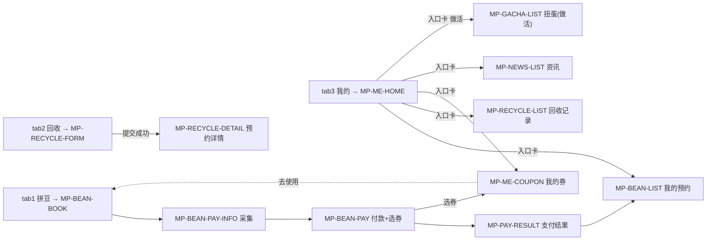
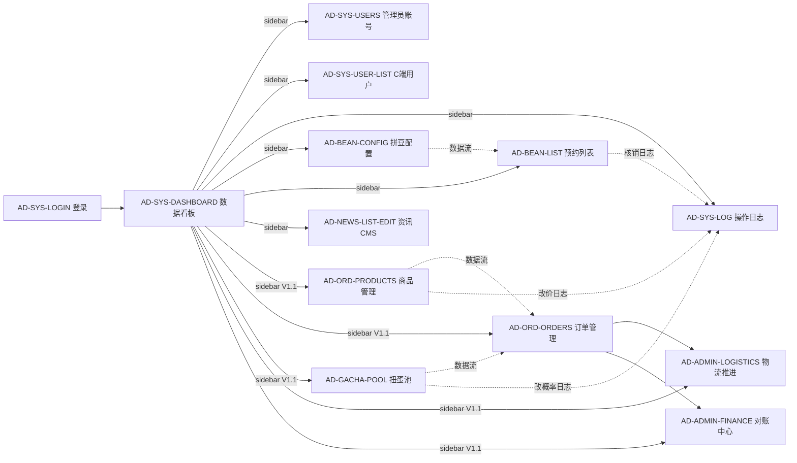

# UI 权威索引

> **本文是 sensenran-guzi 全栈的"出厂 UI 蓝图"**。任何 ticket 实施前，必须先在本文找到对应页面，确认 mockup 路径、关联字段、跳转关系、关联 ticket。
>
> 5 个月后新人入职，只看这一份就能直接干活。

---

## ⚑ 小程序视觉 = 「功能优先清爽」

小程序（miniapp）视觉为**「功能优先清爽」**：暖中性底 `#f4f2ed` + 白卡 + 柔和扩散阴影 + 圆角 + **单一品牌绿 `#33b36b`**（令牌名仍叫 `--c-red`，值已是绿；`--c-bw: 0`，粗描边已归零）。

**小程序皮肤唯一真源 = `code/main/miniapp/src/style/c-tokens.scss` + `uno.config.ts`**（两处注释明写「必须一致」）；组件禁止硬编码 hex。`doc/tokens.md` 与 `doc/13-设计语言-C日漫浓墨.md` 描述的「C 日漫海报浓墨」皮肤已整套退场，不得据此实现。

本文件内的**业务流 / 字段 / 交互关系仍然有效**，继续作为业务结构权威；但其中引用的旧 `design/mockup`（绿色电商版）仅作**业务结构参考**，**视觉不再逐像素遵循**。后台 admin 不套用小程序皮肤，走 ruoyi / Element Plus 默认审美。

---

## ⏸ V1.0 设计冻结期说明（2026-05-28 起）

**决策来源**：Kevin 5/28 决策 — 等甲方确定设计风格再启动 designer，**功能优先 / 视觉后调**。

**冻结期内本文档的状态**：

| 用法 | 当前状态 |
|---|---|
| Admin 端 ticket 实施 | ❌ **不引用本文**。admin 走 ruoyi/Element Plus 默认审美，不出 mockup |
| Mp 端 ticket 实施 | ⚠️ **本文降级为"视觉参考"**。mp mockup 看大致布局即可，**不强求逐像素还原**圆角 / 间距 / 阴影 / 字号 |
| coder §0 自检引用检查 | mp ticket 可标 `doc/12 §<page>` 或 `N/A`，**不再硬卡** |
| Admin mockup（admin-*）| 全部作废 / 仅供概念参考 |
| 7 个 mockup 缺口 | ⏸ 暂停补齐 |
| 2 处 PRD ↔ mockup 不一致 | 仍由 product 裁定（与本文档冻结无关）|

**冻结期解除条件**（任一）：
1. 甲方提供具体设计风格参考（如其他二次元小程序 / 谷子圈品牌物料）
2. 甲方明确"先按现有 mockup + 默认组件库做下去，不调整"
3. 6/10 前甲方仍未表态 → Kevin 主动催 + designer 出 1-2 个风格试探稿

**冻结期解除后**（约 6/10-6/14）：
- 本文档升级 v1.0
- 风格统一调整窗口约 4 天（成本算 V1.0 内，不推 V1.1）
- 组件库可能切换（wot-design-uni → 其他），mp 实现已用业务组件抽象封装层，切换成本可控

详见 [.claude/CLAUDE.md §7.5](../.claude/CLAUDE.md)（V1.0 设计冻结期策略）+ [.claude/agents/kevin-coder.md](../.claude/agents/kevin-coder.md)（mp 实现的"组件库无关"纪律）+ [.claude/agents/kevin-designer.md](../.claude/agents/kevin-designer.md)（designer agent 冻结期响应）。

---

## Changelog

- **v0.6 (2026-06-30)** — 拼豆「下单选桌型档 + 桌型逐格配额防超卖 + 核销时店员现场分座」（ADR-0016，GZ-BEAN-034~037）
  - **mp 下单改选桌型档**：§MP-BEAN-SELECT（页面 ID `MP-BEAN-BOOK`）「选日期 + 连续 1h 区间 → 桌型档卡（`BizSeatTypeCard`，单/双/四人桌，逐档 full 配额布尔 + 区间逐格求和总价；**不显具体座位、不选座、无座位图**）」；可用性接口 `seat-map`→`type-slots`；防超卖「具体 seat_id 区间互斥」→「桌型档逐格配额计数」（`4011 QUOTA_FULL`）；核销码签名因子 `seat_id`→`seat_type`（`signByType`，存量 seat_id 单兼容）
  - **核销分座 UI 上 admin/mp**：§AD-BEAN-BOARD / §MP-BEAN-STAFF-BOARD 改分两区（①物理座位区计时 + canExtend + near_end 弹窗 + 放座/延时 / ②待分座区 → 店员从该桌型空闲物理座挑一个分座，写 `seat_id`/`seat_no_snapshot`，`4021 SEAT_REQUIRED`/`4022 SEAT_TYPE_MISMATCH`/`4002 SEAT_TAKEN`）；§AD-BEAN-LIST 核销时弹空闲物理座分座；§MP-BEAN-LIST 座位号核销分座后才有
  - **门店级 near_end 阈值**：`gz_bean_store.near_end_minutes`（默认 30，门店各自设，取代全局 sys_config）；§AD-BEAN-CONFIG 门店信息加该项
  - **admin 桌型配置**：§AD-BEAN-TYPE-CONFIG「座位单元」→「物理座位（核销分座池）」，`quantity`（桌数）= `slotCapacity` 配额（构造一致）
- **v0.5 (2026-06-29)** — 拼豆回归具体座位 + 简单座位列表自选 + 桌型×星期×1h 格逐格求和计价 + 店内计时看板 + 前 N 名免费促销
  - **mp 拼豆改简单座位列表选座**：§MP-BEAN-BOOK 改「选日期 + 连续 1h 区间 → 简单座位列表/网格（`BizSeatList`，按 zone/桌型/table_no 轻分组渲染座位单元，逐座 full 布尔 + 区间逐格求和总价；门店量小不做影院图）→ 点 1 个具体座位」；防超卖从「类型配额计数」改为「具体 seat_id 区间互斥」；计价从「单价×N」改为「区间逐格求和 Σ 格价(桌型×星期×1h 格)」；§MP-BEAN-PAY 命中前 N 名免费实付 0 直接出码
  - **新增 §MP-BEAN-PROMO-BANNER**（`BizPromoFreeSeats`「本店前 N 名免费，还剩 X 名」）+ **§MP-BEAN-STAFF-BOARD**（店员端计时看板：核销起算实占 + 提前放座 / 延时）
  - **admin 拼豆**：§AD-BEAN-TYPE-CONFIG 升级为「桌型 + 座位单元（按桌型批量生成）」+ 新增 §AD-BEAN-PROMO（前 N 名免费促销配置）+ §AD-BEAN-BOARD（店内计时看板）；§AD-BEAN-LIST 显具体座位号
  - 核销码签名因子改回含 `seat_id`；booking 复活 `seat_id`/`seat_no_snapshot` + 新增 `actual_end_time`/`actual_end_slot`/`is_free`
- **v0.4 (2026-06-09)** — 微信资料/登录态 + 优惠券多策略 + 回收用户拍照
  - **§MP-ME-PROFILE 升级为资料完善页**：头像 `chooseAvatar`（落 COS，禁 getUserProfile）+ 昵称 `<input type=nickname>` + 微信号手填（`wechat_id`）；映射 gz_user(nickname / avatar_image_id / wechat_id)（GZ-USER-005/006，ADR-0009）
  - **§MP-RECYCLE-FORM 加用户拍照上传实物控件**（`submit_image_ids` 必填，至少 1 张才能提交）；§AD-RECYCLE-MANAGE 详情增「用户实物照 submit_image_ids」
  - **§AD-COUPON 发放支持多策略**：模板加 `issue_strategy` 下拉（手动名单 / 注册时段 / 回收自动发）+ `issue_config_json` 策略参数表单；V1 实现 manual，其余 UI 预留
- **v0.3 (2026-06-08)** — V1.2 调整批次 UI 回写
  - **mp 拼豆改付费**：新增 §MP-BEAN-BOOK + §MP-BEAN-PAY-INFO（付款前采集手机/微信号）+ §MP-BEAN-PAY（付款页）；拼豆从免费转付费（座位选座模型 v0.5 回归具体座位 + 简单座位列表自选，详 v0.5）
  - **mp 回收**（新增 M10）：§MP-RECYCLE-FORM（填单 + 自动估价）+ §MP-RECYCLE-SLOT（选时段）+ §MP-RECYCLE-LIST（我的回收记录）；映射 `gz_recycle_appointment`
    > ⚠️ 本条是 v0.5 当时的记录，**已过期**：去估价（ADR-0012）+ SLOT 页并入 FORM（单页三步流）+ 小时格（ADR-0022）。以各 § 正文为准。
  - **mp 优惠券**（新增 M9）：§MP-BEAN-PAY 内选券 + §MP-ME-COUPON（我的券列表）；映射 `gz_user_coupon`
  - **tabbar 重构**：5 tab → **3 tab（拼豆 / 回收 / 我的）**；首页下线，资讯（保留 pages/news）/ 扭蛋（做活非 ComingSoon）入口迁「我的」tab3 入口卡
  - **admin V1.2**：§AD-COUPON（优惠券模板 CRUD + 发放）/ §AD-RECYCLE-PRICE（回收价目表 CRUD）/ §AD-RECYCLE-MANAGE（回收预约单 + 打款单管理）/ §AD-BEAN-TYPE-CONFIG（拼豆桌型 + 座位单元配置，v0.5 升级为按桌型批量生成座位单元）
  - **预购 mp/admin 入口标「V1.2 屏蔽，代码保留」**；扭蛋标「V1.2 权重放低，保留做活」
- **paused_v0.2 (2026-05-28)** — V1.0 设计冻结期生效；本文降级为"视觉参考"
- **v0.2 (2026-05-26)** — 4 项 Kevin 裁定回写
  - C1: 跨境物流 7 节点 → 简化 2 态（`in_japan` / `in_china_dispatching`）。`order-detail.html` 时间线节点 UI 删除，改为 2 态卡片（在日本：'商品在日本备货中' / 已发出：'快递单号 + 快递公司 + 复制'）
  - C2: 预购全款一次性付清（mockup 已对齐，无 UI 改动）
  - C3: 火花券店 V1.0/V1.1 不做（V2 候选）。`gacha-spark-shop.html` 文件保留但移出主跳转图，卡片标 V2 候选
  - C4: 退款归属月份口径（字段层裁定，无 UI 改动）
- **v0.1 (2026-05-26)** — 首次产出

---

## 0. 阅读约定

### 0.1 文件位置

- mockup 文件：`design/mockup/<page-slug>.html`，30 个，浏览器直接打开（用了 tailwind CDN 本地副本 `assets/tailwind.min.css`）
- mockup 截图：`design/mockup/_screenshots/<page-slug>.png`，14 张（**非全量**，截图缺失页面见 §5.4）
- mockup 商品图素材：`design/mockup/assets/products/`，IP 真图（仅 mockup 用，生产环境替换为 OSS 资源）
- 本文件：`doc/12-UI-权威索引.md`
- 视觉 token：`code/main/miniapp/src/style/c-tokens.scss` + `code/main/miniapp/uno.config.ts`（**强约束** — 凡涉及颜色 / 字号 / 间距 / 圆角 / 阴影，必须引用 `var(--c-*)` 变量或 uno 别名，禁止硬编码 hex；两处必须一致）

### 0.2 ticket 任务卡里如何引用本文

```
UI 锚点: doc/12 §<page-id>      例：doc/12 §MP-BEAN-BOOK
```

coder agent 的 §0 自检会读对应段落 → 确认页面布局 / 字段 / 跳转 / token 使用 → 才开始实现。

### 0.3 页面 ID 命名规范

| 前缀 | 含义 |
|---|---|
| `MP-` | 微信小程序（C 端）页面 |
| `AD-` | 后台管理（Admin）页面 |
| `<域>` | SYS / BEAN / USER / NEWS / ORD / GACHA / ADMIN / PAY |
| `<功能>` | LIST / DETAIL / EDIT / CONFIRM / HOME 等 |

示例：
- `MP-BEAN-BOOK` = 小程序 / 拼豆 / 选桌型档下单
- `AD-NEWS-EDIT` = 后台 / 资讯 / 编辑
- `MP-ME-HOME` = 小程序 / 会员 / 首页

### 0.4 V1.0 / V1.1 优先级标记

每个页面卡片标注：
- **V1.0** = 6/15 硬期限必交付
- **V1.0 占位** = V1.0 显示但仅占位/空状态，V1.1 接真实数据
- **V1.1** = 6/16-7/31 软期限必交付
- **V1.1 待裁定** = mockup 已存在但 PRD 标"不做"，待 product 拍板（见 §6 待裁定清单）

### 0.5 偏差审计原则（CLAUDE.md §9.5）

V1.0/V1.1 实施期间发现 ticket 实施跟 mockup 不符：
- **改 mockup 不改实现** — mockup 是权威，调整 mockup + 改本文索引 + 重发客户确认
- 例外：mockup 包含 PRD 明确不做的功能（如 me-home 的"优惠券/邀请好友"）→ 实施时按 PRD 删，本文 §7 标"mockup 超范围片段"

### 0.6 视觉 token 引用速查

真源 = `code/main/miniapp/src/style/c-tokens.scss`（+ `uno.config.ts` 的同名镜像）。本文只列**最常用 7 个** —— 变量名一律 `--c-*`，**组件里出现其他名字（如 `--brand-*` / `--price` / `--ink`）一律是过时残留，不要照抄**：

| Token | Hex | 用途 |
|---|---|---|
| `--c-bg` | `#f4f2ed` | 页面底（暖中性，非纯白） |
| `--c-surface` | `#ffffff` | 卡片 / 栏面（白卡） |
| `--c-red` | `#33b36b` | **品牌主色 = 清新绿**（令牌名沿用 red）——主 CTA / 价格 / 选中态 / 头条标 |
| `--c-red-deep` | `#2aa05e` | 主色按下态 |
| `--c-ink` | `#211d17` | 正文（暖近黑） |
| `--c-ink-2` | `#857d70` | 次要文字 / 说明 |
| `--c-danger` | `#e0452f` | 报错 / 危险 / 校验警告（品牌主色是绿，报错单独用红） |

> ⚠️ **粗描边 / 硬投影 / 直角 / 网点已退场**：`--c-bw = 0`、`--c-bw-2 = 0`，全站只剩 `--c-bw-3`（2rpx 发丝线）。不要再按「C 日漫浓墨」写粗墨边或硬投影。

其余（字号 `--c-fs-*` / 圆角 `--c-radius*` / 阴影 `--c-shadow*` / 间距 `--c-gap-*`）见 `c-tokens.scss` 本体。

---

## 1. 总览：页面清单表

### 1.1 小程序（C 端）页面清单 — 共 30 个（含 1 个已废弃 + 1 个 V2 候选）

| 页面 ID | 路径建议 | 名称 | 用途（一句） | mockup 文件 | V1.0 / V1.1 | 关联 ticket |
|---|---|---|---|---|---|---|
| MP-SYS-HOME | `/pages/index/index` | 首页 | banner + 入口 + 资讯卡片 ⚠️ **V1.2 下线**（去首页，tabbar 改 3 tab）| `home.html` | V1.0 → V1.2 下线 | GZ-ADMIN-005 / GZ-SYS-010 |
| MP-SYS-AUTH | `/pages/login/auth-modal` | 微信授权弹窗 | 触发性弹窗（非独立页）| `auth-modal.html` | V1.0 | GZ-SYS-002 |
| MP-BEAN-BOOK | `/pages/bean/index` | 拼豆下单（选桌型档）| 选日期 + 连续 1h 区间 → 桌型档卡（BizSeatTypeCard，单/双/四人桌，逐档 full 布尔，**不显具体座位**）→ 点桌型档 → 计价（区间逐格求和；命中促销显「本单免费」）+ 选券 → 付款 | **缺口** ⚠️（C 系统新画）| V1.2 | GZ-BEAN-034 / 037 / 033 |
| MP-BEAN-PAY-INFO | `/pages/bean/pay-info` | 拼豆付款前采集 | 采集手机号（getPhoneNumber）+ 微信号（手填）| **缺口** ⚠️（C 系统新画）| V1.2 | GZ-USER-005 / GZ-BEAN-024 |
| MP-BEAN-PAY | `/pages/bean/pay` | 拼豆付款页 | 实付明细 + 选券抵扣 + JSAPI 拉起支付（命中前 N 名免费则实付 0 直接出码）| **缺口** ⚠️（C 系统新画）| V1.2 | GZ-BEAN-024 / 025 / GZ-COUPON-003 |
| MP-BEAN-PROMO-BANNER | 首页 / 拼豆页内嵌 | 前 N 名免费 banner | BizPromoFreeSeats「本店前 N 名免费，还剩 X 名」（命中促销显眼提示，名额用尽隐藏）| **缺口** ⚠️（C 系统新画）| V1.2 | GZ-BEAN-030 |
| MP-BEAN-STAFF-BOARD | `/pages/bean/timing-board` | 店员端计时看板 + 核销分座 | 分两区：①物理座位区（空闲/使用中倒计时/临近结束高亮+canExtend/已超时）+ 提前放座/延时 / ②待分座区（已付未核销单 → 店员挑空闲物理座分座）| **缺口** ⚠️（C 系统新画，mp 管理端）| V1.2 | GZ-BEAN-035 / 036 |
| MP-BEAN-LIST | `/pages/bean/my-list` | 我的预约列表 | 状态 tab + 详情 + 核销码（桌型档名；座位号核销分座后才有）| `booking-list.html` | V1.0（V1.2 改 status×pay_status）| GZ-BEAN-005 / 006 / 007 / 014 |
| MP-RECYCLE-FORM | `/pages/recycle/form` | 回收预约填单（**单页三步流**）| 门店 → ① 点数档 → ② 日期 → ③ **小时格**起始时间 → 提交 | 无 mockup（清爽风 token）| V1.2 | GZ-RECYCLE-002 / 007 / **012 / 013** |
| ~~MP-RECYCLE-SLOT~~ | ~~`/pages/recycle/slot`~~ | ❌ **页面不存在** | 已并入 MP-RECYCLE-FORM 第 ③ 步 | — | — | — |
| MP-RECYCLE-LIST | `/pages/recycle/my-list` | 我的回收记录 | 预约状态列表（含打款态）+ 到店区间 `slot_start-slot_end` | 无 mockup（清爽风 token）| V1.2 | GZ-RECYCLE-002 / 003 |
| MP-ME-COUPON | `/pages/me/coupon` | 我的优惠券 | **V1.2** 代金券列表（未用/已用/已过期）| **缺口** ⚠️（C 系统新画）| V1.2 | GZ-COUPON-003 |
| MP-ME-HOME | `/pages/me/index` | 会员中心首页 | 头像 + 订单状态 + 九宫格 | `me-home.html` | V1.0（部分超范围 — 见 §7）| GZ-USER-001 |
| MP-ME-PROFILE | `/pages/me/profile` | 个人资料 / 资料完善 | 头像 chooseAvatar(落 COS) + 昵称 nickname 输入 + 微信号手填 + 手机号 | **缺口** ⚠️ | V1.0 + **V1.2 升级** | GZ-USER-002 / 005 / 006 |
| MP-ME-ADDR-LIST | `/pages/me/address/list` | 地址簿列表 | 默认 + 普通地址 + 新建 | `address-list.html` | V1.0 | GZ-USER-003 |
| MP-ME-ADDR-EDIT | `/pages/me/address/edit` | 地址编辑 | 表单 + 智能粘贴 + 设默认 | `address-edit.html` | V1.0 | GZ-USER-003 |
| MP-ME-COLLECTION | `/pages/me/collection` | 我的图鉴 | 按机器分组 + 收集进度 | `me-collection.html` | V1.1 **待裁定** | GZ-GACHA-107 |
| MP-NEWS-LIST | `/pages/news/list` | 资讯列表 | 分类 tab + 文章卡片 | `news-list.html` | V1.0 | GZ-NEWS-001 |
| MP-NEWS-DETAIL | `/pages/news/detail` | 资讯详情 | 富文本 + 视频 + 分享 | `news-detail.html` | V1.0 | GZ-NEWS-001 / 002 |
| MP-ORD-LIST | `/pages/me/orders` | 我的订单（3 tab）| 全部 / 扭蛋 / 预购 / 拼豆 | `order-list.html` | V1.0 占位 + V1.1 真数据 | GZ-USER-004 / GZ-USER-101 |
| MP-ORD-DETAIL | `/pages/me/order-detail` | 订单详情 | 顶部状态 + 物流 2 态卡 + 国内单号（**C1 简化**） | `order-detail.html` ⚠️ 待重画 | V1.1 | GZ-USER-102 / 103 / 104 |
| MP-ORD-CONFIRM | `/pages/order/confirm` | 确认订单 | 地址 + 商品 + 金额 + 协议 | `order-confirm.html` | V1.1 | GZ-ORD-103 / 104 / GZ-PAY-101 |
| MP-PAY-RESULT | `/pages/pay/result` | 支付结果 | 成功 / 失败 / 超时 三态 | `pay-result.html` | V1.0 通道 + V1.1 业务 | GZ-PAY-001 / GZ-PAY-101 |
| MP-ORD-PREORDER-LIST | `/pages/ord/list` | 预购商品列表 | 排序 + 筛选 IP + 卡片 ⚠️ **V1.2 屏蔽入口保留代码** | `preorder-list.html` | V1.1 → V1.2 屏蔽 | GZ-ORD-102 / GZ-ORD-110 |
| MP-ORD-PREORDER-DETAIL | `/pages/ord/detail` | 预购商品详情 | 主图 + 倒计时 + 规格 + CTA ⚠️ **V1.2 屏蔽** | `preorder-detail.html` | V1.1 → V1.2 屏蔽 | GZ-ORD-103 / GZ-ORD-110 |
| MP-GACHA-LIST | `/pages/gacha/list` | 扭蛋机大厅 | 今日扭蛋墙 + 机器卡（**V1.2 做活，入口从「我的」tab3 进**）| `gacha-list.html` | V1.1（V1.2 权重放低）| GZ-GACHA-102 / GZ-GACHA-110 / GZ-SYS-010 |
| MP-GACHA-DETAIL | `/pages/gacha/detail` | 单机详情 | 拟物机器 + 奖品池 + 概率公示 | `gacha-detail.html` | V1.1 | GZ-GACHA-103 |
| MP-GACHA-DRAW | `/pages/gacha/draw` | 开盒结果页 | 三段分镜动画 + 揭晓 | `gacha-draw.html` | V1.1 | GZ-GACHA-104 / 105 |
| MP-GACHA-HISTORY | `/pages/gacha/history` | 我的扭蛋记录 | 按时间倒序 + 按机器筛 | `gacha-history.html` | V1.1 | GZ-GACHA-106 |
| ~~MP-GACHA-SPARK~~ | ~~`/pages/gacha/spark-shop`~~ | ~~扭蛋火花商店~~ | **V2 候选**（C3 已裁定 V1.0/V1.1 不做，mockup 文件保留供 v2 参考）| `gacha-spark-shop.html` | **V2 候选** | — |

### 1.2 后台管理（Admin）页面清单 — 共 21 个（含 11 个缺口 + 1 个已停用）

| 页面 ID | 路径建议 | 名称 | 用途（一句） | mockup 文件 | V1.0 / V1.1 | 关联 ticket |
|---|---|---|---|---|---|---|
| AD-SYS-LOGIN | `/login` | 管理员登录 | 左品牌图 + 右登录表单 | `admin-login.html` | V1.0 | GZ-ADMIN-001 |
| AD-SYS-DASHBOARD | `/dashboard` | 数据看板 | KPI 卡片 + 图表 + 待办 | `admin-dashboard.html` | V1.0 非交易 + V1.1 交易 | GZ-ADMIN-003 / 106 |
| AD-SYS-USERS | `/admin/users` | 管理员账号 CRUD | owner / staff 列表 + 重置密码 | **缺口** ⚠️ | V1.0 | GZ-ADMIN-002 |
| AD-SYS-USER-LIST | `/user/list` | C 端用户管理（查看）| 用户列表 + openId + 注册时间筛 | **缺口** ⚠️（与 AD-SYS-USERS 不同）| V1.0 | GZ-SYS-003 |
| AD-SYS-LOG | `/system/log` | 操作日志 | 管理员审计日志 | **缺口** ⚠️ | V1.0 | GZ-SYS-006 |
| AD-BEAN-CONFIG | `/bean/config` | 拼豆门店/桌型/物理座位/时段配置 | 门店（含 near_end_minutes 阈值）+ 桌型配置（含按桌型批量生成物理座位）+ 物理座位管理 + 时段模板 | **缺口** ⚠️ | V1.0（物理座位段 V1.2 扩展）| GZ-BEAN-001 / 002 / 023 |
| AD-BEAN-TYPE-CONFIG | `/bean/type-config` | 拼豆桌型 + 物理座位配置 | 每门店每桌型（单/双/四人桌）单价 + book_mode + 桌数 quantity（= 配额）+ 按桌型批量生成/管理物理座位（编号/分区/停用，核销分座池）| **缺口** ⚠️（ruoyi 默认）| V1.2 | GZ-BEAN-023 / 027 |
| AD-BEAN-PROMO | `/bean/free-promo` | 前 N 名免费促销配置 | 每门店周期类型（day/week/days）+ 名额 N + 促销起止 + 总开关 | **缺口** ⚠️（ruoyi 默认）| V1.2 | GZ-BEAN-027 |
| AD-BEAN-BOARD | `/bean/board` | 计时看板 + 核销分座（分两区）| ①物理座位区（倒计时 + canExtend + near_end 弹窗 + 放座/延时）+ ②待分座区（已付未核销 → 店员分座）+ 门店阈值配置 | **缺口** ⚠️（ruoyi 默认）| V1.2 | GZ-BEAN-035 / 036 |
| AD-BEAN-LIST | `/bean/bookings` | 预约列表 + 核销分座 | 列表筛 + 扫码核销（核销时弹该桌型空闲物理座分座；座位号分座后才有）| **缺口** ⚠️ | V1.0（V1.2 核销加分座）| GZ-BEAN-008 / 036 |
| AD-BEAN-REVENUE | `/gz-bean/revenue` | 拼豆营业额 + **桌型使用时长 · 上桌率** | 汇总卡 + 桌型×计费方式拆分 + **月度 桌型使用时长/上桌率（纯时长口径，不看金额）** + 明细 + 趋势 | N/A（ruoyi 默认）| V1.2（使用时长报表 2026-09-28 追加）| GZ-BEAN-0702 / **GZ-BEAN-059** |
| AD-COUPON | `/coupon/template` | 优惠券模板 CRUD + 发放 | **V1.2** 代金券模板 CRUD + 选用户/名单批量发 | **缺口** ⚠️（ruoyi 默认）| V1.2 | GZ-COUPON-001 |
| ~~AD-RECYCLE-PRICE~~ | `/recycle/price-rule` | ⛔ **已停用**（ADR-0012 去估价，菜单已隐藏，代码/表保留不删）| — | N/A | V1.2 | GZ-RECYCLE-001 |
| AD-RECYCLE-CONFIG | `/recycle/config` | 回收配置（点数档时长 + **营业时段配置**）| 点数档 →「占用小时数」；营业窗口按星期 + 生效区间 + 按周批量配置（**命名/列序对齐拼豆 AD-BEAN-CONFIG**）| N/A（ruoyi 默认）| V1.2 | GZ-RECYCLE-004 / 006 / **012 / 015** |
| AD-RECYCLE-MANAGE | `/recycle/appointment` | 回收**周看板** + 预约单管理 | 周看板 rowspan 区间块 + 手动占用 / 改期 / 释放 / **取消** + 记录列表 | N/A（ruoyi 默认 + ADR-0004 mp 店员端）| V1.2 | GZ-RECYCLE-003 / 010 / 011 / **012 / 013 / 014** |
| AD-NEWS-LIST-EDIT | `/news/list` + `/news/edit` | 资讯 CMS | 列表 + 富文本编辑 + 定时发布 | `admin-news.html` | V1.0 | GZ-NEWS-003 / 004 / GZ-SYS-005 |
| AD-ORD-PRODUCTS | `/products` | 预购商品管理 | CRUD + SKU + 批量上下架 | `admin-products.html` | V1.1 | GZ-ADMIN-101 / GZ-ORD-101 |
| AD-ORD-ORDERS | `/orders` | 三类订单聚合管理 | 业务 tab + 状态筛 + 物流推进 | `admin-orders.html` | V1.1 | GZ-ADMIN-103 / GZ-ADMIN-104 / GZ-PAY-103 |
| AD-GACHA-POOL | `/gacha/pool` | 扭蛋池管理 | 机器 + 奖品 + 概率权重 | `admin-gacha-pool.html` | V1.1 | GZ-ADMIN-102 / GZ-GACHA-101 |
| AD-ADMIN-LOGISTICS | `/logistics` | 物流批次推进 | 7 节点推进 + 批量录入单号 | **缺口** ⚠️ | V1.1 | GZ-ADMIN-104 |
| AD-ADMIN-FINANCE | `/finance` | 对账中心 | GMV / 退款 / 通道费 / 实际到账 | **缺口** ⚠️ | V1.1 | GZ-ADMIN-105 |

### 1.3 非页面文件

| ID | 文件 | 用途 |
|---|---|---|
| MK-INDEX | `index.html` | **Mockup 预览中心**（dark theme，左侧分组导航 + 右侧 iframe），仅 designer/Kevin/客户预览用，不是产品页 |

---

## 2. 小程序页面详细卡片

### §MP-SYS-HOME — 首页

- **mockup**: `design/mockup/home.html`
- **路径**: `/pages/index/index`（小程序 tabBar 第 1 项）
- **用途**: 整个小程序流量入口，承接 banner / 4 大入口 / 爆款 / 资讯
- **V1.0 / V1.1**: V1.0
- **关联 ticket**: GZ-ADMIN-005（5 tab 框架）/ GZ-BEAN-010（拼豆入口卡）/ GZ-NEWS-001（资讯卡片）
- **页面结构**（从上到下）:
  1. 状态栏 / 顶部 Logo + 搜索框 + 相机图标
  2. 主 Banner（16:7，单图模式 + 倒计时角标 + CTA "立即扭蛋"）
  3. 双卡片入口（扭蛋开盒 / 预购日谷）
  4. 拼豆预约横长卡片（紫粉渐变）
  5. "爆款热销" 区块（双列 4 卡片）
  6. "最新资讯" 区块（2 条横式卡片）
  7. 客服浮层（右下角 fab）
  8. 底部 5 tab（首页 active）
- **关键字段引用**（粗略，doc/11 待 product 补完整）:
  - banner: `imageUrl` / `linkUrl` / `countdownEndAt` / `titleZh` / `subtitleZh`
  - 双入口卡: `gachaActiveMachineCount` / `preorderNewSkuCount`
  - 拼豆卡: `storeName` / `availableSlotsToday`
- **跳转关系**:
  - banner → 跳具体活动（V1.0 仅跳 资讯详情；V1.1 可跳扭蛋机详情）
  - "扭蛋开盒" 卡 → 跳 MP-GACHA-LIST（V1.0 占位提示"敬请期待 V1.1"）
  - "预购日谷" 卡 → 跳 MP-ORD-PREORDER-LIST（V1.0 占位）
  - "拼豆预约" 卡 → 跳 MP-BEAN-BOOK
  - "爆款热销" 商品 → V1.0 跳资讯详情；V1.1 跳具体预购/扭蛋详情
  - "最新资讯" → 跳 MP-NEWS-DETAIL
- **组件映射**（wot-design-uni）:
  - banner → `wd-swiper`
  - 倒计时 → `wd-count-down`
  - 卡片 → `wd-card` 或自定义 div + tailwind
  - 客服 fab → `<button open-type="contact">` 包 `wd-fab` 样式
- **token 使用**:
  - banner 黄绿渐变: `#FFE89A → var(--brand-accent) → var(--brand-primary)`
  - "扭蛋开盒"卡背景: `linear-gradient(135deg, var(--brand-primary-soft), #C7F0CA)`
  - "预购日谷"卡: 黄系 `#FFFBEB → #FFE8A8`
  - 拼豆卡: 紫 `#F1E6FE → #FFFFFF`
  - 区块标题左侧绿条: `.section-bar` width 3px / height 14px / bg `var(--brand-primary)`
- **V1.0 实施注意**:
  - "爆款热销" / banner 数据 V1.0 没有真实业务，**先用 CMS 配置位**（甲方手填资讯/外链）
  - 双入口卡 V1.0 显示但点击跳"敬请期待 V1.1"提示
- **待澄清** ⚠️:
  - C1: banner 是否多图轮播（mockup 显示 indicator 但只画 1 张）→ V1.0 默认单图
  - C2: "爆款热销" V1.0 数据来源（PRD 无对应模块）→ 建议从资讯文章里抽取置顶推荐

---

### §MP-SYS-AUTH — 微信授权弹窗

- **mockup**: `design/mockup/auth-modal.html`
- **路径**: 触发性弹窗，无独立路由（在 home / 任意页触发未登录场景）
- **用途**: 首次进入小程序或触发下单/预约时引导微信登录
- **V1.0 / V1.1**: V1.0
- **关联 ticket**: GZ-SYS-002（微信登录链路）
- **页面结构**:
  1. 背景：模糊处理的当前页（filter blur 2px + 半透明遮罩 rgba(0,0,0,.45)）
  2. 底部弹起 sheet（slideUp 动画 .3s）
  3. sheet 顶部：谷子宇宙 Logo + "二次元谷子玩家社区"副标题
  4. 申请项卡片：头像和昵称（必需）+ 手机号（非必需，拼豆时单独询问）
  5. 协议勾选：用户协议 / 隐私政策 / 扭蛋出现概率规则
  6. 微信绿 CTA "微信一键登录"
  7. 次级按钮 "暂不登录·先逛逛"
  8. 底部提示 "登录后才可下单 / 扭蛋 / 预约"
- **关键交互**:
  - `wx.login()` → `wx.getUserProfile()` → 后端 `code2session` → 写 storage token
  - 拒绝授权 → 关闭弹窗，可继续浏览资讯，触发预约/下单时重弹
- **token 使用**:
  - 微信绿（特殊色，不在 tokens.md，本页专用）: `#07C160`
  - logo 框: `linear-gradient(135deg, var(--brand-primary), var(--brand-primary-deep))` + 发光阴影
  - "必需"角标: `var(--brand-primary-soft)` 底 + `var(--brand-primary-deep)` 字
- **组件映射**:
  - 弹窗 → `wd-popup` position="bottom"
  - 协议复选 → `wd-checkbox`
  - 微信登录按钮 → 原生 `<button open-type="getUserInfo">` + 自定义样式
- **待澄清** ⚠️:
  - C3: 协议链接 V1.0 是否就绪（用户协议 / 隐私政策 / 概率规则）→ 阻塞甲方提供

---

### §MP-BEAN-SELECT（页面 ID `MP-BEAN-BOOK`）— 拼豆下单（选桌型档）⚠️ 缺口

- **mockup**: **缺失** ⚠️（C 日漫海报浓墨系统新画，走 doc/tokens.md + doc/13）
- **路径**: `/pages/bean/index`（去首页后 tab1「拼豆」落地页 = 本页）
- **用途**: 拼豆付费核心入口。**选日期 + 连续 1h 区间 → 选桌型档 → 计价**（区间逐格求和；命中前 N 名免费显「本单免费」）→ （可选）选券 → 跳付款前采集（doc/10 §11）。**一笔预约 = 1 个桌型档 + 1 段连续区间**；**mp 不显示具体座位编号、不选具体座位**（具体座位到店由店员核销时现场分配，ADR-0016）
- **V1.0 / V1.1 / V1.2**: **V1.2**
- **关联 ticket**: GZ-BEAN-034（桌型档可用性 `type-slots` + 逐格配额下单）/ GZ-BEAN-037（mp 下单页选桌型档）/ GZ-BEAN-033（区间逐格求和计价）
- **页面结构**（C 系统，单页顺序展示，「先选场次再选桌型」）:
  1. 顶部门店信息 + 全局门店态（`BizStoreSelector`；成都 2 店 CD001/CD002，未选先提示选店）
  2. **前 N 名免费 banner**（命中促销时）：`BizPromoFreeSeats`「本店前 N 名免费，还剩 X 名」（详 §MP-BEAN-PROMO-BANNER）
  3. 选日期（横滑日期 chip，C 风粗墨边）
  4. **选连续 1h 区间**：`BizSlotGrid` 营业窗口整点切 1h 格，连续多选（ADR-0011 区间模型）。此步只定区间，不绑桌型
  5. **桌型档卡** `BizSeatTypeCard`（门店仅几种桌型：单人 / 双人 / 四人桌）：列出所有启用桌型档（`seat_type_config`）；每档标桌型名（`config.name`）+ 订法标签（整桌 / 拼桌·按座）+ 该桌型所选区间总价（区间逐格求和 `priceCent`）
     - 逐档 `full` 布尔：该桌型在所选区间内任一格配额满（活跃单 ≥ `slotCapacity`）→ **灰显「已约满」不可点**；可订 → 高亮可点
     - **单选**：点选 1 个桌型档即高亮（桌型档维度只下发「可订/已满」布尔，**不下发余量数字、不显具体座位**）
  6. **单笔金额条**：选定桌型所选区间**逐格求和总价** `priceCent`；**命中前 N 名免费时显「本单免费」**（实付 0）
  7. （可选）选券入口 → §MP-BEAN-PAY 内或本页弹券列表（doc/10 §12.N3）
  8. 底部 fixed CTA：已选「桌型档 + 区间」+ 单笔金额 / 「本单免费」+ "去付款 ›"
- **关键字段映射**（doc/11 §3 拼豆域，一笔一行 booking 无子表）:
  - 桌型档定义：`gz_bean_seat_type_config`（store_id / seat_type / name / book_mode / capacity / quantity（桌数 = slotCapacity 分母）/ price_cent 基础价 / enabled）
  - 物理座位（**下单不选，核销分座池**）：`gz_bean_seat`（seat_type_config_id / seat_no / table_no / zone / enabled）
  - 格价（桌型×星期×1h 格）：`gz_bean_seat_type_price`（seat_type_config_id / weekday / slot_start【NULL=整天默认 / HH:00=该格】/ price_cent）
  - 前 N 名免费配置：`gz_bean_free_promo`（period_type day/week/days / period_days / anchor_date / free_count / start_date / end_date / enabled）
  - 预约单（**一笔一行**）：`gz_bean_booking`（**seat_id=NULL 下单**（核销分座写）/ seat_type_config_id / seat_type_snapshot（桌型名快照）/ sess_date / slot_start / slot_end / **amount_cent**（= 区间逐格求和 Σ 格价；命中免费=0）/ discount_amount_cent / is_free / pay_status / coupon_id）
- **可用性 + 计价 + 防超卖约束**（doc/10 §11，桌型档逐格配额 + 区间逐格求和计价）:
  - 可用性接口 `GET /app/gz/bean/booking/type-slots?storeId&sessDate&slotStart&slotEnd`：返回各启用桌型档 `{ seatTypeConfigId, typeName, bookMode, capacity, priceCent（该桌型所选区间总价 = 逐格求和 Σ 格价(当天星期, 各 1h 格)，3 级回退取格价；区间未选时 null）, full（该桌型区间内任一格配额满）}`
  - 提交时后端对区间内**每个 1h 格**升序 `COUNT(活跃) FOR UPDATE`（`seat_type_config_id` 维度，占用止界 = `COALESCE(actual_end_slot, slot_end)`，`@Transactional REPEATABLE_READ`），任一格 ≥ `slotCapacity` 则拒单（业务码 4011 QUOTA_FULL，前端提示换桌型/换时段）
- **token 使用**: C 系统 `var(--c-*)`，Biz 组件（BizScreen / BizPanel / BizSlotGrid / BizSeatTypeCard / BizPromoFreeSeats / BizFixedCta）
- **组件映射**: `src/components/biz/Biz*`（不直接撒 wd-* / el-*）；桌型档卡 `BizSeatTypeCard`（逐档 full 态 + 区间总价，**不含座位图 / 不含具体座位列表**）
- **跳转关系**:
  - 来源：tab「拼豆」（tab1 落地）
  - 去向："去付款" → MP-BEAN-PAY-INFO（先采集手机/微信号）→ MP-BEAN-PAY；命中免费仍走该流程（实付 0，§MP-BEAN-PAY 直接出码）
  - 提交成功后：MP-BEAN-LIST（默认 active "待到店"）
- **AC 可达**:
  - AI 模拟器可达 — kevin-qa 用 run.mjs `reLaunch` 到 `/pages/bean/index` 断言桌型档卡渲染（强制）
  - 真机可达 — Kevin 从 tab「拼豆」点 1 次即到（tab1 落地页本身）
- **待澄清** ⚠️:
  - 同一用户对同一桌型档 + 区间重复提交 → 幂等返回原单；跨桌型/跨区间可多次下单
  - 桌型档卡 mockup 缺口转 @designer 按 C 系统补（BizSeatTypeCard 视觉，单人/双人/四人桌卡，无座位图）

---

### §MP-BEAN-PAY-INFO — 拼豆付款前采集（手机 + 微信号）⚠️ V1.2 缺口

- **mockup**: **缺失** ⚠️（C 系统新画，参考 me-profile 表单风格）
- **路径**: `/pages/bean/pay-info`
- **用途**: 付款前采集手机号 + 微信号（doc/10 §11）；缺一不可继续付款
- **V1.0 / V1.1 / V1.2**: **V1.2**
- **关联 ticket**: GZ-USER-005（gz_user.wechat_id）/ GZ-BEAN-024
- **页面结构**:
  1. nav-bar "完善联系方式"
  2. 提示卡（C 风）："到店通知 + 收款需要，仅本店可见"
  3. **手机号**：已有则预填脱敏；为空 → 原生 `<button open-type="getPhoneNumber">`（沿用 §1.N8）
  4. **微信号**：`<input>` 手动填（`gz_user.wechat_id`，GZ-USER-005 新增字段，非微信 API 拉取）
  5. 底部 fixed CTA "确认并去付款"
- **关键字段映射**:
  - `gz_user.mobile`（getPhoneNumber 解密）+ `gz_user.wechat_id`（手填）→ 下单时 snapshot 到 `gz_bean_booking`
- **token 使用**: C 系统；表单走 Biz 表单组件
- **跳转关系**: 来源 MP-BEAN-BOOK；去向 MP-BEAN-PAY
- **Tier 2 可达**: 从 tab「拼豆」→ 选单元 → "去付款" 2 次到达
- **待澄清** ⚠️:
  - 微信号为非必填校验规则（仅格式校验，不校验真实性）

---

### §MP-BEAN-PAY — 拼豆付款页（含选券）⚠️ V1.2 缺口

- **mockup**: **缺失** ⚠️（C 系统新画）
- **路径**: `/pages/bean/pay`
- **用途**: 实付明细 + 选代金券抵扣 + JSAPI 拉起微信支付（doc/10 §11 + §12.N3）；命中前 N 名免费则实付 0 直接出码
- **V1.0 / V1.1 / V1.2**: **V1.2**
- **关联 ticket**: GZ-BEAN-034（JSAPI 支付 + 桌型档下单）/ GZ-BEAN-025（前 N 名免费发放）/ GZ-COUPON-003（选券）
- **页面结构**:
  1. nav-bar "确认付款"
  2. 预约明细（桌型档名 + 区间 + 单笔金额；**付款时未分座，不显具体座位号**）
  3. **选券区**：GET `/api/coupon/usable?business=pindou&amount` 列 unused 可用代金券；选中 → 抵扣 = min(单笔金额, 券面额)
  4. **价格明细**：单笔金额 / 优惠券抵扣 / **实付**（= 单笔金额 − 券面额，下限 0）；命中前 N 名免费时 `amount_cent=0`，全段显「本单免费」
  5. 底部 fixed 支付条："实付 ¥XX" + "微信支付" CTA；实付 ≤ 0（免费 / 券抵满）→ "确认预约"，直接出核销码不拉支付
- **关键交互**:
  - 选券下单事务内券 `unused → locked`（doc/10 §12.N4）；支付成功 `locked → used`（§12.N5）
  - 前 N 名免费命中（下单事务内原子发放，桶内 `is_free=1` 计数 < `free_count`）→ 本单 `is_free=1`、`amount_cent=0`、实付 0 → 复用「实付 ≤ 0 直接 `pay_status='paid'`、不建支付单、即时出核销码」逻辑
  - 实付 = `gz_pay_transaction.amount_cent`（business_type=pindou）；**券面额 / 免费单均不计 GMV**
  - JSAPI `wx.requestPayment` → 回调 onPaid → pay_status=paid
- **关键字段映射**:
  - `gz_user_coupon`（coupon_no / amount_snapshot_cent / status / related_pay_out_trade_no）
  - `gz_bean_booking.amount_cent`（命中免费=0）/ `gz_bean_booking.discount_amount_cent` / `gz_bean_booking.is_free` / `gz_pay_transaction.amount_cent`（实付）
- **token 使用**: C 系统；价格强调用朱红 `var(--c-...)` 价格色；「本单免费」用朱红强调标
- **跳转关系**:
  - 来源：MP-BEAN-PAY-INFO
  - 去向：支付成功（或免费直接出码）→ MP-PAY-RESULT → MP-BEAN-LIST；失败 → 留本页重试
- **AC 可达**: AI 模拟器 reLaunch + wxMOCK 登录走完下单流断言实付明细 / 免费态（强制）；真机 Kevin 从 tab「拼豆」走完下单流程到达（真机微信原生支付）
- **待澄清** ⚠️:
  - 单单仅 1 张券（doc/10 Q12.2）；单笔金额 < 券面额时实付 0 不找零（§12.E3）；免费单不再叠加用券（已实付 0）

---

### §MP-BEAN-PROMO-BANNER — 前 N 名免费 banner ⚠️ 缺口

- **mockup**: **缺失** ⚠️（C 系统新画）
- **路径**: 内嵌组件，无独立路由（挂首页入口区 + 拼豆页 §MP-BEAN-BOOK 顶部）
- **用途**: 前 N 名免费促销引流提示。命中促销显眼提示「本店前 N 名免费，还剩 X 名」，名额用尽 / 促销关时隐藏
- **V1.0 / V1.1 / V1.2**: **V1.2**
- **关联 ticket**: GZ-BEAN-030（mp 免费 banner）
- **组件**: `BizPromoFreeSeats`（C 风票券 / 号外报头气质，朱红 + 粗墨边）
- **页面结构**:
  1. banner 卡：主文案「本店前 N 名免费」+ 剩余名额「还剩 X 名」（紧迫感数字）
  2. 周期标签（`periodLabel`：今日 / 本周 / 本周期）
  3. 点击 → 跳 §MP-BEAN-SELECT 选桌型档下单
- **关键接口 / 字段**:
  - `GET /app/gz/bean/free-promo/status?storeId` 返回 `{ enabled, freeCount, remaining（= free_count − 桶内已发，下限 0）, periodLabel }`
  - `remaining > 0` → 显 banner + §MP-BEAN-BOOK 价格区标「本单免费」；`remaining <= 0` 或促销关 → 不显、显真实价
  - 数据源 `gz_bean_free_promo`（每门店一行）+ 桶内已发免费单计数
- **token 使用**: C 系统票券样式；剩余名额朱红强调
- **跳转关系**: 来源 首页 / 拼豆页内嵌；去向 §MP-BEAN-BOOK
- **AC 可达**: AI 模拟器 reLaunch 拼豆页断言 banner 命中态渲染（强制）；纯展示无真机原生，AI ✅ 即终态
- **待澄清** ⚠️:
  - 「还剩 X 名」是促销话术（引流紧迫感），与座位 `full` 布尔无关、不违反「不下发余量数字」铁律

---

### §MP-BEAN-STAFF-BOARD — 店员端计时看板 ⚠️ 缺口

- **mockup**: **缺失** ⚠️（C 系统新画，mp 管理端）
- **路径**: `/pages/bean/timing-board`
- **用途**: 店员在店内实时看当日两区 + 倒计时 + 核销分座 + 提前放座 / 延时（ADR-0016「核销时现场分座 + 计时 + 放座」）
- **V1.0 / V1.1 / V1.2**: **V1.2**
- **关联 ticket**: GZ-BEAN-035（看板分两区 + 门店级 near_end）/ GZ-BEAN-036（核销分座，mp 店员端 fast-follow）
- **权限**: openid 绑 sys_user + 复用 ruoyi RBAC（ADR-0004 mp 管理端地基）；店员 / owner 可见全门店
- **页面结构**（C 系统，分两区，ADR-0016）:
  1. nav-bar "计时看板" + 门店 + 日期切换
  2. **① 物理座位区**（按 `seat_id` 列表 / 网格，按 zone / 桌型分组）；每座显状态行：
     - **空闲**：当前无已分座活跃单覆盖
     - **使用中**：已核销分座（`status='used'`，`seat_id` 有值），当前 < 计划 `slot_end`，显 `remainingMinutes` 倒计时
     - **临近结束**：使用中且剩 ≤ **门店级 `gz_bean_store.near_end_minutes`（默认 30，门店各自设）** → **高亮** + `canExtend` 派生「请客人收尾」/「可问延时」
     - **已超时**：已核销且当前 > `slot_end` 且未放座
     - ② **待分座区**（已付未核销未分座单 = `status='pending'`+`pay_status='paid'`+`seat_id` NULL，按桌型+时段聚合）：每单「核销分座」→ 弹该桌型空闲物理座 → 店员挑一个绑定（写 `seat_id`/`seat_no_snapshot` + `status→used` + `verify_time`）
  3. 操作（看板上对某座当前单）：
     - **提前放座**：写 `actual_end_time=now` + `actual_end_slot=ceil(now→整点)` → 该桌型 `actual_end_slot` 之后的格配额立即可再约（不改 status，仍 `used`）
     - **延时**：把 `slot_end` 往后推 K 个整点格 → 先校验该桌型新增格配额未满（满则拒绝）→ 通过则更新；**V1 不走线上补付**（差额线下 / 门店政策）
- **关键接口 / 字段**:
  - `GET /app/gz/bean/board?storeId&sessDate` 返回两区（①物理座位区 + ②待分座区 + canExtend）
  - 核销分座：`doVerify` 入参加 `seatId`（`4021 SEAT_REQUIRED`/`4022 SEAT_TYPE_MISMATCH`/`4002 SEAT_TAKEN`）
  - `gz_bean_booking`（seat_id / seat_no_snapshot / verify_time / status / slot_end / actual_end_time / actual_end_slot）；门店阈值 `gz_bean_store.near_end_minutes`
- **token 使用**: C 系统；临近结束 / 超时用朱红高亮
- **跳转关系**: 来源 「我的」tab3 店员入口（按权限显隐）
- **AC 可达**: AI 模拟器 reLaunch + wxMOCK 店员登录断言看板渲染 + 放座操作打真后端（强制）；放座 / 延时 DB 改动自动验
- **待澄清** ⚠️:
  - mp 看板与 admin §AD-BEAN-BOARD 共用 `GET /app/gz/bean/board` + 放座 / 延时接口；plus-ui owner 兜底，店员日常用 mp

---

### §MP-BEAN-LIST — 我的预约列表

- **mockup**: `design/mockup/booking-list.html`
- **路径**: `/pages/bean/my-list`（从 MP-ME-HOME 九宫格"我的预约"进 / 提交预约成功后跳）
- **用途**: 用户查看历史预约 + 4 状态 tab + 取消 / 导航 / 核销码
- **V1.0 / V1.1**: V1.0
- **关联 ticket**: GZ-BEAN-005（详情+核销码）/ GZ-BEAN-006（列表）/ GZ-BEAN-007（取消）
- **⚠️ 路由说明**:
  - 底部 tab "拼豆" → §MP-BEAN-BOOK（`/pages/bean/index`，下单落地页）
  - "我的预约"是 MP-BEAN-LIST 独立路由，从「我的」tab3 入口卡 / 预约成功后跳
- **页面结构**:
  1. nav-bar："我的预约" + 右上"+ 新建"链接（→ MP-BEAN-BOOK）
  2. 4 状态 tab：待到店 / 已核销 / 已取消 / 未到店（含数量徽章）
  3. 预约卡片（按时间倒序）:
     - 头部：店名 + 桌型档名（`seat_type_snapshot`）+ 时段 + 右侧状态 pill（**核销分座后**追显座位号 `seat_no_snapshot`，未核销显「到店分座」）
     - 主体：date-block（紫粉渐变） + 地址 + 电话 + 手机号
     - 待到店：核销码二维码区（80×80）+ "BK20260514000A3" 码文本
     - 操作按钮：取消预约 / 导航到店 / 联系客服（待到店态）/ 再次预约（已核销态）
  4. 灰色 footer "— 共 7 条预约记录 —"
- **状态机映射**（业务 `status` × 付费 `pay_status` 双维度正交，doc/10 §11 + 附录 A.14；「已核销」= `status='used'`+`pay_status='paid'`，**不存在 `verified` 落库值**）:
  - `status='pending'` + `pay_status='paid'` → status-pill upcoming (待到店)
  - `status='used'` + `pay_status='paid'` → status-pill used (已核销分座)
  - `status='cancelled'` → status-pill cancelled (已取消)
  - `status='no_show'` → status-pill noshow (已过期/未到店)
  - `pay_status='unpaid'/'paying'` → 短暂过渡态（建单到支付间，列表一般不展示）
  - `pay_status='refunded'` → 已退款（admin 人工特例）
  - ⚠️ 卡片体显「桌型档名 + 区间 + 实付金额 / 本单免费」（一行 booking 一张卡）；座位号核销分座后才有
- **token 使用**:
  - status-pill upcoming: `bg var(--brand-primary)` / 白字
  - status-pill cancelled: 白底 + `border var(--line)`
  - date-block: 浅绿渐变 + `border #CFEAD0`
  - btn-mini.danger（取消）: `color var(--price)` / `border #FFB8B8`
- **核销码生成**:
  - 内容：`BK|{booking_no}|{verify_code}`，签名因子 `HmacSHA256(booking_no + sess_date + seat_type)`（下单时无具体座位 → 用桌型签，ADR-0016 `signByType`；一段区间仍 1 个码；存量旧自选座单 seat_id 非空仍用 seat_id 验签兼容）
  - 渲染：wxapi 本地生成，不依赖外部 CDN（PRD 明确）
- **组件映射**:
  - tab → `wd-tabs`
  - status pill → 自定义 span + tailwind
  - 二维码 → 微信小程序原生 canvas / 第三方 qrcode-vue3 在 uni-app 适配
- **跳转关系**:
  - 来源：「我的」tab3 入口卡"我的预约" / MP-BEAN-BOOK 提交成功
  - 去向：单卡片点击 → 预约详情（同 mockup 已展开版，或独立路由 `/pages/bean/detail?id=`）
  - "导航到店" → 调微信小程序原生 `wx.openLocation`
  - "联系客服" → `<button open-type="contact">`

---

### §MP-ME-HOME — 会员中心首页

- **mockup**: `design/mockup/me-home.html`
- **路径**: `/pages/me/index`（小程序 tabBar 第 5 项"我的"）
- **用途**: 用户资产概览 + 全功能入口
- **V1.0 / V1.1**: V1.0（**部分超范围**，见下方"超范围片段"）
- **关联 ticket**: GZ-USER-001
- **页面结构**:
  1. 头部 banner（绿色渐变 + 圆角下沉 24px）:
     - 状态栏白字嵌入
     - 头像 + 昵称 + 等级 pill "👑 LV3 资深玩家"
     - "📱 138****2341 · 已连续签到 12 天"
     - 经验进度条 62%（黄色渐变）
  2. 数据气泡卡（叠在 header 上，-40px margin）:
     - 4 列：订单 14 / 预约 3 / 收藏 28 / 优惠券 2（红字）
  3. "我的订单" 4 状态横向（💳 待付款 / 📦 待发货 / 🚚 运输中 / ✓ 已完成）
  4. "常用功能" 九宫格 3×3（图标 + 文字）:
     - 我的订单 / 我的预约 / 扭蛋记录 / 我的图鉴 / 地址簿 / 我的收藏 / 优惠券 / 联系客服 / 关于我们 / 设置
  5. "邀请好友得积分" 黄底横幅
  6. 底部 5 tab（"我的"active）
- **⚠️ 超范围片段**（mockup 有但 PRD V1.0 / V1.1 都不做，实施时删）:
  - **等级体系**（LV3 / 经验进度条 / "距 LV4 还差 280 经验值"）→ PRD §6 F2，v2 候选
  - **签到**（"已连续签到 12 天"）→ PRD 未提
  - **收藏数 28**（"我的收藏"九宫格）→ PRD §1.1 明确"不做社区/UGC"，收藏边界模糊
  - **优惠券 2 / 红色徽章**（九宫格 + 数据气泡 + "邀请好友得积分"）→ PRD §6 F1，v2 候选
  - **邀请好友** → PRD §6 F13，v2 候选
- **V1.0 必保留片段**:
  - 头像 + 昵称
  - 我的订单 / 我的预约 / 地址簿 / 联系客服 / 关于 / 设置 入口
  - V1.0 占位：扭蛋记录 / 我的图鉴 入口跳"敬请期待 V1.1"
- **token 使用**:
  - me-header: `linear-gradient(180deg, var(--brand-primary), #6FD173)` + 圆角下沉
  - level-pill: `linear-gradient(135deg, var(--brand-accent), #F2A900)` + `color #5A3A00`
  - badge-red: `bg var(--price)` / 白字
  - section-bar: 3px 绿条
- **跳转关系**:
  - 头像 → MP-ME-PROFILE
  - "我的订单"全部 → MP-ORD-LIST
  - 4 状态横向（待付款/待发货/运输中/已完成）→ MP-ORD-LIST 各自子筛
  - 九宫格"我的预约" → MP-BEAN-LIST
  - 九宫格"地址簿" → MP-ME-ADDR-LIST
  - 九宫格"扭蛋记录" → V1.0 提示，V1.1 跳 MP-GACHA-HISTORY
  - 九宫格"我的图鉴" → V1.0 提示，V1.1 跳 MP-ME-COLLECTION
- **待澄清** ⚠️:
  - C6: 超范围片段（等级/签到/收藏/优惠券/邀请）需 product 拍板「V1.0 删」or「保留 UI 占位但不接逻辑」or「升 V1.1」
  - 默认处理：**V1.0 删等级/签到/邀请，保留收藏 UI 占位（数字置 0 / 跳"敬请期待"）**

---

### §MP-ME-PROFILE — 个人资料 / 资料完善（chooseAvatar + nickname + 微信号）⚠️ 缺口

- **mockup**: **缺失** ⚠️（C 系统新画；表单参考 address-edit 风格）
- **路径**: `/pages/me/profile`
- **用途**: 微信资料采集 / 编辑 —— **头像（chooseAvatar）+ 昵称（nickname 输入）+ 微信号（手动填）+ 手机号**（doc/10 §15 资料采集口径）
- **V1.0 / V1.1 / V1.2**: V1.0（基础）+ **V1.2 升级资料采集**（chooseAvatar + nickname 持久化 + 微信号）
- **关联 ticket**: GZ-USER-002（基础）/ GZ-USER-005（wechat_id 字段 + 录入）/ GZ-USER-006（chooseAvatar + nickname 持久化，ADR-0009）
- **建议页面结构**（C 系统，参考 address-edit form-card）:
  1. nav-bar "个人资料"
  2. **头像区**：`<button open-type="chooseAvatar" @chooseavatar="...">` 拿微信临时头像 → 上传腾讯云 COS → 写 `gz_user.avatar_image_id` + 缓存 `avatar_url`（**头像落 COS，不存微信临时 URL**，doc/10 §15.N3）；**禁用 `getUserProfile`**（已废弃，只返匿名灰头像）
  3. 表单：
     - **昵称**：`<input type="nickname">`（微信键盘联想采集，doc/10 §15.N4）→ 写 `gz_user.nickname`；不可用 getUserProfile
     - **微信号**：`<input>` 手动填（`gz_user.wechat_id`，**微信无 API 取微信号，只能手动填**，doc/10 §15.N5）
     - **手机号**：已收集则预填脱敏，可改（getPhoneNumber）
     - 性别（可选）
  4. 底部 "保存" CTA（C 风朱红粗墨边）
- **关键字段映射**（doc/11 §2.1 gz_user）:
  - `avatar_image_id`（FK gz_file_object，`usage_type='user_avatar'`）+ `avatar_url`（COS 可渲染 URL 缓存）/ `nickname` / `wechat_id`（手填）/ `mobile`
- **采集口径**（doc/10 §15，ADR-0009）:
  - 头像只能 chooseAvatar → 落 COS；昵称只能 `<input type=nickname>`；微信号手动填；**采集一次落库不重复弹窗**，本页可主动改
- **token 使用**: C 系统；表单走 Biz 表单组件
- **跳转关系**: 来源 MP-ME-HOME 头像/「资料完善」入口 / 拼豆付款前缺资料时引导
- **Tier 2 可达**: 从「我的」tab → 点头像 / 「编辑资料」1 次到达
- **完工标准**: chooseAvatar 头像上传 COS 成功并回显；nickname 采集落库；wechat_id 手填落库；重进不重复弹窗

---

### §MP-ME-ADDR-LIST — 地址簿列表

- **mockup**: `design/mockup/address-list.html`
- **路径**: `/pages/me/address/list`
- **用途**: 收货地址 CRUD
- **V1.0 / V1.1**: V1.0
- **关联 ticket**: GZ-USER-003
- **页面结构**:
  1. nav-bar "收货地址" + 右上"管理"
  2. 默认地址卡（绿边 + 浅绿渐变背景 + 底部彩虹分隔线）:
     - 收件人 + 手机 + "默认"绿标
     - 完整地址
     - "编辑"链接
  3. 普通地址卡（白底 + 灰边）:
     - 收件人 + 手机
     - 地址
     - "设为默认"（radio）/ "编辑" / "删除"（红字）
  4. footer "— 共 3 个地址（最多 20 个）—"
  5. 底部 fixed CTA "+ 新建收货地址"（绿色 pill）
- **关键字段**（doc/11 待补）:
  - `id` / `name` / `phone` / `province` / `city` / `district` / `detail` / `isDefault` (boolean) / `tag` (家/公司/学校/自定义)
- **业务规则**:
  - 默认地址唯一（DB unique + 业务层兜底）
  - 上限 20 个
  - tag 字段可选
- **token 使用**:
  - default 卡: `border var(--brand-primary)` + `linear-gradient(135deg, var(--brand-primary-soft), #fff)`
  - 默认标: `bg var(--brand-primary)` / 白字
  - "删除"链接: `color var(--price)`
  - 彩虹线: 复合 stripes（绿黄红绿循环）— **本色不在 tokens.md**，是地址簿专属装饰
  - cta-add: `linear-gradient(180deg, #6FD173, #3DAE43)` + 绿光阴影
- **组件映射**:
  - 卡片 → `wd-cell-group`
  - radio → `wd-radio`
  - 底部 fixed CTA → 自定义 / `wd-button`
- **跳转关系**:
  - 来源：MP-ME-HOME 九宫格"地址簿" / MP-ORD-CONFIRM 选地址
  - 去向：编辑 → MP-ME-ADDR-EDIT?id= / 新建 → MP-ME-ADDR-EDIT
- **待澄清** ⚠️:
  - C7: "彩虹分隔线" 是装饰还是有语义（如默认地址标记）→ 默认纯装饰，可删

---

### §MP-ME-ADDR-EDIT — 地址编辑

- **mockup**: `design/mockup/address-edit.html`
- **路径**: `/pages/me/address/edit?id=<可空>`（无 id = 新建，有 id = 编辑）
- **用途**: 新建或编辑收货地址
- **V1.0 / V1.1**: V1.0
- **关联 ticket**: GZ-USER-003
- **页面结构**:
  1. nav-bar "编辑地址" + 右上"删除"（红字，新建时隐藏）
  2. 表单卡（4 字段）:
     - 收件人（input）
     - 手机号（tel input）
     - 所在地区（readonly + 触发省市区 picker）
     - 详细地址（textarea 3 行）
  3. "地址标签（可选）" 卡：🏠 家 / 🏢 公司 / 🏫 学校 / + 自定义（chip 横排）
  4. "设为默认地址" 开关（switch）
  5. "💡 智能粘贴"小贴士黄底卡（带 "📋 智能粘贴" 按钮）
  6. 底部 fixed "保存地址" CTA（绿色 pill）
- **关键交互**:
  - 智能粘贴：剪贴板有姓名+手机+地址整段文本时，系统自动识别填入（V1.0 可选实现，**降级方案**：仅显示按钮，点击调微信原生 chooseAddress）
- **token 使用**:
  - form-card: `bg #fff` + `border var(--line)`
  - 标签选中: `bg var(--brand-primary)` 白字
  - 智能粘贴卡: 黄底 `bg #FFFBEB` + `border #FFE8A8` + `color #7A5500`
  - switch on: `bg var(--brand-primary)`
- **组件映射**:
  - 表单 → `wd-cell-group` + `wd-input` + `wd-textarea`
  - 省市区 → `wd-picker` 三级联动 / 调用 `wx.chooseAddress` 原生
  - switch → `wd-switch`
  - chip → 自定义 + tailwind
- **跳转关系**:
  - 来源：MP-ME-ADDR-LIST 编辑/新建
  - 去向：保存成功 → 返回 MP-ME-ADDR-LIST
- **待澄清** ⚠️:
  - C8: "智能粘贴"是否 V1.0 实现（PRD 未提）→ 默认仅画 UI，V1.0 实施时 button 点击降级调 `wx.chooseAddress`

---

### §MP-ME-COLLECTION — 我的图鉴（V1.1 简版已裁定）

- **mockup**: `design/mockup/me-collection.html`
- **路径**: `/pages/me/collection`
- **用途**: 按机器分组展示用户已获得扭蛋奖品（收集驱动）
- **V1.0 / V1.1**: **V1.1 简版（按机器分组 + 已得高亮 + 集齐徽章，不发实物）已裁定**，见 doc/02 §3.3 + doc/10 Q8.4；图鉴数据查 `gz_user_gacha_collection` 表（doc/11 §7.5）
- **关联 ticket**: GZ-GACHA-107
- **页面结构**:
  1. 顶部进度英雄卡（金色渐变 + 奖杯徽章 + 进度条 + "距下一档徽章还差 N 个"）
  2. tab（按机器分组：全部 / CHIIKAWA × 三丽鸥 / 咒术回战 / 魔法少女小圆 / 三丽鸥单品）
  3. 图鉴格子（3 列网格，aspect 1:1）:
     - 状态：`locked`（灰度滤镜）/ `unlocked`（彩色 + 真实商品图）
     - 边框按稀有度：SSR 金边光晕 / SR 紫 / R 蓝 / N 灰
  4. 集齐徽章奖励提示
- **token 使用**:
  - progress-hero: `linear-gradient(135deg, #FFFBEB, #FFF7D6, #FFE89A)` + 金光放射
  - badge-trophy: `linear-gradient(135deg, var(--r-ssr), #E8A100)` + 金光阴影
  - col-cell.ssr: 金边 1.5px + 金光阴影
  - col-cell.locked: `filter grayscale(1) opacity(.35)`
- **裁定（V1.1 简版，doc/02 §3.3 + doc/10 Q8.4）**:
  - 集齐徽章 = **纯徽章展示，不发实物**（集齐 = 该 user × machine 下所有 prize 都有 collection 记录，mp 实时 COUNT 计算，`gz_user_gacha_collection` 不维护「徽章拿到没」字段，doc/11 §7.5）
  - 简版范围：按机器分组 + 已得高亮（locked/unlocked）+ 集齐徽章；无积分 / 无兑换 / 无奖励机制

---

### §MP-ME-COUPON — 我的优惠券 ⚠️ V1.2 缺口

- **mockup**: **缺失** ⚠️（C 系统新画）
- **路径**: `/pages/me/coupon`
- **用途**: **V1.2** 用户代金券列表（doc/10 §12）
- **V1.0 / V1.1 / V1.2**: **V1.2**
- **关联 ticket**: GZ-COUPON-003
- **页面结构**:
  1. nav-bar "我的优惠券"
  2. tab：未使用 / 已使用 / 已过期（对应 `gz_user_coupon.status`）
  3. 券卡（C 风票券样式，朱红 + 粗墨边）:
     - 面额（大字 `amount_snapshot_cent`）+ "代金券" + 适用范围"仅拼豆"
     - 有效期（`expire_time`）+ 状态标
     - unused 券："去使用 ›"（跳 MP-BEAN-BOOK）
- **关键字段映射**:
  - `gz_user_coupon`（coupon_no / amount_snapshot_cent / status / gained_time / expire_time / used_time）
- **token 使用**: C 系统票券样式；面额朱红强调
- **跳转关系**: 来源 "我的" tab3 入口卡；去向 unused → MP-BEAN-BOOK
- **Tier 2 可达**: 从 "我的" tab → "我的优惠券" 入口 1 次到达
- **待澄清** ⚠️:
  - V1.2 发放策略：`manual`（admin 选用户/名单，已实现）/ `event`（回收完成自动发，事件钩子留位）/ `register_window`（按注册时段，预留）；无领券中心（doc/10 Q12.1）

---

### §MP-RECYCLE-FORM — 回收预约填单（**单页三步流**）

- **mockup**: 无（mp 已从「C 日漫浓墨」换皮为**功能优先清爽风**，真源 `miniapp/src/style/c-tokens.scss`；本页无独立 mockup，视觉走 token + Biz 原子组件）
- **路径**: `/pages/recycle/form`（tab「回收」落地页）
- **用途**: 选门店 → 选点数档 → 选日期 → 选到店起始时间 → 提交（doc/10 §13）
- **关联 ticket**: GZ-RECYCLE-002 / 007 / **012 / 013**
- **关联 ADR**: ADR-0012（去估价 + 点数档）· **ADR-0022**（1 小时格占用）

> ⚠️ **本页已吸收原 §MP-RECYCLE-SLOT**：不存在独立的「选时段」页，选时间是本页第 ③ 步。

- **页面结构**（自上而下）:
  1. `BizStoreSelector` 选门店（默认空，**不从拼豆继承**；未选门店时 ③ 区提示先选店）
  2. **① 选点数档**：`points__chip` 平铺单选（`gz_recycle_qty_range` 启用档），显示档名 + 时长
  3. **② 选日期**：`BizDatePicker`（横向 7 天）
  4. **③ 选到店时间**：**1 小时格网格**（`grid-template-columns: repeat(3,1fr)` 换行，不横滑）
     - 每格两行：主行 `09:00 - 10:00`，副行状态（`可选` / `已约满` / `已过` / `放不下 N 小时`）
     - **未选点数档时**本区提示「请先选择点数，再选到店时间」——占几小时由点数档决定
     - 选中起点后**被连占覆盖的 N 格全部高亮**（一条带）+ 下方绿底摘要「已选到店时间：09:00 - 13:00（4 小时）」
     - 不可选格点击给 toast 说明原因（三种原因对用户含义不同，静默 return 会让人困惑）
  5. `BizFixedCta` 提交；`BizAuthSheet` 采集微信登录 + 手机号（点提交时弹）

- **关键契约**:
  - 可用性：`GET /app/gz/recycle/appointment/slot-availability?storeId&date&qtyBucketCode`
    → `{ date, spanHours, slots:[{ startTime, endTime, label, taken, past, selectable }] }`
    **前端只看 `selectable`** —— 「从这格起放不放得下 N 小时」的规则（营业窗口连续性 / 休息断档不可桥接 /
    今日已过 / 逐格占用 / 跨窗口不可连占）全在后端，前端复刻必然漂移
  - 提交：`POST /submit` body `{ storeId, product{categories,qtyBucketCode}, slotStart:"HH:mm:ss", apptDate }`
    —— **只传起点，不传结束时间**（时长由点数档决定，服务端权威）

- **关键字段映射**: `gz_recycle_appointment`（`slot_start` / `slot_end` = 占用真源区间 / `product_snapshot_json.spanHours` 冻结占格面）· `gz_recycle_qty_range`（`duration_minutes / 60` = 占几格）
- **已废弃的旧描述**（本段 2026-08-26 前的内容全部作废）: ~~自动估价卡~~（ADR-0012 去估价）· ~~用户拍照上传实物~~（GZ-RECYCLE-007 去拍照）· ~~IP 选择~~（同上）· ~~微信号采集~~（同上）· ~~品类必填~~（客户 7.15 去品类，可空）
- **跳转关系**: 来源 tab「回收」；提交成功 → `/pages/recycle/detail`
- **Tier 2 可达**: tab「回收」点 1 次即到
- **实现纪律**: 只用 `view/text` + 既有 `Biz*`，不新增 `wd-*`；样式 100% `var(--c-*)`；**选中态用回收绿**（`--c-green`），不带入拼豆红（两域已有色彩分工）

---

### §MP-RECYCLE-SLOT — ~~回收选到店时段~~ **已废弃**

- **状态**: ❌ **页面不存在**。选时间是 §MP-RECYCLE-FORM 的第 ③ 步（单页三步流）。
- **为什么留着这一段**: 旧文档与旧 ticket 里有大量「去向 MP-RECYCLE-SLOT」的引用，直接删段会让后人以为漏写。
- **对应关系**: 原「按匹配时长展示可约时段」→ 现「小时格网格 + `selectable` 置灰」；原「联系方式采集」→ 现 `BizAuthSheet`（提交时弹）。

---

### §MP-RECYCLE-LIST — 我的回收记录

- **mockup**: 无（同 §MP-RECYCLE-FORM，走 token + Biz 组件）
- **路径**: `/pages/recycle/my-list`
- **用途**: 回收预约状态列表（含打款态，doc/10 §13 + 附录 A.20）
- **关联 ticket**: GZ-RECYCLE-002 / 003
- **页面结构**:
  1. nav-bar「我的回收记录」
  2. 预约卡（按时间倒序）：点数档 + **到店时间 `slot_start-slot_end`** + 状态 pill
     - 状态映射（`gz_recycle_appointment.status`）：
       - `submitted` → 待到店核对
       - `confirmed_onsite` → 店员已确认（展示 `final_amount_cent`）
       - `paying` → 打款中
       - `paid` → 已到账（展示到账金额）
       - `cancelled` / `no_show` → 灰显
       - `payout_failed` → **打款处理中**（用户视感，不暴露"失败"，doc/10 §13.E4）
     - `confirmed_onsite` 后展示店员核对照（`verify_image_ids`）+ 最终金额
- **时间显示**: 直接渲染 `slotStart-slotEnd`（GZ-RECYCLE-012 起是真实占用区间）；**012 之前的历史单**走 `arrivalSlotText` 优先分支显示旧的「早晨/下午」文案 —— 两条分支都要留
- **关键字段映射**: `gz_recycle_appointment`（`status` / `slot_start` / `slot_end` / `final_amount_cent` / `verify_image_ids`）
- **跳转关系**: 提交成功 → detail；「我的」tab 入口进列表
- **待澄清**: `payout_failed` 对用户的文案口径（不暴露"失败"）

---

### §MP-NEWS-LIST — 资讯列表

- **mockup**: `design/mockup/news-list.html`
- **路径**: `/pages/news/list`
- **用途**: 资讯文章浏览（V1.0 唯一持续运营 ）
- **V1.0 / V1.1**: V1.0
- **关联 ticket**: GZ-NEWS-001
- **页面结构**:
  1. nav-bar "资讯中心" + 右上搜索图标
  2. 分类 tab 横排（全部 / 新品 12 / 活动 / 攻略 / 公告）
  3. 置顶大图卡（aspect 16:9）:
     - 黄绿渐变图 + 文字 overlay
     - "置顶" 红角标 + "官方" 灰底标
     - 标题 + 摘要（line-clamp-2）
     - 日期 + 阅读量 + 点赞 + 分类绿标
  4. 双列文章卡（继续滚动）
  5. 底部 5 tab
- **关键字段**:
  - `id` / `title` / `summary` / `category` (新品/活动/攻略/公告) / `coverImage` / `content` (rich text) / `viewCount` / `likeCount` / `publishedAt` / `isPinned` / `status` (draft/published/offline)
- **token 使用**:
  - ncard: 白底 + `border var(--line)` + 阴影 `0 1px 3px rgba(0,0,0,.04)`
  - tag-red（置顶）: `bg var(--price)` 白字
  - tag-green（新品）: `bg var(--brand-primary)` 白字
  - tag-outline（攻略）: `border + color var(--brand-primary)` + `bg var(--brand-primary-soft)`
- **组件映射**:
  - tab → `wd-tabs`
  - 卡片列表 → 自定义 + tailwind
- **跳转关系**:
  - 来源：MP-SYS-HOME "最新资讯" / 底部 tab "首页" 滚动入口
  - 去向：单条 → MP-NEWS-DETAIL?id=

---

### §MP-NEWS-DETAIL — 资讯详情

- **mockup**: `design/mockup/news-detail.html`
- **路径**: `/pages/news/detail?id=`
- **用途**: 资讯阅读 + 分享到微信好友/朋友圈
- **V1.0 / V1.1**: V1.0
- **关联 ticket**: GZ-NEWS-001 / 002（分享）
- **页面结构**:
  1. nav-bar 返回 + 标题 + 右上"↗" 分享
  2. 文章 body:
     - h1 标题 + meta 行（日期 / 分类 / 阅读量）
     - 封面 cover（黄绿渐变 + emoji + 标题，宽屏）
     - 富文本正文（h2 左侧绿条 / p 14px / 行高 1.75）
     - 嵌入商品卡（黄渐变小卡，跳商品/扭蛋详情）
     - 视频块（aspect 16:9 + 圆形播放按钮）
  3. 底部 fixed toolbar:
     - 点赞 / 收藏（icon-btn active 态红色）
     - 评论（V1.0 可隐藏，PRD 不做评论）
     - 分享按钮
- **富文本节点白名单**（关键，防 XSS）:
  - 允许：p / h1 / h2 / h3 / strong / em / a / img / video / ul / ol / li / blockquote
  - 拒绝：script / iframe / 外站链接（统一拦截或转纯文本）
- **token 使用**:
  - article h2: `border-left:3px solid var(--brand-primary)` + padding-left 8px
  - product-card-inline: 黄底 `linear-gradient(135deg, #FFFBEB, #fff)` + `border #FFE8A8`
  - icon-btn.active: `color var(--price)`
- **组件映射**:
  - 富文本渲染 → 小程序 `<rich-text>` 或 `mp-html` 库
  - 视频 → 小程序原生 `<video>`
  - 分享 → 小程序原生 `onShareAppMessage` + `onShareTimeline`
- **跳转关系**:
  - 分享 → 朋友/朋友圈，自定义卡片（封面 + 标题 + 摘要）
- **待澄清** ⚠️:
  - C10: 底部"评论"是否保留 UI（PRD 不做评论）→ 默认 V1.0 删评论入口

---

### §MP-ORD-LIST — 我的订单（3 tab）

- **mockup**: `design/mockup/order-list.html`
- **路径**: `/pages/me/orders`
- **用途**: 订单聚合查看（V1.0 占位 / V1.1 真数据）
- **V1.0 / V1.1**: V1.0 占位（空状态 + "敬请期待 V1.1"）+ V1.1 真数据接入
- **关联 ticket**: GZ-USER-004（V1.0 占位）/ GZ-USER-101（V1.1 接入）
- **页面结构**:
  1. nav-bar "我的订单" + 右上搜索
  2. 业务 tab（全部 12 / 扭蛋 8 / 预购 3 / 拼豆 1）
  3. 状态子筛 chip 横滑（全部状态 / 待支付 1 / 待发货 / 运输中 / 已完成 / 已取消）
  4. 订单卡（按时间倒序）:
     - 头部：biz-chip + 业务类型名 + 订单号短 + 状态文字
     - 主体：商品 thumb（扭蛋显示稀有度边框/真实商品图）+ 商品名 + 规格 + 数量
     - foot：金额 + 操作按钮（再次抽 / 申请退款 / 查看物流 / 删除订单 等）
- **⚠️ 与 PRD/mockup 不一致**:
  - mockup 显示 4 tab（全部/扭蛋/预购/拼豆）— 但 PRD M5 §进入会员中心 步骤 4 写"三个 tab（扭蛋/预购/全部）"
  - PRD §M5 §异常分支说"预约数据不混在订单 tab，独立"我的预约"入口"
  - **裁定**：拼豆 tab 应该删除（PRD 为准），保留 3 tab（全部/扭蛋/预购）；mockup 待修订
- **token 使用**:
  - tab active: `color var(--brand-primary-deep)` + 底部 3px 绿条
  - thumb.ssr: 金边 1.5px + 金光阴影
  - btn-mini.primary: `bg var(--brand-primary)` 白字
  - btn-mini.danger: `color var(--price)`
- **跳转关系**:
  - 来源：MP-ME-HOME "我的订单"
  - 去向：单卡片 → MP-ORD-DETAIL?id=

---

### §MP-ORD-DETAIL — 订单详情（物流 2 态简化）

- **mockup**: `design/mockup/order-detail.html` ⚠️ **当前版本是 7 节点时间线，待重画为 2 态卡**
- **路径**: `/pages/me/order-detail?id=`
- **用途**: 订单完整信息 + 物流 2 态卡片 + 国内单号
- **V1.0 / V1.1**: V1.1
- **关联 ticket**: GZ-USER-102 / 103（物流 2 态展示）/ 104（确认收货）
- **页面结构**:
  1. nav-bar 返回 + "订单详情"
  2. 顶部状态卡（绿色渐变 + 当前状态大字）
  3. 商品信息块（thumb + 名称 + 规格 + 数量 + 金额）
  4. **物流 2 态卡片**（C1 裁定，**取消 7 节点时间线**）:
     - 态 1 `in_japan`：展示文案"商品在日本备货中"+ 副文"我们会在合批后统一发货"，无可操作元素
     - 态 2 `in_china_dispatching`：展示"快递单号: SF1234567890" + 快递公司"顺丰速运" + "📋 复制单号"按钮，提示"请到快递公司官方渠道查询轨迹"
  5. 订单信息（订单号 / 创建时间 / 支付时间 / 收货地址 snapshot）
  6. 底部 fixed CTA：扭蛋订单 → "申请退款（特例走客服）" / 预购订单 → "确认收货"（用户主动确认提前签收）
- **关键字段**（doc/11 待补）:
  - `logisticsStatus`: `in_japan` | `in_china_dispatching`
  - `cnTrackingNo`: string（国内单号，态 2 显示）
  - `cnCarrierCode`: string（快递公司编码，如 `SF` / `YTO` / `ZTO`）
  - `cnCarrierName`: string（快递公司显示名，从 carrierCode 映射）
- **token 使用**:
  - 态 1 卡片底色: `var(--brand-primary-soft)` + `border #CFEAD0`（在途感）
  - 态 2 卡片底色: 白底 + `border var(--line)`（已发出感）
  - "复制单号"按钮: `bg var(--brand-primary)` 白字 + 圆角 pill
  - **tokens.md §1.5 物流时间线色 V1.1 不使用**（无时间线了）
- **组件映射**:
  - 复制单号 → `uni.setClipboardData`
- **跳转关系**:
  - 来源：MP-ORD-LIST
  - 去向："申请退款" → 跳客服 / "确认收货" → 调接口 → 刷新
- **C1 决策影响**:
  - mockup 原 7 节点纵向时间线 UI 全删
  - admin 端推进节点逻辑同步简化（见 §AD-ORD-ORDERS / §AD-ADMIN-LOGISTICS）
  - PRD M5 §跨境物流 7 节点章节作废（待 PRD v1.0 同步）

---

### §MP-ORD-CONFIRM — 确认订单（预购）

- **mockup**: `design/mockup/order-confirm.html`
- **路径**: `/pages/order/confirm?productId=&skuId=&qty=`
- **用途**: 预购下单确认 → 调起微信支付
- **V1.0 / V1.1**: V1.1
- **关联 ticket**: GZ-ORD-103 / 104 / GZ-PAY-101
- **页面结构**:
  1. nav-bar "确认订单" + 右上"客服"
  2. 收货地址卡（点击选地址）
  3. 商品卡：thumb + 名称 + SKU + 数量加减 + 单价
  4. 价格明细（小计 / 跨境服务费可选 / 优惠 / 实付）
  5. 备注 textarea（可选）
  6. "已阅读不支持退款"强制勾选
  7. 底部 fixed 支付条："实付 ¥XXX" + "提交订单" 绿色 CTA
- **关键约束**:
  - 截止日已过 → 提交时拦截
  - SKU 库存不足 → 拦截重选
  - 必须勾选"不支持退款"
- **token 使用**:
  - cta-pay: `linear-gradient(180deg, #6FD173, #3DAE43)` + 绿光阴影
- **组件映射**:
  - 地址选择 → 跳 MP-ME-ADDR-LIST 单选
  - 数量加减 → `wd-input-number`
  - 协议勾选 → `wd-checkbox`
- **跳转关系**:
  - 来源：MP-ORD-PREORDER-DETAIL "立即购买"
  - 去向：提交 → 拉起微信支付 → MP-PAY-RESULT

---

### §MP-PAY-RESULT — 支付结果（三态）

- **mockup**: `design/mockup/pay-result.html`（**三态并排展示**：成功 / 失败 / 超时）
- **路径**: `/pages/pay/result?orderId=`
- **用途**: 支付回调后的结果页
- **V1.0 / V1.1**: V1.0（仅通道测试用 0.01 元）+ V1.1（业务支付）
- **关联 ticket**: GZ-PAY-001（通道测试）/ GZ-PAY-101（业务支付）/ GZ-PAY-102（主动查单）
- **页面结构**（每态相似）:
  1. 居中大图标（80×80 圆）:
     - 成功：绿色 ✓ + popIn 动画
     - 失败：红色 ✕
     - 超时：黄色 ⏱ + spin 动画
  2. 状态大字 + 描述
  3. 订单信息卡（订单号 / 业务类型 / 金额 / 时间）
  4. CTA:
     - 成功：扭蛋 → "查看奖品 / 继续抽奖" / 预购 → "查看订单 / 继续逛逛"
     - 失败：重试 / 客服
     - 超时：刷新 / 查单
- **关键交互**:
  - 进入页面后轮询订单状态（V1.1 接 GZ-PAY-102 主动查单接口）
  - 5s 后状态未更新 → 显示超时态 + 主动查单按钮
- **token 使用**:
  - icon-success: `linear-gradient(135deg, var(--brand-primary), var(--brand-primary-deep))` + 绿光阴影
  - icon-failed: 红渐变 + 红光阴影
  - icon-pending: 黄渐变 + 黄光阴影
- **组件映射**:
  - 图标动画 → CSS keyframes (mockup 已写 successPop / spin)
- **跳转关系**:
  - 成功 扭蛋 → MP-GACHA-DRAW（V1.1）
  - 成功 预购 → MP-ORD-DETAIL?id=
  - 失败 → 返回上一页

---

### §MP-ORD-PREORDER-LIST — 预购商品列表 ⚠️ V1.2 屏蔽入口保留代码

> ⚠️ **V1.2（GZ-ORD-110）屏蔽 mp/admin 入口，代码全部保留。** mp 入口卡隐藏（去首页后不进「我的」tab3 入口卡）；ruoyi-gz-ord 代码 + `gz_ord_*` 表 + §6 预购支付分支留存。甲方决定重启时去屏蔽即恢复。页面定义不变，仅入口可见性受影响。

- **mockup**: `design/mockup/preorder-list.html`
- **路径**: `/pages/ord/list`（V1.0/V1.1 tab；V1.2 无 tab 入口）
- **用途**: 预购商品浏览 + 筛选（V1.2 入口屏蔽）
- **V1.0 / V1.1 / V1.2**: V1.1 真数据 → **V1.2 屏蔽入口保留代码**
- **关联 ticket**: GZ-ADMIN-005（V1.0 占位）/ GZ-ORD-102（V1.1）
- **页面结构**:
  1. nav-bar "预购日谷"
  2. 排序 tab（到货近的 / 热度 / 截止紧迫）
  3. IP 筛选 chip 横滑（CHIIKAWA / 咒术回战 / 魔法少女 / 三丽鸥 / 等）
  4. 商品卡双列：
     - 真实商品图（带 "Mockup Only" 水印）
     - 红色角标（"截止 3 天"等紧迫提示）
     - 商品名 + 价格 + 截止倒计时 + 到货日（"8月到货"）
     - 加入购物车 fab 按钮（绿圆 +）
  5. 底部 5 tab（预购 active）
- **token 使用**:
  - sort-tab.active: `color var(--brand-primary-deep)` + 底部 2px 绿条
  - filter-chip.active: `bg var(--brand-primary-soft)` + `color var(--brand-primary-deep)`
  - badge-corner（角标）: `linear-gradient(135deg, var(--price), var(--price-deep))` + 红光阴影
  - countdown-num: `bg var(--ink)` 白字 + tabular-nums
- **组件映射**:
  - tab → `wd-tabs`
  - filter chip → 自定义
  - 商品卡 → 自定义 grid
- **跳转关系**:
  - 单卡片 → MP-ORD-PREORDER-DETAIL?id=
- **待澄清** ⚠️:
  - C11: 是否支持购物车（PRD M3 §关键页面 §购物车可选实现 / MVP 可砍）→ V1.1 默认不做，"加入购物车" fab 直接走"立即购买"

---

### §MP-ORD-PREORDER-DETAIL — 预购商品详情

- **mockup**: `design/mockup/preorder-detail.html`
- **路径**: `/pages/ord/detail?id=`
- **用途**: 商品详情 + 规格选择 + CTA
- **V1.0 / V1.1**: V1.1
- **关联 ticket**: GZ-ORD-103
- **页面结构**:
  1. nav-bar 返回 + "商品详情" + 分享 + 更多
  2. 主图轮播（aspect 1:1）+ gallery indicator
  3. 价格卡（大红价 + 截止倒计时 + 利益贴纸 "立省 21"）
  4. 商品名 + IP 标签
  5. 关键信息（截止日 / 预计到货日 / 销量 / 评价）
  6. 规格选择 chip（active 绿边 + 浅绿底 / disabled 灰删除线）
  7. 详情富文本描述
  8. 底部 fixed CTA：客服 / 加入购物车（V1.1 砍）/ 立即购买（绿色渐变）
- **token 使用**:
  - countdown-num（大号）: `bg var(--ink)` 白字 + 22px min-width
  - benefit-sticker（立省）: `linear-gradient(135deg, #FFE39A, var(--brand-accent))` + 黄阴影
  - sku-chip.active: `border var(--brand-primary)` + `bg var(--brand-primary-soft)`
  - cta-primary: 绿渐变 + 绿光
- **跳转关系**:
  - 立即购买 → MP-ORD-CONFIRM

---

### §MP-GACHA-LIST — 扭蛋机大厅（V1.2 做活，入口迁「我的」）

> ⚠️ **V1.2（GZ-GACHA-110 + GZ-SYS-010）：扭蛋保留做活**（非 ComingSoon、非屏蔽）。去首页后扭蛋入口从首页双卡迁到**「我的」tab3 入口卡**（与资讯并列）。admin 调 `gz_gacha_prize.weight` 权重放低（纯数据），业务流/动画/概率公示不变。

- **mockup**: `design/mockup/gacha-list.html`
- **路径**: `/pages/gacha/list`（V1.2 从「我的」tab3 入口卡进，非底部 tab）
- **用途**: 扭蛋机浏览 + 今日扭蛋墙 FOMO + 筛选
- **V1.0 / V1.1 / V1.2**: V1.1 真数据（V1.2 权重放低保留做活，入口迁「我的」）
- **关联 ticket**: GZ-ADMIN-005（V1.0 占位）/ GZ-GACHA-102（V1.1）
- **页面结构**:
  1. nav-bar "扭蛋大厅"
  2. "今日扭蛋墙"FOMO 横滑（其他玩家刚抽到的 SSR/SR，戳动用户欲望）
  3. 筛选 chip（全部 / 限定 / 新品 / 热销 / 即将下架）
  4. 扭蛋机卡片网格（双列）:
     - 拟物迷你机器视觉（玻璃罩 + 胶囊 + 把手）— tokens §9 强约束
     - 机器名 + 单抽价格 + 剩余库存条 + 限定标
     - 稀有度 chip 列出有的 SSR/SR 数量
  5. 底部 5 tab（扭蛋 active）
- **token 使用**:
  - wall-card: `linear-gradient(135deg, #FFFBEB, #fff)` + `border #FFE8A8`
  - wall-avatar.ssr: 金边光晕（双层 box-shadow）
  - stock-bar-fill: `linear-gradient(90deg, var(--brand-primary), var(--brand-primary-deep))`
  - filter-chip.active: `bg var(--brand-primary)` 白字
- **关键视觉约束**（tokens §9）:
  - 每个机器卡用立体迷你机器视觉，不是平面商品图
- **跳转关系**:
  - 单卡片 → MP-GACHA-DETAIL?id=

---

### §MP-GACHA-DETAIL — 扭蛋单机详情

- **mockup**: `design/mockup/gacha-detail.html`
- **路径**: `/pages/gacha/detail?id=`
- **用途**: 单台扭蛋机详情 + 奖品池可视化 + 概率公示
- **V1.0 / V1.1**: V1.1
- **关联 ticket**: GZ-GACHA-103
- **页面结构**:
  1. nav-bar
  2. 顶部 banner：**拟物扭蛋机**（玻璃罩 + 胶囊 + 把手 + 出蛋口）— tokens §9 必做
  3. 机器信息（名称 + 单抽价 + 十连价 + 总库存 + 倒计时下架）
  4. "全部奖品"网格（按稀有度色边框 + chip）
  5. "概率公示"折叠区（默认折叠，外露"合规 / 实时归一化"双标签）
  6. 玩家近期出货墙（FOMO）
  7. 底部 fixed 双 CTA：cta-single（单抽 ¥XX）/ cta-ten（十连 ¥XXX，黄底立省 NN）
- **token 使用**:
  - rarity-chip + ssr/sr/r/n：tokens §1.4 严格对齐
  - prize-card 按稀有度：金边/紫边/蓝边
  - cta-single: 主绿 + 绿光
  - cta-ten: 黄底立省贴纸
- **关键视觉约束**（tokens §9）:
  - 拟物扭蛋机机器形态（不是商品图平铺）
  - 概率公示默认折叠
  - "合规 / 实时归一化"双标签外露

---

### §MP-GACHA-DRAW — 开盒结果页

- **mockup**: `design/mockup/gacha-draw.html`
- **路径**: `/pages/gacha/draw?orderId=` 或 `?machineId=`
- **用途**: 支付成功后三段分镜动画 + 揭晓奖品
- **V1.0 / V1.1**: V1.1
- **关联 ticket**: GZ-GACHA-104（事务）/ 105（动画）
- **页面结构**（三段分镜，tokens §9 强约束）:
  1. **Frame 1 旋转胶囊**：转动动画 + 浅绿底
  2. **Frame 2 裂开光爆**：胶囊裂开 + 金光辐射 + 浅金底
  3. **Frame 3 揭晓**：奖品居中 + 稀有度光晕（按 tokens §1.4b 严格对齐）
  4. 揭晓后操作区：
     - 奖品大图 + 稀有度大角标
     - "图鉴进度 N/M" 提示（伏笔 me-collection）
     - 集齐特典徽章奖励明示
     - CTA：继续抽 / 查看订单 / 分享炫耀
- **token 使用**:
  - frame-card.f1: 浅绿渐变
  - frame-card.f2: 金色渐变 + 金边
  - frame-card.f3: SSR 金光晕（光晕值 `rgba(255,215,0,.55)`, tokens §1.4b）
  - rarity-glow-ssr / sr / r / n
- **关键约束**（tokens §9 收集驱动）:
  - 每次开盒后强提示图鉴进度
  - 集齐特典明示徽章奖励
  - **不写**"中奖"，用"获得"

---

### §MP-GACHA-HISTORY — 我的扭蛋记录

- **mockup**: `design/mockup/gacha-history.html`
- **路径**: `/pages/gacha/history`
- **用途**: 用户历史抽奖记录（聚合数据 + 按机器筛）
- **V1.0 / V1.1**: V1.1
- **关联 ticket**: GZ-GACHA-106
- **页面结构**:
  1. nav-bar "我的扭蛋记录"
  2. tab（全部 / 待发货 / 已发货 / 已完成）
  3. 顶部统计卡（绿底渐变）:
     - 累计抽数 / SSR 数 / 总投入 / 平均出货价值
  4. 按机器筛 chip
  5. 抽奖记录卡列表（按时间倒序）:
     - prize-thumb 按稀有度边框
     - 机器名 + 奖品名 + 稀有度 chip + 抽奖时间
     - SSR 行：金色高亮 `linear-gradient(90deg, var(--r-ssr-soft), #fff)`
  6. 底部 5 tab
- **token 使用**:
  - stat-card: `linear-gradient(135deg, var(--brand-primary-soft), #fff)` + `border #CFEAD0`
  - draw-card.ssr-row: 金边 + 金渐变背景
  - rarity-chip.ssr: 金渐变 + `color #5A3A00`
- **跳转关系**:
  - 单卡片 → MP-ORD-DETAIL?id=（订单详情，含跨境物流 7 节点）

---

### §MP-GACHA-SPARK — 扭蛋火花商店（V2 候选，已裁定 V1.0/V1.1 不做）

- **mockup**: `design/mockup/gacha-spark-shop.html`（**文件保留**，作为 v2 设计参考资产）
- **路径**: `/pages/gacha/spark-shop`（v2 才接入路由）
- **用途**: 火花券（重复中奖累积的代币）兑换商品池
- **V1.0 / V1.1 / V2**: **V2 候选** — C3 已裁定 V1.0/V1.1 不做
- **关联 ticket**: 无（GZ-ADMIN-107 已在需求拆解中标记 P2/v2）
- **C3 决策**:
  - 2026-05-26 Kevin 确认：V1.0 / V1.1 都不做扭蛋积分兑换 / 火花券店
  - PRD §5.2 "不做扭蛋代币 / 积分兑换"为准
  - mockup 文件保留供 v2 启动时复用，不算"缺口"也不算"完工"
  - 主跳转图（§4.1）将其从主路径移除，避免 5 个月后新人误读 V1.0/V1.1 范围
- **页面结构**（v2 参考）:
  1. 顶部"火花"余额卡（深紫渐变 + 金球图标 + 余额数字 + 兑换记录入口）
  2. 兑换商品 grid（火花券需求 + 商品 + 稀有度）
  3. 兑换规则折叠区
- **token 使用**（v2 启动时再决定是否落 token）:
  - spark-hero: `linear-gradient(135deg, #2C1656, #1F0F44, #14082C)`（深紫黑，非品牌色）
  - spark-icon-big: 金球放射 + 金光阴影

---

## 3. 后台管理页面详细卡片

### §AD-SYS-LOGIN — 管理员登录

- **mockup**: `design/mockup/admin-login.html`
- **路径**: `/login`
- **用途**: 后台账号登录入口
- **V1.0 / V1.1**: V1.0
- **关联 ticket**: GZ-ADMIN-001
- **页面结构**（双栏布局）:
  1. **左栏**（绿色渐变 + 装饰球）:
     - 谷子宇宙品牌区
     - "谷子宇宙数字化业务系统"
     - 副标题 + 4 个统计 stat-card（用户数 / 订单数 / GMV / 在线扭蛋机）
     - 底部版权
  2. **右栏**（白底，宽 480px）:
     - login-card（380px）
     - "欢迎回来" + 副标
     - 用户名 / 密码 field
     - "忘记密码"链接 + "记住我"勾选
     - 绿色 CTA "登录"
     - 底部"联系管理员开通账号"
- **token 使用**:
  - 左栏: `linear-gradient(135deg, var(--brand-primary), var(--brand-primary-deep))` + 装饰 radial gradient
  - field focus: `border-color var(--brand-primary)` + 白底
  - cta: 绿渐变 + 绿光阴影
- **业务规则**（PRD M7.10 + GZ-ADMIN-001 AC）:
  - 密码 ≥ 8 位 + 大小写 + 数字
  - 错误 5 次锁 30 分钟
- **组件映射**（Element Plus / plus-ui）:
  - 表单 → `el-form` + `el-input`
  - 按钮 → `el-button` type="primary"

---

### §AD-SYS-DASHBOARD — 数据看板

- **mockup**: `design/mockup/admin-dashboard.html`
- **路径**: `/dashboard`
- **用途**: 业务全景数据 + 待办
- **V1.0 / V1.1**: V1.0（仅非交易卡：用户/预约/资讯）+ V1.1（追加交易卡：GMV/订单/抽数）
- **关联 ticket**: GZ-ADMIN-003（V1.0）/ GZ-ADMIN-106（V1.1）
- **页面结构**（双栏布局）:
  1. 左 sidebar（220px 暗色 `#1F2937`）:
     - 品牌 logo + "谷子宇宙·后台"
     - 菜单分组：业务运营 / 内容管理 / 财务 / 系统设置
     - active 项：浅绿底 + 左侧 3px 绿条
  2. 主 content:
     - topbar（56px 白底）：面包屑 + 用户头像 + 退出
     - KPI 卡片 grid（4-6 个）：
       - 今日订单 / 今日 GMV / 累计用户 / 累计预约 / 资讯阅读
       - 4 种 KPI 卡变体：默认绿、accent 黄、price 红、purple 紫
     - 图表区（折线图 mock）
     - 表格区（待办订单 / 物流推进）
- **V1.0 关键约束**:
  - **不展示 GMV / 订单数 / 抽数**（业务订单 V1.1 才有）
  - 仅显示：累计用户 / 今日新增 / 累计预约 / 今日预约 / 资讯累计/今日阅读
- **token 使用**:
  - sidebar: `bg #1F2937`（**未在 tokens.md**，admin 侧边栏专属暗色，建议追加到 tokens.md）
  - sidebar-active: `bg rgba(91,200,95,.18)` + `color var(--brand-primary)` + 左侧绿条
  - kpi 卡: 浅渐变 + `border var(--brand-primary-soft)` / `border #FFE8A8` 等
  - section-title 左侧绿条: 3px × 14px
- **组件映射**（Element Plus）:
  - 表格 → `el-table`
  - 图表 → ECharts
  - 卡片 → `el-card`
- **待澄清** ⚠️:
  - C13: sidebar 暗色 `#1F2937` 未在 tokens.md 定义 → 建议追加 `--admin-sidebar` / `--admin-sidebar-active`

---

### §AD-SYS-USERS — 管理员账号 CRUD ⚠️ 缺口

- **mockup**: **缺失** ⚠️
- **路径**: `/admin/users`
- **用途**: owner 创建/禁用/重置 staff 账号
- **V1.0 / V1.1**: V1.0
- **关联 ticket**: GZ-ADMIN-002
- **建议页面结构**（参考 admin-products.html 的列表风格）:
  1. sidebar + topbar 复用 dashboard
  2. content:
     - 顶部 toolbar：搜索 + "新建账号" 绿按钮
     - 表格列：用户名 / 角色（owner/staff）/ 关联门店 / 最后登录 / 状态 / 操作
     - 操作列：编辑 / 重置密码 / 禁用/启用 / 删除
  3. 新建/编辑抽屉（`el-drawer`）:
     - 用户名 / 密码（创建时）/ 角色 select / 关联门店 select / 备注
- **token 使用**: 同 admin-products.html
- **完工标准**: 视觉与 admin-dashboard / admin-products 一致
- **待 designer 补**: 优先级 P0（D01 起 ticket 实施前必须有）

---

### §AD-SYS-USER-LIST — C 端用户管理 ⚠️ 缺口

- **mockup**: **缺失** ⚠️
- **路径**: `/user/list`
- **用途**: 查看 C 端用户列表（**不含修改**，仅查）
- **V1.0 / V1.1**: V1.0
- **关联 ticket**: GZ-SYS-003
- **建议页面结构**:
  1. sidebar + topbar 复用 dashboard
  2. content:
     - toolbar：搜索（openId / 昵称 / 手机号）+ 时间范围筛
     - 表格列：头像 / 昵称 / openId / 手机号 / 注册时间 / 最后登录 / 累计预约
     - 操作列：仅"查看详情"（不可编辑）
  3. 详情抽屉：展示用户完整信息 + 关联预约 + 关联订单（V1.1 接入）
- **完工标准**: 视觉与 dashboard 一致

---

### §AD-SYS-LOG — 操作日志 ⚠️ 缺口

- **mockup**: **缺失** ⚠️
- **路径**: `/system/log`
- **用途**: 后台关键操作审计
- **V1.0 / V1.1**: V1.0
- **关联 ticket**: GZ-SYS-006
- **建议页面结构**:
  1. sidebar + topbar
  2. content:
     - toolbar：管理员筛 + 操作类型筛 + 时间范围筛
     - 表格列：时间 / 管理员 / 操作类型（资讯发布/用户禁用/预约状态修改/扭蛋池改概率等）/ 目标对象 / IP / 备注
     - 详情：点击行展开查看完整 diff（如改前概率 → 改后概率）
- **完工标准**: 视觉与 dashboard 一致；至少保留 12 个月日志

---

### §AD-BEAN-CONFIG — 拼豆门店/时段配置 ⚠️ 缺口

> 门店基本信息 + 时段模板。桌型 + 物理座位配置见 §AD-BEAN-TYPE-CONFIG。

- **mockup**: **缺失** ⚠️
- **路径**: `/bean/config`
- **用途**: 门店 CRUD + 时段模板配置
- **V1.0 / V1.1**: V1.0
- **关联 ticket**: GZ-BEAN-001 / 002
- **建议页面结构**（左右分栏）:
  1. 左栏（240px）：门店列表 + "新建门店"按钮（成都 2 店 CD001/CD002）
  2. 右栏：选中门店后展示
     - 门店基本信息（名称 / 地址 / 电话 / 营业时段 / 类型 pindou|guzi / 营业状态 / **计时看板临近结束阈值 `near_end_minutes`（默认 30，门店各自设，§AD-BEAN-BOARD 用）**）
     - **时段模板**子区：
       - 时段卡片列表（开始-结束 + 适用星期，整点切 1h 格）
       - "新建时段"
       - 批量复制到其他星期
- **完工标准**: 配置完成后用户端 §MP-BEAN-SELECT 看到的营业时段 / 1h 格一致；`near_end_minutes` 改动反映到 §AD-BEAN-BOARD 高亮阈值

---

### §AD-BEAN-TYPE-CONFIG — 拼豆桌型 + 物理座位配置 ⚠️ 缺口

- **mockup**: **缺失** ⚠️（admin 走 ruoyi/Element Plus 默认，不出 C mockup）
- **路径**: `/bean/type-config`
- **用途**: 配每门店每桌型（单/双/四人桌）基础单价 + book_mode（整桌 whole / 按座 seat）+ 桌数 quantity（= 防超卖配额）+ 「桌型×星期×1h 格」逐格价 + 按桌型批量生成 / 管理物理座位（店员核销分座池数据源）
- **V1.0 / V1.1 / V1.2**: **V1.2**
- **关联 ticket**: GZ-BEAN-023（物理座位 CRUD + 自动生成）/ GZ-BEAN-027（admin 物理座位 + 促销配置）/ GZ-BEAN-033（星期×1h 格价格网格）
- **建议页面结构**（ruoyi CRUD）:
  1. sidebar + topbar 复用 dashboard
  2. 门店筛选（成都 2 店）
  3. **桌型配置表格**（`gz_bean_seat_type_config`）:
     - 列：桌型名（`name`，自定义如「靠窗单人位」，去字典 ADR-0014）/ book_mode（whole 整桌 / seat 按座）/ capacity（每桌座位数）/ quantity（桌数 = `slotCapacity` 配额分母）/ 基础单价（price_cent，元/小时，可被「星期×1h 格」逐格覆盖）/ 启用 switch / 操作
     - 新建/编辑：name 自填 + book_mode + capacity + quantity（桌数）+ price_cent 基础价 + 「星期 × 1h 格价格网格」入口 + enabled（`seat_type` code 后端自动生成 `st<id>`，不在表单）
     - UNIQUE(tenant_id, store_id, name) 同店不重名校验
  4. **「星期 × 1h 格价格网格」弹窗**（`gz_bean_seat_type_price`，逐格定价）:
     - 行 = 星期一..星期日，列 = 各 1h 格（按门店营业窗口切出的整点格）+ 一个「整天默认」列
     - 每格可填覆盖价（分/元）：填「整天默认」= 该星期所有未单独配格的格回退价（`slot_start=NULL`）；填某格 = 该「星期×该 1h 格」覆盖价（`slot_start=HH:00`）；空 = 逐级回退（格 ?? 整天默认 ?? 基础价）
     - 覆盖式保存：未传的「星期×格」删除其覆盖行
  5. **物理座位管理**（每桌型行展开 / 「管理座位」入口）:
     - **按桌型批量生成**：按 quantity（桌数）→ 系统按 book_mode 自动生成带编号物理座位（whole → quantity 个桌单元 D1..DN；seat → quantity × capacity 个座位，按 table_no 分组 Q1-1..Q1-N）；**生成数量 = `slotCapacity` = 防超卖配额**（构造一致，保证核销时必有空座可分，ADR-0016 取舍 C）
     - 生成后物理座位表格（`gz_bean_seat`）：列 seat_no / table_no / zone / 启用 switch / 操作；可单独停用（坏了/撤桌不影响已有预约）/ 调编号 / 调分区
     - **⚠️ 一致性提示**：admin 单独停用物理座位会使可分座数 < 配额（`quantity`），应同步调小 `quantity` 或重生成；未同步则核销分座时该桌型可能无空座（店员改派别座，非静默超卖）
- **关键字段映射**:
  - `gz_bean_seat_type_config`（store_id / seat_type code（自动）/ name / book_mode / capacity / quantity（= 配额）/ price_cent 基础价 / enabled）
  - `gz_bean_seat_type_price`（seat_type_config_id / weekday / slot_start【NULL=整天默认 / HH:00=该格】/ price_cent；UNIQUE 含 slot_start）
  - `gz_bean_seat`（seat_type_config_id / seat_no / table_no / zone / row_label / col_index / enabled / sort_no）
- **组件映射**: Element Plus `el-table` + `el-drawer` 编辑 + 星期×1h 格价格网格弹窗 + 批量生成弹窗（ruoyi 默认审美）
- **完工标准**:
  - 桌型名 / 基础价 / 逐格价 / book_mode / quantity 反映到 mp §MP-BEAN-SELECT 桌型档卡（区间逐格求和总价 + full 配额态）；物理座位反映到 §AD-BEAN-BOARD 核销分座池
  - 旧 legacy 座位（A1-B5，无 config 关联）停用不参与分座（表保留不 DROP）
- **Tier**: 纯 admin → 仅 Tier 1A + 1B，AI ✅ 即终态（CLAUDE.md §8.2）

---

### §AD-BEAN-PROMO — 前 N 名免费促销配置 ⚠️ 缺口

- **mockup**: **缺失** ⚠️（admin 走 ruoyi/Element Plus 默认）
- **路径**: `/bean/free-promo`
- **用途**: 配每门店前 N 名免费促销（周期可配 + 名额 + 起止）
- **V1.0 / V1.1 / V1.2**: **V1.2**
- **关联 ticket**: GZ-BEAN-027（admin 物理座位 + 促销配置）
- **建议页面结构**（ruoyi CRUD，每门店一行）:
  1. 门店筛选
  2. 促销配置表单（`gz_bean_free_promo`）:
     - **周期类型**（period_type）：day 每天 / week 每周（ISO 周一起）/ days 每 N 天滚动
     - period_days（days 时的 N）+ anchor_date（days 滚动锚点）
     - free_count（每周期免费名额 N）
     - start_date / end_date（促销窗口，可空 = 不限）
     - enabled（总开关）
     - UNIQUE(tenant_id, store_id) 校验
- **关键字段映射**:
  - `gz_bean_free_promo`（store_id / period_type / period_days / anchor_date / free_count / start_date / end_date / enabled）
- **组件映射**: Element Plus `el-form`（ruoyi 默认审美）
- **完工标准**: 配置反映到 mp §MP-BEAN-PROMO-BANNER「还剩 X 名」+ 下单事务前 N 名免费发放
- **Tier**: 纯 admin → 仅 Tier 1A + 1B，AI ✅ 即终态

---

### §AD-BEAN-BOARD — 计时看板 + 核销分座（分两区）⚠️ 缺口

- **mockup**: **缺失** ⚠️（admin 走 ruoyi/Element Plus 默认）
- **路径**: `/bean/board`
- **用途**: 甲方端（plus-ui owner / 店员）拼豆运营主台：**① 物理座位区计时**（已分座 used 单倒计时 + 提前放座 / 延时 + near_end 主动弹窗）+ **② 待分座区**（已付未核销未分座单，店员核销时从此挑单 → 分一个空闲物理座）+ 门店 `near_end_minutes` 阈值配置（与 mp §MP-BEAN-STAFF-BOARD 共用接口，ADR-0016）
- **V1.0 / V1.1 / V1.2**: **V1.2**
- **关联 ticket**: GZ-BEAN-035（看板分两区 + canExtend + 门店级 near_end）/ GZ-BEAN-036（admin 看板 + 核销分座 UI + 主动弹窗 + 阈值配置）
- **建议页面结构**:
  1. sidebar + topbar
  2. 门店 + 日期切换 + 门店 `near_end_minutes` 阈值配置入口（默认 30，门店各自设）
  3. **① 物理座位区**（按 `seat_id` 行 / 网格，按 zone / 桌型分组）：每座显状态（空闲 / 使用中【倒计时 slot_end】/ 临近结束【剩 ≤ `near_end_minutes` 高亮 + `canExtend` 派生「请客人收尾」or「可问延时」】/ 已超时）；操作：提前放座（写 `actual_end_time/actual_end_slot`，释放该桌型后续格配额）/ 延时（推 slot_end，重校验该桌型新增格配额未满；V1 不线上补付）
     - **按座分组每张物理桌另起一行**（按 `table_no` 切行），整桌分组照常连排
     - **加座并桌**：临时桌（`mp_visible=0`）座位填了「同桌标识」`table_no`、且等于某正式桌座位的 `table_no`（只比同桌标识不比座位号，忽略大小写）→ 显示在该桌最后一座之后，卡片打「加座」角标 + 虚线框；对不上任何正式桌的留在临时桌分组（垫底）。节假日临时加座 = 建一个临时桌型（整桌 × 每桌 1 座 × 加座数）+ 在「座位单元」逐座填同桌标识、把座位号改成桌号编号（如 Q1-5，仅加座座位可改）
  4. **② 待分座区**（按 booking 列，已付未核销未分座单 = `status='pending'`+`pay_status='paid'`+`seat_id` NULL，按桌型+时段+数量聚合）：每单「核销分座」按钮 → 弹该桌型空闲物理座列表，店员挑一个绑定（写 `seat_id`/`seat_no_snapshot` + `status→used` + `verify_time`）
  5. **主动弹窗**：前端轮询（30s）diff 新进入 near_end 的座 → `ElNotification` 去重提醒（不上 WebSocket）
- **关键接口 / 字段**:
  - `GET /app/gz/bean/board?storeId&sessDate`（返两区：①物理座位区 + ②待分座区 + canExtend 派生）
  - 核销分座：`doVerify` 入参加 `seatId`（校验本店/启用/桌型匹配/区间未占，Redis seat 锁 + FOR UPDATE；新单未传 `4021 SEAT_REQUIRED`/桌型不符 `4022 SEAT_TYPE_MISMATCH`/座区间已占 `4002 SEAT_TAKEN`）
  - `gz_bean_booking`（seat_id / seat_no_snapshot / verify_time / status / slot_end / actual_end_time / actual_end_slot）
  - 临近结束阈值：**门店级 `gz_bean_store.near_end_minutes`**（默认 30，门店各自设；全局 sys_config `gz.bean.board.near_end_minutes` 仅未配兜底）
- **组件映射**: Element Plus `el-table` / 网格 + `ElNotification`（ruoyi 默认审美）
- **完工标准**: ②区分座后该座进①区计时；放座后该桌型 `actual_end_slot` 之后的格配额在 §MP-BEAN-SELECT 桌型档卡立即可再约
- **Tier**: 纯 admin → 仅 Tier 1A + 1B，AI ✅ 即终态

---

### §AD-BEAN-LIST — 预约列表 + 核销分座 ⚠️ 缺口

- **mockup**: **缺失** ⚠️
- **路径**: `/bean/bookings`
- **用途**: 甲方端预约管理 + 扫码/手动核销（核销时现场分座）
- **V1.0 / V1.1 / V1.2**: V1.0（V1.2 核销加分座）
- **关联 ticket**: GZ-BEAN-008 / GZ-BEAN-036（核销分座）
- **建议页面结构**:
  1. sidebar + topbar
  2. toolbar：门店筛 + 日期筛 + 状态筛 + 右上"扫码核销"绿按钮
  3. 表格列：预约号 / 用户头像昵称 / 手机号 / 门店 / 日期+时段 / 桌型档名（`seat_type_snapshot`）/ **座位号（`seat_no_snapshot`，核销分座后才有值，未核销显「未分座」）** / 实付金额 / 状态 / 创建时间 / 操作
  4. 操作列：核销（弹该桌型空闲物理座选座 → 分座 + 核销）/ 取消 / 查看详情
  5. "扫码核销"按钮 → 弹窗调起摄像头（H5 用 jsQR）→ 识别后自动跳详情核销分座
- **完工标准**: 核销分座写 `seat_id`/`seat_no_snapshot` + 操作写日志（GZ-SYS-006）；核销分座主入口在 §AD-BEAN-BOARD ②待分座区，本页提供列表/扫码补充入口

---

### §AD-BEAN-REVENUE — 拼豆营业额（含桌型使用时长 · 上桌率）

- **mockup**: **缺失**（admin 走 ruoyi/Element Plus 默认）
- **路径**: `/gz-bean/revenue`（权限串 `gz:bean:revenue:list`）
- **用途**: 甲方/店员看拼豆经营 —— 汇总卡（营业额/现金/线上）+ 桌型×计费方式拆分 + **月度桌型使用时长** + 明细 + 趋势
- **V1.2**（GZ-BEAN-0702 建页；**2026-09-28 追加「桌型使用时长 · 上桌率」区块，GZ-BEAN-059**）
- **关联 ticket**: GZ-BEAN-0702 / **GZ-BEAN-059**
- **页面结构**:
  1. 筛选栏：时间维度（日/按周/按月/按季）+ 日期区间（内置快捷）+ **门店（必选，无「全部门店」）** + 查询/刷新
  2. 汇总卡：营业额 / 现金 / 线上
  3. **桌型 × 计费方式拆分**（金额口径：`pay_status='paid' AND is_free=0`）
  4. **桌型使用时长 · 上桌率**（*时长口径，**不看金额*** —— 甲方 2026-09-28：店员不填现金，金额不可信）：
     区块标题旁 = **桌型筛选**（默认「全部桌型」，选项取本区间实际出现的桌型，只影响本区块）；
     列 = 月份 / 桌型（带 `座`/`桌` 量纲标签）/ **桌数/座位数** / **上桌时长** / **小程序时长** / **线下时长** /
     **平均每桌/座时长** / 可售时长 / 上桌率 / 营业占用率 / 总单数 / 已上桌 / 未到店 / 已取消 / 含包天 / **线下单数**；
     区块下方一行**口径说明**。门店是筛选条件 → **表里没有门店列**；默认顺序 = **月份 → 桌型**（月份单元格 rowspan 合并）；
     **数值列可点表头排序**（`sortable="custom"` 由页面自己排 `:data`，见 `pitfalls.md` §8.17）。
     甲方要的是两个**绝对量** ——「这个月一共多少小时」+「每个座位平均多少小时」
     （整桌桌型「平均每桌」=「平均每座」）；上桌率只是同一件事的百分比视图（用来比天数不同的月份）
  5. 明细（按单）+ 趋势图
- **口径（真源：`doc/daily/D27/tickets/GZ-BEAN-059.md`）**:
  - 时长单位 = **桌·小时 / 座·小时**（`whole` 按桌、`seat` 按座），与 `slotCapacity()` 同量纲
  - 分子 = 每张**已上桌**单（`status IN ('used','completed')` 且 `pay_status='paid'`）覆盖的**营业小时格数**
    （格起点落在 `[slot_start, slot_end)`）；包天按当天营业格数（如 11）计，不按钟表 12h
  - 分母 A（**上桌率**）= Σ 每格 `slotCapacity − 当日生效关闭数` = **与小程序可卖量同源**（`effectiveCapacity`）；
    分母 B（营业占用率）= Σ 每格 `slotCapacity`
  - 当日关闭与 `mp_long_close_count` 是**覆盖**关系（ADR-0024 §6），**不相加**
  - **来源拆分**（甲方 2026-09-29）：`上桌时长` = **小程序时长**（`source='mp'`）+ **线下时长**
    （`walk_in` 看板现金入座 + `admin` 后台代客），**两段相加恒等于总时长**；线下一直计入，拆开只为看得出占比；
    「线下单数」供现金对账（现金常没录金额）。**金额仍不参与本报表**
  - **平均每桌/每座时长** = 上桌时长 ÷ `slotCapacity()`（后端 `avgHoursPerUnit`；容量 0 → `null` → 「—」）
  - 分母 0 → `null` → 页面「—」；合计行的比率**按合计重算**，不求和百分比；
    **合计行的「桌数/座位数」与「平均每桌/座时长」给「—」**（桌与座不是同一单位，跨桌型不可加）
- **后端端点**: `GET /system/gz/bean/revenue/seat-usage?startDate&endDate&storeId`（权限 `gz:bean:revenue:list`，无新菜单）
- **完工标准**: 页面行与端点返回逐字一致（E2E `e2e/gz-bean/seat-usage.spec.ts`）；
  新增桌型档无需改代码即自动出现在报表里

---

### §AD-NEWS-LIST-EDIT — 资讯 CMS

- **mockup**: `design/mockup/admin-news.html`（**编辑器形态**，列表页待补或合并）
- **路径**: `/news/list` + `/news/edit`
- **用途**: 资讯文章 CRUD + 富文本编辑 + 定时发布
- **V1.0 / V1.1**: V1.0
- **关联 ticket**: GZ-NEWS-003 / 004 / GZ-SYS-005
- **mockup 状态**: admin-news.html 是**编辑器形态**（双栏：左编辑 / 右预览），列表形态待补
- **页面结构**（编辑器形态）:
  1. sidebar + topbar
  2. **左栏 editor-pane**（flex 1）:
     - title-input（大字 20px 标题）
     - editor-meta（分类 + 状态 + 定时发布时间）
     - toolbar-rich（粗体 / 斜体 / h2 / 图片 / 视频 / 链接 / 嵌入商品 等富文本工具）
     - editor-body（富文本编辑区，min-height 420px）
  3. **右栏 preview-pane**（380px）:
     - 实时预览（模拟小程序视图）
  4. 底部 fixed 操作条：保存草稿 / 立即发布 / 定时发布
- **关键约束**:
  - 富文本节点白名单（h1/h2/h3/p/strong/em/a/img/video/ul/li/blockquote）
  - 图片上传走 OSS（GZ-SYS-005）
  - 视频用 URL 链接，不做转码
  - 嵌入商品功能：从预购/扭蛋商品库选择并嵌入卡片
- **token 使用**:
  - title-input 底部线: `border-bottom 1px solid var(--line)`
  - tb-btn.active: `bg var(--brand-primary-soft)` + `color var(--brand-primary-deep)`
  - editor-body h2: `border-left 3px solid var(--brand-primary)`
- **组件映射**（Element Plus / plus-ui）:
  - 富文本 → wangEditor / TinyMCE / Quill（择一）
  - 抽屉 → `el-drawer`
  - 表单 → `el-form`

---

### §AD-ORD-PRODUCTS — 预购商品管理

- **mockup**: `design/mockup/admin-products.html`
- **路径**: `/products`
- **用途**: 预购商品 CRUD + SKU 配置 + 批量上下架
- **V1.0 / V1.1**: V1.1
- **关联 ticket**: GZ-ADMIN-101 / GZ-ORD-101
- **页面结构**:
  1. sidebar + topbar
  2. content:
     - toolbar：搜索 + IP 筛 + 状态筛 + "新建商品" 绿按钮 + 批量操作
     - 表格列：thumb / 商品名 / IP 标签 / SKU 数 / 截止日（带 countdown chip）/ 到货日 / 销量 / 状态 switch / 操作
     - countdown chip：normal 绿 / warn 黄 / danger 红
     - 状态 switch：on（绿）/ off（灰）
  3. 新建/编辑抽屉:
     - 商品基本信息
     - 多 SKU 表格（规格名 / 价格 / 库存）
     - 截止日 + 到货日 picker
     - 富文本描述（复用 GZ-NEWS-003 编辑器）
     - 上下架开关
- **token 使用**:
  - countdown.normal: `bg var(--brand-primary-soft)` + `color var(--brand-primary-deep)`
  - countdown.danger: `bg #FFE4E4` + `color var(--price)`
  - pill.on: `bg var(--brand-primary-soft)` + `color var(--brand-primary-deep)`
- **组件映射**:
  - 表格 → `el-table`
  - SKU 嵌套表 → `el-table` 内嵌
  - 抽屉 → `el-drawer`

---

### §AD-ORD-ORDERS — 三类订单聚合管理

- **mockup**: `design/mockup/admin-orders.html`
- **路径**: `/orders`
- **用途**: 三类订单统一列表 + 物流推进 + 申请退款
- **V1.0 / V1.1**: V1.1
- **关联 ticket**: GZ-ADMIN-103 / GZ-ADMIN-104（物流推进） / GZ-PAY-103（退款）
- **页面结构**:
  1. sidebar + topbar
  2. content:
     - toolbar：业务 tab（全部 / 扭蛋 / 预购 / 拼豆查询）+ 状态筛 + 用户筛 + 时间范围
     - 表格列：勾选 / 订单号 / 业务 chip（gacha 绿 / pre 黄）/ 用户 / 商品 snapshot / 金额 / 状态 pill / 物流状态 / 创建时间 / 操作
     - status-pill 多态：s-paid 黄 / s-jp 蓝 / s-cn 绿 / s-done 灰 / s-await 红
     - 操作：详情 / 申请退款 / 推进物流
  3. **物流推进面板**（底部固定，**C1 简化**）:
     - 已勾选订单数 + 当前批次共同状态
     - **2 态切换**（横向 2 段，左 `in_japan` / 右 `in_china_dispatching`）
     - "推进到已发往中国"按钮：弹窗逐单录入快递公司 select + 单号 input
     - 不再有"日本备货 / 国际段 / 清关 / 国内仓"中间节点 UI
     - **C1 裁定**：合同 §2.3 V1.1 跨境物流推进简化为 2 态
- **关键约束**:
  - 业务线 A（预购）/ B（扭蛋）分别核算，不交叉冲抵
  - "申请退款"按钮 owner 权限（staff 隐藏）
  - 物流回退：仅 owner，写审计日志
- **token 使用**:
  - biz-chip.gacha: `bg var(--brand-primary-soft)` + `color var(--brand-primary-deep)`
  - biz-chip.pre: `bg #FFFBEB` + `color #7A5500`
  - 物流时间线节点色：见 tokens §1.5
- **组件映射**:
  - 表格 → `el-table` + `el-table-column type="selection"`
  - 抽屉详情 → `el-drawer`
  - 时间线 → 自定义 div

---

### §AD-GACHA-POOL — 扭蛋池管理

- **mockup**: `design/mockup/admin-gacha-pool.html`
- **路径**: `/gacha/pool`
- **用途**: 扭蛋机 + 奖品池 + 概率权重 + 库存
- **V1.0 / V1.1**: V1.1
- **关联 ticket**: GZ-ADMIN-102 / GZ-GACHA-101
- **页面结构**:
  1. sidebar + topbar
  2. content:
     - toolbar：搜索 + "新建扭蛋机" 绿按钮
     - 机器列表表格：thumb / 机器名 / 单抽价 / 奖品池数 / 总库存 / 状态 switch / 操作
  3. 选中机器 → 进入奖品池编辑视图:
     - 奖品列表表格：thumb / 名称 / 稀有度 chip / 概率权重（input）/ 实时归一化%（预览）/ 初始库存 / 当前剩余 / 库存条 / 操作
     - 概率权重总和不强制 100，系统自动归一化
     - 实时归一化%预览：用户实际看到的归一化概率（仅在池有库存奖品计算）
     - "添加奖品" 按钮
- **token 使用**:
  - rarity-chip（admin 大版）: padding 2-8 / size 10px
  - stock-bar-track: 80px × 6px
  - stock-bar-fill: 绿渐变
  - switch.on: 绿 / switch.off: 灰

---

### §AD-ADMIN-LOGISTICS — 物流批次推进（2 态简化）⚠️ V1.1 缺口

- **mockup**: **缺失** ⚠️（admin-orders.html 内有底部推进面板，但独立批次管理页未做）
- **路径**: `/logistics`
- **用途**: 跨境物流 2 态批次推进 + 国内单号录入
- **V1.0 / V1.1**: V1.1
- **关联 ticket**: GZ-ADMIN-104
- **建议页面结构**（C1 简化）:
  1. sidebar + topbar
  2. content:
     - toolbar：批次筛（按"商品+截止日"自动归集 / 手动批次）+ 状态筛（in_japan / in_china_dispatching）
     - 批次卡片列表（每个批次一张大卡）:
       - 批次名 / 包含订单数 / 当前状态 + 进入时间
       - 订单缩略列表
       - 当前 `in_japan` → "标记为已发往中国"按钮（绿色 CTA）
       - 当前 `in_china_dispatching` → 显示已录入的单号统计 / "补录单号"按钮
     - "标记为已发往中国" → 弹窗逐单录入快递公司 select（顺丰/圆通/中通/韵达/京东等枚举）+ 单号 input + 必填校验
  3. 历史推进记录（审计日志）
- **完工标准**:
  - 2 态切换 UI（不再有 7 节点横向时间线）
  - 推进操作写日志（GZ-SYS-006）
  - 单号录入校验：每单必填 cnTrackingNo + cnCarrierCode
- **C1 决策影响**:
  - 不再画 7 节点时间线
  - 录入入口从"国内派送节点"改为"in_japan → in_china_dispatching 状态切换"
  - 视觉简化对降低 designer 工作量友好

---

### §AD-ADMIN-FINANCE — 对账中心 ⚠️ 缺口

- **mockup**: **缺失** ⚠️
- **路径**: `/finance`
- **用途**: GMV / 退款 / 通道费 / 实际到账（合同 §4.1 / 4.2 核心）
- **V1.0 / V1.1**: V1.1
- **关联 ticket**: GZ-ADMIN-105
- **建议页面结构**:
  1. sidebar + topbar
  2. content:
     - 时间范围 picker（默认当月，支持季度切换）
     - **业务线 tab**（A 预购 / B 扭蛋，**禁用交叉冲抵 UI** — 合同 §4.1.2）
     - 4 大 KPI 卡：
       - GMV（绿）
       - 退款/退货（黄）
       - 通道费（紫）
       - **实际到账流水**（红强调，= GMV − 退款 − 通道费）
     - 明细表格：每笔订单的订单号 / 金额 / 时间 / 状态 / 通道费明细
     - 顶部按钮：导出 Excel（合同 §4.2.1 必含上述颗粒度）
  3. 季度结算锚点提醒（3/6/9/12 月 15 日前）
- **关键约束**（合同 §4.1）:
  - 业务线 A、B 分别核算，**禁止 UI 上交叉冲抵**
  - Excel 导出必须含每笔订单完整字段
  - 季度结算锚点必显示
- **完工标准**: 与微信商户后台流水比对（自动比对脚本）
- **V1.2 影响**: 对账需感知 `business_type=pindou`（拼豆 V1.2 起真实流水入账，券面额不计 GMV）；回收 `business_type=recycle` 反向出账独立核算（不计 GMV，记回收支出）

---

### §AD-COUPON — 优惠券模板 CRUD + 发放 ⚠️ V1.2 缺口

- **mockup**: **缺失** ⚠️（admin 走 ruoyi 默认审美）
- **路径**: `/coupon/template`
- **用途**: **V1.2** 代金券模板 CRUD（含**发放策略选择**）+ `manual` 策略下选用户/名单批量发放（doc/10 §12.N1-N2）
- **V1.0 / V1.1 / V1.2**: **V1.2**
- **关联 ticket**: GZ-COUPON-001
- **建议页面结构**（ruoyi CRUD）:
  1. sidebar + topbar
  2. **模板列表表格**（`gz_coupon_template`）:
     - 列：template_no / name / 面额（amount_cent，元）/ 适用业务（pindou）/ **发放策略（issue_strategy）** / 有效天数（valid_days）/ 总配额（total_quota）/ 已发（issued_count）/ 状态（active/paused/archived）/ 操作
     - 新建/编辑抽屉：name + discount_type（V1 仅 cash）+ amount_cent + applicable_business + valid_days + total_quota + **`issue_strategy` 下拉**（`manual` 手动 / `register_window` 按注册时段 / `event` 业务事件，字典 `gz_coupon_issue_strategy`）+ **`issue_config_json` 策略参数表单**（按所选策略动态展示：`register_window` → 注册时段 start/end；`event` → 事件类型 select；`manual` → 空）
  3. **发放操作**（按 `issue_strategy` 路由，走 `ICouponIssuanceStrategy`）:
     - **`manual`**（V1 实现）：行内"发放"按钮 → 选用户（多选 C 端用户列表）或上传名单 → 批量发 → 校验 `issued_count + N <= total_quota`（乐观锁）
     - **`register_window`**（预留）：UI 下拉可选但发放逻辑 V1 不实现（留位）
     - **`event`**（预留 + 钩子）：UI 下拉可选；回收完成自动发券由 §13 `CouponIssuanceEvent` 钩子消费（监听骨架留位）
- **关键字段映射**:
  - `gz_coupon_template`（template_no / name / discount_type / amount_cent / applicable_business / **issue_strategy / issue_config_json** / valid_days / total_quota / issued_count / status）
  - 发放写 `gz_user_coupon`（coupon_no / template_id / user_id / amount_snapshot_cent / status=unused / gained_time / expire_time）
- **组件映射**: Element Plus `el-table` + `el-drawer` + `el-select`（发放策略）+ `el-transfer`（manual 选用户）
- **完工标准**: `manual` 发放后用户 MP-ME-COUPON 可见；配额超发拦截；`register_window`/`event` 下拉项存在（策略逻辑预留可编译）
- **Tier**: 纯 admin → 仅 Tier 1A + 1B

---

### §AD-RECYCLE-PRICE — 回收价目表 CRUD **（已停用，菜单已隐藏）**

- **状态**: ⛔ **ADR-0012 去估价后停用**，代码与表保留不删（`gz_recycle_price_rule`），菜单已隐藏（`V202606270006`）
- **路径**: `/recycle/price-rule`（`views/gz-recycle/price-rule/index.vue`，页面文件仍在）
- **为什么保留不删**: 历史单的 `estimated_amount_cent` 溯源；将来若甲方要回估价能直接复活
- **取代它的是**: §AD-RECYCLE-CONFIG 的「点数档时长」tab（`gz_recycle_qty_range`）—— 点数档只驱动**占几个小时格**，不参与金额

---

### §AD-RECYCLE-CONFIG — 回收配置（点数档 + 营业时段）

- **mockup**: N/A（admin 走 ruoyi / Element Plus 默认审美，不引 mockup、不调样式）
- **路径**: `/recycle/config`（`views/gz-recycle/config/index.vue`，`el-tabs` 两 tab，懒加载 + keep-alive）
- **关联 ticket**: GZ-RECYCLE-004 / 006 / **012 / 015**
- **关联 ADR**: ADR-0012 · **ADR-0022 §1 §2**

**tab1「点数档时长」**（menu 13005，`gz_recycle_qty_range`）
- 列：档码 / 档名 / **占用时长**（`4 小时（240 分钟）`）/ 启用 / 排序 / 备注 / 操作
- 表单以「**占用小时数**」录入（`el-input-number` 1-12），提交 `×60` 落 `duration_minutes`（DB 仍存分钟，历史单快照口径不变）
- 非 60 倍数的旧数据在编辑时挂 warning「旧数据 N 分钟，保存后按 M 小时计」——**诚实提示，不静默改数**
- ~~`occupy_next_slot` 开关~~ **已删除**（GZ-RECYCLE-012 退休；留一个拨了不生效的开关，店主一定会去动然后困惑）
- 口径：每 50 点 ≈ 1 小时，**200 点封顶 4 小时** → `pts-150-200` 与 `pts-200-plus` 占用时长相同是刻意的

**tab2「营业时段配置」**（menu 13006，`gz_recycle_time_slot`）
> ⚠️ **命名与页面结构刻意对齐拼豆 §AD-BEAN-CONFIG**（Kevin 2026-08-26：「回收如果有和拼豆类似的页面和功能，
> 命名和页面尽量保持一致，方便店员操作」）—— 店员在两个域之间切换时扫读位置与叫法一致。

- 列序（与拼豆同）：门店 / **时段名** / **开始时间** / **结束时间** / **适用星期** / **生效区间** / 小时格 / **启用**（switch）/ 排序 / 备注 / 操作
  - 「小时格」是回收特有（拼豆无），放在生效区间之后，不打乱前面的共同列序
- 两条 alert 同拼豆：说明 + **「营业窗口须整点」**警示
- 「新增时段」/「**按周批量配置**」双按钮；批量弹窗内叫「时段列表」/「+ 加一条」（全部同拼豆词）
- **按周批量配置**：选中星期 × 多段窗口 → **每星期各建一条**（不是一行 `weekdays="1,2,3"`）
  - 一行多星期更省行数，但店员改「只有周六延后打烊」时得先拆行 —— 拆行最容易出错。一星期一条后改哪天就编辑哪条
  - 逐条提交、判重拒绝不中断，最后汇总「创建 N / 跳过 M」（**非事务性**：中途断网会留下已建的条，需店员自查）
- 校验：起止**必须整点**（`el-time-picker` 的 `disabled-minutes` + 提交前 `validateWindow` 兜底 + 后端 `validateTimeRange` 真源）；窗口至少 1 小时
- 「本窗口将切出 N 个小时格：10:00 / 11:00 …」实时预览
- 整点校验三件套抽在 `plus-ui/src/utils/hour-slot.ts`，**拼豆与回收共用**（不抽的话两域一定慢慢漂）

- **完工标准**: 配的营业窗口按星期生效，反映到 mp §MP-RECYCLE-FORM 的小时格；非整点被拦；批量配置能一次铺满一周
- **Tier**: 纯 admin → 仅 Tier 1A + 1B

---

### §AD-RECYCLE-MANAGE — 回收周看板 + 预约单管理

- **mockup**: N/A（admin 走 ruoyi 默认审美；店员核对入口下沉 mp，复用 ADR-0004）
- **路径**: `/recycle/appointment`（`views/gz-recycle/appointment/index.vue` + `components/`）
- **关联 ticket**: GZ-RECYCLE-003 / 010 / 011 / **012 / 013 / 014** / GZ-PAY-105
- **关联 ADR**: ADR-0021 · **ADR-0022 §5**

**上半：周看板（rowspan 区间块）**
- 行 = 该店营业窗口切出的小时格 **∪ 本周七天并集** ∪ **孤儿格**（存量单占着但已不在营业窗口 → 打 `outOfWindow` 标 + tooltip）
  - 两个并集缺一不可：不做七天并集，周末与平时窗口不同的格会没有行；不做孤儿格并集，会出现「实际挡着下单但看板上没这行」，店员看到空白却约不上
- 列 = 周一至周日；周切换（上一周 / 本周 / 下一周）
- 占用**一单一个区间块**，按 `spanHours` 做 **rowspan 合并**（逐格渲会把一笔 4 小时单画成 4 个格）
  - 块两行紧凑：`尾号4位 · 点数档` / `状态 dict-tag + 09:00-13:00`；手动占用块显示「占用 · 备注」
  - 点块开 `el-popover` 承载全部动作：**详情 / 改期 / 释放 / 取消**（行内塞不下）
- 空闲格可多选（click 切换 + **shift+click 同列区间选**）→「按周批量配置」外的另一条快捷路径
- 格 kind：`idle` / `customer` / `manual`；~~`spill`~~ **已随 `spill_time_slot_id` 退休**
- 每格根节点带 `data-cell-kind` 供 E2E 断言

**看板上的四个动作**
| 动作 | 适用 | 后端 | 守卫 |
|---|---|---|---|
| 手动占用 | 空闲格（可多选） | `POST /manual-hold` body `slotStarts[]` | 备注必填；每格一行 span=1 |
| 改期 | `submitted` 顾客单 / `manual_hold` | `POST /{id}/reschedule` body `slotStart` | 用 `HourSlotPicker`，**必传 `excludeAppointmentId`**（不排除自身则相邻起点永远选不了）|
| 释放 | 手动占用 | `POST /{id}/release-hold` | 仅 `source='manual'`，否则 4129 |
| **取消** | `submitted` / `confirmed_onsite` 顾客单 | `POST /{id}/cancel` | **回收是反向打款**：`paying`/`paid`/`payout_failed` 一律 **4132**（钱在途或已出账）|

> 「取消」为什么必须有（GZ-RECYCLE-014）：prod **SnailJob 根本没部署**，no_show cron 从来没跑过，
> 店员此前对顾客爽约单没有任何释放手段。改小时格后一张 4 小时大单爽约 = 当天 4 个格全废。

**下半：回收记录列表**（原样保留）
- 列：`appointment_no` / 用户 / 点数档 / 最终金额 / 到店时间 / 状态 / 操作
- 筛选：门店 / 日期区间 / 状态（含「手动占用」）/ 点数档 / 金额 / 单号
- 详情 drawer：`product_snapshot_json` + 店员核对照 `verify_image_ids` + 打款段
- ~~用户提交实物照 `submit_image_ids`~~ **已随 GZ-RECYCLE-007 去拍照退休**（列保留，新单恒 NULL）

**店员核对**（主形态下沉 mp 店员端 ADR-0004；plus-ui owner 兜底）
- 扫码 / 列表进 → 核对实物 + 拍照（`verify_image_ids`）+ 微调 `final_amount_cent` + 确认 → `confirmed_onsite` 触发打款

- **完工标准**: 周看板一屏看完本周排布；四个动作可用；并发失败即刷真相态（`refreshAfterFailure` + `pruneSelection`）
- **Tier**: 纯 admin → 仅 Tier 1A + 1B

### 4.0 V1.2 tabbar 重构 + 入口结构（GZ-SYS-010）

> **V1.2 去首页 → 3 tab**（`miniapp/src/tabbar/config.ts` + 下线 `pages/index/index.vue`）。资讯（保留 `pages/news`）+ 扭蛋（做活非 ComingSoon）入口迁到「我的」tab3 入口卡。

| tab | 页面 | 落地页 | 图标（C 风粗墨描边，designer 出）|
|---|---|---|---|
| tab1 | 拼豆 | MP-BEAN-BOOK（`/pages/bean/index`，选桌型档下单）| home.png → 改拼豆图标（选中朱红）|
| tab2 | 回收 | MP-RECYCLE-FORM（`/pages/recycle/form`，填单估价）| **新增**回收 tab 图标（C 风，GZ-SYS-010）|
| tab3 | 我的 | MP-ME-HOME（`/pages/me/index`）| me 图标（选中朱红）|

**「我的」tab3 入口卡**（去首页后承接非主线入口）:
- 我的预约（MP-BEAN-LIST）/ 我的回收记录（MP-RECYCLE-LIST）/ 我的优惠券（MP-ME-COUPON）
- **资讯入口卡** → MP-NEWS-LIST（`pages/news` 保留）
- **扭蛋入口卡** → MP-GACHA-LIST（**做活，非 ComingSoon**；扭蛋**降优先级，做活排最后 D14**，GZ-GACHA-111）
- 地址簿 / 个人资料（MP-ME-PROFILE 资料完善）/ 联系客服 / 关于
- **预购入口卡隐藏**（GZ-ORD-110 屏蔽，代码保留）



### 4.1 小程序（C 端）主路径（V1.0/V1.1 历史 — 含首页 + 5 tab，V1.2 已被 §4.0 替换）

```mermaid
graph LR
  Home["MP-SYS-HOME 首页"]
  Auth["MP-SYS-AUTH 授权弹窗"]
  BeanSelect["MP-BEAN-BOOK 拼豆选桌型档"]
  BeanList["MP-BEAN-LIST 我的预约"]
  MeHome["MP-ME-HOME 会员中心"]
  MeProfile["MP-ME-PROFILE 资料编辑"]
  AddrList["MP-ME-ADDR-LIST 地址簿"]
  AddrEdit["MP-ME-ADDR-EDIT 地址编辑"]
  MeCollection["MP-ME-COLLECTION 图鉴"]
  NewsList["MP-NEWS-LIST 资讯列表"]
  NewsDetail["MP-NEWS-DETAIL 资讯详情"]
  OrdList["MP-ORD-LIST 我的订单"]
  OrdDetail["MP-ORD-DETAIL 订单详情"]
  OrdConfirm["MP-ORD-CONFIRM 确认订单"]
  PayResult["MP-PAY-RESULT 支付结果"]
  PreList["MP-ORD-PREORDER-LIST 预购列表"]
  PreDetail["MP-ORD-PREORDER-DETAIL 预购详情"]
  GachaList["MP-GACHA-LIST 扭蛋大厅"]
  GachaDetail["MP-GACHA-DETAIL 单机详情"]
  GachaDraw["MP-GACHA-DRAW 开盒结果"]
  GachaHistory["MP-GACHA-HISTORY 抽奖记录"]
  GachaSpark["MP-GACHA-SPARK 火花商店 [V2 候选]"]:::v2

  Home -->|拼豆卡/tab| BeanSelect
  Home -->|扭蛋卡/tab| GachaList
  Home -->|预购卡/tab| PreList
  Home -->|资讯卡| NewsDetail
  Home -->|资讯入口| NewsList
  Home -->|tab"我的"| MeHome

  Home -.触发未登录.-> Auth
  BeanSelect -.触发未登录.-> Auth
  OrdConfirm -.触发未登录.-> Auth

  BeanSelect -->|提交成功| BeanList
  BeanList -->|+新建| BeanSelect

  MeHome --> MeProfile
  MeHome --> BeanList
  MeHome --> AddrList
  MeHome -->|九宫格订单| OrdList
  MeHome -->|九宫格图鉴 V1.1| MeCollection
  MeHome -->|九宫格扭蛋记录 V1.1| GachaHistory

  AddrList --> AddrEdit
  AddrEdit -->|保存| AddrList

  NewsList --> NewsDetail
  NewsDetail -.嵌入商品.-> PreDetail
  NewsDetail -.嵌入商品.-> GachaDetail

  OrdList --> OrdDetail

  PreList --> PreDetail
  PreDetail -->|立即购买| OrdConfirm
  OrdConfirm -->|微信支付| PayResult
  PayResult -->|扭蛋成功| GachaDraw
  PayResult -->|预购成功| OrdDetail
  PayResult -->|失败/超时| OrdConfirm

  GachaList --> GachaDetail
  GachaDetail -->|投币| OrdConfirm
  GachaDraw --> OrdDetail
  GachaDraw -->|继续抽| GachaDetail
  GachaDraw -.伏笔.-> MeCollection
  GachaHistory --> OrdDetail

  classDef v2 fill:#F0F0F0,stroke:#9A9AA3,color:#5C5C66,stroke-dasharray: 5 5
```

> 注：`MP-GACHA-SPARK 火花商店` 标灰虚线 = V2 候选（C3 已裁定 V1.0/V1.1 不做），mockup 文件保留作 v2 参考。主跳转图中不接入任何路径。

### 4.2 后台 Admin 主路径



### 4.3 主路径 vs 边缘路径

| 类型 | 路径 |
|---|---|
| **V1.0 主路径**（用户必经）| Home → BeanSelect → BeanList → 核销码到店扫码 |
| **V1.0 主路径**（用户必经）| Home → NewsList → NewsDetail → 分享 |
| **V1.0 主路径**（用户必经）| Auth → MeHome → AddrList |
| **V1.1 主路径**（核心交易）| Home → GachaList → GachaDetail → OrdConfirm → 支付 → PayResult → GachaDraw |
| **V1.1 主路径**（核心交易）| Home → PreList → PreDetail → OrdConfirm → 支付 → PayResult → OrdDetail |
| **V1.1 物流路径**（必经过支付）| OrdDetail → 物流 2 态卡（在日本 / 已发往中国）→ 已发往中国时显示快递单号 + 复制 |
| **V1.1 边缘路径** | MeHome → GachaHistory / MeCollection |
| **V2 候选**（不接入主路径）| MP-GACHA-SPARK 火花商店（C3 已裁定 V1.0/V1.1 不做）|

---

## 5. Mockup 缺口清单（精炼最终版）

> 对照 PRD + 需求拆解 + Kevin 4 项裁定后的最终清单。

### 5.1 V1.0 必画 mockup（6 项，按优先级 — **5/28-5/30 designer 必补**）

| 排 | 优先级 | 缺口 mockup / 修订 | 关联 ticket | 阻断 | 建议风格参考 |
|---|---|---|---|---|---|
| 1 | ⭐⭐⭐ | `admin-booking-config.html`（新画） | GZ-BEAN-001 / 002 | D01 起 ticket 实施 | 双栏（左门店列表 + 右配置）+ 自定义座位 grid |
| 2 | ⭐⭐⭐ | `admin-bookings.html`（新画） | GZ-BEAN-008 | 核销链路闭环 | admin-orders.html（列表）+ 扫码弹窗 |
| 3 | ⭐⭐ | `me-profile.html`（新画） | GZ-USER-002 | V1.0 用户必经路径 | address-edit.html |
| 4 | ⭐⭐ | `admin-users.html`（新画） | GZ-ADMIN-002 | owner 管 staff | admin-products.html（列表）+ el-drawer |
| 5 | ⭐ | `booking-list.html` 修订（`no_show` pill / 底部 tab 路由错位）| GZ-BEAN-006 | mockup 与 PRD 不一致 | 修现有文件 — 见 §6 D5 |
| 6 | ⭐ | `order-list.html` 修订（删拼豆 tab，恢复 3 tab）| GZ-USER-004 / 101 | mockup 与 PRD 不一致 | 修现有文件 — 见 §6 D3 |

### 5.2 V1.1 缺口（不在本阶段画，**6/16 起补**）

| 缺口 mockup | 关联 ticket | 严重度 | 建议风格参考 |
|---|---|---|---|
| `admin-finance.html` | GZ-ADMIN-105 | **P1 高（合同 §4.1 4% 分成对账核心）** | 双栏（业务线 tab + KPI 卡 + 明细表）|
| `admin-logistics.html` | GZ-ADMIN-104 | P1 中（**C1 简化后视觉量大幅降低**）| 批次卡列表 + 2 态切换 + 单号录入弹窗 |
| `order-detail.html` 重画 | GZ-USER-102 / 103 | P1 高（**C1 必改**）| 7 节点时间线 → 物流 2 态卡，结构大改 |
| `admin-news-list.html`（列表态）| GZ-NEWS-003 | P1 低 | admin-products.html（列表）— admin-news.html 仅编辑器态 |
| `admin-log.html` | GZ-SYS-006 | P1 低 | admin-orders.html（列表）+ 详情抽屉 |
| `admin-user-list.html`（C 端用户管理）| GZ-SYS-003 | P1 低 | admin-products.html（列表）只读模式 |
| `admin-recycle-bin.html`（软删除回收站）| GZ-ADMIN-108 | P1 低 | admin-products.html（列表）+ "恢复"操作 |

### 5.2b V1.2 调整批次缺口（mp 全部走 C 日漫海报浓墨，**designer 按 C 系统补**；admin 走 ruoyi 默认不出 mockup）

> mp 端 V1.2 新页**不出旧绿色 mockup**，直接走 C 系统（doc/tokens.md + doc/13）的 Biz 组件实现，本表标注即可（doc/12 §10 维护规则：冻结期后 mp 以 C 系统为视觉真源）。admin 走 ruoyi/Element Plus 默认审美，无 mockup。

| 端 | 缺口页 | 关联 ticket | 视觉来源 | 备注 |
|---|---|---|---|---|
| mp | MP-BEAN-BOOK（选桌型档：选区间 → 桌型档卡 → 点档，区间逐格求和计价，不显座位）| GZ-BEAN-034/037/033 | C 系统 Biz 组件 | tab1 落地页；新 BizSeatTypeCard（单/双/四人桌，无座位图）|
| mp | MP-BEAN-PAY-INFO（采集手机/微信号）| GZ-USER-005 / BEAN-024 | C 系统，参考 me-profile | 付款前置 |
| mp | MP-BEAN-PAY（付款+选券，免费实付 0 出码）| GZ-BEAN-024 / 025 / COUPON-003 | C 系统 | JSAPI + 券抵扣 + 前 N 名免费 |
| mp | MP-BEAN-PROMO-BANNER（前 N 名免费 banner）| GZ-BEAN-030 | C 系统票券样式 | BizPromoFreeSeats，首页/拼豆页内嵌 |
| mp | MP-BEAN-STAFF-BOARD（店员端计时看板 + 核销分座，分两区）| GZ-BEAN-035/036 | C 系统，mp 管理端 | ①计时放座/延时 + ②待分座区分座，ADR-0004 权限 |
| mp | MP-ME-PROFILE（资料完善 chooseAvatar+nickname+微信号）| GZ-USER-002/005/006 | C 系统，表单参考 address-edit | 头像落 COS，ADR-0009 |
| mp | MP-RECYCLE-FORM（单页三步流：点数档 → 日期 → 小时格）| GZ-RECYCLE-002/007/012/013 | 清爽风 token | tab2 落地页；去估价 / 去拍照 |
| ~~mp~~ | ~~MP-RECYCLE-SLOT~~ | — | — | ❌ 页面不存在，已并入 FORM |
| mp | MP-RECYCLE-LIST（回收记录）| GZ-RECYCLE-002/003 | 清爽风 token | — |
| mp | MP-ME-COUPON（我的券）| GZ-COUPON-003 | C 系统票券样式 | — |
| mp | tab2 回收 tab 图标（C 风粗墨描边 80×80）| GZ-SYS-010 | designer | active/inactive |
| admin | AD-BEAN-TYPE-CONFIG（桌型 + 物理座位，按桌型批量生成 + quantity=配额 + 星期×1h 格价格网格）| GZ-BEAN-023/027/033 | ruoyi 默认 | 物理座位是核销分座池；quantity=slotCapacity 配额 |
| admin | AD-BEAN-PROMO（前 N 名免费促销配置）| GZ-BEAN-027 | ruoyi 默认 | 周期 day/week/days + 名额 |
| admin | AD-BEAN-BOARD（计时看板 + 核销分座，分两区）| GZ-BEAN-035/036 | ruoyi 默认 | ①计时放座/延时 + ②待分座区分座 + near_end 弹窗，owner 兜底 |
| admin | AD-COUPON（券模板+发放）| GZ-COUPON-001 | ruoyi 默认 | — |
| ~~admin~~ | ~~AD-RECYCLE-PRICE（价目表）~~ | — | — | ⛔ 已停用（去估价），菜单隐藏 |
| admin | AD-RECYCLE-CONFIG（点数档 + 营业时段配置）| GZ-RECYCLE-004/006/012/015 | ruoyi 默认 | **命名/列序对齐拼豆 AD-BEAN-CONFIG** |
| admin | AD-RECYCLE-MANAGE（周看板 + 预约单）| GZ-RECYCLE-003/010/011/012/013/014 | ruoyi 默认 + ADR-0004 mp 店员端 | 含 GZ-RECYCLE-014「取消」|

### 5.3 V2 候选 mockup（不画新的，**保留现有**）

| mockup | 状态 | 处理 |
|---|---|---|
| `gacha-spark-shop.html` | 已画完整 | **C3 已裁定 V1.0/V1.1 不做**，文件保留作 v2 参考资产 |

### 5.4 mockup 内片段缺口（不需要新文件）

| 片段 | 在哪 | V1.1 需补 |
|---|---|---|
| order-detail 已签收 / 退款态 | order-detail.html | 重画时补 |
| auth-modal 拒绝授权后态 | auth-modal.html | 当前只画首次弹窗态 |
| pay-result 三态 | pay-result.html | ✅ 已并排 |

### 5.5 mockup 截图缺失（design/mockup/_screenshots/）

当前 14 张截图。**客户预签字前（5/30 前）必补**：
- mp 端缺：`auth-modal.png` / `address-list.png` / `address-edit.png` / `news-detail.png` / `booking-list.png` / `gacha-history.png`
- admin 端全缺：`admin-login.png` / `admin-dashboard.png` / `admin-news.png` / `admin-orders.png` / `admin-products.png` / `admin-gacha-pool.png`

截图汇总用于微信发客户预签字（5/30 前）。

---

## 6. PRD ↔ Mockup 决策清单

> v0.2 状态：10 条决策，已裁定 2 条（C1 / C3），保留 8 条（v0.3 / v1.0 修订时收敛）。

| # | 现象 | 状态 | 处理 |
|---|---|---|---|
| **D1** | `gacha-spark-shop.html` 已 mockup，PRD §5.2 明确"不做扭蛋积分兑换" | ✅ **已裁定（C3）** | V1.0/V1.1 都不做（V2 候选）。mockup 文件保留作 v2 参考。主跳转图灰显。详见 §MP-GACHA-SPARK 卡片 |
| **D2** | `me-collection.html` 已 mockup，PRD M2 未明确"图鉴"为 V1.1 必交付 | 🟡 保留 | 默认 V1.1 简版（无徽章/集齐特典），v0.3 待 @product 确认 V1.1 范围 |
| **D3** | `order-list.html` 显示 4 tab（含拼豆），PRD M5 说"3 tab + 独立我的预约入口" | 🟡 保留 | 按 PRD 删拼豆 tab；mockup 修订列入 §5.1 排 6（V1.0 必做）|
| **D4** | `me-home.html` 含等级 LV3 / 签到 / 收藏 / 优惠券 / 邀请好友 — 全部超 V1.0/V1.1 范围 | 🟡 保留 | V1.0 删等级/签到/邀请；保留收藏 UI 占位（数字 0），v0.3 待 @product 拍板 |
| **D5** | `booking-list.html` 底部 tab "拼豆" active，但"拼豆 tab" 落地页 = MP-BEAN-BOOK（我的预约是独立路由）| 🟡 保留 | 实施按当前 IA；mockup 修订列入 §5.1 排 5（V1.0 必做）|
| **D6** | `home.html` "爆款热销"区块 V1.0 数据来源不明（PRD 无预购/扭蛋数据）| 🟡 保留 | V1.0 用 CMS 配置位，区块标题改"精选推荐"，v0.3 designer 修订 |
| **D7** | `news-detail.html` 含点赞/收藏/评论底部 toolbar，PRD §1.1 明确"不做评论/UGC" | 🟡 保留 | V1.0 删评论入口；保留点赞/收藏 UI 占位，v0.3 designer 修订 |
| **D8** | `booking-select.html` 日期 chip 显示 9 天，PRD 写 7 天，注释又写 14 天 | 🟡 保留 | 以 mockup 14 天为准（已写入 ticket AC），v0.3 待 @product 在 PRD v1.0 同步 |
| **D9** | `address-edit.html` 含"智能粘贴"按钮（PRD 未提）| 🟡 保留 | V1.0 保留 UI，点击降级调 `wx.chooseAddress`，实施时不算缺口 |
| **D10** | 后台 sidebar 暗色 `#1F2937` / 微信绿 `#07C160` / 火花深紫 — 未 token 化 | 🟡 保留 | v0.3 designer 维护 tokens.md，追加 `--admin-sidebar` / `--wechat`（火花券色随 C3 推 v2 一并搁置）|
| **D11** | 跨境物流 7 节点 vs Kevin "2 态" 简化诉求 | ✅ **已裁定（C1）** | V1.0/V1.1 不做 7 节点流转。`order-detail.html` 重画为 2 态卡（在日本 / 已发往中国 + 国内单号 + 复制按钮）。`admin-orders` 物流推进面板简化为 2 态切换。详见 §MP-ORD-DETAIL / §AD-ADMIN-LOGISTICS / §AD-ORD-ORDERS |

### 6.1 已裁定项的实施位置回查

| 裁定 | doc/12 受影响段 | 影响摘要 |
|---|---|---|
| **C1** 物流 2 态 | §1.1 总览（MP-ORD-DETAIL 用途/mockup 标⚠️待重画）/ §MP-ORD-DETAIL（页面结构+字段+token）/ §AD-ORD-ORDERS（推进面板 2 态）/ §AD-ADMIN-LOGISTICS（建议结构 2 态）/ §5.2（order-detail.html 重画进 V1.1 缺口）/ §4.3 物流路径文案 | 7 节点 UI 全删 |
| **C2** 全款一次性 | 无 | mockup 已对齐 |
| **C3** 火花券店 V2 | §1.1 总览（MP-GACHA-SPARK 行 strikethrough + 标 V2 候选）/ §MP-GACHA-SPARK 卡片重写 / §4.1 主跳转图灰显 / §4.3 V2 边缘行 / §5.3 V2 候选段 | mockup 文件保留，主跳转图移除 |
| **C4** 退款归属月份 | 无 | 字段层裁定，UI 不变 |

---

## 7. 视觉一致性检查

### 7.1 已发现的不一致点

| # | 不一致点 | 涉及 mockup | 处理 |
|---|---|---|---|
| **V1** | sidebar 暗色 `#1F2937` 未 token 化 | admin-dashboard / news / orders / products / gacha-pool / login | 追加 `--admin-sidebar: #1F2937` 到 tokens.md |
| **V2** | sidebar-active `rgba(91,200,95,.18)` 未 token 化 | 同上 5 个 admin | 追加 `--admin-sidebar-active` |
| **V3** | 微信绿 `#07C160` 未在 tokens.md（仅 auth-modal 用） | auth-modal.html | 追加 `--wechat: #07C160`（微信原生绿，固定值） |
| **V4** | 火花商店深紫 `#2C1656`-`#14082C` 未 token 化 | gacha-spark-shop.html | **C3 推 v2 → 无需 token 化**，文件内 hex 保留供 v2 参考 |
| **V5** | 状态栏 mockup 写死"9:41" + "100%" | 所有 mp mockup | 生产实现走小程序原生状态栏，不复制 mockup |
| **V6** | mockup 用 emoji 作为 IP 占位 + 部分用真实商品图（`Mockup Only` 水印） | home / news / order-list / preorder / me-collection 等 | 生产替换为 OSS 图片（甲方提供）|
| **V7** | tab active 底部下划线宽度不统一：booking-list 30px / order-list 30px / news-list 24px / gacha-history 24px | 多个 mp mockup | 统一为 24px（出现频率高），改 booking-list / order-list |
| **V8** | tabbar 高度 mockup 写 60px，tokens.md §7 写 56px（h-14） | 所有有 tabbar 的 mp mockup | 以 tokens 56px 为准，mockup 待修订 |
| **V9** | `.section-bar` 在多 mockup 重复定义（CSS）| 几乎所有 mockup | 实际实施抽公共样式，mockup 内允许冗余 |
| **V10** | `me-home.html` 用 `padding-bottom:60px`，其他 tabbar 页用 60px 也有用 80px | me-home / booking-select / address-edit | 统一 60px（无 fixed CTA）/ 80-90px（有 fixed CTA）|

### 7.2 token 化标记

凡涉及色彩 / 字号 / 间距 / 圆角 / 阴影：
- ✅ 已 token 化：see tokens.md §1-5
- ⚠️ 未 token 化但需要：see §7.1 V1-V4
- 🟢 mockup 内特定装饰（无需 token）：地址簿"彩虹分隔线" / sidebar 装饰球

---

## 8. UI 组件库映射表

### 8.1 小程序（wot-design-uni）

| UI 模式 | wot-design-uni 组件 | 备注 |
|---|---|---|
| 顶部状态栏 | 小程序原生 | 不用组件 |
| Banner 轮播 | `wd-swiper` | home / preorder-detail |
| Tab 切换 | `wd-tabs` | booking-list / news-list / order-list / gacha-history |
| 列表/卡片 | `wd-cell-group` + `wd-cell` 或自定义 div | address-list / booking-list / news-list |
| 按钮 | `wd-button` | 全局 |
| 输入框 | `wd-input` / `wd-textarea` | address-edit / me-profile |
| 单选 / 复选 | `wd-radio` / `wd-checkbox` | address-list / auth-modal |
| 开关 | `wd-switch` | address-edit |
| 加减器 | `wd-input-number` | order-confirm |
| Picker | `wd-picker` | address-edit 省市区 |
| 日期 picker | `wd-calendar` / `wd-date-picker` | booking-select / order-confirm |
| 弹窗 | `wd-popup` position="bottom" | auth-modal / 概率公示折叠 |
| Toast | `wd-toast` | 全局 |
| Loading | `wd-loading` | 全局 |
| 倒计时 | `wd-count-down` | home banner / preorder-detail / gacha-detail |
| 二维码 | 自定义 canvas / `qrcode-vue3` 适配 | booking-list 核销码 |
| 富文本渲染 | 小程序 `<rich-text>` 或 `mp-html` | news-detail |
| 视频 | 小程序原生 `<video>` | news-detail |
| 客服按钮 | `<button open-type="contact">` | 全局 fab |
| 微信登录按钮 | `<button open-type="getUserInfo">` | auth-modal |
| 分享 | `onShareAppMessage` / `onShareTimeline` | news-detail / order-detail |
| 文件上传 | `wx.chooseMedia` + 自定义上传 | me-profile 头像 / 资讯封面 |

### 8.2 后台 Admin（Element Plus / plus-ui）

| UI 模式 | Element Plus 组件 | 备注 |
|---|---|---|
| 表格 | `el-table` + `el-table-column` | 所有 admin 列表 |
| 分页 | `el-pagination` | 所有 admin 列表 |
| 表单 | `el-form` + `el-form-item` | login / 编辑抽屉 |
| 输入 | `el-input` + `el-input-number` | 全局 |
| 选择 | `el-select` + `el-option` | role 选择 / 门店选择 |
| 单选 / 复选 | `el-radio` / `el-checkbox` | 表单 |
| 开关 | `el-switch` | products 上下架 |
| 抽屉（详情/编辑）| `el-drawer` | products / orders / gacha-pool 编辑 |
| 对话框 | `el-dialog` | 二次确认 / 扫码核销 |
| Tab 切换 | `el-tabs` + `el-tab-pane` | orders 业务 tab |
| 日期范围 | `el-date-picker` type="daterange" | finance / orders |
| 上传 | `el-upload` action="<OSS endpoint>" | news 富文本图片 |
| 图表 | ECharts (`echarts` + 自封装) | dashboard |
| 树 | `el-tree` | （V1.0 暂不需要）|
| 富文本 | wangEditor / TinyMCE / Quill | news 编辑器 |
| 面包屑 | `el-breadcrumb` | topbar |
| 头像 | 自定义 div | topbar 用户区 |
| Tag / Pill | `el-tag` 或自定义 span | 状态 pill / 业务 chip |
| 步骤条（物流时间线）| `el-steps` 或自定义 | logistics |
| 通知 | `el-message` / `el-notification` | 全局 |

### 8.3 通用约定

| 场景 | 处理 |
|---|---|
| **i18n** | 可见字符串走 `t('xxx.yyy')`，zh_CN 为主，en_US 留 key 不强制翻译 |
| **emoji 使用** | mockup 用 emoji 占位（IP/图标），生产替换为 OSS 资源；按钮文字内不混 emoji（铁律 §9） |
| **暗色模式** | V1.0 / V1.1 不做，admin sidebar 是固定暗色装饰 |
| **响应式** | 小程序固定 375px 视口；admin 最小宽 1280px |
| **加载态** | 列表用骨架屏 / 详情用 loading mask |
| **空状态** | 统一插画 + "暂无 XX" + 主 CTA（如 "去预约"）|

---

## 9. 阶段路线图（与开发期对齐）

| 时间窗 | 任务 | 产出 |
|---|---|---|
| **5/26**（D0）| doc/12 v0.1 首产 + Kevin 4 项裁定 → doc/12 v0.2 回写 | 本文件 v0.2 |
| **5/27-5/28** | @product 走 §6 剩余 8 条决策（D2-D10）→ doc/12 v0.3 | 决策结论合并 |
| **5/28-5/30** | @designer 补 V1.0 缺口 4 个新画 + 2 个修订（§5.1）| design/mockup/me-profile / admin-users / admin-bookings / admin-booking-config + 修订 booking-list / order-list |
| **5/30** | 截图汇总（缺失 12 张），Kevin 发微信给客户预签字 | design/mockup/_screenshots/*.png |
| **5/31** | PRD v1.0 签字 + doc/12 升 v1.0 | 决策完成 |
| **6/01-6/15**（V1.0 开发期）| coder ticket 实施按 doc/12 §<page-id> 锚点查 | reports/<T>.md 内引用 doc/12 §<page-id> |
| **6/15-6/30**（V1.0 验收宽限）| 实施偏差 → 改 mockup 不改实现 | doc/12 持续维护 |
| **6/16-7/31**（V1.1 开发期）| @designer 补 V1.1 缺口（**order-detail.html C1 重画** / admin-finance / admin-logistics / admin-news-list / admin-log 等）+ 解决 D2 me-collection V1.1 范围 | mockup 完整 |

---

## 10. 维护规则（CLAUDE.md §9.5）

1. **doc/12 是 mockup 的元信息索引，不是 mockup 本身** — 视觉细节看 mockup 文件，doc/12 只写"在哪 / 是什么 / 关联谁"
2. **不写中间态 / 不留变更历史** — 直接写当前最终状态。决策原因 → ADR / git commit
3. **凡 mockup 与 ticket 实施不符**：
   - 优先级 1：改 mockup（mockup 是权威）
   - 例外：mockup 含 PRD 明确不做 → 实施时按 PRD 删，本文 §6 D 段标记
4. **新增页面时**：
   - 在 §1 总览表加一行
   - 在 §2 / §3 加详细卡片
   - 在 §4 跳转图加节点
   - 写 mockup 文件 + 截图
5. **缺口 mockup 补齐时**：移 §5 缺口列表 → 加 §2/§3 卡片

---

## 附录 A. mockup 全索引（30 个 + 1 个预览中心）

| 序 | 文件名 | 页面 ID | 用途 | V1.0/V1.1 |
|---|---|---|---|---|
| 1 | home.html | MP-SYS-HOME | 小程序首页 | V1.0 |
| 2 | auth-modal.html | MP-SYS-AUTH | 授权弹窗 | V1.0 |
| 3 | booking-list.html | MP-BEAN-LIST | 我的预约 | V1.0 |
| 4 | booking-select.html | MP-BEAN-BOOK | 拼豆下单（legacy 座位 grid mockup 已过时；当前为选桌型档卡，无座位图，C 系统新画）| V1.0 |
| 5 | me-home.html | MP-ME-HOME | 会员中心 | V1.0 部分 |
| 6 | me-collection.html | MP-ME-COLLECTION | 我的图鉴 | V1.1 待裁定 |
| 7 | address-list.html | MP-ME-ADDR-LIST | 地址簿 | V1.0 |
| 8 | address-edit.html | MP-ME-ADDR-EDIT | 地址编辑 | V1.0 |
| 9 | news-list.html | MP-NEWS-LIST | 资讯列表 | V1.0 |
| 10 | news-detail.html | MP-NEWS-DETAIL | 资讯详情 | V1.0 |
| 11 | order-list.html | MP-ORD-LIST | 我的订单 | V1.0 占位+V1.1 |
| 12 | order-detail.html | MP-ORD-DETAIL | 订单详情+7 节点 | V1.1 |
| 13 | order-confirm.html | MP-ORD-CONFIRM | 确认订单 | V1.1 |
| 14 | pay-result.html | MP-PAY-RESULT | 支付结果三态 | V1.0+V1.1 |
| 15 | preorder-list.html | MP-ORD-PREORDER-LIST | 预购列表 | V1.0 占位+V1.1 |
| 16 | preorder-detail.html | MP-ORD-PREORDER-DETAIL | 预购详情 | V1.1 |
| 17 | gacha-list.html | MP-GACHA-LIST | 扭蛋大厅 | V1.0 占位+V1.1 |
| 18 | gacha-detail.html | MP-GACHA-DETAIL | 单机详情 | V1.1 |
| 19 | gacha-draw.html | MP-GACHA-DRAW | 开盒结果 | V1.1 |
| 20 | gacha-history.html | MP-GACHA-HISTORY | 抽奖记录 | V1.1 |
| 21 | gacha-spark-shop.html | MP-GACHA-SPARK | 火花商店 | **V2 候选**（C3 已裁定）|
| 22 | admin-login.html | AD-SYS-LOGIN | 后台登录 | V1.0 |
| 23 | admin-dashboard.html | AD-SYS-DASHBOARD | 数据看板 | V1.0+V1.1 |
| 24 | admin-news.html | AD-NEWS-LIST-EDIT | 资讯 CMS 编辑器 | V1.0 |
| 25 | admin-products.html | AD-ORD-PRODUCTS | 商品管理 | V1.1 |
| 26 | admin-orders.html | AD-ORD-ORDERS | 订单管理+物流 | V1.1 |
| 27 | admin-gacha-pool.html | AD-GACHA-POOL | 扭蛋池管理 | V1.1 |
| — | index.html | MK-INDEX | mockup 预览中心 | — 仅 designer/客户用 |

mp 小程序：21 页（V1.0/V1.1）+ 1 V2 候选（spark-shop）+ 1 预览索引 + 1 缺口（me-profile）= 24 个目标
admin 后台：6 页（已画）+ 7 缺口（V1.0×3：admin-users / admin-booking-config / admin-bookings ｜ V1.1×4：admin-finance / admin-logistics / admin-log / admin-user-list / admin-news-list / admin-recycle-bin）= 13 个目标

**统计**:
- 已画 mockup：27 个（不含 index.html 预览中心）
- V1.0 缺口：4 个新画 + 2 个修订（§5.1）
- V1.1 缺口：7 个（含 order-detail.html C1 重画）
- V2 候选：1 个（spark-shop，已画保留）

---

## 附录 B. 与其他文档的关联

| 关联文档 | 关联方式 |
|---|---|
| `doc/02-prd.md` | 本文每个 § 段引用 PRD M1-M8 章节 |
| `doc/02-需求拆解.md` | 本文每个 § 段 "关联 ticket" 引用 57 ticket |
| `doc/tokens.md` | 本文所有色彩/字号/间距引用 token 变量 |
| `doc/_adr/` | 本文 §6 待裁定如出 ADR，引用 ADR 编号（暂无）|
| `doc/10-业务流.md`（待 product 出）| 本文每个 § 段"关联业务流"引用，本文 v0.1 暂留空 |
| `doc/11-字段表.md`（待 product 出）| 本文每个 § 段"关键字段"仅列字段名+一句解释，详细字段类型待 doc/11 |
| `doc/daily/_templates/ticket.md` | ticket 模板"UI 锚点"字段填 `doc/12 §<page-id>` |
| `agents/kevin-coder.md` §0 自检 | coder agent 实施前读对应 doc/12 §<page-id> |

---

**本文 v0.6 截止 2026-06-30**（拼豆下单选桌型档 + 桌型逐格配额防超卖 + 核销时店员现场分座 + 桌型×星期×1h 格逐格求和计价，ADR-0016：§MP-BEAN-SELECT 选桌型档卡【BizSeatTypeCard，不显具体座位、防超卖桌型档逐格配额计数 QUOTA_FULL、区间逐格求和计价】；可用性 `seat-map`→`type-slots`，核销码签名因子 `seat_id`→`seat_type`；§AD-BEAN-BOARD / §MP-BEAN-STAFF-BOARD 分两区【①物理座位区计时 + canExtend + near_end 弹窗 + 放座/延时 / ②待分座区核销分座】；门店级 `gz_bean_store.near_end_minutes`；admin §AD-BEAN-TYPE-CONFIG「座位单元」→「物理座位（核销分座池，quantity=配额）」+ 新增 §AD-BEAN-PROMO）。

mp V1.2 新页全部走 C 日漫海报浓墨系统（Biz 组件，doc/tokens.md + doc/13），admin 走 ruoyi 默认审美。V1.2 实施锚点：coder ticket 实施按 doc/12 §<page-id> 查 + doc/10 §11-§15 业务流 + doc/11 字段表。
