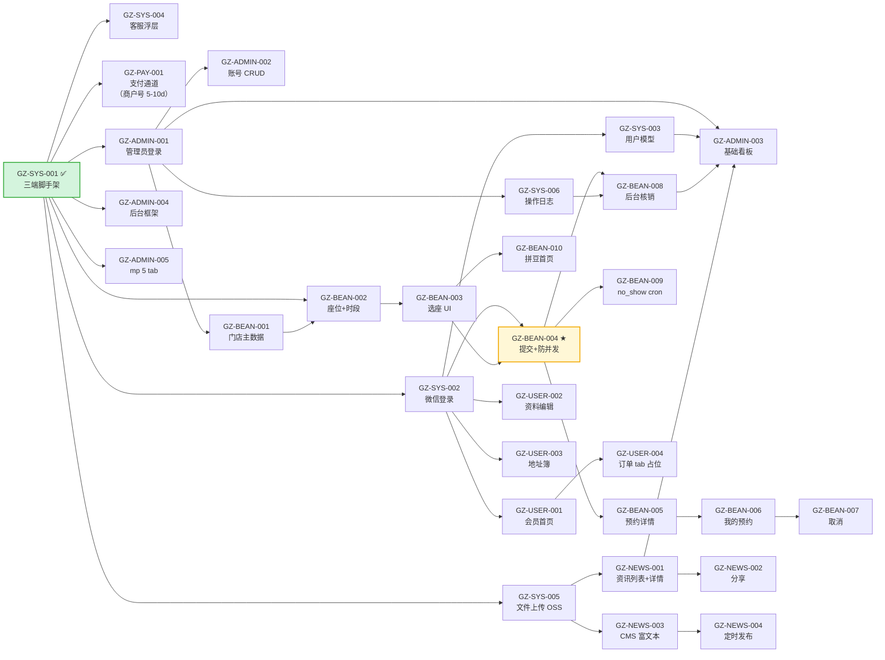

# sensenran-guzi daily 任务跟踪

> 主入口看 [doc/09-执行手册.md](../09-执行手册.md)（每天怎么干的 SOP）。
> 本文件聚焦 **V1.0 30 ticket 在 D01-D14 的整体编排** + 文件夹结构 + 单人闭环原则。
>
> **单人 + AI 自闭环**：Kevin 一个人 + Claude Code，不做 multi-person closing / cross-day issue 跟踪。
> **不估时、不开 standup**：合同按交付物计价（启动费 + 分成），不按工时；执行端每天 ticket 推进，干完算完。

---

## 0. sensenran 单人模式硬约束（vs dongjiaoshan 多人模式）

| 维度 | dongjiaoshan 多人版 | sensenran 单人版 |
|---|---|---|
| 派单 | 复制 prompt 全文 → spawn AI | `开始 d<N>` 或 `@coder 做 D<N>/<TICKET>` |
| prompt 模板 | 4 份（prompt-fe / be / fullstack / min） | **0 份**，流程纪律在 [.claude/agents/kevin-coder.md](../../.claude/agents/kevin-coder.md) |
| ticket 描述 | prompts/<T>.md 自带流程段 | tickets/<T>.md 任务卡（只 What/AC，无流程） |
| 测试人力 | ABC 三人各跑 testing-human | **AI 测试每日 gate**（kevin-coder Tier 1A + kevin-qa Tier 1B 全自动；Tier 1B 含 admin Playwright E2E + **mp 模拟器 E2E**，全 ✅ 即 close 解锁下游）+ **Kevin 残留人验**（节点触发，仅真机微信原生 + 设计首版拍板） |
| admin 测试 | 人测 | **kevin-qa Playwright MCP 全自动** |
| 后端测试 | 人测 | kevin-coder 自测 + kevin-qa 集成测试双层 |
| mp 测试 | 人测 | vitest unit + **AI mp 模拟器 E2E**（Tier 1B 每日 gate：导航可达 / 渲染 / 表单提交打真后端 / 列表 / 条件 UI / wxMOCK 登录 / 截图）+ Kevin 仅真机微信原生 / sense（节点触发） |
| 当 testing 不过 | append `_open-issues.md` → 日终多人决策 | 在 ticket 任务卡 `§revision` 段就地写 → AI 闭环修 |
| 跨日 issue 跟踪 | `_open-issues.md` + 日终 closing 会 | **不存在**（问题不出 ticket） |
| 日终 closing | 0-5 步（汇总 + 决策 + 批量改文档 + ADR）| `cat reports/*.md > summary.md` + `git commit` + 写明日 README |
| 工程自检 | 每天跑 daily-engineering-audit 8 维 | **移到每周一次**（周末做一次） |
| 三段式（§0 / 实现 / §N）| 写在 4 份 prompt 模板里 | 写在 agent.md 里强制 |
| 分支策略 | `feature/day<N>` 逐日切（多人冲突隔离）| `main + staging` 双分支，所有 ticket 直 commit staging（详 [doc/04-架构.md §5](../04-架构.md)）|

---

## 1. 怎么用这份计划

**cwd 推荐**：在 `sensenran-guzi/` 根目录起 Claude Code（会自动加载 `.claude/CLAUDE.md` 项目引导）。

### 1.1 Kevin 开工（每天早上 1 分钟）

1. `cd doc/daily/D<N>/`（D01 起，5/27 创建第一个）
2. 打开 `README.md` 看今日目标 + ticket 清单（2-4 个）
3. 一行派单：
   ```
   @coder 做 D<N>/GZ-BEAN-002
   ```
   主线程读任务卡（`tickets/GZ-BEAN-002.md`）+ spawn `kevin-coder` subagent，自动带项目纪律。

### 1.2 AI Tier 1A — kevin-coder 实现 + 自测（每 ticket 10-40 min，自动）

每个 ticket 由 [.claude/agents/kevin-coder.md](../../.claude/agents/kevin-coder.md) 强制 4 段：

1. **§0 状态自检**（开干前必跑 7 步：git / 上游 / 关键类表 / 编译 / ADR / 合同范围 / 权威蓝图 doc/10/11/12 引用）
   - 任一项不通过 → STOP 报 Kevin

2. **实现 ticket 主体**
   - 写代码 / 改 DB / 跑 Flyway
   - 复杂任务自行 spawn subagent

3. **§N 完工总结 + AI Tier 1A 自测**（编译 / 单测 / curl / DB / Flyway / 并发压测 / mp 模拟器 E2E `node test/e2e/run.mjs <flow>`）
   - **必须贴 ≥ 3 个代码 block 的 raw output**

4. **主线程统一派 kevin-qa 跑 Tier 1B** ⭐
   - kevin-coder 完工后交付到「Tier 1A 全 ✅ + §AI 测试段占位 + 标注待 Tier 1B」，交回主线程
   - **主线程统一派 kevin-qa 串行跑**（子 agent 不能 spawn 孙 agent；mp E2E 与 admin E2E 共享单例端口、禁并发，整批一个 kevin-qa）
   - 等 kevin-qa 在 reports/<T>.md 追加 §AI 测试段
   - 任一 ❌ → 主线程派 kevin-coder 修（Kevin 不介入）
   - 全 ✅ → ticket 即 close（解锁下游）；仅碰真机原生 / 新页首版视觉的 mp 进 progress.md「人验」列待节点验，纯 admin / 纯后端 / 纯功能 mp ticket 即终态

**强制约束**（来自 dongjiaoshan D02 翻车经验）：
- ❌ 不允许"已通过 / ok / 全部跑通"五字了事 — verification gap 翻车前兆
- ✅ 必须 ≥ 3 个代码 block 的 raw output
- ✅ §0 自检任一失败 → STOP，不要"绕过去"
- ✅ ADR 已读行强制写（找不到关联 ADR 写"无相关"也算）
- ✅ **完工后由主线程派 kevin-qa 跑 Tier 1B 不可绕过**（仅 2 种例外：无任何端的纯 DDL ticket / 标 @no-qa，见 kevin-coder.md §N.1）

### 1.3 AI Tier 1B — kevin-qa 自动接管（每 ticket 5-15 min，自动）

详见 [.claude/agents/kevin-qa.md](../../.claude/agents/kevin-qa.md) §Tier 1B 自动执行流程。

按 ticket Tech 段端分发：
- **admin 端**：Playwright MCP E2E（登录 / CRUD / perm / 列表筛选）
- **后端**：mvn 集成测试（如 coder Tier 1A 已跑则不重复）+ API 契约 curl
- **mp 端**：vitest unit（store / composables / utils）+ **mp 模拟器 E2E**（`node test/e2e/run.mjs <flow|all>`：导航可达 / 渲染 / 表单提交打真后端 / 列表 / wxMOCK 登录 / 截图）；**仅 wx 真机原生能力跳过**给 Tier 2
  - **硬 gate 无降级**：mp E2E 必须真跑过；preflight 环境（devtools 开 + 登录 / 后端 8080 / dist 完整）起不来 → 阻塞回修，不静默降级

结果追加到 `reports/<T>.md` §AI 测试段。

### 1.4 Kevin Tier 2 残留人验（节点触发，仅 mp ticket）

详见 [_templates/daily-testing-human.md](_templates/daily-testing-human.md)。

**关键**：ticket 在 AI 全 ✅ 时就已 close（不卡人验）。Tier 2 已收窄到 AI 模拟器测不到的「残留」 —— ① 真机微信原生 6 类（真实支付 / getPhoneNumber / 客服 / 真机扫码 / 登录头像昵称授权 / 真机性能）② 设计首版主观拍板。**取消 3-4 天例行批量**：节奏改 Kevin 自定（无固定周期）+ 支付 / 扭蛋 / 回收 / 打款上线前必跑一轮真钱，触发时扫掉 `progress.md`「人验」列里待节点验的 ⬜。

**进人验列的条件**（mp ticket）：
- ticket 碰真机微信原生能力（真实支付 / getPhoneNumber / 客服 / 真机扫码 / 登录头像昵称授权 / 真机性能）
- 或本 ticket 含新 mp 页首版视觉（设计主观拍板）
- 纯功能 mp ticket（无真机原生 / 无新页首版视觉）→ 在 AI gate close、不进人验列（同 admin）
- 纯 admin / 纯后端 ticket → 不进人验列（AI ✅ 即终态）

集中跑一轮时逐条判断：
- ✅ OK → 在 `progress.md`「人验」列标 ✅
- ❌ NOT OK → 在该 ticket 任务卡 `§revision` 段写"问题 1: 现象 / 期望"（ticket 已 close 也照样回填）→ `@coder 修` → 下轮再验

### 1.5 §revision 闭环（AI 自闭环修）

两类触发：

**A. Tier 1B 失败 → 主线程回派 kevin-coder**（Kevin 不介入）
- kevin-qa 在 reports/<T>.md §AI 测试段写失败清单 → 主线程派 kevin-coder → 改完主线程再派 kevin-qa 复测 → 直到 ✅
- 整个过程不需要 Kevin 派单

**B. Tier 2 残留人验失败 → Kevin 手动派**（节点触发；ticket 可能已 close 数天，仍回填原任务卡 §revision）

```
@coder 修 D<N>/GZ-BEAN-002 revision 段
```

AI 动作：
1. 读 `§revision` 段每条问题
2. 定位 + 修
3. 自测：贴新 raw output 到 `reports/<T>.md` 末尾追加
4. 在任务卡 `§revision` 每条后追加"已修 / 改了 <文件>"
5. **标注待 Tier 1B 复测**，由主线程统一派 kevin-qa 复测（含重跑 mp 模拟器 E2E）
6. 该 ticket 人验列重置为 ⬜，等 Kevin 下轮节点触发残留人验再验

循环到 OK。**不出 ticket 边界**，不写 `_open-issues.md`。

### 1.6 日终 closing（3-5 分钟）

```bash
cd doc/daily/D<N>
cat reports/*.md > summary.md   # 一行汇总
git add -A
git commit -m "D<N>: <主线>"
# 写 D<N+1>/README.md（列 2-4 个明日 ticket）
```

---

## 2. V1.0 + V1.1 整体编排表 ★（10 day 紧凑版，2026-05-28 重排）

> **起跑参考日不是 deadline**。某天没干完顺延，但 V1.0 整体硬期限 **6/15 周一**不可滑动（合同 §2.2）。
> **重排后 10 day = V1.0 6 day（D02-D07）+ V1.1 4 day（D08-D11）**。原 D12-D14 buffer 已合并进 D07/D11 内尾段。
> 周末（5/30-31, 6/6-7, 6/13-14）**不排 ticket**（参考节奏，不强制；如必要可补班）。
> 状态标记：✅ 完工 / 🚧 进行中 / ⏸ 阻塞 / ⏳ 未开始
>
> **触发口径**："开始 dN" ≡ 文件夹 DNN（号一致，无偏移）。如 "开始 d8" = D08。（早期筹备期曾用 d=D-1 偏移，已废除。）

### 2.1 V1.0 编排（D02-D07，6 day，29 ticket — D01 GZ-SYS-001 已 ✅）

| filesystem | 起跑参考日 | 主题 | ticket 数 | ticket 清单 | 状态 |
|---|---|---|---|---|---|
| [D01](./D01/README.md) | 2026-05-27 周三 | 三端脚手架 + 云服务采购 | 1 | GZ-SYS-001 | ✅ |
| [D02](./D02/README.md) | 2026-05-28 周四 | 系统底座完工：登录 / 用户 / 客服 / OSS | 4 | GZ-SYS-002 / 003 / 004 / 005 | ⏳ |
| [D03](./D03/README.md) | 2026-05-29 周五 | Admin 框架 + mp 5 tab + 账号 + 操作日志（+ 商户号资料启动） | 5 | GZ-ADMIN-001 / 002 / 004 / 005 + GZ-SYS-006 | ⏳ |
| [D04](./D04/README.md) | 2026-06-01 周一 | 拼豆主数据 + 选座 + 提交 ★（V1.0 最复杂 day） | 4 | GZ-BEAN-001 / 002 / 003 / 004 ★ | ⏳ |
| [D05](./D05/README.md) | 2026-06-02 周二 | 拼豆收尾：详情 / 列表 / 取消 / 后台核销 / cron / 首页 | 6 | GZ-BEAN-005 / 006 / 007 / 008 / 009 / 010 | ⏳ |
| [D06](./D06/README.md) | 2026-06-03 周三 | 会员中心 + 资讯 C 端 | 6 | GZ-USER-001 / 002 / 003 / 004 + GZ-NEWS-001 / 002 | ⏳ |
| [D07](./D07/README.md) | 2026-06-04 周四 | 资讯 CMS + 看板 + 支付通道 + V1.0 集成回归 | 4 | GZ-NEWS-003 / 004 + GZ-ADMIN-003 + GZ-PAY-001 | ⏳ |

**V1.0 验收窗口**：6/05（周五）- 6/12（周五），8 天给 staging 部署 + bug fix + 客户演示。6/15 周一硬交付。

### 2.2 V1.1 编排（D08-D11，4 批次，28 ticket 实施 + 1 v2 候选）

| filesystem | 起跑参考日 | 主题 | ticket 数 | ticket 清单 | 状态 |
|---|---|---|---|---|---|
| [D08](./D08/README.md) | —（不绑日历，上游 close 解锁下游） | 预购支付域：业务统一支付(V3) + 预购全链路（mock 自测） | 9 | GZ-PAY-101/104/102/103 + GZ-ORD-101/102/103/104/105 | ⏳ |
| [D09](./D09/README.md) | —（不绑日历，上游 close 解锁下游） | 扭蛋域全链路（抽奖事务防超卖 + 图鉴）★ | 7 | GZ-GACHA-101~107 | ⏳ |
| [D10](./D10/README.md) | —（不绑日历，上游 close 解锁下游） | 订单聚合 + admin 三件套 + mp 订单查看下沉 | 8 | GZ-USER-101/102/103/104 + GZ-ADMIN-101/102/103 + GZ-ADMIN-201 | ⏳ |
| [D11](./D11/README.md) | —（不绑日历，上游 close 解锁下游） | 物流 2 态推进 + 对账中心 ⭐ + 看板 + 软删恢复（火花券 ADMIN-107 移 v2） | 4 + 1v2 | GZ-ADMIN-104/105/106/108（+ ADMIN-107 v2 候选不实施） | ⏳ |

**V1.1 验收窗口**：6/22（周一）- 7/31（周五），6.5 周给 staging 联调 + 客户验收。

**合计**：30（V1.0）+ 27（V1.1）= **57 ticket** 全清单覆盖 ✅

### 2.1 排单决策原则（编排时遵循）

1. **依赖顺序**：GZ-SYS-001 → 后续 ticket 必须依赖项已 close 才能起（详 §4 关键依赖图）
2. **业务域聚合**：同一域 ticket 连续做（拼豆 10+ ticket 集中 W2 一周 4 天，不插到资讯里）
3. **复杂度平衡**：每天 1 个 M + 1 个 S，或 2-4 个 S，避免堆 3 个 M（单人 + AI 扛不住）
4. **关键路径优先**：合同 §2.1 V1.0 必交付的拼豆 + 微信登录放前半段；资讯 / 看板放后半段（容错空间）
5. **支付通道并行**：商户号申请需 5-10 工作日（合同 §2.1 第一期第三项），D03 启动资料提交、D12 接入调通；不连续占工作日
6. **集成 buffer**：D13 + D14 留 2 天给跨 ticket 联调 + 部署 staging/main + 客户演示，不排新 ticket

### 2.2 关键时间锚点

| 锚点 | 日期 | 触发动作 |
|---|---|---|
| **D03 商户号资料提交** | 2026-05-29 周五 | Kevin 在派单 GZ-PAY-001 前先向甲方收齐资料 + 提交微信支付 V3 商户号申请；申请通过预计 6/8-6/12（合同强约束 #12） |
| **PRD v1.0 签字** | 2026-05-31 周日 | Kevin × 李茂森 视频会议过 PRD §5 / 02-需求拆解 §5 / doc/10 附录 D.1 / doc/11 D.1 全部 ⚠️ 重大项（C1-C4 已裁定，主要是确认 4 项裁定 + 收集甲方反馈） |
| **D08 拼豆核心 demo 可看** | 2026-06-05 周五 | 用户可在 mp 端走通"选座 → 提交 → 核销码 → 后台扫码核销" demo 链路（合同 §2.1 V1.0 核心） |
| **D12 支付通道调通** | 2026-06-11 周四 | 0.01 元测试单跑通完整链路（依赖商户号申请已通过；如未通过 → §3 阻塞处理） |
| **D13 staging 灰度上线** | 2026-06-12 周五 | 三端部署到测试环境，Kevin 自测 + 准备客户演示 |
| **V1.0 硬期限 = 客户验收** | 2026-06-15 周一 | 30 ticket 全 ✅ + main 部署生产 + 客户对照 02-需求拆解 §5 签字（合同 §2.2）|

---

## 3. 完成判定锚点（不是工期 deadline）

> 这些是"达成判定"，不是"必须 X 天完成"。AI 写到 / Kevin 测到这里就算这个锚过了，下一组 ticket 解锁。

| 锚点 | 判定标准 | 关联 ticket | 关联合同 / doc |
|---|---|---|---|
| **M-SYS 系统底座完成** | 三端脚手架可跑（hello world）+ Flyway 跑通 + 微信登录链路通（mp 拿到 token，gz_user 落库）+ 用户基础模型 + 客服浮层 + 文件上传 + 操作日志 | GZ-SYS-001 ~ 006 | 合同 §2.1（一）基础设施 + doc/10 §1 / §5 |
| **M-PAY 支付通道调通（HelloWorld）** | 微信支付 V3 商户号挂甲方公司 + APIv3 密钥 + 商户证书部署 + 0.01 元 admin 测试单跑通"统一下单 → wx.requestPayment → 微信回调 → 验签 → gz_pay_transaction 入库 paid" | GZ-PAY-001 | 合同 §2.1（一）支付通道 + doc/10 §2 + 强约束 #12 |
| **M-BEAN 拼豆预约 ⭐** | 门店 + 座位 + 时段模板配置完整；mp 选日期 → 选时段 → 选座位 → 提交（Redis 锁 + UNIQUE 索引防抢座 + 手机号强收集）→ 核销码二维码 → 后台扫码核销 → 状态机 4 态（pending/used/cancelled/no_show）完整；no_show 凌晨 cron 自动标记 | GZ-BEAN-001 ~ 010 | 合同 §2.1（一）拼豆预约 + doc/10 §3 + 强约束 #13 |
| **M-USER 会员中心 V1.0 占位** | mp 端「我的」首页 + 个人资料编辑（昵称 / 头像 / 手机号）+ 地址簿 CRUD（默认地址唯一）+ 我的订单 tab 占位（"敬请期待 V1.1"）+ 我的预约入口 | GZ-USER-001 ~ 004 | 合同 §2.1（一）会员中心占位 + doc/10 §4 + 强约束 #7 |
| **M-NEWS 资讯中心** | mp 端列表（按分类 tab）+ 详情（富文本 + 视频）+ 分享好友/朋友圈；admin 端 CMS（富文本编辑器 + 图片上传走 OSS）+ 定时发布 cron | GZ-NEWS-001 ~ 004 + GZ-SYS-005 | 合同 §2.1（一）资讯中心 + doc/10 §5 |
| **M-ADMIN 后台基础** | 管理员登录 + owner/staff 角色 + 账号 CRUD + 后台框架（sidebar / topbar / 面包屑）+ 基础数据看板（用户 / 预约 / 资讯阅读 — 非交易指标）+ 操作日志 | GZ-ADMIN-001 ~ 005 | 合同 §2.1（二）后台基础（非交易）|
| **M-V1.0 交付** | 30 ticket 全部 ✅ + staging 部署成功 + main 部署成功 + 客户对照 02-需求拆解 §5 验收清单签字 + 截图汇总归档 | 全部 V1.0 P0 | 合同 §2.2 硬期限 6/15 + §8.1.4 验收宽限 |

> **达成判定 vs 工期 deadline**：M-BEAN 在 D08 完工是"参考时点"，若 D08 没达成 → D09 顺延 1 天但 D09 自身 ticket 也要做（单人 + AI 流程靠"上游 close → 下游解锁"驱动，不靠钟点）。**唯一硬死线**：6/15 客户验收 = M-V1.0 交付。

---

## 4. 关键依赖图（不可颠倒）

只画"硬依赖"（上游不 close 下游开不了工），不画"业务相关性"软依赖：



**关键路径解读**（覆盖 V1.0 全部 30 ticket）：

```
GZ-SYS-001 (祖宗，已 ✅) ─┬─► GZ-SYS-002 ─► GZ-SYS-003
                          │        ↓
                          │   GZ-USER-001/002/003/004
                          │
                          ├─► GZ-SYS-004 / SYS-005 / ADMIN-001/004/005
                          │
                          ├─► GZ-ADMIN-001 ─► SYS-006 / ADMIN-002 / ADMIN-003
                          │
                          ├─► GZ-SYS-005 ─► GZ-NEWS-001/003 ─► NEWS-002/004
                          │
                          ├─► GZ-PAY-001（独立链路，商户号申请 5-10 工作日为长尾依赖）
                          │
                          └─► GZ-BEAN-001 ─► BEAN-002 ─► BEAN-003 ─► BEAN-004 ★
                                                          ↓               │
                                                       BEAN-010            ├─► BEAN-005 ─► BEAN-006 ─► BEAN-007
                                                                           ├─► BEAN-008（需 SYS-006）
                                                                           └─► BEAN-009 (cron)

★ BEAN-004（提交 + Redis 锁 + UNIQUE 索引防并发）是 V1.0 最复杂业务点，所有 BEAN-005~009 都依赖它
```

**长尾依赖警告（不在 ticket 图，但影响排期）**：
- **微信支付 V3 商户号申请**（合同 §2.1（一）+ doc/10 §2 + 强约束 #12）：5-10 工作日。**D03 当周必须启动甲方资料收集**，否则 D12 PAY-001 完不工，连锁影响 V1.0 验收的"基础设施"模块
- **域名 ICP 备案**（doc/02-需求拆解 §6.2 风险 #2）：7-20 天。SYS-001 实施期已启动，6/15 前必须完成（否则 mp 上线被拦截）
- **甲方主体配合**（小程序账号实名 / 商户号资料 / 客服企业微信账号）：Kevin 必须每周一发清单催客户（doc/02-需求拆解 §6.2 风险 #7）

如果上游 ticket 没 ✅，Kevin 派单前 §0 自检会卡住（agent.md 强制）。

---

## 5. V1.1 简略规划（参考性，不展开）

V1.1 范围（合同 §2.1 第二期，6/16-7/31 软期限）共 **27 ticket**，包含：

| 业务域 | ticket 数 | 关键交付 |
|---|---|---|
| GZ-PAY（业务支付）| 3 | 业务支付统一服务 / 主动查单 / 退款 |
| GZ-ORD（预定货品）| 5 | 商品 + SKU + 列表 + 详情 + 下单 + 订单 |
| GZ-GACHA（扭蛋）⭐ | 6 | 机器 + 奖品池 + 列表 + 详情 + 抽奖事务 + 动画 + 历史 + 图鉴（GZ-ADMIN-107 火花券店 = V2 候选，C3 已裁定不做）|
| GZ-USER V1.1 扩展 | 4 | 订单聚合统一接口 + 详情 + 跨境物流 2 态 + 自动签收（C1 简化）|
| GZ-ADMIN V1.1 扩展 | 7 | 商品管理 / 扭蛋池 / 订单三类 / 物流推进（C1 简化）/ 对账中心 ⭐ / 看板扩展 / 软删除 |
| 兜底 buffer | 2 | 集成回归 + V1.1 验收准备 |

**详细 D15-D???? 编排在 V1.0 收尾时（6/12-6/15）再排**（避免现在排了 V1.1 但 V1.0 期间出意外打乱节奏）。

参考文档：
- ticket 全清单 → [doc/02-需求拆解.md §3](../02-需求拆解.md) V1.1 章节 + 附录 A 索引表
- 业务流权威 → [doc/10-业务流权威图.md](../10-业务流权威图.md) §6-§10（C1-C4 v0.2 已裁定）
- 字段权威 → [doc/11-字段权威表.md](../11-字段权威表.md) §6-§10
- UI 权威 → [doc/12-UI-权威索引.md](../12-UI-权威索引.md) V1.1 标记的页面

---

## 6. 文件夹结构（每天开工时 `cp -r _templates D<N>` 即可）

```
doc/daily/
├── README.md                         本文件（V1.0 整体编排）
├── _templates/                       模板（不动）
│   ├── daily-README.md               D<N>/README.md 模板
│   ├── daily-progress.md             D<N>/progress.md 模板
│   ├── daily-summary.md              D<N>/summary.md 模板（实际由 cat reports/*.md 生成）
│   ├── daily-testing-human.md        D<N>/testing-human.md 模板
│   ├── ticket.md                     D<N>/tickets/<T>.md 模板
│   └── report.md                     D<N>/reports/<T>.md 模板
│
├── D01/                              5/27 完工 ✅
│   ├── README.md                     今日目标 + ticket 清单 + 依赖
│   ├── progress.md                   今日 ticket 状态表
│   ├── testing-human.md              Kevin 测试清单
│   ├── tickets/                      今日所有 ticket 任务卡
│   │   └── GZ-SYS-001.md
│   ├── reports/                      AI 完工报告（per ticket 一文件）
│   │   └── GZ-SYS-001.md
│   └── summary.md                    日终 cat reports/*.md 生成
│
├── D02/ - D14/                       同 D01 结构（开工日由 cp -r _templates 创建）
```

**注意**：
- `_open-issues.md` 不建（问题在 ticket 内 `§revision` 闭环）
- `prompts/` 目录不建（一行派单替代）
- `testing-ai.md` 不单独建（AI 自测段已在 reports/<T>.md 内）
- `daily-engineering-audit.md` 不建（移到每周末）

---

## 7. ticket 任务卡颗粒度（_templates/ticket.md）

每个任务卡 8-15 行，不要再多。包含：

```markdown
# <TICKET-ID> — <一句话标题>

**优先级**: P0 | P1 | P2
**复杂度**: S | M | L | XL
**关联 PRD**: M4 §<段>
**关联 mockup**: booking-select.html
**依赖**: GZ-SYS-001（如有）

## What
（1-2 句描述做什么）

## AC（验收标准）
- [ ] AC 1：...
- [ ] AC 2：...
- [ ] AC 3：...

## Tech（端 + 范围）
- 后端：ruoyi-gz-bean 模块 / 表 gz_bean_booking
- 前端：miniapp/pages/bean/select.vue

## 权威文档引用（§0 自检必读）
- doc/10 §<编号> 业务流
- doc/11 §<编号> 字段
- doc/12 §<page-id> UI

## 备注
（如有特殊约束 / ADR 关联 / 合同条款，写在这）

---

## §revision（Kevin 残留人验不过时填，节点触发；ticket 已 close 也可回填，初始空）

<!-- 例：
- 问题 1：座位锁住了但 UI 没刷新 / 期望：选中态变灰
- 问题 2：返回首页时进度条还在转 / 期望：清掉
-->
```

**反例**（不要这样写）：
- ❌ 详尽到字段级（那是 doc/11 字段权威表的事）
- ❌ 写实现细节（那是 coder 的事）
- ❌ 写流程纪律（那在 agent.md）

---

## 8. 周末工作（每周日做一次）

1. **跑工程自检**（A-H 维度 grep，参考 dongjiaoshan/_templates/daily-engineering-audit.md，但每周一次而非每天）
2. **curator 周巡**（21:30 自动触发，或手动 `@curator`）
   - 抽 skill 候选
   - 整合 facts/learnings
   - 刷新 SKILLS_INDEX.md
   - 提示是否 sync USER.md
3. **本周 commit 整理**（写一句"本周做了 X"到 `doc/daily/W<N>.md`，可选）

---

## 9. V1.0 / V1.1 阶段适配

| 阶段 | 时间 | daily 频次 | 重点 |
|---|---|---|---|
| 筹备期 | 5/26-5/27 完工 → 5/28 起 V1.0 | 已并入 V1.0 | PRD 签字 / mockup 缺口 / .claude 骨架（已完）|
| **V1.0 开发** | **6/01-6/15（D04-D14）** | 每天 D<N> | 拼豆 / 微信登录 / 资讯 / 会员占位 / 后台基础 / 支付通道（详 §2 表）|
| V1.0 验收 | 6/15-6/30 | 不开 daily | 客户对照 02-需求拆解 §5 签字（合同 §8.1.4 15 日宽限）|
| V1.1 开发 | 6/16-7/31 | 每天 D<N> | 业务支付 / 预定 / 扭蛋 / 物流 / 对账（详 §5）|
| V1.1 验收 | 8/01+ | 不开 daily | 客户对照 02-需求拆解 附录 A 签字 |
| 维护期 | 8/01+ | 按需 | 月维护工时上限协商（合同 §4.6）|

---

## 10. 不在 daily 做的事

- ❌ 重新设计架构（用 04-架构.md 已定的，回 agent-lab 决策）
- ❌ 跨 ticket 的大重构（拆成新 ticket 排进未来 D<N>）
- ❌ 跨日 issue 跟踪（问题在 ticket 内闭环，超出 ticket 边界的写新 ticket）
- ❌ 业务审查会 / 标准会 / 站会（单人不需要）
- ❌ 复制 prompt 全文派单（一行 `@coder 做 D<N>/<T>` 就够）
- ❌ 给 ticket 估时（"1.5h / 3-4h"）— 干完算完
- ❌ 写"软目标 / 工期紧 / 可拖到 D??"— V1.0 6/15 是合同硬死线，不可滑动；其他天数是参考

### 历史人日数字怎么办

`doc/02-需求拆解.md` 里的"复杂度 S / M / L"是给 Kevin 排单时的 t-shirt size 参考（每 ticket 1 个标签）。**实施期 AI 一律忽略**，按本表 §2 排单顺序执行即可。
